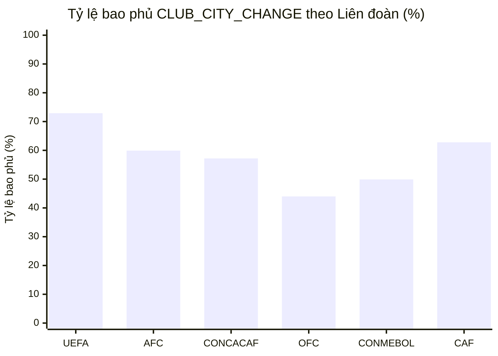

# Bảng Kiểm Kê Độ Bao Phủ CLUB_CITY_CHANGE (Official Competitions)

> [!NOTE]
> Checklist theo dõi mức độ bao phủ `CLUB_CITY_CHANGE` trên các giải đấu chính thức (Official Competitions) trong [fm24_club.lnc](file:///d:/Games/thudd/fm24-lnc/fm24-lnc-be/data/fm24_club.lnc).
> **Quy ước:** Đã tự động loại trừ các nhóm `[OTHER]` (ngoài hệ thống giải) và `[EXTINCT]` (CLB giải thể) để phản ánh chính xác nhất tiến độ hoàn thiện dữ liệu game.

## 1. Số Liệu Tổng Quan Tiến Độ

- **Tổng số CLB trong các giải đấu chính thức:** **4,836 CLB** (loại trừ các nhóm Other/Extinct)
- **Số CLB đã có City:** **3,189 CLB (65.94%)**
- **Số CLB chưa có City:** **1,647 CLB (34.06%)**
- **Số lượng `rd-uid` còn lại:** **0 dòng** (100% dòng city đều dùng City ID thật từ `fm24_geography.lnc`)

### Tổng hợp theo Liên đoàn

| Liên đoàn | Số quốc gia | Số CLB có City | Tổng số CLB | Tỷ lệ bao phủ | Tiến độ |
| :--- | :---: | :---: | :---: | :---: | :--- |
| **UEFA** | 53 | 1,898 | 2,603 | **72.9%** | 🟩🟩🟩🟩🟩🟩🟩⬜⬜⬜ |
| **AFC** | 35 | 702 | 1,171 | **59.9%** | 🟩🟩🟩🟩🟩⬜⬜⬜⬜⬜ |
| **CONCACAF** | 9 | 218 | 381 | **57.2%** | 🟩🟩🟩🟩🟩⬜⬜⬜⬜⬜ |
| **OFC** | 1 | 11 | 25 | **44.0%** | 🟩🟩🟩🟩⬜⬜⬜⬜⬜⬜ |
| **CONMEBOL** | 10 | 201 | 403 | **49.9%** | 🟩🟩🟩🟩⬜⬜⬜⬜⬜⬜ |
| **CAF** | 10 | 159 | 253 | **62.8%** | 🟩🟩🟩🟩🟩🟩⬜⬜⬜⬜ |

---

## 2. Phân Nhóm Tiến Độ Toàn Bộ 118 Quốc Gia (Coverage Tiers)

> [!TIP]
> Toàn bộ các quốc gia được phân nhóm theo tỷ lệ bao phủ City từ cao xuống thấp (100%, 90% - <100%, 80% - <90%,...):

### Bảng Tổng Hợp Các Nhóm Tiến Độ

| Nhóm tỷ lệ | Biểu tượng | Số quốc gia | Số CLB có City | Tổng số CLB | Tỷ lệ nhóm |
| :--- | :---: | :---: | :---: | :---: | :---: |
| **100% (Hoàn thành)** | ✅ | **40** | 1,341 | 1,341 | **100.0%** |
| **90% đến dưới 100%** | 🟢 | **4** | 187 | 202 | **92.6%** |
| **80% đến dưới 90%** | 🟡 | **1** | 160 | 179 | **89.4%** |
| **70% đến dưới 80%** | 🟡 | **3** | 71 | 97 | **73.2%** |
| **60% đến dưới 70%** | 🟡 | **21** | 574 | 887 | **64.7%** |
| **50% đến dưới 60%** | 🟡 | **14** | 384 | 717 | **53.6%** |
| **40% đến dưới 50%** | 🟠 | **10** | 189 | 429 | **44.1%** |
| **30% đến dưới 40%** | 🟠 | **11** | 198 | 539 | **36.7%** |
| **20% đến dưới 30%** | 🟠 | **7** | 54 | 213 | **25.4%** |
| **10% đến dưới 20%** | 🔴 | **6** | 28 | 196 | **14.3%** |
| **Dưới 10%** | 🔴 | **1** | 3 | 36 | **8.3%** |

---

### 2.1. Nhóm 100% (Hoàn thành) (40 quốc gia) ✅

| STT | Liên đoàn | Quốc gia | Đã có City / Tổng | Còn thiếu | Tỷ lệ (%) | Các giải đấu |
| :---: | :---: | :--- | :---: | :---: | :---: | :--- |
| 1 | UEFA | **[ESP] SPAIN** | 218/218 | 0 | **100.0%** | `[67] LALIGA EA SPORTS (23/24)` (20/20), `[68] LALIGA HYPERMOTION (23/24)` (22/22), `[2000048844] Primera Federación Grupo 1 (23/24)` (20/20), `[2000048846] Primera Federación Grupo 2 (23/24)` (20/20), `[2000099903] Segunda Federación Grupo 1 (23/24)` (18/18), `[2000099904] Segunda Federación Grupo 2 (23/24)` (18/18), `[2000099905] Segunda Federación Grupo 3 (23/24)` (18/18), `[2000099906] Segunda Federación Grupo 4 (23/24)` (18/18), `[2000099907] Segunda Federación Grupo 5 (23/24)` (18/18), `Team B/C` (46/46) |
| 2 | UEFA | **[ENG] ENGLAND** | 164/164 | 0 | **100.0%** | `[11] Premier League (23/24)` (20/20), `[12] EFL Championship (23/24)` (24/24), `[13] EFL League One (23/24)` (24/24), `[14] EFL League Two (23/24)` (24/24), `[109201] National League (23/24)` (24/24), `[5123054] National League North (23/24)` (24/24), `[5123055] National League South (23/24)` (24/24) |
| 3 | UEFA | **[ITA] ITALY** | 100/100 | 0 | **100.0%** | `[32] Serie A (23/24)` (20/20), `[33] Serie B (23/24)` (20/20), `[43127172] Serie C Girone A (23/24)` (20/20), `[43127173] Serie C Girone B (23/24)` (20/20), `[43127174] Serie C Girone C (23/24)` (20/20) |
| 4 | AFC | **[KOR] KOREA REPUBLIC** | 74/74 | 0 | **100.0%** | `[136407] K.League 1 (2023)` (12/12), `[66029602] K.League 2 (2023)` (13/13), `[66010517] K3 League (2023)` (15/15), `[66040773] K4 League (2023)` (18/18), `[66039929] K.League Junior Group A` (6/6), `[66039930] K.League Junior Group B` (10/10) |
| 5 | AFC | **[VIE] VIETNAM** | 71/71 | 0 | **100.0%** | `[8550000] V.League 1 (23/24)` (14/14), `[8550001] V.League 2 (23/24)` (14/14), `[8550002] Vietnamese Second Division (23/24)` (16/16), `[8550003] Vietnamese Third Division (23/24)` (27/27) |
| 6 | UEFA | **[CZE] CZECHIA** | 57/57 | 0 | **100.0%** | `[131287] Chance Liga (23/24)` (16/16), `[131288] Chance Národní Liga (23/24)` (16/16), `[136041] CFL A (23/24)` (6/6), `[25060473] CFL B (23/24)` (7/7), `[136042] MSFL (23/24)` (12/12) |
| 7 | UEFA | **[POR] PORTUGAL** | 56/56 | 0 | **100.0%** | `[60] Liga Portugal (23/24)` (18/18), `[61] Liga Portugal 2 (23/24)` (18/18), `[2000112232] Liga 3 Norte (23/24)` (10/10), `[2000112233] Liga 3 Sul (23/24)` (10/10) |
| 8 | UEFA | **[BIH] BOSNIA & HERZEGOVINA** | 46/46 | 0 | **100.0%** | `[8401073] Wwin League BIH (23/24)` (12/12), `[8407370] Prva liga Federacije BiH (23/24)` (16/16), `[8407360] Prva liga Republike Srpske (23/24)` (18/18) |
| 9 | CONCACAF | **[MEX] MEXICO** | 33/33 | 0 | **100.0%** | `[135973] Liga MX (23/24)` (18/18), `[2000017067] Liga de Expansión MX (23/24)` (15/15) |
| 10 | CONMEBOL | **[CHI] CHILE** | 32/32 | 0 | **100.0%** | `[5250792] Liga de Primera Chileno (2023)` (16/16), `[5250793] Liga de Ascenso Chileno (2023)` (16/16) |
| 11 | UEFA | **[BLR] BELARUS** | 32/32 | 0 | **100.0%** | `[7483354] Belarusian Premier League (2023)` (15/15), `[7483366] Belarusian First League (2023)` (17/17) |
| 12 | UEFA | **[SRB] SERBIA** | 32/32 | 0 | **100.0%** | `[132321] SuperLiga Srbije (23/24)` (16/16), `[5776050] PrvaLiga Srbije (23/24)` (16/16) |
| 13 | UEFA | **[SUI] SWITZERLAND** | 32/32 | 0 | **100.0%** | `[137889] Swiss Super League (23/24)` (12/12), `[137890] Swiss Challenge League (23/24)` (10/10), `[98027828] Swiss Promotion League (23/24)` (10/10) |
| 14 | UEFA | **[ISR] ISRAEL** | 28/28 | 0 | **100.0%** | `[7860000] Ligat TOTO Winner (23/24)` (14/14), `[7860001] Liga Leumit (23/24)` (14/14) |
| 15 | UEFA | **[SVK] SLOVAKIA** | 28/28 | 0 | **100.0%** | `[7560276] Niké liga (23/24)` (12/12), `[7560277] MONACObet LIGA (23/24)` (16/16) |
| 16 | AFC | **[QAT] QATAR** | 24/24 | 0 | **100.0%** | `[5632126] Qatar Stars League (23/24)` (12/12), `[5632158] QSL 2 League (23/24)` (12/12) |
| 17 | CAF | **[LBY] LIBYA** | 22/22 | 0 | **100.0%** | `[13208974] Libyan Premier League (23/24)` (22/22) |
| 18 | CAF | **[NGA] NIGERIA** | 20/20 | 0 | **100.0%** | `[12016011] Nigeria Professional Football League (23/24)` (20/20) |
| 19 | UEFA | **[GEO] GEORGIA** | 20/20 | 0 | **100.0%** | `[59126495] Erovnuli Liga (2023)` (10/10), `[59126496] Erovnuli Liga 2 (2023)` (10/10) |
| 20 | CAF | **[SUD] SUDAN** | 18/18 | 0 | **100.0%** | `[36513629] Sudani Premier League (23/24)` (18/18) |
| 21 | CONMEBOL | **[BOL] BOLIVIA** | 17/17 | 0 | **100.0%** | `[86000000] División Profesional de Bolivia (2023)` (17/17) |
| 22 | CAF | **[TAN] TANZANIA** | 16/16 | 0 | **100.0%** | `[13211724] Tanzanian Premier League` (16/16) |
| 23 | AFC | **[TJK] TAJIKISTAN** | 15/15 | 0 | **100.0%** | `[59007964] Ligai Olii Tojikiston (2023)` (10/10), `[59110037] Ligai Yakumi Tojikiston (2023)` (5/5) |
| 24 | CONMEBOL | **[VEN] VENEZUELA** | 15/15 | 0 | **100.0%** | `[86000001] Liga FUTVE (2023)` (15/15) |
| 25 | UEFA | **[SMR] SAN MARINO** | 15/15 | 0 | **100.0%** | `[43032015] Campionato Sammarinese` (15/15) |
| 26 | CAF | **[ANG] ANGOLA** | 14/14 | 0 | **100.0%** | `[12034515] Girabola (23/24)` (14/14) |
| 27 | CAF | **[TUN] TUNISIA** | 14/14 | 0 | **100.0%** | `[12019164] Tunisian Ligue Professionnelle 1 (23/24)` (14/14) |
| 28 | UEFA | **[MLT] MALTA** | 14/14 | 0 | **100.0%** | `[2300050] Maltese Premier League (23/24)` (14/14) |
| 29 | AFC | **[LAO] LAOS** | 12/12 | 0 | **100.0%** | `[5634246] Lao League 1 (2023)` (12/12) |
| 30 | AFC | **[SYR] SYRIA** | 12/12 | 0 | **100.0%** | `[5635022] Syrian Premier League (23/24)` (12/12) |
| 31 | UEFA | **[WAL] WALES** | 12/12 | 0 | **100.0%** | `[130672] Cymru Premier (23/24)` (12/12) |
| 32 | UEFA | **[GIB] GIBRALTAR** | 11/11 | 0 | **100.0%** | `[36532636] Gibraltar Football League` (11/11) |
| 33 | AFC | **[MNG] MONGOLIA** | 10/10 | 0 | **100.0%** | `[23090971] Mongolian Premier League (23/24)` (10/10) |
| 34 | AFC | **[PHI] PHILIPPINES** | 10/10 | 0 | **100.0%** | `[23390834] Philippines Football League (23/24)` (10/10) |
| 35 | AFC | **[SGP] SINGAPORE** | 10/10 | 0 | **100.0%** | `[5395850] Singapore Premier League (2023)` (9/9), `[23501268] Singapore Premier League 2` (1/1) |
| 36 | AFC | **[TKM] TURKMENISTAN** | 9/9 | 0 | **100.0%** | `[5638083] Türkmenistan Ýokary Liga (2023)` (9/9) |
| 37 | UEFA | **[FRO] FAROE ISLANDS** | 9/9 | 0 | **100.0%** | `[8300358] Betrideildin` (9/9) |
| 38 | UEFA | **[AND] ANDORRA** | 8/8 | 0 | **100.0%** | `[47000005] Lliga Multisegur Assegurances` (8/8) |
| 39 | UEFA | **[MDA] MOLDOVA** | 8/8 | 0 | **100.0%** | `[59007607] Moldovan Super Liga (23/24)` (8/8) |
| 40 | AFC | **[MAC] MACAU** | 3/3 | 0 | **100.0%** | `[5630248] Liga de Elite` (3/3) |

### 2.2. Nhóm 90% đến dưới 100% (4 quốc gia) 🟢

| STT | Liên đoàn | Quốc gia | Đã có City / Tổng | Còn thiếu | Tỷ lệ (%) | Các giải đấu |
| :---: | :---: | :--- | :---: | :---: | :---: | :--- |
| 1 | UEFA | **[NED] NETHERLANDS** | 48/49 | **-1** | **98.0%** | `[29] Eredivisie (23/24)` (18/18), `[30] Keuken Kampioen Divisie (23/24)` (20/20), `Team B` (10/11) |
| 2 | AFC | **[HKG] HONG KONG** | 23/25 | **-2** | **92.0%** | `[5624449] Hong Kong Premier League (23/24)` (11/11), `[5624450] Hong Kong First Division (23/24)` (12/12), `[7400579] Hong Kong Second Division (23/24)` (0/2) |
| 3 | AFC | **[PRK] KOREA DPR** | 11/12 | **-1** | **91.7%** | `[23100525] DPRK Premier Football League` (11/12) |
| 4 | CONCACAF | **[USA] USA** | 105/116 | **-11** | **90.5%** | `[40] Major League Soccer (2023)` (29/29), `[43] USL Championship (2023)` (22/24), `[20047508] USL League One (2023)` (6/14), `[2000102644] MLS Next Pro (2023)` (27/28), `[72023762] MLS NEXT` (21/21) |

### 2.3. Nhóm 80% đến dưới 90% (1 quốc gia) 🟡

| STT | Liên đoàn | Quốc gia | Đã có City / Tổng | Còn thiếu | Tỷ lệ (%) | Các giải đấu |
| :---: | :---: | :--- | :---: | :---: | :---: | :--- |
| 1 | UEFA | **[GER] GERMANY** | 160/179 | **-19** | **89.4%** | `[22] Bundesliga (23/24)` (18/18), `[23] 2. Bundesliga (23/24)` (18/18), `[35010926] 3. Liga (23/24)` (20/20), `[26] Regionalliga Nord (23/24)` (5/6), `[91107110] Regionalliga Nordost (23/24)` (5/8), `[35010927] Regionalliga West (23/24)` (7/7), `[27] Regionalliga Südwest (23/24)` (4/7), `[91107111] Regionalliga Bayern (23/24)` (5/7), `Team II/III` (19/21), `[92086572] A-Junioren-Bundesliga Nord/Nordost (23/24)` (13/14), `[92086574] A-Junioren-Bundesliga West (23/24)` (13/14), `[92086573] A-Junioren-Bundesliga Süd/Südwest (23/24)` (14/14), `NLZ Teams` (19/25) |

### 2.4. Nhóm 70% đến dưới 80% (3 quốc gia) 🟡

| STT | Liên đoàn | Quốc gia | Đã có City / Tổng | Còn thiếu | Tỷ lệ (%) | Các giải đấu |
| :---: | :---: | :--- | :---: | :---: | :---: | :--- |
| 1 | CONMEBOL | **[COL] COLOMBIA** | 27/36 | **-9** | **75.0%** | `[5260948] Liga BetPlay DIMAYOR (2023)` (20/20), `[5260950] Torneo BetPlay DIMAYOR (2023)` (7/16) |
| 2 | UEFA | **[LUX] LUXEMBOURG** | 14/19 | **-5** | **73.7%** | `[5340000] BGL Ligue` (14/19) |
| 3 | UEFA | **[SCO] SCOTLAND** | 30/42 | **-12** | **71.4%** | `[45] Scottish Premiership (23/24)` (12/12), `[46] Scottish Championship (23/24)` (5/10), `[47] Scottish League One (23/24)` (6/10), `[48] Scottish League Two (23/24)` (7/10) |

### 2.5. Nhóm 60% đến dưới 70% (21 quốc gia) 🟡

| STT | Liên đoàn | Quốc gia | Đã có City / Tổng | Còn thiếu | Tỷ lệ (%) | Các giải đấu |
| :---: | :---: | :--- | :---: | :---: | :---: | :--- |
| 1 | UEFA | **[AUT] AUSTRIA** | 34/49 | **-15** | **69.4%** | `[136543] ÖFB Bundesliga (23/24)` (12/12), `[136544] ÖFB 2. Liga (23/24)` (8/16), `[136546] Regionalliga Ost (23/24)` (2/2), `[5607687] Regionalliga Mitte (23/24)` (3/5), `[5607688] Regionalliga West (23/24)` (1/1), `[16068419] ÖFB Jugendliga U18` (8/13) |
| 2 | UEFA | **[UKR] UKRAINE** | 22/32 | **-10** | **68.8%** | `[5314301] Ukrainian Premier League (23/24)` (16/16), `[5314302] Ukrainian First League (23/24)` (6/16) |
| 3 | UEFA | **[CRO] CROATIA** | 15/22 | **-7** | **68.2%** | `[129645] HNL (23/24)` (10/10), `[129646] Prva NL (23/24)` (5/12) |
| 4 | UEFA | **[MKD] NORTH MACEDONIA** | 19/28 | **-9** | **67.9%** | `[8401070] 1.MFL (23/24)` (7/12), `[8403796] 2.MFL (23/24)` (12/16) |
| 5 | CAF | **[MAR] MOROCCO** | 21/31 | **-10** | **67.7%** | `[12019395] Botola Pro (23/24)` (10/16), `[12019395] Botola Pro (22/23)` (11/15) |
| 6 | UEFA | **[POL] POLAND** | 51/76 | **-25** | **67.1%** | `[129558] Ekstraklasa (23/24)` (13/18), `[129559] I liga (23/24)` (15/18), `[162504] II liga (23/24)` (11/18), `[129560] III liga (23/24)` (12/22) |
| 7 | AFC | **[CHN] CHINA PR** | 49/74 | **-25** | **66.2%** | `[130931] Chinese Super League (2023)` (13/16), `[131126] China League One (2023)` (10/16), `[1002872] China League Two North Group (2023)` (7/8), `[1002873] China League Two South Group (2023)` (4/8), `[5627655] Chinese Champions League` (15/26) |
| 8 | AFC | **[THA] THAILAND** | 70/106 | **-36** | **66.0%** | `[5624920] Thai League 1 (23/24)` (16/16), `[5637986] Thai League 2 (23/24)` (18/18), `[2000038391] Thai League 3 Northern Region (23/24)` (5/11), `[2000038392] Thai League 3 Northeastern Region (23/24)` (6/13), `[2000038393] Thai League 3 Eastern Region (23/24)` (3/11), `[2000038394] Thai League 3 Western Region (23/24)` (5/11), `[2000038398] Thai League 3 Southern Region (23/24)` (10/12), `[2000038395] Thai League 3 BK Metropolitan Region (23/24)` (7/14) |
| 9 | UEFA | **[SVN] SLOVENIA** | 17/26 | **-9** | **65.4%** | `[7580000] Prva Liga Telemach (23/24)` (7/10), `[7580001] 2.SNL (23/24)` (10/16) |
| 10 | UEFA | **[IRL] IRELAND** | 26/40 | **-14** | **65.0%** | `[129372] LOI Premier Division (2023)` (5/10), `[129373] LOI First Division (2023)` (8/10), `[52086882] LOI Academy U19 League` (13/20) |
| 11 | UEFA | **[ARM] ARMENIA** | 16/25 | **-9** | **64.0%** | `[59006196] Armenian Premier League (23/24)` (5/10), `[59006197] Armenian First League (23/24)` (11/15) |
| 12 | UEFA | **[GRE] GREECE** | 24/38 | **-14** | **63.2%** | `[129650] Super League Greece (23/24)` (14/14), `[36086001] Super League Greece 2 North Group (23/24)` (3/12), `[36086002] Super League Greece 2 South Group (23/24)` (7/12) |
| 13 | AFC | **[AUS] AUSTRALIA** | 22/35 | **-13** | **62.9%** | `[129985] A-League Men (23/24)` (8/12), `[432083] NPL ACT` (1/1), `[130185] NPL NSW` (5/10), `[15007722] NPL Northern NSW` (0/1), `[15045003] NPL South Australia` (2/2), `[15041771] NPL Queensland` (1/1), `[130188] NPL Victoria` (1/3), `[130189] NPL Western Australia` (1/1), `[15020175] Victorian Premier League 1` (1/2), `[15045546] NSW League Two` (1/1), `[15090908] Victorian Premier League 2` (1/1) |
| 14 | UEFA | **[KAZ] KAZAKHSTAN** | 27/43 | **-16** | **62.8%** | `[59007527] Qazaqstan Premier Ligasy (2023)` (7/14), `[59010820] Qazaqstan Birinshi Ligasy (2023)` (11/14), `[59107180] QJ League` (9/15) |
| 15 | AFC | **[BHR] BAHRAIN** | 15/24 | **-9** | **62.5%** | `[1039313] Bahraini Premier League (23/24)` (9/12), `[1039314] Bahraini Second Division (23/24)` (6/12) |
| 16 | UEFA | **[ISL] ICELAND** | 15/24 | **-9** | **62.5%** | `[7840132] Besta deild karla (2023)` (8/12), `[7840133] Lengjudeild karla (2023)` (7/12) |
| 17 | AFC | **[IDN] INDONESIA** | 33/53 | **-20** | **62.3%** | `[41004312] Indonesian Super League (23/24)` (8/18), `[41042740] Indonesian Championship (23/24)` (19/28), `[41042746] Liga Nusantara (23/24)` (6/7) |
| 18 | CONCACAF | **[CRC] COSTA RICA** | 18/29 | **-11** | **62.1%** | `[80000563] Liga Promérica (23/24)` (7/12), `[80000564] Liga Transcomer (23/24)` (11/17) |
| 19 | AFC | **[UAE] UAE** | 36/59 | **-23** | **61.0%** | `[7880000] UAE Pro League (23/24)` (14/14), `[7880028] UAE First Division League (23/24)` (8/17), `[2000017168] UAE Second Division League (23/24)` (0/14), `U21 Arabian Gulf League` (14/14) |
| 20 | UEFA | **[LVA] LATVIA** | 14/23 | **-9** | **60.9%** | `[8403697] Latvijas Virsliga (2023)` (6/10), `[8403797] Latvijas Nakotnes liga (2023)` (8/13) |
| 21 | UEFA | **[BEL] BELGIUM** | 30/50 | **-20** | **60.0%** | `[1] Jupiler Pro League (23/24)` (16/16), `[2] Challenger Pro League (23/24)` (7/16), `[8154824] Belgian Division 1 (23/24)` (7/18) |

### 2.6. Nhóm 50% đến dưới 60% (14 quốc gia) 🟡

| STT | Liên đoàn | Quốc gia | Đã có City / Tổng | Còn thiếu | Tỷ lệ (%) | Các giải đấu |
| :---: | :---: | :--- | :---: | :---: | :---: | :--- |
| 1 | AFC | **[KGZ] KYRGYZSTAN** | 16/27 | **-11** | **59.3%** | `[59005735] Kyrgyz Premier League (2023)` (5/11), `[2000174549] Kyrgyz National League Group A (2023)` (6/8), `[2000174550] Kyrgyz National League Group B (2023)` (5/8) |
| 2 | UEFA | **[DEN] DENMARK** | 28/48 | **-20** | **58.3%** | `[6] 3F Superliga (23/24)` (12/12), `[7] NordicBet Liga (23/24)` (8/12), `[8] 2. division (23/24)` (4/12), `[2000016262] 3. division (23/24)` (4/12) |
| 3 | UEFA | **[EST] ESTONIA** | 11/19 | **-8** | **57.9%** | `[7681558] Meistriliiga (2024)` (5/10), `[7681559] Esiliiga (2024)` (6/9) |
| 4 | CONMEBOL | **[ARG] ARGENTINA** | 37/65 | **-28** | **56.9%** | `[102421] Liga Profesional (2023)` (28/28), `[102422] Primera Nacional (2023)` (9/37) |
| 5 | UEFA | **[CYP] CYPRUS** | 17/30 | **-13** | **56.7%** | `[692430] Cyprus League by Stoiximan (23/24)` (9/14), `[692431] Cypriot Second Division` (8/16) |
| 6 | UEFA | **[MNE] MONTENEGRO** | 11/20 | **-9** | **55.0%** | `[5745020] 1.CFL (23/24)` (5/10), `[5754888] 2.CFL (23/24)` (6/10) |
| 7 | AFC | **[MAS] MALAYSIA** | 24/45 | **-21** | **53.3%** | `[5624536] Liga Super Malaysia (23/24)` (14/14), `[23493567] Liga A1 Semi-Pro Malaysia (23/24)` (5/14), `[2000293663] Liga A2 Amateur Borneo` (1/4), `[2000293661] Liga A2 Amateur East Coast` (3/4), `[2000293660] Liga A2 Amateur Central` (1/5), `[23501366] Piala MFL` (0/1), `[23226054] Piala Presiden Malaysia` (0/1), `[23404341] Piala Belia Malaysia` (0/2) |
| 8 | UEFA | **[BUL] BULGARIA** | 18/34 | **-16** | **52.9%** | `[7500000] efbet League (23/24)` (15/16), `[7500118] Bulgarian Second League (23/24)` (3/18) |
| 9 | UEFA | **[FRA] FRANCE** | 113/214 | **-101** | **52.8%** | `[16] Ligue 1 (23/24)` (18/18), `[17] Ligue 2 (23/24)` (20/20), `[18] Ligue 3 (23/24)` (18/18), `[19] National 2 Groupe A (23/24)` (2/13), `[914522] National 2 Groupe B (23/24)` (2/14), `[914523] National 2 Groupe C (23/24)` (2/14), `[914524] National 2 Groupe D (23/24)` (1/13), `Team 2` (50/104) |
| 10 | UEFA | **[RUS] RUSSIA** | 25/48 | **-23** | **52.1%** | `[130486] Russian Premier League (23/24)` (16/16), `[130487] Russian First League (23/24)` (2/18), `[2000272298] Russian Second League Div. A Gold Group (23/24)` (3/10), `[2000272300] Russian Second League Div. A Silver Group (23/24)` (1/1), `[8051008] Russian Second League (23/24)` (3/3) |
| 11 | UEFA | **[FIN] FINLAND** | 47/93 | **-46** | **50.5%** | `[129120] Veikkausliiga (2023)` (9/12), `[129131] Ykkönen (2023)` (8/12), `[145450] Kakkonen` (30/69) |
| 12 | UEFA | **[LTU] LITHUANIA** | 18/36 | **-18** | **50.0%** | `[2300046] TOPLYGA (2023)` (4/10), `[2300047] LFF I Lyga (2023)` (9/16), `[2000170236] LFF II Lyga (2023)` (5/10) |
| 13 | AFC | **[OMA] OMAN** | 12/24 | **-12** | **50.0%** | `[23071760] Oman Professional League (23/24)` (6/12), `[23237487] Oman First Division League Group A (23/24)` (3/6), `[23237488] Oman First Division League Group B (23/24)` (3/6) |
| 14 | AFC | **[TPE] CHINESE TAIPEI** | 7/14 | **-7** | **50.0%** | `[23397138] Taiwan Football Premier League (2023)` (5/8), `[2000070108] Taiwan Football Challenge League (2023)` (2/6) |

### 2.7. Nhóm 40% đến dưới 50% (10 quốc gia) 🟠

| STT | Liên đoàn | Quốc gia | Đã có City / Tổng | Còn thiếu | Tỷ lệ (%) | Các giải đấu |
| :---: | :---: | :--- | :---: | :---: | :---: | :--- |
| 1 | UEFA | **[SWE] SWEDEN** | 31/64 | **-33** | **48.4%** | `[50] Allsvenskan (2023)` (16/16), `[52] Superettan (2023)` (6/16), `[8114887] Ettan Södra (2023)` (1/16), `[8114888] Ettan Norra (2023)` (8/16) |
| 2 | UEFA | **[AZE] AZERBAIJAN** | 8/17 | **-9** | **47.1%** | `[59006943] Azərbaycan Premyer Liqasi (23/24)` (4/10), `[59008101] Azərbaycan I Liqa (23/24)` (4/7) |
| 3 | CONCACAF | **[CAN] CANADA** | 22/47 | **-25** | **46.8%** | `[20502998] Canadian Premier League (2023)` (3/8), `[20500261] Ontario Premier League 1` (5/12), `[20035150] Ligue1 Québec` (6/12), `[2000150744] British Columbia Premier League` (2/8), `[2000320681] Alberta Premier League` (6/7) |
| 4 | CAF | **[ALG] ALGERIA** | 22/48 | **-26** | **45.8%** | `[12015290] Ligue Professionnelle 1 (23/24)` (8/16), `[2000021475] Ligue Professionnelle 2 Poule Est (23/24)` (7/16), `[12031135] Ligue Professionnelle 2 (23/24)` (7/16) |
| 5 | UEFA | **[ALB] ALBANIA** | 20/45 | **-25** | **44.4%** | `[8350942] Abissnet Superiore (23/24)` (7/10), `[11024371] FSHF Kategoria e Parë Grupi A (23/24)` (6/12), `[2000093167] FSHF Kategoria e Dytë Grupi A (23/24)` (5/12), `[2000093168] FSHF Kategoria e Dytë Grupi B (23/24)` (2/11) |
| 6 | OFC | **[NZL] NEW ZEALAND** | 11/25 | **-14** | **44.0%** | `[432266] Northern League` (4/11), `[88006344] Central League` (4/9), `[2000095538] Southern League` (3/5) |
| 7 | CONCACAF | **[NCA] NICARAGUA** | 10/23 | **-13** | **43.5%** | `[86000027] Liga Primera de Nicaragua (23/24)` (6/10), `[80024180] Liga Ascenso de Nicaragua (23/24)` (4/13) |
| 8 | AFC | **[KSA] SAUDI ARABIA** | 28/68 | **-40** | **41.2%** | `[7920263] Saudi Pro League (23/24)` (18/18), `[7920264] Saudi First Division League (23/24)` (1/18), `[23155549] Saudi Second Division League Group A (23/24)` (5/16), `[23155550] Saudi Second Division League Group B (23/24)` (4/16) |
| 9 | AFC | **[LBN] LEBANON** | 7/17 | **-10** | **41.2%** | `[5629952] Lebanese Premier League (23/24)` (4/12), `[5631613] Lebanese Second Division (23/24)` (3/5) |
| 10 | UEFA | **[TUR] TURKIYE** | 30/75 | **-45** | **40.0%** | `[130286] Süper Lig (23/24)` (20/20), `[463479] 1. Lig (23/24)` (3/17), `[463485] 2. Lig Beyaz Grup (23/24)` (5/19), `[463481] 2. Lig (23/24)` (2/19) |

### 2.8. Nhóm 30% đến dưới 40% (11 quốc gia) 🟠

| STT | Liên đoàn | Quốc gia | Đã có City / Tổng | Còn thiếu | Tỷ lệ (%) | Các giải đấu |
| :---: | :---: | :--- | :---: | :---: | :---: | :--- |
| 1 | UEFA | **[NOR] NORWAY** | 38/96 | **-58** | **39.6%** | `[1300397] Eliteserien (2023)` (16/16), `[1300398] OBOS-ligaen (2023)` (4/16), `[145428] PostNord-ligaen (2023)` (8/24), `[1301420] Norsk Tipping-ligaen (2023)` (10/40) |
| 2 | UEFA | **[NIR] NORTHERN IRELAND** | 15/38 | **-23** | **39.5%** | `[130023] NIFL Premiership (23/24)` (5/12), `[130024] NIFL Championship (23/24)` (3/12), `[147023] NIFL Premier Intermediate League (23/24)` (7/14) |
| 3 | AFC | **[JOR] JORDAN** | 10/26 | **-16** | **38.5%** | `[5635278] Jordanian Pro League (23/24)` (6/12), `[5635282] Jordanian First Division League (23/24)` (4/14) |
| 4 | AFC | **[KUW] KUWAIT** | 6/16 | **-10** | **37.5%** | `[23063354] Kuwait Premier League (23/24)` (5/10), `[23078275] Kuwaiti Division One (23/24)` (1/6) |
| 5 | AFC | **[JPN] JAPAN** | 28/75 | **-47** | **37.3%** | `[102428] J1 League (2023)` (18/18), `[115424] J2 League (2023)` (3/22), `[791180] J3 League (2023)` (3/20), `[107256] Japan Football League (2023)` (4/15) |
| 6 | UEFA | **[HUN] HUNGARY** | 13/35 | **-22** | **37.1%** | `[7520391] OTP Bank Liga (23/24)` (4/12), `[152045] Merkantil Bank Liga (23/24)` (9/18), `[38013451] Nemzeti Bajnokság III` (0/5) |
| 7 | CONCACAF | **[SLV] EL SALVADOR** | 11/30 | **-19** | **36.7%** | `[87001116] Primera División de El Salvador` (4/12), `[87001812] Segunda División de El Salvador` (7/18) |
| 8 | CONMEBOL | **[BRA] BRAZIL** | 44/121 | **-77** | **36.4%** | `[102423] Brasileirão Série A (2023)` (20/20), `[107191] Brasileirão Série B (2023)` (4/20), `[107192] Brasileirão Série C (2023)` (4/20), `[19127222] Brasileirão Série D (2023)` (16/61) |
| 9 | CONMEBOL | **[PER] PERU** | 11/33 | **-22** | **33.3%** | `[5290551] Liga 1 Peru (2023)` (6/19), `[5290553] Liga 2 Peru (2023)` (5/14) |
| 10 | CONCACAF | **[GUA] GUATEMALA** | 9/27 | **-18** | **33.3%** | `[87000495] Liga Guate (23/24)` (6/12), `[87000505] Primera División de Ascenso (23/24)` (3/15) |
| 11 | AFC | **[IRQ] IRAQ** | 13/42 | **-29** | **31.0%** | `[23038303] Iraq Stars League (23/24)` (7/20), `[2000099726] Iraqi Premier Division League (23/24)` (6/22) |

### 2.9. Nhóm 20% đến dưới 30% (7 quốc gia) 🟠

| STT | Liên đoàn | Quốc gia | Đã có City / Tổng | Còn thiếu | Tỷ lệ (%) | Các giải đấu |
| :---: | :---: | :--- | :---: | :---: | :---: | :--- |
| 1 | AFC | **[IRN] IR IRAN** | 10/34 | **-24** | **29.4%** | `[1018789] Persian Gulf Pro League (23/24)` (4/16), `[1018790] Azadegan League (23/24)` (6/18) |
| 2 | CONMEBOL | **[ECU] ECUADOR** | 7/26 | **-19** | **26.9%** | `[80000566] LigaPro Serie A (2024)` (4/16), `[80000567] LigaPro Serie B (2024)` (3/10) |
| 3 | AFC | **[IND] INDIA** | 13/51 | **-38** | **25.5%** | `[40026565] Indian Super League (23/24)` (4/12), `[5624525] I-League (23/24)` (2/13), `[7640505] I-League 2 (23/24)` (2/8), `[40000892] I-League 3 (23/24)` (2/7), `[5624538] Punjab Super League` (0/1), `[40026090] Kerala Super League` (0/2), `[5624530] Calcutta Football League` (0/2), `[5624534] Bangalore Super Division` (1/1), `[5624535] Goa Professional League` (0/2), `[5624899] Mumbai Football League` (1/1), `[5625174] Chennai Senior Division` (0/1), `[40035413] AIFF Elite Youth League` (1/1) |
| 4 | CAF | **[RSA] SOUTH AFRICA** | 8/32 | **-24** | **25.0%** | `[131234] South African Premiership (23/24)` (5/16), `[131235] South African Championship (23/24)` (3/16) |
| 5 | AFC | **[BAN] BANGLADESH** | 5/20 | **-15** | **25.0%** | `[5630062] Bangladesh Football League (23/24)` (3/10), `[23184385] Bangladesh Championship League (23/24)` (2/10) |
| 6 | AFC | **[CAM] CAMBODIA** | 5/20 | **-15** | **25.0%** | `[23084471] Cambodian Premier League (23/24)` (4/12), `[23184338] Cambodian League 2 (23/24)` (1/8) |
| 7 | CONMEBOL | **[URU] URUGUAY** | 6/30 | **-24** | **20.0%** | `[5512770] Liga AUF Uruguaya (2023)` (5/16), `[5512771] Segunda División Profesional AUF (2023)` (1/14) |

### 2.10. Nhóm 10% đến dưới 20% (6 quốc gia) 🔴

| STT | Liên đoàn | Quốc gia | Đã có City / Tổng | Còn thiếu | Tỷ lệ (%) | Các giải đấu |
| :---: | :---: | :--- | :---: | :---: | :---: | :--- |
| 1 | AFC | **[UZB] UZBEKISTAN** | 6/32 | **-26** | **18.8%** | `[59135038] Uzbekistan Super League (2023)` (2/14), `[59135039] Uzbekistan Pro League (2023)` (2/11), `[73000048] Uzbekistan First League (2023)` (2/7) |
| 2 | CONMEBOL | **[PAR] PARAGUAY** | 5/28 | **-23** | **17.9%** | `[79010950] Copa de Primera APF (2023)` (0/12), `[79010962] AFP Intermedia (2023)` (5/16) |
| 3 | CONCACAF | **[PAN] PANAMA** | 5/34 | **-29** | **14.7%** | `[86000021] Liga LPF Tigo` (2/12), `[80010007] Liga PROM` (3/22) |
| 4 | AFC | **[MYA] MYANMAR** | 3/22 | **-19** | **13.6%** | `[23090922] Myanmar National League (2023)` (1/12), `[23193285] MNL-2 League (2023)` (2/10) |
| 5 | CONCACAF | **[HON] HONDURAS** | 5/42 | **-37** | **11.9%** | `[87000201] Liga Hondubet (23/24)` (0/10), `[87000202] Liga Nacional de Ascenso (23/24)` (5/32) |
| 6 | CAF | **[EGY] EGYPT** | 4/38 | **-34** | **10.5%** | `[12015393] Egyptian Premier League (23/24)` (2/18), `[2000340108] Egyptian Second Division A (23/24)` (2/20) |

### 2.11. Nhóm Dưới 10% (1 quốc gia) 🔴

| STT | Liên đoàn | Quốc gia | Đã có City / Tổng | Còn thiếu | Tỷ lệ (%) | Các giải đấu |
| :---: | :---: | :--- | :---: | :---: | :---: | :--- |
| 1 | UEFA | **[ROU] ROMANIA** | 3/36 | **-33** | **8.3%** | `[7540024] Liga I României (23/24)` (0/16), `[150913] Liga II României (23/24)` (3/20) |

---

## 3. Danh Sách Các Giải Đấu Chính Thức Đạt Độ Bao Phủ > 90% (124 giải đấu)

| Liên đoàn | Quốc gia | Giải đấu | Đã có City | Tổng số CLB | Còn thiếu | Tỷ lệ (%) | Vị trí trong file |
| :---: | :--- | :--- | :---: | :---: | :---: | :---: | :--- |
| UEFA | [ESP] SPAIN | `Team B/C` | 46 | 46 | 0 | 100.0% ✅ | [Line 31299](file:///d:/Games/thudd/fm24-lnc/fm24-lnc-be/data/fm24_club.lnc#L31299) |
| CONCACAF | [USA] USA | `[40] Major League Soccer (2023)` | 29 | 29 | 0 | 100.0% ✅ | [Line 10932](file:///d:/Games/thudd/fm24-lnc/fm24-lnc-be/data/fm24_club.lnc#L10932) |
| CONMEBOL | [ARG] ARGENTINA | `[102421] Liga Profesional (2023)` | 28 | 28 | 0 | 100.0% ✅ | [Line 11848](file:///d:/Games/thudd/fm24-lnc/fm24-lnc-be/data/fm24_club.lnc#L11848) |
| AFC | [VIE] VIETNAM | `[8550003] Vietnamese Third Division (23/24)` | 27 | 27 | 0 | 100.0% ✅ | [Line 7658](file:///d:/Games/thudd/fm24-lnc/fm24-lnc-be/data/fm24_club.lnc#L7658) |
| UEFA | [ENG] ENGLAND | `[12] EFL Championship (23/24)` | 24 | 24 | 0 | 100.0% ✅ | [Line 18437](file:///d:/Games/thudd/fm24-lnc/fm24-lnc-be/data/fm24_club.lnc#L18437) |
| UEFA | [ENG] ENGLAND | `[13] EFL League One (23/24)` | 24 | 24 | 0 | 100.0% ✅ | [Line 18584](file:///d:/Games/thudd/fm24-lnc/fm24-lnc-be/data/fm24_club.lnc#L18584) |
| UEFA | [ENG] ENGLAND | `[14] EFL League Two (23/24)` | 24 | 24 | 0 | 100.0% ✅ | [Line 18731](file:///d:/Games/thudd/fm24-lnc/fm24-lnc-be/data/fm24_club.lnc#L18731) |
| UEFA | [ENG] ENGLAND | `[109201] National League (23/24)` | 24 | 24 | 0 | 100.0% ✅ | [Line 18878](file:///d:/Games/thudd/fm24-lnc/fm24-lnc-be/data/fm24_club.lnc#L18878) |
| UEFA | [ENG] ENGLAND | `[5123054] National League North (23/24)` | 24 | 24 | 0 | 100.0% ✅ | [Line 18986](file:///d:/Games/thudd/fm24-lnc/fm24-lnc-be/data/fm24_club.lnc#L18986) |
| UEFA | [ENG] ENGLAND | `[5123055] National League South (23/24)` | 24 | 24 | 0 | 100.0% ✅ | [Line 19086](file:///d:/Games/thudd/fm24-lnc/fm24-lnc-be/data/fm24_club.lnc#L19086) |
| CAF | [LBY] LIBYA | `[13208974] Libyan Premier League (23/24)` | 22 | 22 | 0 | 100.0% ✅ | [Line 8579](file:///d:/Games/thudd/fm24-lnc/fm24-lnc-be/data/fm24_club.lnc#L8579) |
| UEFA | [ESP] SPAIN | `[68] LALIGA HYPERMOTION (23/24)` | 22 | 22 | 0 | 100.0% ✅ | [Line 30499](file:///d:/Games/thudd/fm24-lnc/fm24-lnc-be/data/fm24_club.lnc#L30499) |
| CONCACAF | [USA] USA | `[72023762] MLS NEXT` | 21 | 21 | 0 | 100.0% ✅ | [Line 11553](file:///d:/Games/thudd/fm24-lnc/fm24-lnc-be/data/fm24_club.lnc#L11553) |
| CAF | [NGA] NIGERIA | `[12016011] Nigeria Professional Football League (23/24)` | 20 | 20 | 0 | 100.0% ✅ | [Line 8831](file:///d:/Games/thudd/fm24-lnc/fm24-lnc-be/data/fm24_club.lnc#L8831) |
| CONMEBOL | [BRA] BRAZIL | `[102423] Brasileirão Série A (2023)` | 20 | 20 | 0 | 100.0% ✅ | [Line 12288](file:///d:/Games/thudd/fm24-lnc/fm24-lnc-be/data/fm24_club.lnc#L12288) |
| CONMEBOL | [COL] COLOMBIA | `[5260948] Liga BetPlay DIMAYOR (2023)` | 20 | 20 | 0 | 100.0% ✅ | [Line 13099](file:///d:/Games/thudd/fm24-lnc/fm24-lnc-be/data/fm24_club.lnc#L13099) |
| UEFA | [ENG] ENGLAND | `[11] Premier League (23/24)` | 20 | 20 | 0 | 100.0% ✅ | [Line 18314](file:///d:/Games/thudd/fm24-lnc/fm24-lnc-be/data/fm24_club.lnc#L18314) |
| UEFA | [FRA] FRANCE | `[17] Ligue 2 (23/24)` | 20 | 20 | 0 | 100.0% ✅ | [Line 20245](file:///d:/Games/thudd/fm24-lnc/fm24-lnc-be/data/fm24_club.lnc#L20245) |
| UEFA | [GER] GERMANY | `[35010926] 3. Liga (23/24)` | 20 | 20 | 0 | 100.0% ✅ | [Line 21900](file:///d:/Games/thudd/fm24-lnc/fm24-lnc-be/data/fm24_club.lnc#L21900) |
| UEFA | [ITA] ITALY | `[32] Serie A (23/24)` | 20 | 20 | 0 | 100.0% ✅ | [Line 24004](file:///d:/Games/thudd/fm24-lnc/fm24-lnc-be/data/fm24_club.lnc#L24004) |
| UEFA | [ITA] ITALY | `[33] Serie B (23/24)` | 20 | 20 | 0 | 100.0% ✅ | [Line 24127](file:///d:/Games/thudd/fm24-lnc/fm24-lnc-be/data/fm24_club.lnc#L24127) |
| UEFA | [ITA] ITALY | `[43127172] Serie C Girone A (23/24)` | 20 | 20 | 0 | 100.0% ✅ | [Line 24250](file:///d:/Games/thudd/fm24-lnc/fm24-lnc-be/data/fm24_club.lnc#L24250) |
| UEFA | [ITA] ITALY | `[43127173] Serie C Girone B (23/24)` | 20 | 20 | 0 | 100.0% ✅ | [Line 24359](file:///d:/Games/thudd/fm24-lnc/fm24-lnc-be/data/fm24_club.lnc#L24359) |
| UEFA | [ITA] ITALY | `[43127174] Serie C Girone C (23/24)` | 20 | 20 | 0 | 100.0% ✅ | [Line 24466](file:///d:/Games/thudd/fm24-lnc/fm24-lnc-be/data/fm24_club.lnc#L24466) |
| UEFA | [NED] NETHERLANDS | `[30] Keuken Kampioen Divisie (23/24)` | 20 | 20 | 0 | 100.0% ✅ | [Line 26724](file:///d:/Games/thudd/fm24-lnc/fm24-lnc-be/data/fm24_club.lnc#L26724) |
| UEFA | [ESP] SPAIN | `[67] LALIGA EA SPORTS (23/24)` | 20 | 20 | 0 | 100.0% ✅ | [Line 30376](file:///d:/Games/thudd/fm24-lnc/fm24-lnc-be/data/fm24_club.lnc#L30376) |
| UEFA | [ESP] SPAIN | `[2000048844] Primera Federación Grupo 1 (23/24)` | 20 | 20 | 0 | 100.0% ✅ | [Line 30635](file:///d:/Games/thudd/fm24-lnc/fm24-lnc-be/data/fm24_club.lnc#L30635) |
| UEFA | [ESP] SPAIN | `[2000048846] Primera Federación Grupo 2 (23/24)` | 20 | 20 | 0 | 100.0% ✅ | [Line 30756](file:///d:/Games/thudd/fm24-lnc/fm24-lnc-be/data/fm24_club.lnc#L30756) |
| UEFA | [TUR] TURKIYE | `[130286] Süper Lig (23/24)` | 20 | 20 | 0 | 100.0% ✅ | [Line 32389](file:///d:/Games/thudd/fm24-lnc/fm24-lnc-be/data/fm24_club.lnc#L32389) |
| AFC | [JPN] JAPAN | `[102428] J1 League (2023)` | 18 | 18 | 0 | 100.0% ✅ | [Line 2589](file:///d:/Games/thudd/fm24-lnc/fm24-lnc-be/data/fm24_club.lnc#L2589) |
| AFC | [KOR] KOREA REPUBLIC | `[66040773] K4 League (2023)` | 18 | 18 | 0 | 100.0% ✅ | [Line 3652](file:///d:/Games/thudd/fm24-lnc/fm24-lnc-be/data/fm24_club.lnc#L3652) |
| AFC | [KSA] SAUDI ARABIA | `[7920263] Saudi Pro League (23/24)` | 18 | 18 | 0 | 100.0% ✅ | [Line 5489](file:///d:/Games/thudd/fm24-lnc/fm24-lnc-be/data/fm24_club.lnc#L5489) |
| AFC | [THA] THAILAND | `[5637986] Thai League 2 (23/24)` | 18 | 18 | 0 | 100.0% ✅ | [Line 6243](file:///d:/Games/thudd/fm24-lnc/fm24-lnc-be/data/fm24_club.lnc#L6243) |
| CAF | [SUD] SUDAN | `[36513629] Sudani Premier League (23/24)` | 18 | 18 | 0 | 100.0% ✅ | [Line 9116](file:///d:/Games/thudd/fm24-lnc/fm24-lnc-be/data/fm24_club.lnc#L9116) |
| CONCACAF | [MEX] MEXICO | `[135973] Liga MX (23/24)` | 18 | 18 | 0 | 100.0% ✅ | [Line 10340](file:///d:/Games/thudd/fm24-lnc/fm24-lnc-be/data/fm24_club.lnc#L10340) |
| UEFA | [BIH] BOSNIA & HERZEGOVINA | `[8407360] Prva liga Republike Srpske (23/24)` | 18 | 18 | 0 | 100.0% ✅ | [Line 16487](file:///d:/Games/thudd/fm24-lnc/fm24-lnc-be/data/fm24_club.lnc#L16487) |
| UEFA | [FRA] FRANCE | `[16] Ligue 1 (23/24)` | 18 | 18 | 0 | 100.0% ✅ | [Line 20134](file:///d:/Games/thudd/fm24-lnc/fm24-lnc-be/data/fm24_club.lnc#L20134) |
| UEFA | [FRA] FRANCE | `[18] Ligue 3 (23/24)` | 18 | 18 | 0 | 100.0% ✅ | [Line 20368](file:///d:/Games/thudd/fm24-lnc/fm24-lnc-be/data/fm24_club.lnc#L20368) |
| UEFA | [GER] GERMANY | `[22] Bundesliga (23/24)` | 18 | 18 | 0 | 100.0% ✅ | [Line 21678](file:///d:/Games/thudd/fm24-lnc/fm24-lnc-be/data/fm24_club.lnc#L21678) |
| UEFA | [GER] GERMANY | `[23] 2. Bundesliga (23/24)` | 18 | 18 | 0 | 100.0% ✅ | [Line 21789](file:///d:/Games/thudd/fm24-lnc/fm24-lnc-be/data/fm24_club.lnc#L21789) |
| UEFA | [NED] NETHERLANDS | `[29] Eredivisie (23/24)` | 18 | 18 | 0 | 100.0% ✅ | [Line 26619](file:///d:/Games/thudd/fm24-lnc/fm24-lnc-be/data/fm24_club.lnc#L26619) |
| UEFA | [POR] PORTUGAL | `[60] Liga Portugal (23/24)` | 18 | 18 | 0 | 100.0% ✅ | [Line 27976](file:///d:/Games/thudd/fm24-lnc/fm24-lnc-be/data/fm24_club.lnc#L27976) |
| UEFA | [POR] PORTUGAL | `[61] Liga Portugal 2 (23/24)` | 18 | 18 | 0 | 100.0% ✅ | [Line 28087](file:///d:/Games/thudd/fm24-lnc/fm24-lnc-be/data/fm24_club.lnc#L28087) |
| UEFA | [ESP] SPAIN | `[2000099903] Segunda Federación Grupo 1 (23/24)` | 18 | 18 | 0 | 100.0% ✅ | [Line 30876](file:///d:/Games/thudd/fm24-lnc/fm24-lnc-be/data/fm24_club.lnc#L30876) |
| UEFA | [ESP] SPAIN | `[2000099904] Segunda Federación Grupo 2 (23/24)` | 18 | 18 | 0 | 100.0% ✅ | [Line 30965](file:///d:/Games/thudd/fm24-lnc/fm24-lnc-be/data/fm24_club.lnc#L30965) |
| UEFA | [ESP] SPAIN | `[2000099905] Segunda Federación Grupo 3 (23/24)` | 18 | 18 | 0 | 100.0% ✅ | [Line 31051](file:///d:/Games/thudd/fm24-lnc/fm24-lnc-be/data/fm24_club.lnc#L31051) |
| UEFA | [ESP] SPAIN | `[2000099906] Segunda Federación Grupo 4 (23/24)` | 18 | 18 | 0 | 100.0% ✅ | [Line 31132](file:///d:/Games/thudd/fm24-lnc/fm24-lnc-be/data/fm24_club.lnc#L31132) |
| UEFA | [ESP] SPAIN | `[2000099907] Segunda Federación Grupo 5 (23/24)` | 18 | 18 | 0 | 100.0% ✅ | [Line 31219](file:///d:/Games/thudd/fm24-lnc/fm24-lnc-be/data/fm24_club.lnc#L31219) |
| CONMEBOL | [BOL] BOLIVIA | `[86000000] División Profesional de Bolivia (2023)` | 17 | 17 | 0 | 100.0% ✅ | [Line 12188](file:///d:/Games/thudd/fm24-lnc/fm24-lnc-be/data/fm24_club.lnc#L12188) |
| UEFA | [BLR] BELARUS | `[7483366] Belarusian First League (2023)` | 17 | 17 | 0 | 100.0% ✅ | [Line 15628](file:///d:/Games/thudd/fm24-lnc/fm24-lnc-be/data/fm24_club.lnc#L15628) |
| AFC | [THA] THAILAND | `[5624920] Thai League 1 (23/24)` | 16 | 16 | 0 | 100.0% ✅ | [Line 6144](file:///d:/Games/thudd/fm24-lnc/fm24-lnc-be/data/fm24_club.lnc#L6144) |
| AFC | [VIE] VIETNAM | `[8550002] Vietnamese Second Division (23/24)` | 16 | 16 | 0 | 100.0% ✅ | [Line 7559](file:///d:/Games/thudd/fm24-lnc/fm24-lnc-be/data/fm24_club.lnc#L7559) |
| CAF | [TAN] TANZANIA | `[13211724] Tanzanian Premier League` | 16 | 16 | 0 | 100.0% ✅ | [Line 9199](file:///d:/Games/thudd/fm24-lnc/fm24-lnc-be/data/fm24_club.lnc#L9199) |
| CONMEBOL | [CHI] CHILE | `[5250792] Liga de Primera Chileno (2023)` | 16 | 16 | 0 | 100.0% ✅ | [Line 12911](file:///d:/Games/thudd/fm24-lnc/fm24-lnc-be/data/fm24_club.lnc#L12911) |
| CONMEBOL | [CHI] CHILE | `[5250793] Liga de Ascenso Chileno (2023)` | 16 | 16 | 0 | 100.0% ✅ | [Line 12996](file:///d:/Games/thudd/fm24-lnc/fm24-lnc-be/data/fm24_club.lnc#L12996) |
| UEFA | [BEL] BELGIUM | `[1] Jupiler Pro League (23/24)` | 16 | 16 | 0 | 100.0% ✅ | [Line 15770](file:///d:/Games/thudd/fm24-lnc/fm24-lnc-be/data/fm24_club.lnc#L15770) |
| UEFA | [BIH] BOSNIA & HERZEGOVINA | `[8407370] Prva liga Federacije BiH (23/24)` | 16 | 16 | 0 | 100.0% ✅ | [Line 16419](file:///d:/Games/thudd/fm24-lnc/fm24-lnc-be/data/fm24_club.lnc#L16419) |
| UEFA | [CZE] CZECHIA | `[131287] Chance Liga (23/24)` | 16 | 16 | 0 | 100.0% ✅ | [Line 17278](file:///d:/Games/thudd/fm24-lnc/fm24-lnc-be/data/fm24_club.lnc#L17278) |
| UEFA | [CZE] CZECHIA | `[131288] Chance Národní Liga (23/24)` | 16 | 16 | 0 | 100.0% ✅ | [Line 17365](file:///d:/Games/thudd/fm24-lnc/fm24-lnc-be/data/fm24_club.lnc#L17365) |
| UEFA | [NOR] NORWAY | `[1300397] Eliteserien (2023)` | 16 | 16 | 0 | 100.0% ✅ | [Line 25971](file:///d:/Games/thudd/fm24-lnc/fm24-lnc-be/data/fm24_club.lnc#L25971) |
| UEFA | [RUS] RUSSIA | `[130486] Russian Premier League (23/24)` | 16 | 16 | 0 | 100.0% ✅ | [Line 28945](file:///d:/Games/thudd/fm24-lnc/fm24-lnc-be/data/fm24_club.lnc#L28945) |
| UEFA | [SRB] SERBIA | `[132321] SuperLiga Srbije (23/24)` | 16 | 16 | 0 | 100.0% ✅ | [Line 29613](file:///d:/Games/thudd/fm24-lnc/fm24-lnc-be/data/fm24_club.lnc#L29613) |
| UEFA | [SRB] SERBIA | `[5776050] PrvaLiga Srbije (23/24)` | 16 | 16 | 0 | 100.0% ✅ | [Line 29698](file:///d:/Games/thudd/fm24-lnc/fm24-lnc-be/data/fm24_club.lnc#L29698) |
| UEFA | [SVK] SLOVAKIA | `[7560277] MONACObet LIGA (23/24)` | 16 | 16 | 0 | 100.0% ✅ | [Line 29912](file:///d:/Games/thudd/fm24-lnc/fm24-lnc-be/data/fm24_club.lnc#L29912) |
| UEFA | [SWE] SWEDEN | `[50] Allsvenskan (2023)` | 16 | 16 | 0 | 100.0% ✅ | [Line 32049](file:///d:/Games/thudd/fm24-lnc/fm24-lnc-be/data/fm24_club.lnc#L32049) |
| UEFA | [UKR] UKRAINE | `[5314301] Ukrainian Premier League (23/24)` | 16 | 16 | 0 | 100.0% ✅ | [Line 32898](file:///d:/Games/thudd/fm24-lnc/fm24-lnc-be/data/fm24_club.lnc#L32898) |
| AFC | [KOR] KOREA REPUBLIC | `[66010517] K3 League (2023)` | 15 | 15 | 0 | 100.0% ✅ | [Line 3568](file:///d:/Games/thudd/fm24-lnc/fm24-lnc-be/data/fm24_club.lnc#L3568) |
| CONCACAF | [MEX] MEXICO | `[2000017067] Liga de Expansión MX (23/24)` | 15 | 15 | 0 | 100.0% ✅ | [Line 10452](file:///d:/Games/thudd/fm24-lnc/fm24-lnc-be/data/fm24_club.lnc#L10452) |
| CONMEBOL | [VEN] VENEZUELA | `[86000001] Liga FUTVE (2023)` | 15 | 15 | 0 | 100.0% ✅ | [Line 13979](file:///d:/Games/thudd/fm24-lnc/fm24-lnc-be/data/fm24_club.lnc#L13979) |
| UEFA | [BLR] BELARUS | `[7483354] Belarusian Premier League (2023)` | 15 | 15 | 0 | 100.0% ✅ | [Line 15543](file:///d:/Games/thudd/fm24-lnc/fm24-lnc-be/data/fm24_club.lnc#L15543) |
| UEFA | [SMR] SAN MARINO | `[43032015] Campionato Sammarinese` | 15 | 15 | 0 | 100.0% ✅ | [Line 29295](file:///d:/Games/thudd/fm24-lnc/fm24-lnc-be/data/fm24_club.lnc#L29295) |
| AFC | [MAS] MALAYSIA | `[5624536] Liga Super Malaysia (23/24)` | 14 | 14 | 0 | 100.0% ✅ | [Line 4349](file:///d:/Games/thudd/fm24-lnc/fm24-lnc-be/data/fm24_club.lnc#L4349) |
| AFC | [UAE] UAE | `[7880000] UAE Pro League (23/24)` | 14 | 14 | 0 | 100.0% ✅ | [Line 6849](file:///d:/Games/thudd/fm24-lnc/fm24-lnc-be/data/fm24_club.lnc#L6849) |
| AFC | [UAE] UAE | `U21 Arabian Gulf League` | 14 | 14 | 0 | 100.0% ✅ | [Line 7101](file:///d:/Games/thudd/fm24-lnc/fm24-lnc-be/data/fm24_club.lnc#L7101) |
| AFC | [VIE] VIETNAM | `[8550000] V.League 1 (23/24)` | 14 | 14 | 0 | 100.0% ✅ | [Line 7385](file:///d:/Games/thudd/fm24-lnc/fm24-lnc-be/data/fm24_club.lnc#L7385) |
| AFC | [VIE] VIETNAM | `[8550001] V.League 2 (23/24)` | 14 | 14 | 0 | 100.0% ✅ | [Line 7472](file:///d:/Games/thudd/fm24-lnc/fm24-lnc-be/data/fm24_club.lnc#L7472) |
| CAF | [ANG] ANGOLA | `[12034515] Girabola (23/24)` | 14 | 14 | 0 | 100.0% ✅ | [Line 8311](file:///d:/Games/thudd/fm24-lnc/fm24-lnc-be/data/fm24_club.lnc#L8311) |
| CAF | [TUN] TUNISIA | `[12019164] Tunisian Ligue Professionnelle 1 (23/24)` | 14 | 14 | 0 | 100.0% ✅ | [Line 9277](file:///d:/Games/thudd/fm24-lnc/fm24-lnc-be/data/fm24_club.lnc#L9277) |
| UEFA | [GER] GERMANY | `[92086573] A-Junioren-Bundesliga Süd/Südwest (23/24)` | 14 | 14 | 0 | 100.0% ✅ | [Line 22563](file:///d:/Games/thudd/fm24-lnc/fm24-lnc-be/data/fm24_club.lnc#L22563) |
| UEFA | [GRE] GREECE | `[129650] Super League Greece (23/24)` | 14 | 14 | 0 | 100.0% ✅ | [Line 22917](file:///d:/Games/thudd/fm24-lnc/fm24-lnc-be/data/fm24_club.lnc#L22917) |
| UEFA | [ISR] ISRAEL | `[7860000] Ligat TOTO Winner (23/24)` | 14 | 14 | 0 | 100.0% ✅ | [Line 23812](file:///d:/Games/thudd/fm24-lnc/fm24-lnc-be/data/fm24_club.lnc#L23812) |
| UEFA | [ISR] ISRAEL | `[7860001] Liga Leumit (23/24)` | 14 | 14 | 0 | 100.0% ✅ | [Line 23887](file:///d:/Games/thudd/fm24-lnc/fm24-lnc-be/data/fm24_club.lnc#L23887) |
| UEFA | [MLT] MALTA | `[2300050] Maltese Premier League (23/24)` | 14 | 14 | 0 | 100.0% ✅ | [Line 25704](file:///d:/Games/thudd/fm24-lnc/fm24-lnc-be/data/fm24_club.lnc#L25704) |
| AFC | [KOR] KOREA REPUBLIC | `[66029602] K.League 2 (2023)` | 13 | 13 | 0 | 100.0% ✅ | [Line 3487](file:///d:/Games/thudd/fm24-lnc/fm24-lnc-be/data/fm24_club.lnc#L3487) |
| AFC | [HKG] HONG KONG | `[5624450] Hong Kong First Division (23/24)` | 12 | 12 | 0 | 100.0% ✅ | [Line 1356](file:///d:/Games/thudd/fm24-lnc/fm24-lnc-be/data/fm24_club.lnc#L1356) |
| AFC | [KOR] KOREA REPUBLIC | `[136407] K.League 1 (2023)` | 12 | 12 | 0 | 100.0% ✅ | [Line 3412](file:///d:/Games/thudd/fm24-lnc/fm24-lnc-be/data/fm24_club.lnc#L3412) |
| AFC | [LAO] LAOS | `[5634246] Lao League 1 (2023)` | 12 | 12 | 0 | 100.0% ✅ | [Line 4122](file:///d:/Games/thudd/fm24-lnc/fm24-lnc-be/data/fm24_club.lnc#L4122) |
| AFC | [QAT] QATAR | `[5632126] Qatar Stars League (23/24)` | 12 | 12 | 0 | 100.0% ✅ | [Line 5262](file:///d:/Games/thudd/fm24-lnc/fm24-lnc-be/data/fm24_club.lnc#L5262) |
| AFC | [QAT] QATAR | `[5632158] QSL 2 League (23/24)` | 12 | 12 | 0 | 100.0% ✅ | [Line 5337](file:///d:/Games/thudd/fm24-lnc/fm24-lnc-be/data/fm24_club.lnc#L5337) |
| AFC | [SYR] SYRIA | `[5635022] Syrian Premier League (23/24)` | 12 | 12 | 0 | 100.0% ✅ | [Line 5931](file:///d:/Games/thudd/fm24-lnc/fm24-lnc-be/data/fm24_club.lnc#L5931) |
| UEFA | [AUT] AUSTRIA | `[136543] ÖFB Bundesliga (23/24)` | 12 | 12 | 0 | 100.0% ✅ | [Line 14946](file:///d:/Games/thudd/fm24-lnc/fm24-lnc-be/data/fm24_club.lnc#L14946) |
| UEFA | [BIH] BOSNIA & HERZEGOVINA | `[8401073] Wwin League BIH (23/24)` | 12 | 12 | 0 | 100.0% ✅ | [Line 16352](file:///d:/Games/thudd/fm24-lnc/fm24-lnc-be/data/fm24_club.lnc#L16352) |
| UEFA | [CZE] CZECHIA | `[136042] MSFL (23/24)` | 12 | 12 | 0 | 100.0% ✅ | [Line 17537](file:///d:/Games/thudd/fm24-lnc/fm24-lnc-be/data/fm24_club.lnc#L17537) |
| UEFA | [DEN] DENMARK | `[6] 3F Superliga (23/24)` | 12 | 12 | 0 | 100.0% ✅ | [Line 17671](file:///d:/Games/thudd/fm24-lnc/fm24-lnc-be/data/fm24_club.lnc#L17671) |
| UEFA | [SCO] SCOTLAND | `[45] Scottish Premiership (23/24)` | 12 | 12 | 0 | 100.0% ✅ | [Line 29358](file:///d:/Games/thudd/fm24-lnc/fm24-lnc-be/data/fm24_club.lnc#L29358) |
| UEFA | [SVK] SLOVAKIA | `[7560276] Niké liga (23/24)` | 12 | 12 | 0 | 100.0% ✅ | [Line 29845](file:///d:/Games/thudd/fm24-lnc/fm24-lnc-be/data/fm24_club.lnc#L29845) |
| UEFA | [SUI] SWITZERLAND | `[137889] Swiss Super League (23/24)` | 12 | 12 | 0 | 100.0% ✅ | [Line 31704](file:///d:/Games/thudd/fm24-lnc/fm24-lnc-be/data/fm24_club.lnc#L31704) |
| UEFA | [WAL] WALES | `[130672] Cymru Premier (23/24)` | 12 | 12 | 0 | 100.0% ✅ | [Line 33135](file:///d:/Games/thudd/fm24-lnc/fm24-lnc-be/data/fm24_club.lnc#L33135) |
| AFC | [HKG] HONG KONG | `[5624449] Hong Kong Premier League (23/24)` | 11 | 11 | 0 | 100.0% ✅ | [Line 1287](file:///d:/Games/thudd/fm24-lnc/fm24-lnc-be/data/fm24_club.lnc#L1287) |
| UEFA | [GIB] GIBRALTAR | `[36532636] Gibraltar Football League` | 11 | 11 | 0 | 100.0% ✅ | [Line 22870](file:///d:/Games/thudd/fm24-lnc/fm24-lnc-be/data/fm24_club.lnc#L22870) |
| AFC | [KOR] KOREA REPUBLIC | `[66039930] K.League Junior Group B` | 10 | 10 | 0 | 100.0% ✅ | [Line 3787](file:///d:/Games/thudd/fm24-lnc/fm24-lnc-be/data/fm24_club.lnc#L3787) |
| AFC | [MNG] MONGOLIA | `[23090971] Mongolian Premier League (23/24)` | 10 | 10 | 0 | 100.0% ✅ | [Line 4734](file:///d:/Games/thudd/fm24-lnc/fm24-lnc-be/data/fm24_club.lnc#L4734) |
| AFC | [PHI] PHILIPPINES | `[23390834] Philippines Football League (23/24)` | 10 | 10 | 0 | 100.0% ✅ | [Line 5120](file:///d:/Games/thudd/fm24-lnc/fm24-lnc-be/data/fm24_club.lnc#L5120) |
| AFC | [TJK] TAJIKISTAN | `[59007964] Ligai Olii Tojikiston (2023)` | 10 | 10 | 0 | 100.0% ✅ | [Line 6027](file:///d:/Games/thudd/fm24-lnc/fm24-lnc-be/data/fm24_club.lnc#L6027) |
| UEFA | [CRO] CROATIA | `[129645] HNL (23/24)` | 10 | 10 | 0 | 100.0% ✅ | [Line 16905](file:///d:/Games/thudd/fm24-lnc/fm24-lnc-be/data/fm24_club.lnc#L16905) |
| UEFA | [GEO] GEORGIA | `[59126495] Erovnuli Liga (2023)` | 10 | 10 | 0 | 100.0% ✅ | [Line 21452](file:///d:/Games/thudd/fm24-lnc/fm24-lnc-be/data/fm24_club.lnc#L21452) |
| UEFA | [GEO] GEORGIA | `[59126496] Erovnuli Liga 2 (2023)` | 10 | 10 | 0 | 100.0% ✅ | [Line 21509](file:///d:/Games/thudd/fm24-lnc/fm24-lnc-be/data/fm24_club.lnc#L21509) |
| UEFA | [POR] PORTUGAL | `[2000112232] Liga 3 Norte (23/24)` | 10 | 10 | 0 | 100.0% ✅ | [Line 28200](file:///d:/Games/thudd/fm24-lnc/fm24-lnc-be/data/fm24_club.lnc#L28200) |
| UEFA | [POR] PORTUGAL | `[2000112233] Liga 3 Sul (23/24)` | 10 | 10 | 0 | 100.0% ✅ | [Line 28264](file:///d:/Games/thudd/fm24-lnc/fm24-lnc-be/data/fm24_club.lnc#L28264) |
| UEFA | [SUI] SWITZERLAND | `[137890] Swiss Challenge League (23/24)` | 10 | 10 | 0 | 100.0% ✅ | [Line 31773](file:///d:/Games/thudd/fm24-lnc/fm24-lnc-be/data/fm24_club.lnc#L31773) |
| UEFA | [SUI] SWITZERLAND | `[98027828] Swiss Promotion League (23/24)` | 10 | 10 | 0 | 100.0% ✅ | [Line 31834](file:///d:/Games/thudd/fm24-lnc/fm24-lnc-be/data/fm24_club.lnc#L31834) |
| AFC | [SGP] SINGAPORE | `[5395850] Singapore Premier League (2023)` | 9 | 9 | 0 | 100.0% ✅ | [Line 5865](file:///d:/Games/thudd/fm24-lnc/fm24-lnc-be/data/fm24_club.lnc#L5865) |
| AFC | [TKM] TURKMENISTAN | `[5638083] Türkmenistan Ýokary Liga (2023)` | 9 | 9 | 0 | 100.0% ✅ | [Line 6792](file:///d:/Games/thudd/fm24-lnc/fm24-lnc-be/data/fm24_club.lnc#L6792) |
| UEFA | [FRO] FAROE ISLANDS | `[8300358] Betrideildin` | 9 | 9 | 0 | 100.0% ✅ | [Line 19618](file:///d:/Games/thudd/fm24-lnc/fm24-lnc-be/data/fm24_club.lnc#L19618) |
| UEFA | [AND] ANDORRA | `[47000005] Lliga Multisegur Assegurances` | 8 | 8 | 0 | 100.0% ✅ | [Line 14670](file:///d:/Games/thudd/fm24-lnc/fm24-lnc-be/data/fm24_club.lnc#L14670) |
| UEFA | [MDA] MOLDOVA | `[59007607] Moldovan Super Liga (23/24)` | 8 | 8 | 0 | 100.0% ✅ | [Line 25781](file:///d:/Games/thudd/fm24-lnc/fm24-lnc-be/data/fm24_club.lnc#L25781) |
| CONCACAF | [USA] USA | `[2000102644] MLS Next Pro (2023)` | 27 | 28 | **-1** | 96.4% 🟡 | [Line 11359](file:///d:/Games/thudd/fm24-lnc/fm24-lnc-be/data/fm24_club.lnc#L11359) |
| UEFA | [BUL] BULGARIA | `[7500000] efbet League (23/24)` | 15 | 16 | **-1** | 93.8% 🟡 | [Line 16584](file:///d:/Games/thudd/fm24-lnc/fm24-lnc-be/data/fm24_club.lnc#L16584) |
| UEFA | [GER] GERMANY | `[92086572] A-Junioren-Bundesliga Nord/Nordost (23/24)` | 13 | 14 | **-1** | 92.9% 🟡 | [Line 22391](file:///d:/Games/thudd/fm24-lnc/fm24-lnc-be/data/fm24_club.lnc#L22391) |
| UEFA | [GER] GERMANY | `[92086574] A-Junioren-Bundesliga West (23/24)` | 13 | 14 | **-1** | 92.9% 🟡 | [Line 22477](file:///d:/Games/thudd/fm24-lnc/fm24-lnc-be/data/fm24_club.lnc#L22477) |
| CONCACAF | [USA] USA | `[43] USL Championship (2023)` | 22 | 24 | **-2** | 91.7% 🟡 | [Line 11115](file:///d:/Games/thudd/fm24-lnc/fm24-lnc-be/data/fm24_club.lnc#L11115) |
| AFC | [PRK] KOREA DPR | `[23100525] DPRK Premier Football League` | 11 | 12 | **-1** | 91.7% 🟡 | [Line 3333](file:///d:/Games/thudd/fm24-lnc/fm24-lnc-be/data/fm24_club.lnc#L3333) |
| UEFA | [NED] NETHERLANDS | `Team B` | 10 | 11 | **-1** | 90.9% 🟡 | [Line 26838](file:///d:/Games/thudd/fm24-lnc/fm24-lnc-be/data/fm24_club.lnc#L26838) |
| UEFA | [GER] GERMANY | `Team II/III` | 19 | 21 | **-2** | 90.5% 🟡 | [Line 22247](file:///d:/Games/thudd/fm24-lnc/fm24-lnc-be/data/fm24_club.lnc#L22247) |

---

## 4. Các Giải Đấu Tiêu Biểu Đã Đạt 100% City (Completed Leagues Milestone)

| Liên đoàn | Quốc gia | Giải đấu | Số CLB | Vị trí trong file |
| :--- | :--- | :--- | :---: | :--- |
| AFC | [HKG] HONG KONG | `[5624449] Hong Kong Premier League (23/24)` | 11/11 | [Line 1287](file:///d:/Games/thudd/fm24-lnc/fm24-lnc-be/data/fm24_club.lnc#L1287) |
| AFC | [HKG] HONG KONG | `[5624450] Hong Kong First Division (23/24)` | 12/12 | [Line 1356](file:///d:/Games/thudd/fm24-lnc/fm24-lnc-be/data/fm24_club.lnc#L1356) |
| AFC | [JPN] JAPAN | `[102428] J1 League (2023)` | 18/18 | [Line 2589](file:///d:/Games/thudd/fm24-lnc/fm24-lnc-be/data/fm24_club.lnc#L2589) |
| AFC | [KOR] KOREA REPUBLIC | `[136407] K.League 1 (2023)` | 12/12 | [Line 3412](file:///d:/Games/thudd/fm24-lnc/fm24-lnc-be/data/fm24_club.lnc#L3412) |
| AFC | [KOR] KOREA REPUBLIC | `[66029602] K.League 2 (2023)` | 13/13 | [Line 3487](file:///d:/Games/thudd/fm24-lnc/fm24-lnc-be/data/fm24_club.lnc#L3487) |
| AFC | [KOR] KOREA REPUBLIC | `[66010517] K3 League (2023)` | 15/15 | [Line 3568](file:///d:/Games/thudd/fm24-lnc/fm24-lnc-be/data/fm24_club.lnc#L3568) |
| AFC | [KOR] KOREA REPUBLIC | `[66040773] K4 League (2023)` | 18/18 | [Line 3652](file:///d:/Games/thudd/fm24-lnc/fm24-lnc-be/data/fm24_club.lnc#L3652) |
| AFC | [KOR] KOREA REPUBLIC | `[66039930] K.League Junior Group B` | 10/10 | [Line 3787](file:///d:/Games/thudd/fm24-lnc/fm24-lnc-be/data/fm24_club.lnc#L3787) |
| AFC | [KSA] SAUDI ARABIA | `[7920263] Saudi Pro League (23/24)` | 18/18 | [Line 5489](file:///d:/Games/thudd/fm24-lnc/fm24-lnc-be/data/fm24_club.lnc#L5489) |
| AFC | [LAO] LAOS | `[5634246] Lao League 1 (2023)` | 12/12 | [Line 4122](file:///d:/Games/thudd/fm24-lnc/fm24-lnc-be/data/fm24_club.lnc#L4122) |
| AFC | [MAS] MALAYSIA | `[5624536] Liga Super Malaysia (23/24)` | 14/14 | [Line 4349](file:///d:/Games/thudd/fm24-lnc/fm24-lnc-be/data/fm24_club.lnc#L4349) |
| AFC | [MNG] MONGOLIA | `[23090971] Mongolian Premier League (23/24)` | 10/10 | [Line 4734](file:///d:/Games/thudd/fm24-lnc/fm24-lnc-be/data/fm24_club.lnc#L4734) |
| AFC | [PHI] PHILIPPINES | `[23390834] Philippines Football League (23/24)` | 10/10 | [Line 5120](file:///d:/Games/thudd/fm24-lnc/fm24-lnc-be/data/fm24_club.lnc#L5120) |
| AFC | [QAT] QATAR | `[5632126] Qatar Stars League (23/24)` | 12/12 | [Line 5262](file:///d:/Games/thudd/fm24-lnc/fm24-lnc-be/data/fm24_club.lnc#L5262) |
| AFC | [QAT] QATAR | `[5632158] QSL 2 League (23/24)` | 12/12 | [Line 5337](file:///d:/Games/thudd/fm24-lnc/fm24-lnc-be/data/fm24_club.lnc#L5337) |
| AFC | [SYR] SYRIA | `[5635022] Syrian Premier League (23/24)` | 12/12 | [Line 5931](file:///d:/Games/thudd/fm24-lnc/fm24-lnc-be/data/fm24_club.lnc#L5931) |
| AFC | [THA] THAILAND | `[5624920] Thai League 1 (23/24)` | 16/16 | [Line 6144](file:///d:/Games/thudd/fm24-lnc/fm24-lnc-be/data/fm24_club.lnc#L6144) |
| AFC | [THA] THAILAND | `[5637986] Thai League 2 (23/24)` | 18/18 | [Line 6243](file:///d:/Games/thudd/fm24-lnc/fm24-lnc-be/data/fm24_club.lnc#L6243) |
| AFC | [TJK] TAJIKISTAN | `[59007964] Ligai Olii Tojikiston (2023)` | 10/10 | [Line 6027](file:///d:/Games/thudd/fm24-lnc/fm24-lnc-be/data/fm24_club.lnc#L6027) |
| AFC | [UAE] UAE | `[7880000] UAE Pro League (23/24)` | 14/14 | [Line 6849](file:///d:/Games/thudd/fm24-lnc/fm24-lnc-be/data/fm24_club.lnc#L6849) |
| AFC | [UAE] UAE | `U21 Arabian Gulf League` | 14/14 | [Line 7101](file:///d:/Games/thudd/fm24-lnc/fm24-lnc-be/data/fm24_club.lnc#L7101) |
| AFC | [VIE] VIETNAM | `[8550000] V.League 1 (23/24)` | 14/14 | [Line 7385](file:///d:/Games/thudd/fm24-lnc/fm24-lnc-be/data/fm24_club.lnc#L7385) |
| AFC | [VIE] VIETNAM | `[8550001] V.League 2 (23/24)` | 14/14 | [Line 7472](file:///d:/Games/thudd/fm24-lnc/fm24-lnc-be/data/fm24_club.lnc#L7472) |
| AFC | [VIE] VIETNAM | `[8550002] Vietnamese Second Division (23/24)` | 16/16 | [Line 7559](file:///d:/Games/thudd/fm24-lnc/fm24-lnc-be/data/fm24_club.lnc#L7559) |
| AFC | [VIE] VIETNAM | `[8550003] Vietnamese Third Division (23/24)` | 27/27 | [Line 7658](file:///d:/Games/thudd/fm24-lnc/fm24-lnc-be/data/fm24_club.lnc#L7658) |
| CAF | [ANG] ANGOLA | `[12034515] Girabola (23/24)` | 14/14 | [Line 8311](file:///d:/Games/thudd/fm24-lnc/fm24-lnc-be/data/fm24_club.lnc#L8311) |
| CAF | [LBY] LIBYA | `[13208974] Libyan Premier League (23/24)` | 22/22 | [Line 8579](file:///d:/Games/thudd/fm24-lnc/fm24-lnc-be/data/fm24_club.lnc#L8579) |
| CAF | [NGA] NIGERIA | `[12016011] Nigeria Professional Football League (23/24)` | 20/20 | [Line 8831](file:///d:/Games/thudd/fm24-lnc/fm24-lnc-be/data/fm24_club.lnc#L8831) |
| CAF | [SUD] SUDAN | `[36513629] Sudani Premier League (23/24)` | 18/18 | [Line 9116](file:///d:/Games/thudd/fm24-lnc/fm24-lnc-be/data/fm24_club.lnc#L9116) |
| CAF | [TAN] TANZANIA | `[13211724] Tanzanian Premier League` | 16/16 | [Line 9199](file:///d:/Games/thudd/fm24-lnc/fm24-lnc-be/data/fm24_club.lnc#L9199) |
| CAF | [TUN] TUNISIA | `[12019164] Tunisian Ligue Professionnelle 1 (23/24)` | 14/14 | [Line 9277](file:///d:/Games/thudd/fm24-lnc/fm24-lnc-be/data/fm24_club.lnc#L9277) |
| CONCACAF | [MEX] MEXICO | `[135973] Liga MX (23/24)` | 18/18 | [Line 10340](file:///d:/Games/thudd/fm24-lnc/fm24-lnc-be/data/fm24_club.lnc#L10340) |
| CONCACAF | [MEX] MEXICO | `[2000017067] Liga de Expansión MX (23/24)` | 15/15 | [Line 10452](file:///d:/Games/thudd/fm24-lnc/fm24-lnc-be/data/fm24_club.lnc#L10452) |
| CONCACAF | [USA] USA | `[40] Major League Soccer (2023)` | 29/29 | [Line 10932](file:///d:/Games/thudd/fm24-lnc/fm24-lnc-be/data/fm24_club.lnc#L10932) |
| CONCACAF | [USA] USA | `[72023762] MLS NEXT` | 21/21 | [Line 11553](file:///d:/Games/thudd/fm24-lnc/fm24-lnc-be/data/fm24_club.lnc#L11553) |
| CONMEBOL | [ARG] ARGENTINA | `[102421] Liga Profesional (2023)` | 28/28 | [Line 11848](file:///d:/Games/thudd/fm24-lnc/fm24-lnc-be/data/fm24_club.lnc#L11848) |
| CONMEBOL | [BOL] BOLIVIA | `[86000000] División Profesional de Bolivia (2023)` | 17/17 | [Line 12188](file:///d:/Games/thudd/fm24-lnc/fm24-lnc-be/data/fm24_club.lnc#L12188) |
| CONMEBOL | [BRA] BRAZIL | `[102423] Brasileirão Série A (2023)` | 20/20 | [Line 12288](file:///d:/Games/thudd/fm24-lnc/fm24-lnc-be/data/fm24_club.lnc#L12288) |
| CONMEBOL | [CHI] CHILE | `[5250792] Liga de Primera Chileno (2023)` | 16/16 | [Line 12911](file:///d:/Games/thudd/fm24-lnc/fm24-lnc-be/data/fm24_club.lnc#L12911) |
| CONMEBOL | [CHI] CHILE | `[5250793] Liga de Ascenso Chileno (2023)` | 16/16 | [Line 12996](file:///d:/Games/thudd/fm24-lnc/fm24-lnc-be/data/fm24_club.lnc#L12996) |
| CONMEBOL | [COL] COLOMBIA | `[5260948] Liga BetPlay DIMAYOR (2023)` | 20/20 | [Line 13099](file:///d:/Games/thudd/fm24-lnc/fm24-lnc-be/data/fm24_club.lnc#L13099) |
| CONMEBOL | [VEN] VENEZUELA | `[86000001] Liga FUTVE (2023)` | 15/15 | [Line 13979](file:///d:/Games/thudd/fm24-lnc/fm24-lnc-be/data/fm24_club.lnc#L13979) |
| UEFA | [AUT] AUSTRIA | `[136543] ÖFB Bundesliga (23/24)` | 12/12 | [Line 14946](file:///d:/Games/thudd/fm24-lnc/fm24-lnc-be/data/fm24_club.lnc#L14946) |
| UEFA | [BEL] BELGIUM | `[1] Jupiler Pro League (23/24)` | 16/16 | [Line 15770](file:///d:/Games/thudd/fm24-lnc/fm24-lnc-be/data/fm24_club.lnc#L15770) |
| UEFA | [BIH] BOSNIA & HERZEGOVINA | `[8401073] Wwin League BIH (23/24)` | 12/12 | [Line 16352](file:///d:/Games/thudd/fm24-lnc/fm24-lnc-be/data/fm24_club.lnc#L16352) |
| UEFA | [BIH] BOSNIA & HERZEGOVINA | `[8407370] Prva liga Federacije BiH (23/24)` | 16/16 | [Line 16419](file:///d:/Games/thudd/fm24-lnc/fm24-lnc-be/data/fm24_club.lnc#L16419) |
| UEFA | [BIH] BOSNIA & HERZEGOVINA | `[8407360] Prva liga Republike Srpske (23/24)` | 18/18 | [Line 16487](file:///d:/Games/thudd/fm24-lnc/fm24-lnc-be/data/fm24_club.lnc#L16487) |
| UEFA | [BLR] BELARUS | `[7483354] Belarusian Premier League (2023)` | 15/15 | [Line 15543](file:///d:/Games/thudd/fm24-lnc/fm24-lnc-be/data/fm24_club.lnc#L15543) |
| UEFA | [BLR] BELARUS | `[7483366] Belarusian First League (2023)` | 17/17 | [Line 15628](file:///d:/Games/thudd/fm24-lnc/fm24-lnc-be/data/fm24_club.lnc#L15628) |
| UEFA | [CRO] CROATIA | `[129645] HNL (23/24)` | 10/10 | [Line 16905](file:///d:/Games/thudd/fm24-lnc/fm24-lnc-be/data/fm24_club.lnc#L16905) |
| UEFA | [CZE] CZECHIA | `[131287] Chance Liga (23/24)` | 16/16 | [Line 17278](file:///d:/Games/thudd/fm24-lnc/fm24-lnc-be/data/fm24_club.lnc#L17278) |
| UEFA | [CZE] CZECHIA | `[131288] Chance Národní Liga (23/24)` | 16/16 | [Line 17365](file:///d:/Games/thudd/fm24-lnc/fm24-lnc-be/data/fm24_club.lnc#L17365) |
| UEFA | [CZE] CZECHIA | `[136042] MSFL (23/24)` | 12/12 | [Line 17537](file:///d:/Games/thudd/fm24-lnc/fm24-lnc-be/data/fm24_club.lnc#L17537) |
| UEFA | [DEN] DENMARK | `[6] 3F Superliga (23/24)` | 12/12 | [Line 17671](file:///d:/Games/thudd/fm24-lnc/fm24-lnc-be/data/fm24_club.lnc#L17671) |
| UEFA | [ENG] ENGLAND | `[11] Premier League (23/24)` | 20/20 | [Line 18314](file:///d:/Games/thudd/fm24-lnc/fm24-lnc-be/data/fm24_club.lnc#L18314) |
| UEFA | [ENG] ENGLAND | `[12] EFL Championship (23/24)` | 24/24 | [Line 18437](file:///d:/Games/thudd/fm24-lnc/fm24-lnc-be/data/fm24_club.lnc#L18437) |
| UEFA | [ENG] ENGLAND | `[13] EFL League One (23/24)` | 24/24 | [Line 18584](file:///d:/Games/thudd/fm24-lnc/fm24-lnc-be/data/fm24_club.lnc#L18584) |
| UEFA | [ENG] ENGLAND | `[14] EFL League Two (23/24)` | 24/24 | [Line 18731](file:///d:/Games/thudd/fm24-lnc/fm24-lnc-be/data/fm24_club.lnc#L18731) |
| UEFA | [ENG] ENGLAND | `[109201] National League (23/24)` | 24/24 | [Line 18878](file:///d:/Games/thudd/fm24-lnc/fm24-lnc-be/data/fm24_club.lnc#L18878) |
| UEFA | [ENG] ENGLAND | `[5123054] National League North (23/24)` | 24/24 | [Line 18986](file:///d:/Games/thudd/fm24-lnc/fm24-lnc-be/data/fm24_club.lnc#L18986) |
| UEFA | [ENG] ENGLAND | `[5123055] National League South (23/24)` | 24/24 | [Line 19086](file:///d:/Games/thudd/fm24-lnc/fm24-lnc-be/data/fm24_club.lnc#L19086) |
| UEFA | [ESP] SPAIN | `[67] LALIGA EA SPORTS (23/24)` | 20/20 | [Line 30376](file:///d:/Games/thudd/fm24-lnc/fm24-lnc-be/data/fm24_club.lnc#L30376) |
| UEFA | [ESP] SPAIN | `[68] LALIGA HYPERMOTION (23/24)` | 22/22 | [Line 30499](file:///d:/Games/thudd/fm24-lnc/fm24-lnc-be/data/fm24_club.lnc#L30499) |
| UEFA | [ESP] SPAIN | `[2000048844] Primera Federación Grupo 1 (23/24)` | 20/20 | [Line 30635](file:///d:/Games/thudd/fm24-lnc/fm24-lnc-be/data/fm24_club.lnc#L30635) |
| UEFA | [ESP] SPAIN | `[2000048846] Primera Federación Grupo 2 (23/24)` | 20/20 | [Line 30756](file:///d:/Games/thudd/fm24-lnc/fm24-lnc-be/data/fm24_club.lnc#L30756) |
| UEFA | [ESP] SPAIN | `[2000099903] Segunda Federación Grupo 1 (23/24)` | 18/18 | [Line 30876](file:///d:/Games/thudd/fm24-lnc/fm24-lnc-be/data/fm24_club.lnc#L30876) |
| UEFA | [ESP] SPAIN | `[2000099904] Segunda Federación Grupo 2 (23/24)` | 18/18 | [Line 30965](file:///d:/Games/thudd/fm24-lnc/fm24-lnc-be/data/fm24_club.lnc#L30965) |
| UEFA | [ESP] SPAIN | `[2000099905] Segunda Federación Grupo 3 (23/24)` | 18/18 | [Line 31051](file:///d:/Games/thudd/fm24-lnc/fm24-lnc-be/data/fm24_club.lnc#L31051) |
| UEFA | [ESP] SPAIN | `[2000099906] Segunda Federación Grupo 4 (23/24)` | 18/18 | [Line 31132](file:///d:/Games/thudd/fm24-lnc/fm24-lnc-be/data/fm24_club.lnc#L31132) |
| UEFA | [ESP] SPAIN | `[2000099907] Segunda Federación Grupo 5 (23/24)` | 18/18 | [Line 31219](file:///d:/Games/thudd/fm24-lnc/fm24-lnc-be/data/fm24_club.lnc#L31219) |
| UEFA | [ESP] SPAIN | `Team B/C` | 46/46 | [Line 31299](file:///d:/Games/thudd/fm24-lnc/fm24-lnc-be/data/fm24_club.lnc#L31299) |
| UEFA | [FRA] FRANCE | `[16] Ligue 1 (23/24)` | 18/18 | [Line 20134](file:///d:/Games/thudd/fm24-lnc/fm24-lnc-be/data/fm24_club.lnc#L20134) |
| UEFA | [FRA] FRANCE | `[17] Ligue 2 (23/24)` | 20/20 | [Line 20245](file:///d:/Games/thudd/fm24-lnc/fm24-lnc-be/data/fm24_club.lnc#L20245) |
| UEFA | [FRA] FRANCE | `[18] Ligue 3 (23/24)` | 18/18 | [Line 20368](file:///d:/Games/thudd/fm24-lnc/fm24-lnc-be/data/fm24_club.lnc#L20368) |
| UEFA | [GEO] GEORGIA | `[59126495] Erovnuli Liga (2023)` | 10/10 | [Line 21452](file:///d:/Games/thudd/fm24-lnc/fm24-lnc-be/data/fm24_club.lnc#L21452) |
| UEFA | [GEO] GEORGIA | `[59126496] Erovnuli Liga 2 (2023)` | 10/10 | [Line 21509](file:///d:/Games/thudd/fm24-lnc/fm24-lnc-be/data/fm24_club.lnc#L21509) |
| UEFA | [GER] GERMANY | `[22] Bundesliga (23/24)` | 18/18 | [Line 21678](file:///d:/Games/thudd/fm24-lnc/fm24-lnc-be/data/fm24_club.lnc#L21678) |
| UEFA | [GER] GERMANY | `[23] 2. Bundesliga (23/24)` | 18/18 | [Line 21789](file:///d:/Games/thudd/fm24-lnc/fm24-lnc-be/data/fm24_club.lnc#L21789) |
| UEFA | [GER] GERMANY | `[35010926] 3. Liga (23/24)` | 20/20 | [Line 21900](file:///d:/Games/thudd/fm24-lnc/fm24-lnc-be/data/fm24_club.lnc#L21900) |
| UEFA | [GER] GERMANY | `[92086573] A-Junioren-Bundesliga Süd/Südwest (23/24)` | 14/14 | [Line 22563](file:///d:/Games/thudd/fm24-lnc/fm24-lnc-be/data/fm24_club.lnc#L22563) |
| UEFA | [GIB] GIBRALTAR | `[36532636] Gibraltar Football League` | 11/11 | [Line 22870](file:///d:/Games/thudd/fm24-lnc/fm24-lnc-be/data/fm24_club.lnc#L22870) |
| UEFA | [GRE] GREECE | `[129650] Super League Greece (23/24)` | 14/14 | [Line 22917](file:///d:/Games/thudd/fm24-lnc/fm24-lnc-be/data/fm24_club.lnc#L22917) |
| UEFA | [ISR] ISRAEL | `[7860000] Ligat TOTO Winner (23/24)` | 14/14 | [Line 23812](file:///d:/Games/thudd/fm24-lnc/fm24-lnc-be/data/fm24_club.lnc#L23812) |
| UEFA | [ISR] ISRAEL | `[7860001] Liga Leumit (23/24)` | 14/14 | [Line 23887](file:///d:/Games/thudd/fm24-lnc/fm24-lnc-be/data/fm24_club.lnc#L23887) |
| UEFA | [ITA] ITALY | `[32] Serie A (23/24)` | 20/20 | [Line 24004](file:///d:/Games/thudd/fm24-lnc/fm24-lnc-be/data/fm24_club.lnc#L24004) |
| UEFA | [ITA] ITALY | `[33] Serie B (23/24)` | 20/20 | [Line 24127](file:///d:/Games/thudd/fm24-lnc/fm24-lnc-be/data/fm24_club.lnc#L24127) |
| UEFA | [ITA] ITALY | `[43127172] Serie C Girone A (23/24)` | 20/20 | [Line 24250](file:///d:/Games/thudd/fm24-lnc/fm24-lnc-be/data/fm24_club.lnc#L24250) |
| UEFA | [ITA] ITALY | `[43127173] Serie C Girone B (23/24)` | 20/20 | [Line 24359](file:///d:/Games/thudd/fm24-lnc/fm24-lnc-be/data/fm24_club.lnc#L24359) |
| UEFA | [ITA] ITALY | `[43127174] Serie C Girone C (23/24)` | 20/20 | [Line 24466](file:///d:/Games/thudd/fm24-lnc/fm24-lnc-be/data/fm24_club.lnc#L24466) |
| UEFA | [MLT] MALTA | `[2300050] Maltese Premier League (23/24)` | 14/14 | [Line 25704](file:///d:/Games/thudd/fm24-lnc/fm24-lnc-be/data/fm24_club.lnc#L25704) |
| UEFA | [NED] NETHERLANDS | `[29] Eredivisie (23/24)` | 18/18 | [Line 26619](file:///d:/Games/thudd/fm24-lnc/fm24-lnc-be/data/fm24_club.lnc#L26619) |
| UEFA | [NED] NETHERLANDS | `[30] Keuken Kampioen Divisie (23/24)` | 20/20 | [Line 26724](file:///d:/Games/thudd/fm24-lnc/fm24-lnc-be/data/fm24_club.lnc#L26724) |
| UEFA | [NOR] NORWAY | `[1300397] Eliteserien (2023)` | 16/16 | [Line 25971](file:///d:/Games/thudd/fm24-lnc/fm24-lnc-be/data/fm24_club.lnc#L25971) |
| UEFA | [POR] PORTUGAL | `[60] Liga Portugal (23/24)` | 18/18 | [Line 27976](file:///d:/Games/thudd/fm24-lnc/fm24-lnc-be/data/fm24_club.lnc#L27976) |
| UEFA | [POR] PORTUGAL | `[61] Liga Portugal 2 (23/24)` | 18/18 | [Line 28087](file:///d:/Games/thudd/fm24-lnc/fm24-lnc-be/data/fm24_club.lnc#L28087) |
| UEFA | [POR] PORTUGAL | `[2000112232] Liga 3 Norte (23/24)` | 10/10 | [Line 28200](file:///d:/Games/thudd/fm24-lnc/fm24-lnc-be/data/fm24_club.lnc#L28200) |
| UEFA | [POR] PORTUGAL | `[2000112233] Liga 3 Sul (23/24)` | 10/10 | [Line 28264](file:///d:/Games/thudd/fm24-lnc/fm24-lnc-be/data/fm24_club.lnc#L28264) |
| UEFA | [RUS] RUSSIA | `[130486] Russian Premier League (23/24)` | 16/16 | [Line 28945](file:///d:/Games/thudd/fm24-lnc/fm24-lnc-be/data/fm24_club.lnc#L28945) |
| UEFA | [SCO] SCOTLAND | `[45] Scottish Premiership (23/24)` | 12/12 | [Line 29358](file:///d:/Games/thudd/fm24-lnc/fm24-lnc-be/data/fm24_club.lnc#L29358) |
| UEFA | [SMR] SAN MARINO | `[43032015] Campionato Sammarinese` | 15/15 | [Line 29295](file:///d:/Games/thudd/fm24-lnc/fm24-lnc-be/data/fm24_club.lnc#L29295) |
| UEFA | [SRB] SERBIA | `[132321] SuperLiga Srbije (23/24)` | 16/16 | [Line 29613](file:///d:/Games/thudd/fm24-lnc/fm24-lnc-be/data/fm24_club.lnc#L29613) |
| UEFA | [SRB] SERBIA | `[5776050] PrvaLiga Srbije (23/24)` | 16/16 | [Line 29698](file:///d:/Games/thudd/fm24-lnc/fm24-lnc-be/data/fm24_club.lnc#L29698) |
| UEFA | [SUI] SWITZERLAND | `[137889] Swiss Super League (23/24)` | 12/12 | [Line 31704](file:///d:/Games/thudd/fm24-lnc/fm24-lnc-be/data/fm24_club.lnc#L31704) |
| UEFA | [SUI] SWITZERLAND | `[137890] Swiss Challenge League (23/24)` | 10/10 | [Line 31773](file:///d:/Games/thudd/fm24-lnc/fm24-lnc-be/data/fm24_club.lnc#L31773) |
| UEFA | [SUI] SWITZERLAND | `[98027828] Swiss Promotion League (23/24)` | 10/10 | [Line 31834](file:///d:/Games/thudd/fm24-lnc/fm24-lnc-be/data/fm24_club.lnc#L31834) |
| UEFA | [SVK] SLOVAKIA | `[7560276] Niké liga (23/24)` | 12/12 | [Line 29845](file:///d:/Games/thudd/fm24-lnc/fm24-lnc-be/data/fm24_club.lnc#L29845) |
| UEFA | [SVK] SLOVAKIA | `[7560277] MONACObet LIGA (23/24)` | 16/16 | [Line 29912](file:///d:/Games/thudd/fm24-lnc/fm24-lnc-be/data/fm24_club.lnc#L29912) |
| UEFA | [SWE] SWEDEN | `[50] Allsvenskan (2023)` | 16/16 | [Line 32049](file:///d:/Games/thudd/fm24-lnc/fm24-lnc-be/data/fm24_club.lnc#L32049) |
| UEFA | [TUR] TURKIYE | `[130286] Süper Lig (23/24)` | 20/20 | [Line 32389](file:///d:/Games/thudd/fm24-lnc/fm24-lnc-be/data/fm24_club.lnc#L32389) |
| UEFA | [UKR] UKRAINE | `[5314301] Ukrainian Premier League (23/24)` | 16/16 | [Line 32898](file:///d:/Games/thudd/fm24-lnc/fm24-lnc-be/data/fm24_club.lnc#L32898) |
| UEFA | [WAL] WALES | `[130672] Cymru Premier (23/24)` | 12/12 | [Line 33135](file:///d:/Games/thudd/fm24-lnc/fm24-lnc-be/data/fm24_club.lnc#L33135) |

---

## 5. Các Giải Đấu Chính Thức Cần Ưu Tiên Hoàn Thiện (Priority Incomplete Leagues)

> [!IMPORTANT]
> Top các giải đấu chính thức có số lượng CLB chưa có City nhiều nhất:

| Liên đoàn | Quốc gia | Giải đấu | Đã có City | Tổng số CLB | Còn thiếu | Tỷ lệ | Vị trí |
| :--- | :--- | :--- | :---: | :---: | :---: | :---: | :--- |
| UEFA | [FRA] FRANCE | `Team 2` | 50 | 104 | **-54** | 48.1% | [Line 20692](file:///d:/Games/thudd/fm24-lnc/fm24-lnc-be/data/fm24_club.lnc#L20692) |
| CONMEBOL | [BRA] BRAZIL | `[19127222] Brasileirão Série D (2023)` | 16 | 61 | **-45** | 26.2% | [Line 12623](file:///d:/Games/thudd/fm24-lnc/fm24-lnc-be/data/fm24_club.lnc#L12623) |
| UEFA | [FIN] FINLAND | `[145450] Kakkonen` | 30 | 69 | **-39** | 43.5% | [Line 19897](file:///d:/Games/thudd/fm24-lnc/fm24-lnc-be/data/fm24_club.lnc#L19897) |
| UEFA | [NOR] NORWAY | `[1301420] Norsk Tipping-ligaen (2023)` | 10 | 40 | **-30** | 25.0% | [Line 26465](file:///d:/Games/thudd/fm24-lnc/fm24-lnc-be/data/fm24_club.lnc#L26465) |
| CONMEBOL | [ARG] ARGENTINA | `[102422] Primera Nacional (2023)` | 9 | 37 | **-28** | 24.3% | [Line 12019](file:///d:/Games/thudd/fm24-lnc/fm24-lnc-be/data/fm24_club.lnc#L12019) |
| CONCACAF | [HON] HONDURAS | `[87000202] Liga Nacional de Ascenso (23/24)` | 5 | 32 | **-27** | 15.6% | [Line 10171](file:///d:/Games/thudd/fm24-lnc/fm24-lnc-be/data/fm24_club.lnc#L10171) |
| AFC | [JPN] JAPAN | `[115424] J2 League (2023)` | 3 | 22 | **-19** | 13.6% | [Line 2700](file:///d:/Games/thudd/fm24-lnc/fm24-lnc-be/data/fm24_club.lnc#L2700) |
| CONCACAF | [PAN] PANAMA | `[80010007] Liga PROM` | 3 | 22 | **-19** | 13.6% | [Line 10802](file:///d:/Games/thudd/fm24-lnc/fm24-lnc-be/data/fm24_club.lnc#L10802) |
| CAF | [EGY] EGYPT | `[2000340108] Egyptian Second Division A (23/24)` | 2 | 20 | **-18** | 10.0% | [Line 8499](file:///d:/Games/thudd/fm24-lnc/fm24-lnc-be/data/fm24_club.lnc#L8499) |
| UEFA | [ROU] ROMANIA | `[150913] Liga II României (23/24)` | 3 | 20 | **-17** | 15.0% | [Line 28667](file:///d:/Games/thudd/fm24-lnc/fm24-lnc-be/data/fm24_club.lnc#L28667) |
| UEFA | [TUR] TURKIYE | `[463481] 2. Lig (23/24)` | 2 | 19 | **-17** | 10.5% | [Line 32659](file:///d:/Games/thudd/fm24-lnc/fm24-lnc-be/data/fm24_club.lnc#L32659) |
| AFC | [JPN] JAPAN | `[791180] J3 League (2023)` | 3 | 20 | **-17** | 15.0% | [Line 2817](file:///d:/Games/thudd/fm24-lnc/fm24-lnc-be/data/fm24_club.lnc#L2817) |
| AFC | [KSA] SAUDI ARABIA | `[7920264] Saudi First Division League (23/24)` | 1 | 18 | **-17** | 5.6% | [Line 5600](file:///d:/Games/thudd/fm24-lnc/fm24-lnc-be/data/fm24_club.lnc#L5600) |
| UEFA | [NOR] NORWAY | `[145428] PostNord-ligaen (2023)` | 8 | 24 | **-16** | 33.3% | [Line 26199](file:///d:/Games/thudd/fm24-lnc/fm24-lnc-be/data/fm24_club.lnc#L26199) |
| UEFA | [ROU] ROMANIA | `[7540024] Liga I României (23/24)` | 0 | 16 | **-16** | 0.0% | [Line 28591](file:///d:/Games/thudd/fm24-lnc/fm24-lnc-be/data/fm24_club.lnc#L28591) |
| UEFA | [RUS] RUSSIA | `[130487] Russian First League (23/24)` | 2 | 18 | **-16** | 11.1% | [Line 29038](file:///d:/Games/thudd/fm24-lnc/fm24-lnc-be/data/fm24_club.lnc#L29038) |
| AFC | [IRQ] IRAQ | `[2000099726] Iraqi Premier Division League (23/24)` | 6 | 22 | **-16** | 27.3% | [Line 2476](file:///d:/Games/thudd/fm24-lnc/fm24-lnc-be/data/fm24_club.lnc#L2476) |
| CONMEBOL | [BRA] BRAZIL | `[107191] Brasileirão Série B (2023)` | 4 | 20 | **-16** | 20.0% | [Line 12411](file:///d:/Games/thudd/fm24-lnc/fm24-lnc-be/data/fm24_club.lnc#L12411) |
| CONMEBOL | [BRA] BRAZIL | `[107192] Brasileirão Série C (2023)` | 4 | 20 | **-16** | 20.0% | [Line 12518](file:///d:/Games/thudd/fm24-lnc/fm24-lnc-be/data/fm24_club.lnc#L12518) |
| CAF | [EGY] EGYPT | `[12015393] Egyptian Premier League (23/24)` | 2 | 18 | **-16** | 11.1% | [Line 8425](file:///d:/Games/thudd/fm24-lnc/fm24-lnc-be/data/fm24_club.lnc#L8425) |
| UEFA | [BUL] BULGARIA | `[7500118] Bulgarian Second League (23/24)` | 3 | 18 | **-15** | 16.7% | [Line 16673](file:///d:/Games/thudd/fm24-lnc/fm24-lnc-be/data/fm24_club.lnc#L16673) |
| UEFA | [SWE] SWEDEN | `[8114887] Ettan Södra (2023)` | 1 | 16 | **-15** | 6.2% | [Line 32217](file:///d:/Games/thudd/fm24-lnc/fm24-lnc-be/data/fm24_club.lnc#L32217) |
| UEFA | [TUR] TURKIYE | `[463479] 1. Lig (23/24)` | 3 | 17 | **-14** | 17.6% | [Line 32498](file:///d:/Games/thudd/fm24-lnc/fm24-lnc-be/data/fm24_club.lnc#L32498) |
| UEFA | [TUR] TURKIYE | `[463485] 2. Lig Beyaz Grup (23/24)` | 5 | 19 | **-14** | 26.3% | [Line 32576](file:///d:/Games/thudd/fm24-lnc/fm24-lnc-be/data/fm24_club.lnc#L32576) |
| AFC | [UAE] UAE | `[2000017168] UAE Second Division League (23/24)` | 0 | 14 | **-14** | 0.0% | [Line 7029](file:///d:/Games/thudd/fm24-lnc/fm24-lnc-be/data/fm24_club.lnc#L7029) |
| AFC | [IRQ] IRAQ | `[23038303] Iraq Stars League (23/24)` | 7 | 20 | **-13** | 35.0% | [Line 2366](file:///d:/Games/thudd/fm24-lnc/fm24-lnc-be/data/fm24_club.lnc#L2366) |
| CONMEBOL | [PER] PERU | `[5290551] Liga 1 Peru (2023)` | 6 | 19 | **-13** | 31.6% | [Line 13649](file:///d:/Games/thudd/fm24-lnc/fm24-lnc-be/data/fm24_club.lnc#L13649) |
| CONMEBOL | [URU] URUGUAY | `[5512771] Segunda División Profesional AUF (2023)` | 1 | 14 | **-13** | 7.1% | [Line 13893](file:///d:/Games/thudd/fm24-lnc/fm24-lnc-be/data/fm24_club.lnc#L13893) |
| CAF | [RSA] SOUTH AFRICA | `[131235] South African Championship (23/24)` | 3 | 16 | **-13** | 18.8% | [Line 9025](file:///d:/Games/thudd/fm24-lnc/fm24-lnc-be/data/fm24_club.lnc#L9025) |
| UEFA | [FRA] FRANCE | `[914522] National 2 Groupe B (23/24)` | 2 | 14 | **-12** | 14.3% | [Line 20535](file:///d:/Games/thudd/fm24-lnc/fm24-lnc-be/data/fm24_club.lnc#L20535) |

---

## 6. Checklist Chi Tiết Toàn Bộ Quốc Gia & Giải Đấu Theo Liên Đoàn

### UEFA (53 quốc gia, 1,898/2,603 CLB — **72.9%**)

#### - [ ] [ALB] ALBANIA (20/45 CLB — **44.4%** 🟠)

| Mục | Giải đấu | Đã có City | Tổng số CLB | Tỷ lệ | Tiến độ | Vị trí |
| :---: | :--- | :---: | :---: | :---: | :---: | :--- |
| - [ ] | `[11024371] FSHF Kategoria e Parë Grupi A (23/24)` | 6 | 12 | **50.0%** | 🟩🟩🟩🟩🟩⬜⬜⬜⬜⬜ | [Line 14403](file:///d:/Games/thudd/fm24-lnc/fm24-lnc-be/data/fm24_club.lnc#L14403) |
| - [ ] | `[2000093167] FSHF Kategoria e Dytë Grupi A (23/24)` | 5 | 12 | **41.7%** | 🟩🟩🟩🟩⬜⬜⬜⬜⬜⬜ | [Line 14466](file:///d:/Games/thudd/fm24-lnc/fm24-lnc-be/data/fm24_club.lnc#L14466) |
| - [ ] | `[2000093168] FSHF Kategoria e Dytë Grupi B (23/24)` | 2 | 11 | **18.2%** | 🟩⬜⬜⬜⬜⬜⬜⬜⬜⬜ | [Line 14524](file:///d:/Games/thudd/fm24-lnc/fm24-lnc-be/data/fm24_club.lnc#L14524) |
| - [ ] | `[8350942] Abissnet Superiore (23/24)` | 7 | 10 | **70.0%** | 🟩🟩🟩🟩🟩🟩🟩⬜⬜⬜ | [Line 14348](file:///d:/Games/thudd/fm24-lnc/fm24-lnc-be/data/fm24_club.lnc#L14348) |

#### - [x] [AND] ANDORRA (8/8 CLB — **100.0%** ✅)

| Mục | Giải đấu | Đã có City | Tổng số CLB | Tỷ lệ | Tiến độ | Vị trí |
| :---: | :--- | :---: | :---: | :---: | :---: | :--- |
| - [x] | `[47000005] Lliga Multisegur Assegurances` | 8 | 8 | **100.0%** | 🟩🟩🟩🟩🟩🟩🟩🟩🟩🟩 | [Line 14670](file:///d:/Games/thudd/fm24-lnc/fm24-lnc-be/data/fm24_club.lnc#L14670) |

#### - [ ] [ARM] ARMENIA (16/25 CLB — **64.0%** 🟡)

| Mục | Giải đấu | Đã có City | Tổng số CLB | Tỷ lệ | Tiến độ | Vị trí |
| :---: | :--- | :---: | :---: | :---: | :---: | :--- |
| - [ ] | `[59006197] Armenian First League (23/24)` | 11 | 15 | **73.3%** | 🟩🟩🟩🟩🟩🟩🟩⬜⬜⬜ | [Line 14808](file:///d:/Games/thudd/fm24-lnc/fm24-lnc-be/data/fm24_club.lnc#L14808) |
| - [ ] | `[59006196] Armenian Premier League (23/24)` | 5 | 10 | **50.0%** | 🟩🟩🟩🟩🟩⬜⬜⬜⬜⬜ | [Line 14754](file:///d:/Games/thudd/fm24-lnc/fm24-lnc-be/data/fm24_club.lnc#L14754) |

#### - [ ] [AUT] AUSTRIA (34/49 CLB — **69.4%** 🟡)

| Mục | Giải đấu | Đã có City | Tổng số CLB | Tỷ lệ | Tiến độ | Vị trí |
| :---: | :--- | :---: | :---: | :---: | :---: | :--- |
| - [ ] | `[136544] ÖFB 2. Liga (23/24)` | 8 | 16 | **50.0%** | 🟩🟩🟩🟩🟩⬜⬜⬜⬜⬜ | [Line 15021](file:///d:/Games/thudd/fm24-lnc/fm24-lnc-be/data/fm24_club.lnc#L15021) |
| - [ ] | `[16068419] ÖFB Jugendliga U18` | 8 | 13 | **61.5%** | 🟩🟩🟩🟩🟩🟩⬜⬜⬜⬜ | [Line 15166](file:///d:/Games/thudd/fm24-lnc/fm24-lnc-be/data/fm24_club.lnc#L15166) |
| - [x] | `[136543] ÖFB Bundesliga (23/24)` | 12 | 12 | **100.0%** | 🟩🟩🟩🟩🟩🟩🟩🟩🟩🟩 | [Line 14946](file:///d:/Games/thudd/fm24-lnc/fm24-lnc-be/data/fm24_club.lnc#L14946) |
| - [ ] | `[5607687] Regionalliga Mitte (23/24)` | 3 | 5 | **60.0%** | 🟩🟩🟩🟩🟩🟩⬜⬜⬜⬜ | [Line 15126](file:///d:/Games/thudd/fm24-lnc/fm24-lnc-be/data/fm24_club.lnc#L15126) |
| - [x] | `[136546] Regionalliga Ost (23/24)` | 2 | 2 | **100.0%** | 🟩🟩🟩🟩🟩🟩🟩🟩🟩🟩 | [Line 15109](file:///d:/Games/thudd/fm24-lnc/fm24-lnc-be/data/fm24_club.lnc#L15109) |
| - [x] | `[5607688] Regionalliga West (23/24)` | 1 | 1 | **100.0%** | 🟩🟩🟩🟩🟩🟩🟩🟩🟩🟩 | [Line 15158](file:///d:/Games/thudd/fm24-lnc/fm24-lnc-be/data/fm24_club.lnc#L15158) |

#### - [ ] [AZE] AZERBAIJAN (8/17 CLB — **47.1%** 🟠)

| Mục | Giải đấu | Đã có City | Tổng số CLB | Tỷ lệ | Tiến độ | Vị trí |
| :---: | :--- | :---: | :---: | :---: | :---: | :--- |
| - [ ] | `[59006943] Azərbaycan Premyer Liqasi (23/24)` | 4 | 10 | **40.0%** | 🟩🟩🟩🟩⬜⬜⬜⬜⬜⬜ | [Line 15382](file:///d:/Games/thudd/fm24-lnc/fm24-lnc-be/data/fm24_club.lnc#L15382) |
| - [ ] | `[59008101] Azərbaycan I Liqa (23/24)` | 4 | 7 | **57.1%** | 🟩🟩🟩🟩🟩⬜⬜⬜⬜⬜ | [Line 15437](file:///d:/Games/thudd/fm24-lnc/fm24-lnc-be/data/fm24_club.lnc#L15437) |

#### - [ ] [BEL] BELGIUM (30/50 CLB — **60.0%** 🟡)

| Mục | Giải đấu | Đã có City | Tổng số CLB | Tỷ lệ | Tiến độ | Vị trí |
| :---: | :--- | :---: | :---: | :---: | :---: | :--- |
| - [ ] | `[8154824] Belgian Division 1 (23/24)` | 7 | 18 | **38.9%** | 🟩🟩🟩⬜⬜⬜⬜⬜⬜⬜ | [Line 15962](file:///d:/Games/thudd/fm24-lnc/fm24-lnc-be/data/fm24_club.lnc#L15962) |
| - [x] | `[1] Jupiler Pro League (23/24)` | 16 | 16 | **100.0%** | 🟩🟩🟩🟩🟩🟩🟩🟩🟩🟩 | [Line 15770](file:///d:/Games/thudd/fm24-lnc/fm24-lnc-be/data/fm24_club.lnc#L15770) |
| - [ ] | `[2] Challenger Pro League (23/24)` | 7 | 16 | **43.8%** | 🟩🟩🟩🟩⬜⬜⬜⬜⬜⬜ | [Line 15869](file:///d:/Games/thudd/fm24-lnc/fm24-lnc-be/data/fm24_club.lnc#L15869) |

#### - [x] [BIH] BOSNIA & HERZEGOVINA (46/46 CLB — **100.0%** ✅)

| Mục | Giải đấu | Đã có City | Tổng số CLB | Tỷ lệ | Tiến độ | Vị trí |
| :---: | :--- | :---: | :---: | :---: | :---: | :--- |
| - [x] | `[8407360] Prva liga Republike Srpske (23/24)` | 18 | 18 | **100.0%** | 🟩🟩🟩🟩🟩🟩🟩🟩🟩🟩 | [Line 16487](file:///d:/Games/thudd/fm24-lnc/fm24-lnc-be/data/fm24_club.lnc#L16487) |
| - [x] | `[8407370] Prva liga Federacije BiH (23/24)` | 16 | 16 | **100.0%** | 🟩🟩🟩🟩🟩🟩🟩🟩🟩🟩 | [Line 16419](file:///d:/Games/thudd/fm24-lnc/fm24-lnc-be/data/fm24_club.lnc#L16419) |
| - [x] | `[8401073] Wwin League BIH (23/24)` | 12 | 12 | **100.0%** | 🟩🟩🟩🟩🟩🟩🟩🟩🟩🟩 | [Line 16352](file:///d:/Games/thudd/fm24-lnc/fm24-lnc-be/data/fm24_club.lnc#L16352) |

#### - [x] [BLR] BELARUS (32/32 CLB — **100.0%** ✅)

| Mục | Giải đấu | Đã có City | Tổng số CLB | Tỷ lệ | Tiến độ | Vị trí |
| :---: | :--- | :---: | :---: | :---: | :---: | :--- |
| - [x] | `[7483366] Belarusian First League (2023)` | 17 | 17 | **100.0%** | 🟩🟩🟩🟩🟩🟩🟩🟩🟩🟩 | [Line 15628](file:///d:/Games/thudd/fm24-lnc/fm24-lnc-be/data/fm24_club.lnc#L15628) |
| - [x] | `[7483354] Belarusian Premier League (2023)` | 15 | 15 | **100.0%** | 🟩🟩🟩🟩🟩🟩🟩🟩🟩🟩 | [Line 15543](file:///d:/Games/thudd/fm24-lnc/fm24-lnc-be/data/fm24_club.lnc#L15543) |

#### - [ ] [BUL] BULGARIA (18/34 CLB — **52.9%** 🟡)

| Mục | Giải đấu | Đã có City | Tổng số CLB | Tỷ lệ | Tiến độ | Vị trí |
| :---: | :--- | :---: | :---: | :---: | :---: | :--- |
| - [ ] | `[7500118] Bulgarian Second League (23/24)` | 3 | 18 | **16.7%** | 🟩⬜⬜⬜⬜⬜⬜⬜⬜⬜ | [Line 16673](file:///d:/Games/thudd/fm24-lnc/fm24-lnc-be/data/fm24_club.lnc#L16673) |
| - [ ] | `[7500000] efbet League (23/24)` | 15 | 16 | **93.8%** | 🟩🟩🟩🟩🟩🟩🟩🟩🟩⬜ | [Line 16584](file:///d:/Games/thudd/fm24-lnc/fm24-lnc-be/data/fm24_club.lnc#L16584) |

#### - [ ] [CRO] CROATIA (15/22 CLB — **68.2%** 🟡)

| Mục | Giải đấu | Đã có City | Tổng số CLB | Tỷ lệ | Tiến độ | Vị trí |
| :---: | :--- | :---: | :---: | :---: | :---: | :--- |
| - [ ] | `[129646] Prva NL (23/24)` | 5 | 12 | **41.7%** | 🟩🟩🟩🟩⬜⬜⬜⬜⬜⬜ | [Line 16965](file:///d:/Games/thudd/fm24-lnc/fm24-lnc-be/data/fm24_club.lnc#L16965) |
| - [x] | `[129645] HNL (23/24)` | 10 | 10 | **100.0%** | 🟩🟩🟩🟩🟩🟩🟩🟩🟩🟩 | [Line 16905](file:///d:/Games/thudd/fm24-lnc/fm24-lnc-be/data/fm24_club.lnc#L16905) |

#### - [ ] [CYP] CYPRUS (17/30 CLB — **56.7%** 🟡)

| Mục | Giải đấu | Đã có City | Tổng số CLB | Tỷ lệ | Tiến độ | Vị trí |
| :---: | :--- | :---: | :---: | :---: | :---: | :--- |
| - [ ] | `[692431] Cypriot Second Division` | 8 | 16 | **50.0%** | 🟩🟩🟩🟩🟩⬜⬜⬜⬜⬜ | [Line 17188](file:///d:/Games/thudd/fm24-lnc/fm24-lnc-be/data/fm24_club.lnc#L17188) |
| - [ ] | `[692430] Cyprus League by Stoiximan (23/24)` | 9 | 14 | **64.3%** | 🟩🟩🟩🟩🟩🟩⬜⬜⬜⬜ | [Line 17113](file:///d:/Games/thudd/fm24-lnc/fm24-lnc-be/data/fm24_club.lnc#L17113) |

#### - [x] [CZE] CZECHIA (57/57 CLB — **100.0%** ✅)

| Mục | Giải đấu | Đã có City | Tổng số CLB | Tỷ lệ | Tiến độ | Vị trí |
| :---: | :--- | :---: | :---: | :---: | :---: | :--- |
| - [x] | `[131287] Chance Liga (23/24)` | 16 | 16 | **100.0%** | 🟩🟩🟩🟩🟩🟩🟩🟩🟩🟩 | [Line 17278](file:///d:/Games/thudd/fm24-lnc/fm24-lnc-be/data/fm24_club.lnc#L17278) |
| - [x] | `[131288] Chance Národní Liga (23/24)` | 16 | 16 | **100.0%** | 🟩🟩🟩🟩🟩🟩🟩🟩🟩🟩 | [Line 17365](file:///d:/Games/thudd/fm24-lnc/fm24-lnc-be/data/fm24_club.lnc#L17365) |
| - [x] | `[136042] MSFL (23/24)` | 12 | 12 | **100.0%** | 🟩🟩🟩🟩🟩🟩🟩🟩🟩🟩 | [Line 17537](file:///d:/Games/thudd/fm24-lnc/fm24-lnc-be/data/fm24_club.lnc#L17537) |
| - [x] | `[25060473] CFL B (23/24)` | 7 | 7 | **100.0%** | 🟩🟩🟩🟩🟩🟩🟩🟩🟩🟩 | [Line 17495](file:///d:/Games/thudd/fm24-lnc/fm24-lnc-be/data/fm24_club.lnc#L17495) |
| - [x] | `[136041] CFL A (23/24)` | 6 | 6 | **100.0%** | 🟩🟩🟩🟩🟩🟩🟩🟩🟩🟩 | [Line 17456](file:///d:/Games/thudd/fm24-lnc/fm24-lnc-be/data/fm24_club.lnc#L17456) |

#### - [ ] [DEN] DENMARK (28/48 CLB — **58.3%** 🟡)

| Mục | Giải đấu | Đã có City | Tổng số CLB | Tỷ lệ | Tiến độ | Vị trí |
| :---: | :--- | :---: | :---: | :---: | :---: | :--- |
| - [x] | `[6] 3F Superliga (23/24)` | 12 | 12 | **100.0%** | 🟩🟩🟩🟩🟩🟩🟩🟩🟩🟩 | [Line 17671](file:///d:/Games/thudd/fm24-lnc/fm24-lnc-be/data/fm24_club.lnc#L17671) |
| - [ ] | `[7] NordicBet Liga (23/24)` | 8 | 12 | **66.7%** | 🟩🟩🟩🟩🟩🟩⬜⬜⬜⬜ | [Line 17746](file:///d:/Games/thudd/fm24-lnc/fm24-lnc-be/data/fm24_club.lnc#L17746) |
| - [ ] | `[8] 2. division (23/24)` | 4 | 12 | **33.3%** | 🟩🟩🟩⬜⬜⬜⬜⬜⬜⬜ | [Line 17817](file:///d:/Games/thudd/fm24-lnc/fm24-lnc-be/data/fm24_club.lnc#L17817) |
| - [ ] | `[2000016262] 3. division (23/24)` | 4 | 12 | **33.3%** | 🟩🟩🟩⬜⬜⬜⬜⬜⬜⬜ | [Line 17883](file:///d:/Games/thudd/fm24-lnc/fm24-lnc-be/data/fm24_club.lnc#L17883) |

#### - [x] [ENG] ENGLAND (164/164 CLB — **100.0%** ✅)

| Mục | Giải đấu | Đã có City | Tổng số CLB | Tỷ lệ | Tiến độ | Vị trí |
| :---: | :--- | :---: | :---: | :---: | :---: | :--- |
| - [x] | `[12] EFL Championship (23/24)` | 24 | 24 | **100.0%** | 🟩🟩🟩🟩🟩🟩🟩🟩🟩🟩 | [Line 18437](file:///d:/Games/thudd/fm24-lnc/fm24-lnc-be/data/fm24_club.lnc#L18437) |
| - [x] | `[13] EFL League One (23/24)` | 24 | 24 | **100.0%** | 🟩🟩🟩🟩🟩🟩🟩🟩🟩🟩 | [Line 18584](file:///d:/Games/thudd/fm24-lnc/fm24-lnc-be/data/fm24_club.lnc#L18584) |
| - [x] | `[14] EFL League Two (23/24)` | 24 | 24 | **100.0%** | 🟩🟩🟩🟩🟩🟩🟩🟩🟩🟩 | [Line 18731](file:///d:/Games/thudd/fm24-lnc/fm24-lnc-be/data/fm24_club.lnc#L18731) |
| - [x] | `[109201] National League (23/24)` | 24 | 24 | **100.0%** | 🟩🟩🟩🟩🟩🟩🟩🟩🟩🟩 | [Line 18878](file:///d:/Games/thudd/fm24-lnc/fm24-lnc-be/data/fm24_club.lnc#L18878) |
| - [x] | `[5123054] National League North (23/24)` | 24 | 24 | **100.0%** | 🟩🟩🟩🟩🟩🟩🟩🟩🟩🟩 | [Line 18986](file:///d:/Games/thudd/fm24-lnc/fm24-lnc-be/data/fm24_club.lnc#L18986) |
| - [x] | `[5123055] National League South (23/24)` | 24 | 24 | **100.0%** | 🟩🟩🟩🟩🟩🟩🟩🟩🟩🟩 | [Line 19086](file:///d:/Games/thudd/fm24-lnc/fm24-lnc-be/data/fm24_club.lnc#L19086) |
| - [x] | `[11] Premier League (23/24)` | 20 | 20 | **100.0%** | 🟩🟩🟩🟩🟩🟩🟩🟩🟩🟩 | [Line 18314](file:///d:/Games/thudd/fm24-lnc/fm24-lnc-be/data/fm24_club.lnc#L18314) |

#### - [x] [ESP] SPAIN (218/218 CLB — **100.0%** ✅)

| Mục | Giải đấu | Đã có City | Tổng số CLB | Tỷ lệ | Tiến độ | Vị trí |
| :---: | :--- | :---: | :---: | :---: | :---: | :--- |
| - [x] | `Team B/C` | 46 | 46 | **100.0%** | 🟩🟩🟩🟩🟩🟩🟩🟩🟩🟩 | [Line 31299](file:///d:/Games/thudd/fm24-lnc/fm24-lnc-be/data/fm24_club.lnc#L31299) |
| - [x] | `[68] LALIGA HYPERMOTION (23/24)` | 22 | 22 | **100.0%** | 🟩🟩🟩🟩🟩🟩🟩🟩🟩🟩 | [Line 30499](file:///d:/Games/thudd/fm24-lnc/fm24-lnc-be/data/fm24_club.lnc#L30499) |
| - [x] | `[67] LALIGA EA SPORTS (23/24)` | 20 | 20 | **100.0%** | 🟩🟩🟩🟩🟩🟩🟩🟩🟩🟩 | [Line 30376](file:///d:/Games/thudd/fm24-lnc/fm24-lnc-be/data/fm24_club.lnc#L30376) |
| - [x] | `[2000048844] Primera Federación Grupo 1 (23/24)` | 20 | 20 | **100.0%** | 🟩🟩🟩🟩🟩🟩🟩🟩🟩🟩 | [Line 30635](file:///d:/Games/thudd/fm24-lnc/fm24-lnc-be/data/fm24_club.lnc#L30635) |
| - [x] | `[2000048846] Primera Federación Grupo 2 (23/24)` | 20 | 20 | **100.0%** | 🟩🟩🟩🟩🟩🟩🟩🟩🟩🟩 | [Line 30756](file:///d:/Games/thudd/fm24-lnc/fm24-lnc-be/data/fm24_club.lnc#L30756) |
| - [x] | `[2000099903] Segunda Federación Grupo 1 (23/24)` | 18 | 18 | **100.0%** | 🟩🟩🟩🟩🟩🟩🟩🟩🟩🟩 | [Line 30876](file:///d:/Games/thudd/fm24-lnc/fm24-lnc-be/data/fm24_club.lnc#L30876) |
| - [x] | `[2000099904] Segunda Federación Grupo 2 (23/24)` | 18 | 18 | **100.0%** | 🟩🟩🟩🟩🟩🟩🟩🟩🟩🟩 | [Line 30965](file:///d:/Games/thudd/fm24-lnc/fm24-lnc-be/data/fm24_club.lnc#L30965) |
| - [x] | `[2000099905] Segunda Federación Grupo 3 (23/24)` | 18 | 18 | **100.0%** | 🟩🟩🟩🟩🟩🟩🟩🟩🟩🟩 | [Line 31051](file:///d:/Games/thudd/fm24-lnc/fm24-lnc-be/data/fm24_club.lnc#L31051) |
| - [x] | `[2000099906] Segunda Federación Grupo 4 (23/24)` | 18 | 18 | **100.0%** | 🟩🟩🟩🟩🟩🟩🟩🟩🟩🟩 | [Line 31132](file:///d:/Games/thudd/fm24-lnc/fm24-lnc-be/data/fm24_club.lnc#L31132) |
| - [x] | `[2000099907] Segunda Federación Grupo 5 (23/24)` | 18 | 18 | **100.0%** | 🟩🟩🟩🟩🟩🟩🟩🟩🟩🟩 | [Line 31219](file:///d:/Games/thudd/fm24-lnc/fm24-lnc-be/data/fm24_club.lnc#L31219) |

#### - [ ] [EST] ESTONIA (11/19 CLB — **57.9%** 🟡)

| Mục | Giải đấu | Đã có City | Tổng số CLB | Tỷ lệ | Tiến độ | Vị trí |
| :---: | :--- | :---: | :---: | :---: | :---: | :--- |
| - [ ] | `[7681558] Meistriliiga (2024)` | 5 | 10 | **50.0%** | 🟩🟩🟩🟩🟩⬜⬜⬜⬜⬜ | [Line 19475](file:///d:/Games/thudd/fm24-lnc/fm24-lnc-be/data/fm24_club.lnc#L19475) |
| - [ ] | `[7681559] Esiliiga (2024)` | 6 | 9 | **66.7%** | 🟩🟩🟩🟩🟩🟩⬜⬜⬜⬜ | [Line 19530](file:///d:/Games/thudd/fm24-lnc/fm24-lnc-be/data/fm24_club.lnc#L19530) |

#### - [ ] [FIN] FINLAND (47/93 CLB — **50.5%** 🟡)

| Mục | Giải đấu | Đã có City | Tổng số CLB | Tỷ lệ | Tiến độ | Vị trí |
| :---: | :--- | :---: | :---: | :---: | :---: | :--- |
| - [ ] | `[145450] Kakkonen` | 30 | 69 | **43.5%** | 🟩🟩🟩🟩⬜⬜⬜⬜⬜⬜ | [Line 19897](file:///d:/Games/thudd/fm24-lnc/fm24-lnc-be/data/fm24_club.lnc#L19897) |
| - [ ] | `[129120] Veikkausliiga (2023)` | 9 | 12 | **75.0%** | 🟩🟩🟩🟩🟩🟩🟩⬜⬜⬜ | [Line 19720](file:///d:/Games/thudd/fm24-lnc/fm24-lnc-be/data/fm24_club.lnc#L19720) |
| - [ ] | `[129131] Ykkönen (2023)` | 8 | 12 | **66.7%** | 🟩🟩🟩🟩🟩🟩⬜⬜⬜⬜ | [Line 19790](file:///d:/Games/thudd/fm24-lnc/fm24-lnc-be/data/fm24_club.lnc#L19790) |

#### - [ ] [FRA] FRANCE (113/214 CLB — **52.8%** 🟡)

| Mục | Giải đấu | Đã có City | Tổng số CLB | Tỷ lệ | Tiến độ | Vị trí |
| :---: | :--- | :---: | :---: | :---: | :---: | :--- |
| - [ ] | `Team 2` | 50 | 104 | **48.1%** | 🟩🟩🟩🟩⬜⬜⬜⬜⬜⬜ | [Line 20692](file:///d:/Games/thudd/fm24-lnc/fm24-lnc-be/data/fm24_club.lnc#L20692) |
| - [x] | `[17] Ligue 2 (23/24)` | 20 | 20 | **100.0%** | 🟩🟩🟩🟩🟩🟩🟩🟩🟩🟩 | [Line 20245](file:///d:/Games/thudd/fm24-lnc/fm24-lnc-be/data/fm24_club.lnc#L20245) |
| - [x] | `[16] Ligue 1 (23/24)` | 18 | 18 | **100.0%** | 🟩🟩🟩🟩🟩🟩🟩🟩🟩🟩 | [Line 20134](file:///d:/Games/thudd/fm24-lnc/fm24-lnc-be/data/fm24_club.lnc#L20134) |
| - [x] | `[18] Ligue 3 (23/24)` | 18 | 18 | **100.0%** | 🟩🟩🟩🟩🟩🟩🟩🟩🟩🟩 | [Line 20368](file:///d:/Games/thudd/fm24-lnc/fm24-lnc-be/data/fm24_club.lnc#L20368) |
| - [ ] | `[914522] National 2 Groupe B (23/24)` | 2 | 14 | **14.3%** | 🟩⬜⬜⬜⬜⬜⬜⬜⬜⬜ | [Line 20535](file:///d:/Games/thudd/fm24-lnc/fm24-lnc-be/data/fm24_club.lnc#L20535) |
| - [ ] | `[914523] National 2 Groupe C (23/24)` | 2 | 14 | **14.3%** | 🟩⬜⬜⬜⬜⬜⬜⬜⬜⬜ | [Line 20586](file:///d:/Games/thudd/fm24-lnc/fm24-lnc-be/data/fm24_club.lnc#L20586) |
| - [ ] | `[19] National 2 Groupe A (23/24)` | 2 | 13 | **15.4%** | 🟩⬜⬜⬜⬜⬜⬜⬜⬜⬜ | [Line 20479](file:///d:/Games/thudd/fm24-lnc/fm24-lnc-be/data/fm24_club.lnc#L20479) |
| - [ ] | `[914524] National 2 Groupe D (23/24)` | 1 | 13 | **7.7%** | ⬜⬜⬜⬜⬜⬜⬜⬜⬜⬜ | [Line 20638](file:///d:/Games/thudd/fm24-lnc/fm24-lnc-be/data/fm24_club.lnc#L20638) |

#### - [x] [FRO] FAROE ISLANDS (9/9 CLB — **100.0%** ✅)

| Mục | Giải đấu | Đã có City | Tổng số CLB | Tỷ lệ | Tiến độ | Vị trí |
| :---: | :--- | :---: | :---: | :---: | :---: | :--- |
| - [x] | `[8300358] Betrideildin` | 9 | 9 | **100.0%** | 🟩🟩🟩🟩🟩🟩🟩🟩🟩🟩 | [Line 19618](file:///d:/Games/thudd/fm24-lnc/fm24-lnc-be/data/fm24_club.lnc#L19618) |

#### - [x] [GEO] GEORGIA (20/20 CLB — **100.0%** ✅)

| Mục | Giải đấu | Đã có City | Tổng số CLB | Tỷ lệ | Tiến độ | Vị trí |
| :---: | :--- | :---: | :---: | :---: | :---: | :--- |
| - [x] | `[59126495] Erovnuli Liga (2023)` | 10 | 10 | **100.0%** | 🟩🟩🟩🟩🟩🟩🟩🟩🟩🟩 | [Line 21452](file:///d:/Games/thudd/fm24-lnc/fm24-lnc-be/data/fm24_club.lnc#L21452) |
| - [x] | `[59126496] Erovnuli Liga 2 (2023)` | 10 | 10 | **100.0%** | 🟩🟩🟩🟩🟩🟩🟩🟩🟩🟩 | [Line 21509](file:///d:/Games/thudd/fm24-lnc/fm24-lnc-be/data/fm24_club.lnc#L21509) |

#### - [ ] [GER] GERMANY (160/179 CLB — **89.4%** 🟡)

| Mục | Giải đấu | Đã có City | Tổng số CLB | Tỷ lệ | Tiến độ | Vị trí |
| :---: | :--- | :---: | :---: | :---: | :---: | :--- |
| - [ ] | `NLZ Teams` | 19 | 25 | **76.0%** | 🟩🟩🟩🟩🟩🟩🟩⬜⬜⬜ | [Line 22650](file:///d:/Games/thudd/fm24-lnc/fm24-lnc-be/data/fm24_club.lnc#L22650) |
| - [ ] | `Team II/III` | 19 | 21 | **90.5%** | 🟩🟩🟩🟩🟩🟩🟩🟩🟩⬜ | [Line 22247](file:///d:/Games/thudd/fm24-lnc/fm24-lnc-be/data/fm24_club.lnc#L22247) |
| - [x] | `[35010926] 3. Liga (23/24)` | 20 | 20 | **100.0%** | 🟩🟩🟩🟩🟩🟩🟩🟩🟩🟩 | [Line 21900](file:///d:/Games/thudd/fm24-lnc/fm24-lnc-be/data/fm24_club.lnc#L21900) |
| - [x] | `[22] Bundesliga (23/24)` | 18 | 18 | **100.0%** | 🟩🟩🟩🟩🟩🟩🟩🟩🟩🟩 | [Line 21678](file:///d:/Games/thudd/fm24-lnc/fm24-lnc-be/data/fm24_club.lnc#L21678) |
| - [x] | `[23] 2. Bundesliga (23/24)` | 18 | 18 | **100.0%** | 🟩🟩🟩🟩🟩🟩🟩🟩🟩🟩 | [Line 21789](file:///d:/Games/thudd/fm24-lnc/fm24-lnc-be/data/fm24_club.lnc#L21789) |
| - [ ] | `[92086572] A-Junioren-Bundesliga Nord/Nordost (23/24)` | 13 | 14 | **92.9%** | 🟩🟩🟩🟩🟩🟩🟩🟩🟩⬜ | [Line 22391](file:///d:/Games/thudd/fm24-lnc/fm24-lnc-be/data/fm24_club.lnc#L22391) |
| - [ ] | `[92086574] A-Junioren-Bundesliga West (23/24)` | 13 | 14 | **92.9%** | 🟩🟩🟩🟩🟩🟩🟩🟩🟩⬜ | [Line 22477](file:///d:/Games/thudd/fm24-lnc/fm24-lnc-be/data/fm24_club.lnc#L22477) |
| - [x] | `[92086573] A-Junioren-Bundesliga Süd/Südwest (23/24)` | 14 | 14 | **100.0%** | 🟩🟩🟩🟩🟩🟩🟩🟩🟩🟩 | [Line 22563](file:///d:/Games/thudd/fm24-lnc/fm24-lnc-be/data/fm24_club.lnc#L22563) |
| - [ ] | `[91107110] Regionalliga Nordost (23/24)` | 5 | 8 | **62.5%** | 🟩🟩🟩🟩🟩🟩⬜⬜⬜⬜ | [Line 22065](file:///d:/Games/thudd/fm24-lnc/fm24-lnc-be/data/fm24_club.lnc#L22065) |
| - [x] | `[35010927] Regionalliga West (23/24)` | 7 | 7 | **100.0%** | 🟩🟩🟩🟩🟩🟩🟩🟩🟩🟩 | [Line 22110](file:///d:/Games/thudd/fm24-lnc/fm24-lnc-be/data/fm24_club.lnc#L22110) |
| - [ ] | `[27] Regionalliga Südwest (23/24)` | 4 | 7 | **57.1%** | 🟩🟩🟩🟩🟩⬜⬜⬜⬜⬜ | [Line 22158](file:///d:/Games/thudd/fm24-lnc/fm24-lnc-be/data/fm24_club.lnc#L22158) |
| - [ ] | `[91107111] Regionalliga Bayern (23/24)` | 5 | 7 | **71.4%** | 🟩🟩🟩🟩🟩🟩🟩⬜⬜⬜ | [Line 22202](file:///d:/Games/thudd/fm24-lnc/fm24-lnc-be/data/fm24_club.lnc#L22202) |
| - [ ] | `[26] Regionalliga Nord (23/24)` | 5 | 6 | **83.3%** | 🟩🟩🟩🟩🟩🟩🟩🟩⬜⬜ | [Line 22025](file:///d:/Games/thudd/fm24-lnc/fm24-lnc-be/data/fm24_club.lnc#L22025) |

#### - [x] [GIB] GIBRALTAR (11/11 CLB — **100.0%** ✅)

| Mục | Giải đấu | Đã có City | Tổng số CLB | Tỷ lệ | Tiến độ | Vị trí |
| :---: | :--- | :---: | :---: | :---: | :---: | :--- |
| - [x] | `[36532636] Gibraltar Football League` | 11 | 11 | **100.0%** | 🟩🟩🟩🟩🟩🟩🟩🟩🟩🟩 | [Line 22870](file:///d:/Games/thudd/fm24-lnc/fm24-lnc-be/data/fm24_club.lnc#L22870) |

#### - [ ] [GRE] GREECE (24/38 CLB — **63.2%** 🟡)

| Mục | Giải đấu | Đã có City | Tổng số CLB | Tỷ lệ | Tiến độ | Vị trí |
| :---: | :--- | :---: | :---: | :---: | :---: | :--- |
| - [x] | `[129650] Super League Greece (23/24)` | 14 | 14 | **100.0%** | 🟩🟩🟩🟩🟩🟩🟩🟩🟩🟩 | [Line 22917](file:///d:/Games/thudd/fm24-lnc/fm24-lnc-be/data/fm24_club.lnc#L22917) |
| - [ ] | `[36086001] Super League Greece 2 North Group (23/24)` | 3 | 12 | **25.0%** | 🟩🟩⬜⬜⬜⬜⬜⬜⬜⬜ | [Line 22998](file:///d:/Games/thudd/fm24-lnc/fm24-lnc-be/data/fm24_club.lnc#L22998) |
| - [ ] | `[36086002] Super League Greece 2 South Group (23/24)` | 7 | 12 | **58.3%** | 🟩🟩🟩🟩🟩⬜⬜⬜⬜⬜ | [Line 23049](file:///d:/Games/thudd/fm24-lnc/fm24-lnc-be/data/fm24_club.lnc#L23049) |

#### - [ ] [HUN] HUNGARY (13/35 CLB — **37.1%** 🟠)

| Mục | Giải đấu | Đã có City | Tổng số CLB | Tỷ lệ | Tiến độ | Vị trí |
| :---: | :--- | :---: | :---: | :---: | :---: | :--- |
| - [ ] | `[152045] Merkantil Bank Liga (23/24)` | 9 | 18 | **50.0%** | 🟩🟩🟩🟩🟩⬜⬜⬜⬜⬜ | [Line 23166](file:///d:/Games/thudd/fm24-lnc/fm24-lnc-be/data/fm24_club.lnc#L23166) |
| - [ ] | `[7520391] OTP Bank Liga (23/24)` | 4 | 12 | **33.3%** | 🟩🟩🟩⬜⬜⬜⬜⬜⬜⬜ | [Line 23102](file:///d:/Games/thudd/fm24-lnc/fm24-lnc-be/data/fm24_club.lnc#L23102) |
| - [ ] | `[38013451] Nemzeti Bajnokság III` | 0 | 5 | **0.0%** | ⬜⬜⬜⬜⬜⬜⬜⬜⬜⬜ | [Line 23261](file:///d:/Games/thudd/fm24-lnc/fm24-lnc-be/data/fm24_club.lnc#L23261) |

#### - [ ] [IRL] IRELAND (26/40 CLB — **65.0%** 🟡)

| Mục | Giải đấu | Đã có City | Tổng số CLB | Tỷ lệ | Tiến độ | Vị trí |
| :---: | :--- | :---: | :---: | :---: | :---: | :--- |
| - [ ] | `[52086882] LOI Academy U19 League` | 13 | 20 | **65.0%** | 🟩🟩🟩🟩🟩🟩⬜⬜⬜⬜ | [Line 23677](file:///d:/Games/thudd/fm24-lnc/fm24-lnc-be/data/fm24_club.lnc#L23677) |
| - [ ] | `[129372] LOI Premier Division (2023)` | 5 | 10 | **50.0%** | 🟩🟩🟩🟩🟩⬜⬜⬜⬜⬜ | [Line 23573](file:///d:/Games/thudd/fm24-lnc/fm24-lnc-be/data/fm24_club.lnc#L23573) |
| - [ ] | `[129373] LOI First Division (2023)` | 8 | 10 | **80.0%** | 🟩🟩🟩🟩🟩🟩🟩🟩⬜⬜ | [Line 23624](file:///d:/Games/thudd/fm24-lnc/fm24-lnc-be/data/fm24_club.lnc#L23624) |

#### - [ ] [ISL] ICELAND (15/24 CLB — **62.5%** 🟡)

| Mục | Giải đấu | Đã có City | Tổng số CLB | Tỷ lệ | Tiến độ | Vị trí |
| :---: | :--- | :---: | :---: | :---: | :---: | :--- |
| - [ ] | `[7840132] Besta deild karla (2023)` | 8 | 12 | **66.7%** | 🟩🟩🟩🟩🟩🟩⬜⬜⬜⬜ | [Line 23396](file:///d:/Games/thudd/fm24-lnc/fm24-lnc-be/data/fm24_club.lnc#L23396) |
| - [ ] | `[7840133] Lengjudeild karla (2023)` | 7 | 12 | **58.3%** | 🟩🟩🟩🟩🟩⬜⬜⬜⬜⬜ | [Line 23463](file:///d:/Games/thudd/fm24-lnc/fm24-lnc-be/data/fm24_club.lnc#L23463) |

#### - [x] [ISR] ISRAEL (28/28 CLB — **100.0%** ✅)

| Mục | Giải đấu | Đã có City | Tổng số CLB | Tỷ lệ | Tiến độ | Vị trí |
| :---: | :--- | :---: | :---: | :---: | :---: | :--- |
| - [x] | `[7860000] Ligat TOTO Winner (23/24)` | 14 | 14 | **100.0%** | 🟩🟩🟩🟩🟩🟩🟩🟩🟩🟩 | [Line 23812](file:///d:/Games/thudd/fm24-lnc/fm24-lnc-be/data/fm24_club.lnc#L23812) |
| - [x] | `[7860001] Liga Leumit (23/24)` | 14 | 14 | **100.0%** | 🟩🟩🟩🟩🟩🟩🟩🟩🟩🟩 | [Line 23887](file:///d:/Games/thudd/fm24-lnc/fm24-lnc-be/data/fm24_club.lnc#L23887) |

#### - [x] [ITA] ITALY (100/100 CLB — **100.0%** ✅)

| Mục | Giải đấu | Đã có City | Tổng số CLB | Tỷ lệ | Tiến độ | Vị trí |
| :---: | :--- | :---: | :---: | :---: | :---: | :--- |
| - [x] | `[32] Serie A (23/24)` | 20 | 20 | **100.0%** | 🟩🟩🟩🟩🟩🟩🟩🟩🟩🟩 | [Line 24004](file:///d:/Games/thudd/fm24-lnc/fm24-lnc-be/data/fm24_club.lnc#L24004) |
| - [x] | `[33] Serie B (23/24)` | 20 | 20 | **100.0%** | 🟩🟩🟩🟩🟩🟩🟩🟩🟩🟩 | [Line 24127](file:///d:/Games/thudd/fm24-lnc/fm24-lnc-be/data/fm24_club.lnc#L24127) |
| - [x] | `[43127172] Serie C Girone A (23/24)` | 20 | 20 | **100.0%** | 🟩🟩🟩🟩🟩🟩🟩🟩🟩🟩 | [Line 24250](file:///d:/Games/thudd/fm24-lnc/fm24-lnc-be/data/fm24_club.lnc#L24250) |
| - [x] | `[43127173] Serie C Girone B (23/24)` | 20 | 20 | **100.0%** | 🟩🟩🟩🟩🟩🟩🟩🟩🟩🟩 | [Line 24359](file:///d:/Games/thudd/fm24-lnc/fm24-lnc-be/data/fm24_club.lnc#L24359) |
| - [x] | `[43127174] Serie C Girone C (23/24)` | 20 | 20 | **100.0%** | 🟩🟩🟩🟩🟩🟩🟩🟩🟩🟩 | [Line 24466](file:///d:/Games/thudd/fm24-lnc/fm24-lnc-be/data/fm24_club.lnc#L24466) |

#### - [ ] [KAZ] KAZAKHSTAN (27/43 CLB — **62.8%** 🟡)

| Mục | Giải đấu | Đã có City | Tổng số CLB | Tỷ lệ | Tiến độ | Vị trí |
| :---: | :--- | :---: | :---: | :---: | :---: | :--- |
| - [ ] | `[59107180] QJ League` | 9 | 15 | **60.0%** | 🟩🟩🟩🟩🟩🟩⬜⬜⬜⬜ | [Line 25035](file:///d:/Games/thudd/fm24-lnc/fm24-lnc-be/data/fm24_club.lnc#L25035) |
| - [ ] | `[59007527] Qazaqstan Premier Ligasy (2023)` | 7 | 14 | **50.0%** | 🟩🟩🟩🟩🟩⬜⬜⬜⬜⬜ | [Line 24728](file:///d:/Games/thudd/fm24-lnc/fm24-lnc-be/data/fm24_club.lnc#L24728) |
| - [ ] | `[59010820] Qazaqstan Birinshi Ligasy (2023)` | 11 | 14 | **78.6%** | 🟩🟩🟩🟩🟩🟩🟩⬜⬜⬜ | [Line 24803](file:///d:/Games/thudd/fm24-lnc/fm24-lnc-be/data/fm24_club.lnc#L24803) |

#### - [ ] [LTU] LITHUANIA (18/36 CLB — **50.0%** 🟡)

| Mục | Giải đấu | Đã có City | Tổng số CLB | Tỷ lệ | Tiến độ | Vị trí |
| :---: | :--- | :---: | :---: | :---: | :---: | :--- |
| - [ ] | `[2300047] LFF I Lyga (2023)` | 9 | 16 | **56.2%** | 🟩🟩🟩🟩🟩⬜⬜⬜⬜⬜ | [Line 25403](file:///d:/Games/thudd/fm24-lnc/fm24-lnc-be/data/fm24_club.lnc#L25403) |
| - [ ] | `[2300046] TOPLYGA (2023)` | 4 | 10 | **40.0%** | 🟩🟩🟩🟩⬜⬜⬜⬜⬜⬜ | [Line 25353](file:///d:/Games/thudd/fm24-lnc/fm24-lnc-be/data/fm24_club.lnc#L25353) |
| - [ ] | `[2000170236] LFF II Lyga (2023)` | 5 | 10 | **50.0%** | 🟩🟩🟩🟩🟩⬜⬜⬜⬜⬜ | [Line 25486](file:///d:/Games/thudd/fm24-lnc/fm24-lnc-be/data/fm24_club.lnc#L25486) |

#### - [ ] [LUX] LUXEMBOURG (14/19 CLB — **73.7%** 🟡)

| Mục | Giải đấu | Đã có City | Tổng số CLB | Tỷ lệ | Tiến độ | Vị trí |
| :---: | :--- | :---: | :---: | :---: | :---: | :--- |
| - [ ] | `[5340000] BGL Ligue` | 14 | 19 | **73.7%** | 🟩🟩🟩🟩🟩🟩🟩⬜⬜⬜ | [Line 25630](file:///d:/Games/thudd/fm24-lnc/fm24-lnc-be/data/fm24_club.lnc#L25630) |

#### - [ ] [LVA] LATVIA (14/23 CLB — **60.9%** 🟡)

| Mục | Giải đấu | Đã có City | Tổng số CLB | Tỷ lệ | Tiến độ | Vị trí |
| :---: | :--- | :---: | :---: | :---: | :---: | :--- |
| - [ ] | `[8403797] Latvijas Nakotnes liga (2023)` | 8 | 13 | **61.5%** | 🟩🟩🟩🟩🟩🟩⬜⬜⬜⬜ | [Line 25224](file:///d:/Games/thudd/fm24-lnc/fm24-lnc-be/data/fm24_club.lnc#L25224) |
| - [ ] | `[8403697] Latvijas Virsliga (2023)` | 6 | 10 | **60.0%** | 🟩🟩🟩🟩🟩🟩⬜⬜⬜⬜ | [Line 25170](file:///d:/Games/thudd/fm24-lnc/fm24-lnc-be/data/fm24_club.lnc#L25170) |

#### - [x] [MDA] MOLDOVA (8/8 CLB — **100.0%** ✅)

| Mục | Giải đấu | Đã có City | Tổng số CLB | Tỷ lệ | Tiến độ | Vị trí |
| :---: | :--- | :---: | :---: | :---: | :---: | :--- |
| - [x] | `[59007607] Moldovan Super Liga (23/24)` | 8 | 8 | **100.0%** | 🟩🟩🟩🟩🟩🟩🟩🟩🟩🟩 | [Line 25781](file:///d:/Games/thudd/fm24-lnc/fm24-lnc-be/data/fm24_club.lnc#L25781) |

#### - [ ] [MKD] NORTH MACEDONIA (19/28 CLB — **67.9%** 🟡)

| Mục | Giải đấu | Đã có City | Tổng số CLB | Tỷ lệ | Tiến độ | Vị trí |
| :---: | :--- | :---: | :---: | :---: | :---: | :--- |
| - [ ] | `[8403796] 2.MFL (23/24)` | 12 | 16 | **75.0%** | 🟩🟩🟩🟩🟩🟩🟩⬜⬜⬜ | [Line 27144](file:///d:/Games/thudd/fm24-lnc/fm24-lnc-be/data/fm24_club.lnc#L27144) |
| - [ ] | `[8401070] 1.MFL (23/24)` | 7 | 12 | **58.3%** | 🟩🟩🟩🟩🟩⬜⬜⬜⬜⬜ | [Line 27082](file:///d:/Games/thudd/fm24-lnc/fm24-lnc-be/data/fm24_club.lnc#L27082) |

#### - [x] [MLT] MALTA (14/14 CLB — **100.0%** ✅)

| Mục | Giải đấu | Đã có City | Tổng số CLB | Tỷ lệ | Tiến độ | Vị trí |
| :---: | :--- | :---: | :---: | :---: | :---: | :--- |
| - [x] | `[2300050] Maltese Premier League (23/24)` | 14 | 14 | **100.0%** | 🟩🟩🟩🟩🟩🟩🟩🟩🟩🟩 | [Line 25704](file:///d:/Games/thudd/fm24-lnc/fm24-lnc-be/data/fm24_club.lnc#L25704) |

#### - [ ] [MNE] MONTENEGRO (11/20 CLB — **55.0%** 🟡)

| Mục | Giải đấu | Đã có City | Tổng số CLB | Tỷ lệ | Tiến độ | Vị trí |
| :---: | :--- | :---: | :---: | :---: | :---: | :--- |
| - [ ] | `[5745020] 1.CFL (23/24)` | 5 | 10 | **50.0%** | 🟩🟩🟩🟩🟩⬜⬜⬜⬜⬜ | [Line 25852](file:///d:/Games/thudd/fm24-lnc/fm24-lnc-be/data/fm24_club.lnc#L25852) |
| - [ ] | `[5754888] 2.CFL (23/24)` | 6 | 10 | **60.0%** | 🟩🟩🟩🟩🟩🟩⬜⬜⬜⬜ | [Line 25900](file:///d:/Games/thudd/fm24-lnc/fm24-lnc-be/data/fm24_club.lnc#L25900) |

#### - [ ] [NED] NETHERLANDS (48/49 CLB — **98.0%** 🟡)

| Mục | Giải đấu | Đã có City | Tổng số CLB | Tỷ lệ | Tiến độ | Vị trí |
| :---: | :--- | :---: | :---: | :---: | :---: | :--- |
| - [x] | `[30] Keuken Kampioen Divisie (23/24)` | 20 | 20 | **100.0%** | 🟩🟩🟩🟩🟩🟩🟩🟩🟩🟩 | [Line 26724](file:///d:/Games/thudd/fm24-lnc/fm24-lnc-be/data/fm24_club.lnc#L26724) |
| - [x] | `[29] Eredivisie (23/24)` | 18 | 18 | **100.0%** | 🟩🟩🟩🟩🟩🟩🟩🟩🟩🟩 | [Line 26619](file:///d:/Games/thudd/fm24-lnc/fm24-lnc-be/data/fm24_club.lnc#L26619) |
| - [ ] | `Team B` | 10 | 11 | **90.9%** | 🟩🟩🟩🟩🟩🟩🟩🟩🟩⬜ | [Line 26838](file:///d:/Games/thudd/fm24-lnc/fm24-lnc-be/data/fm24_club.lnc#L26838) |

#### - [ ] [NIR] NORTHERN IRELAND (15/38 CLB — **39.5%** 🟠)

| Mục | Giải đấu | Đã có City | Tổng số CLB | Tỷ lệ | Tiến độ | Vị trí |
| :---: | :--- | :---: | :---: | :---: | :---: | :--- |
| - [ ] | `[147023] NIFL Premier Intermediate League (23/24)` | 7 | 14 | **50.0%** | 🟩🟩🟩🟩🟩⬜⬜⬜⬜⬜ | [Line 27004](file:///d:/Games/thudd/fm24-lnc/fm24-lnc-be/data/fm24_club.lnc#L27004) |
| - [ ] | `[130023] NIFL Premiership (23/24)` | 5 | 12 | **41.7%** | 🟩🟩🟩🟩⬜⬜⬜⬜⬜⬜ | [Line 26918](file:///d:/Games/thudd/fm24-lnc/fm24-lnc-be/data/fm24_club.lnc#L26918) |
| - [ ] | `[130024] NIFL Championship (23/24)` | 3 | 12 | **25.0%** | 🟩🟩⬜⬜⬜⬜⬜⬜⬜⬜ | [Line 26962](file:///d:/Games/thudd/fm24-lnc/fm24-lnc-be/data/fm24_club.lnc#L26962) |

#### - [ ] [NOR] NORWAY (38/96 CLB — **39.6%** 🟠)

| Mục | Giải đấu | Đã có City | Tổng số CLB | Tỷ lệ | Tiến độ | Vị trí |
| :---: | :--- | :---: | :---: | :---: | :---: | :--- |
| - [ ] | `[1301420] Norsk Tipping-ligaen (2023)` | 10 | 40 | **25.0%** | 🟩🟩⬜⬜⬜⬜⬜⬜⬜⬜ | [Line 26465](file:///d:/Games/thudd/fm24-lnc/fm24-lnc-be/data/fm24_club.lnc#L26465) |
| - [ ] | `[145428] PostNord-ligaen (2023)` | 8 | 24 | **33.3%** | 🟩🟩🟩⬜⬜⬜⬜⬜⬜⬜ | [Line 26199](file:///d:/Games/thudd/fm24-lnc/fm24-lnc-be/data/fm24_club.lnc#L26199) |
| - [x] | `[1300397] Eliteserien (2023)` | 16 | 16 | **100.0%** | 🟩🟩🟩🟩🟩🟩🟩🟩🟩🟩 | [Line 25971](file:///d:/Games/thudd/fm24-lnc/fm24-lnc-be/data/fm24_club.lnc#L25971) |
| - [ ] | `[1300398] OBOS-ligaen (2023)` | 4 | 16 | **25.0%** | 🟩🟩⬜⬜⬜⬜⬜⬜⬜⬜ | [Line 26063](file:///d:/Games/thudd/fm24-lnc/fm24-lnc-be/data/fm24_club.lnc#L26063) |

#### - [ ] [POL] POLAND (51/76 CLB — **67.1%** 🟡)

| Mục | Giải đấu | Đã có City | Tổng số CLB | Tỷ lệ | Tiến độ | Vị trí |
| :---: | :--- | :---: | :---: | :---: | :---: | :--- |
| - [ ] | `[129560] III liga (23/24)` | 12 | 22 | **54.5%** | 🟩🟩🟩🟩🟩⬜⬜⬜⬜⬜ | [Line 27530](file:///d:/Games/thudd/fm24-lnc/fm24-lnc-be/data/fm24_club.lnc#L27530) |
| - [ ] | `[129558] Ekstraklasa (23/24)` | 13 | 18 | **72.2%** | 🟩🟩🟩🟩🟩🟩🟩⬜⬜⬜ | [Line 27248](file:///d:/Games/thudd/fm24-lnc/fm24-lnc-be/data/fm24_club.lnc#L27248) |
| - [ ] | `[129559] I liga (23/24)` | 15 | 18 | **83.3%** | 🟩🟩🟩🟩🟩🟩🟩🟩⬜⬜ | [Line 27346](file:///d:/Games/thudd/fm24-lnc/fm24-lnc-be/data/fm24_club.lnc#L27346) |
| - [ ] | `[162504] II liga (23/24)` | 11 | 18 | **61.1%** | 🟩🟩🟩🟩🟩🟩⬜⬜⬜⬜ | [Line 27440](file:///d:/Games/thudd/fm24-lnc/fm24-lnc-be/data/fm24_club.lnc#L27440) |

#### - [x] [POR] PORTUGAL (56/56 CLB — **100.0%** ✅)

| Mục | Giải đấu | Đã có City | Tổng số CLB | Tỷ lệ | Tiến độ | Vị trí |
| :---: | :--- | :---: | :---: | :---: | :---: | :--- |
| - [x] | `[60] Liga Portugal (23/24)` | 18 | 18 | **100.0%** | 🟩🟩🟩🟩🟩🟩🟩🟩🟩🟩 | [Line 27976](file:///d:/Games/thudd/fm24-lnc/fm24-lnc-be/data/fm24_club.lnc#L27976) |
| - [x] | `[61] Liga Portugal 2 (23/24)` | 18 | 18 | **100.0%** | 🟩🟩🟩🟩🟩🟩🟩🟩🟩🟩 | [Line 28087](file:///d:/Games/thudd/fm24-lnc/fm24-lnc-be/data/fm24_club.lnc#L28087) |
| - [x] | `[2000112232] Liga 3 Norte (23/24)` | 10 | 10 | **100.0%** | 🟩🟩🟩🟩🟩🟩🟩🟩🟩🟩 | [Line 28200](file:///d:/Games/thudd/fm24-lnc/fm24-lnc-be/data/fm24_club.lnc#L28200) |
| - [x] | `[2000112233] Liga 3 Sul (23/24)` | 10 | 10 | **100.0%** | 🟩🟩🟩🟩🟩🟩🟩🟩🟩🟩 | [Line 28264](file:///d:/Games/thudd/fm24-lnc/fm24-lnc-be/data/fm24_club.lnc#L28264) |

#### - [ ] [ROU] ROMANIA (3/36 CLB — **8.3%** 🟠)

| Mục | Giải đấu | Đã có City | Tổng số CLB | Tỷ lệ | Tiến độ | Vị trí |
| :---: | :--- | :---: | :---: | :---: | :---: | :--- |
| - [ ] | `[150913] Liga II României (23/24)` | 3 | 20 | **15.0%** | 🟩⬜⬜⬜⬜⬜⬜⬜⬜⬜ | [Line 28667](file:///d:/Games/thudd/fm24-lnc/fm24-lnc-be/data/fm24_club.lnc#L28667) |
| - [ ] | `[7540024] Liga I României (23/24)` | 0 | 16 | **0.0%** | ⬜⬜⬜⬜⬜⬜⬜⬜⬜⬜ | [Line 28591](file:///d:/Games/thudd/fm24-lnc/fm24-lnc-be/data/fm24_club.lnc#L28591) |

#### - [ ] [RUS] RUSSIA (25/48 CLB — **52.1%** 🟡)

| Mục | Giải đấu | Đã có City | Tổng số CLB | Tỷ lệ | Tiến độ | Vị trí |
| :---: | :--- | :---: | :---: | :---: | :---: | :--- |
| - [ ] | `[130487] Russian First League (23/24)` | 2 | 18 | **11.1%** | 🟩⬜⬜⬜⬜⬜⬜⬜⬜⬜ | [Line 29038](file:///d:/Games/thudd/fm24-lnc/fm24-lnc-be/data/fm24_club.lnc#L29038) |
| - [x] | `[130486] Russian Premier League (23/24)` | 16 | 16 | **100.0%** | 🟩🟩🟩🟩🟩🟩🟩🟩🟩🟩 | [Line 28945](file:///d:/Games/thudd/fm24-lnc/fm24-lnc-be/data/fm24_club.lnc#L28945) |
| - [ ] | `[2000272298] Russian Second League Div. A Gold Group (23/24)` | 3 | 10 | **30.0%** | 🟩🟩🟩⬜⬜⬜⬜⬜⬜⬜ | [Line 29123](file:///d:/Games/thudd/fm24-lnc/fm24-lnc-be/data/fm24_club.lnc#L29123) |
| - [x] | `[8051008] Russian Second League (23/24)` | 3 | 3 | **100.0%** | 🟩🟩🟩🟩🟩🟩🟩🟩🟩🟩 | [Line 29175](file:///d:/Games/thudd/fm24-lnc/fm24-lnc-be/data/fm24_club.lnc#L29175) |
| - [x] | `[2000272300] Russian Second League Div. A Silver Group (23/24)` | 1 | 1 | **100.0%** | 🟩🟩🟩🟩🟩🟩🟩🟩🟩🟩 | [Line 29166](file:///d:/Games/thudd/fm24-lnc/fm24-lnc-be/data/fm24_club.lnc#L29166) |

#### - [ ] [SCO] SCOTLAND (30/42 CLB — **71.4%** 🟡)

| Mục | Giải đấu | Đã có City | Tổng số CLB | Tỷ lệ | Tiến độ | Vị trí |
| :---: | :--- | :---: | :---: | :---: | :---: | :--- |
| - [x] | `[45] Scottish Premiership (23/24)` | 12 | 12 | **100.0%** | 🟩🟩🟩🟩🟩🟩🟩🟩🟩🟩 | [Line 29358](file:///d:/Games/thudd/fm24-lnc/fm24-lnc-be/data/fm24_club.lnc#L29358) |
| - [ ] | `[46] Scottish Championship (23/24)` | 5 | 10 | **50.0%** | 🟩🟩🟩🟩🟩⬜⬜⬜⬜⬜ | [Line 29427](file:///d:/Games/thudd/fm24-lnc/fm24-lnc-be/data/fm24_club.lnc#L29427) |
| - [ ] | `[47] Scottish League One (23/24)` | 6 | 10 | **60.0%** | 🟩🟩🟩🟩🟩🟩⬜⬜⬜⬜ | [Line 29476](file:///d:/Games/thudd/fm24-lnc/fm24-lnc-be/data/fm24_club.lnc#L29476) |
| - [ ] | `[48] Scottish League Two (23/24)` | 7 | 10 | **70.0%** | 🟩🟩🟩🟩🟩🟩🟩⬜⬜⬜ | [Line 29525](file:///d:/Games/thudd/fm24-lnc/fm24-lnc-be/data/fm24_club.lnc#L29525) |

#### - [x] [SMR] SAN MARINO (15/15 CLB — **100.0%** ✅)

| Mục | Giải đấu | Đã có City | Tổng số CLB | Tỷ lệ | Tiến độ | Vị trí |
| :---: | :--- | :---: | :---: | :---: | :---: | :--- |
| - [x] | `[43032015] Campionato Sammarinese` | 15 | 15 | **100.0%** | 🟩🟩🟩🟩🟩🟩🟩🟩🟩🟩 | [Line 29295](file:///d:/Games/thudd/fm24-lnc/fm24-lnc-be/data/fm24_club.lnc#L29295) |

#### - [x] [SRB] SERBIA (32/32 CLB — **100.0%** ✅)

| Mục | Giải đấu | Đã có City | Tổng số CLB | Tỷ lệ | Tiến độ | Vị trí |
| :---: | :--- | :---: | :---: | :---: | :---: | :--- |
| - [x] | `[132321] SuperLiga Srbije (23/24)` | 16 | 16 | **100.0%** | 🟩🟩🟩🟩🟩🟩🟩🟩🟩🟩 | [Line 29613](file:///d:/Games/thudd/fm24-lnc/fm24-lnc-be/data/fm24_club.lnc#L29613) |
| - [x] | `[5776050] PrvaLiga Srbije (23/24)` | 16 | 16 | **100.0%** | 🟩🟩🟩🟩🟩🟩🟩🟩🟩🟩 | [Line 29698](file:///d:/Games/thudd/fm24-lnc/fm24-lnc-be/data/fm24_club.lnc#L29698) |

#### - [x] [SUI] SWITZERLAND (32/32 CLB — **100.0%** ✅)

| Mục | Giải đấu | Đã có City | Tổng số CLB | Tỷ lệ | Tiến độ | Vị trí |
| :---: | :--- | :---: | :---: | :---: | :---: | :--- |
| - [x] | `[137889] Swiss Super League (23/24)` | 12 | 12 | **100.0%** | 🟩🟩🟩🟩🟩🟩🟩🟩🟩🟩 | [Line 31704](file:///d:/Games/thudd/fm24-lnc/fm24-lnc-be/data/fm24_club.lnc#L31704) |
| - [x] | `[137890] Swiss Challenge League (23/24)` | 10 | 10 | **100.0%** | 🟩🟩🟩🟩🟩🟩🟩🟩🟩🟩 | [Line 31773](file:///d:/Games/thudd/fm24-lnc/fm24-lnc-be/data/fm24_club.lnc#L31773) |
| - [x] | `[98027828] Swiss Promotion League (23/24)` | 10 | 10 | **100.0%** | 🟩🟩🟩🟩🟩🟩🟩🟩🟩🟩 | [Line 31834](file:///d:/Games/thudd/fm24-lnc/fm24-lnc-be/data/fm24_club.lnc#L31834) |

#### - [x] [SVK] SLOVAKIA (28/28 CLB — **100.0%** ✅)

| Mục | Giải đấu | Đã có City | Tổng số CLB | Tỷ lệ | Tiến độ | Vị trí |
| :---: | :--- | :---: | :---: | :---: | :---: | :--- |
| - [x] | `[7560277] MONACObet LIGA (23/24)` | 16 | 16 | **100.0%** | 🟩🟩🟩🟩🟩🟩🟩🟩🟩🟩 | [Line 29912](file:///d:/Games/thudd/fm24-lnc/fm24-lnc-be/data/fm24_club.lnc#L29912) |
| - [x] | `[7560276] Niké liga (23/24)` | 12 | 12 | **100.0%** | 🟩🟩🟩🟩🟩🟩🟩🟩🟩🟩 | [Line 29845](file:///d:/Games/thudd/fm24-lnc/fm24-lnc-be/data/fm24_club.lnc#L29845) |

#### - [ ] [SVN] SLOVENIA (17/26 CLB — **65.4%** 🟡)

| Mục | Giải đấu | Đã có City | Tổng số CLB | Tỷ lệ | Tiến độ | Vị trí |
| :---: | :--- | :---: | :---: | :---: | :---: | :--- |
| - [ ] | `[7580001] 2.SNL (23/24)` | 10 | 16 | **62.5%** | 🟩🟩🟩🟩🟩🟩⬜⬜⬜⬜ | [Line 30238](file:///d:/Games/thudd/fm24-lnc/fm24-lnc-be/data/fm24_club.lnc#L30238) |
| - [ ] | `[7580000] Prva Liga Telemach (23/24)` | 7 | 10 | **70.0%** | 🟩🟩🟩🟩🟩🟩🟩⬜⬜⬜ | [Line 30184](file:///d:/Games/thudd/fm24-lnc/fm24-lnc-be/data/fm24_club.lnc#L30184) |

#### - [ ] [SWE] SWEDEN (31/64 CLB — **48.4%** 🟠)

| Mục | Giải đấu | Đã có City | Tổng số CLB | Tỷ lệ | Tiến độ | Vị trí |
| :---: | :--- | :---: | :---: | :---: | :---: | :--- |
| - [x] | `[50] Allsvenskan (2023)` | 16 | 16 | **100.0%** | 🟩🟩🟩🟩🟩🟩🟩🟩🟩🟩 | [Line 32049](file:///d:/Games/thudd/fm24-lnc/fm24-lnc-be/data/fm24_club.lnc#L32049) |
| - [ ] | `[52] Superettan (2023)` | 6 | 16 | **37.5%** | 🟩🟩🟩⬜⬜⬜⬜⬜⬜⬜ | [Line 32138](file:///d:/Games/thudd/fm24-lnc/fm24-lnc-be/data/fm24_club.lnc#L32138) |
| - [ ] | `[8114887] Ettan Södra (2023)` | 1 | 16 | **6.2%** | ⬜⬜⬜⬜⬜⬜⬜⬜⬜⬜ | [Line 32217](file:///d:/Games/thudd/fm24-lnc/fm24-lnc-be/data/fm24_club.lnc#L32217) |
| - [ ] | `[8114888] Ettan Norra (2023)` | 8 | 16 | **50.0%** | 🟩🟩🟩🟩🟩⬜⬜⬜⬜⬜ | [Line 32285](file:///d:/Games/thudd/fm24-lnc/fm24-lnc-be/data/fm24_club.lnc#L32285) |

#### - [ ] [TUR] TURKIYE (30/75 CLB — **40.0%** 🟠)

| Mục | Giải đấu | Đã có City | Tổng số CLB | Tỷ lệ | Tiến độ | Vị trí |
| :---: | :--- | :---: | :---: | :---: | :---: | :--- |
| - [x] | `[130286] Süper Lig (23/24)` | 20 | 20 | **100.0%** | 🟩🟩🟩🟩🟩🟩🟩🟩🟩🟩 | [Line 32389](file:///d:/Games/thudd/fm24-lnc/fm24-lnc-be/data/fm24_club.lnc#L32389) |
| - [ ] | `[463485] 2. Lig Beyaz Grup (23/24)` | 5 | 19 | **26.3%** | 🟩🟩⬜⬜⬜⬜⬜⬜⬜⬜ | [Line 32576](file:///d:/Games/thudd/fm24-lnc/fm24-lnc-be/data/fm24_club.lnc#L32576) |
| - [ ] | `[463481] 2. Lig (23/24)` | 2 | 19 | **10.5%** | 🟩⬜⬜⬜⬜⬜⬜⬜⬜⬜ | [Line 32659](file:///d:/Games/thudd/fm24-lnc/fm24-lnc-be/data/fm24_club.lnc#L32659) |
| - [ ] | `[463479] 1. Lig (23/24)` | 3 | 17 | **17.6%** | 🟩⬜⬜⬜⬜⬜⬜⬜⬜⬜ | [Line 32498](file:///d:/Games/thudd/fm24-lnc/fm24-lnc-be/data/fm24_club.lnc#L32498) |

#### - [ ] [UKR] UKRAINE (22/32 CLB — **68.8%** 🟡)

| Mục | Giải đấu | Đã có City | Tổng số CLB | Tỷ lệ | Tiến độ | Vị trí |
| :---: | :--- | :---: | :---: | :---: | :---: | :--- |
| - [x] | `[5314301] Ukrainian Premier League (23/24)` | 16 | 16 | **100.0%** | 🟩🟩🟩🟩🟩🟩🟩🟩🟩🟩 | [Line 32898](file:///d:/Games/thudd/fm24-lnc/fm24-lnc-be/data/fm24_club.lnc#L32898) |
| - [ ] | `[5314302] Ukrainian First League (23/24)` | 6 | 16 | **37.5%** | 🟩🟩🟩⬜⬜⬜⬜⬜⬜⬜ | [Line 32988](file:///d:/Games/thudd/fm24-lnc/fm24-lnc-be/data/fm24_club.lnc#L32988) |

#### - [x] [WAL] WALES (12/12 CLB — **100.0%** ✅)

| Mục | Giải đấu | Đã có City | Tổng số CLB | Tỷ lệ | Tiến độ | Vị trí |
| :---: | :--- | :---: | :---: | :---: | :---: | :--- |
| - [x] | `[130672] Cymru Premier (23/24)` | 12 | 12 | **100.0%** | 🟩🟩🟩🟩🟩🟩🟩🟩🟩🟩 | [Line 33135](file:///d:/Games/thudd/fm24-lnc/fm24-lnc-be/data/fm24_club.lnc#L33135) |

### AFC (35 quốc gia, 702/1,171 CLB — **59.9%**)

#### - [ ] [AUS] AUSTRALIA (22/35 CLB — **62.9%** 🟡)

| Mục | Giải đấu | Đã có City | Tổng số CLB | Tỷ lệ | Tiến độ | Vị trí |
| :---: | :--- | :---: | :---: | :---: | :---: | :--- |
| - [ ] | `[129985] A-League Men (23/24)` | 8 | 12 | **66.7%** | 🟩🟩🟩🟩🟩🟩⬜⬜⬜⬜ | [Line 3](file:///d:/Games/thudd/fm24-lnc/fm24-lnc-be/data/fm24_club.lnc#L3) |
| - [ ] | `[130185] NPL NSW` | 5 | 10 | **50.0%** | 🟩🟩🟩🟩🟩⬜⬜⬜⬜⬜ | [Line 87](file:///d:/Games/thudd/fm24-lnc/fm24-lnc-be/data/fm24_club.lnc#L87) |
| - [ ] | `[130188] NPL Victoria` | 1 | 3 | **33.3%** | 🟩🟩🟩⬜⬜⬜⬜⬜⬜⬜ | [Line 180](file:///d:/Games/thudd/fm24-lnc/fm24-lnc-be/data/fm24_club.lnc#L180) |
| - [x] | `[15045003] NPL South Australia` | 2 | 2 | **100.0%** | 🟩🟩🟩🟩🟩🟩🟩🟩🟩🟩 | [Line 155](file:///d:/Games/thudd/fm24-lnc/fm24-lnc-be/data/fm24_club.lnc#L155) |
| - [ ] | `[15020175] Victorian Premier League 1` | 1 | 2 | **50.0%** | 🟩🟩🟩🟩🟩⬜⬜⬜⬜⬜ | [Line 209](file:///d:/Games/thudd/fm24-lnc/fm24-lnc-be/data/fm24_club.lnc#L209) |
| - [x] | `[432083] NPL ACT` | 1 | 1 | **100.0%** | 🟩🟩🟩🟩🟩🟩🟩🟩🟩🟩 | [Line 79](file:///d:/Games/thudd/fm24-lnc/fm24-lnc-be/data/fm24_club.lnc#L79) |
| - [ ] | `[15007722] NPL Northern NSW` | 0 | 1 | **0.0%** | ⬜⬜⬜⬜⬜⬜⬜⬜⬜⬜ | [Line 148](file:///d:/Games/thudd/fm24-lnc/fm24-lnc-be/data/fm24_club.lnc#L148) |
| - [x] | `[15041771] NPL Queensland` | 1 | 1 | **100.0%** | 🟩🟩🟩🟩🟩🟩🟩🟩🟩🟩 | [Line 170](file:///d:/Games/thudd/fm24-lnc/fm24-lnc-be/data/fm24_club.lnc#L170) |
| - [x] | `[130189] NPL Western Australia` | 1 | 1 | **100.0%** | 🟩🟩🟩🟩🟩🟩🟩🟩🟩🟩 | [Line 199](file:///d:/Games/thudd/fm24-lnc/fm24-lnc-be/data/fm24_club.lnc#L199) |
| - [x] | `[15045546] NSW League Two` | 1 | 1 | **100.0%** | 🟩🟩🟩🟩🟩🟩🟩🟩🟩🟩 | [Line 225](file:///d:/Games/thudd/fm24-lnc/fm24-lnc-be/data/fm24_club.lnc#L225) |
| - [x] | `[15090908] Victorian Premier League 2` | 1 | 1 | **100.0%** | 🟩🟩🟩🟩🟩🟩🟩🟩🟩🟩 | [Line 235](file:///d:/Games/thudd/fm24-lnc/fm24-lnc-be/data/fm24_club.lnc#L235) |

#### - [ ] [BAN] BANGLADESH (5/20 CLB — **25.0%** 🟠)

| Mục | Giải đấu | Đã có City | Tổng số CLB | Tỷ lệ | Tiến độ | Vị trí |
| :---: | :--- | :---: | :---: | :---: | :---: | :--- |
| - [ ] | `[5630062] Bangladesh Football League (23/24)` | 3 | 10 | **30.0%** | 🟩🟩🟩⬜⬜⬜⬜⬜⬜⬜ | [Line 400](file:///d:/Games/thudd/fm24-lnc/fm24-lnc-be/data/fm24_club.lnc#L400) |
| - [ ] | `[23184385] Bangladesh Championship League (23/24)` | 2 | 10 | **20.0%** | 🟩🟩⬜⬜⬜⬜⬜⬜⬜⬜ | [Line 456](file:///d:/Games/thudd/fm24-lnc/fm24-lnc-be/data/fm24_club.lnc#L456) |

#### - [ ] [BHR] BAHRAIN (15/24 CLB — **62.5%** 🟡)

| Mục | Giải đấu | Đã có City | Tổng số CLB | Tỷ lệ | Tiến độ | Vị trí |
| :---: | :--- | :---: | :---: | :---: | :---: | :--- |
| - [ ] | `[1039313] Bahraini Premier League (23/24)` | 9 | 12 | **75.0%** | 🟩🟩🟩🟩🟩🟩🟩⬜⬜⬜ | [Line 260](file:///d:/Games/thudd/fm24-lnc/fm24-lnc-be/data/fm24_club.lnc#L260) |
| - [ ] | `[1039314] Bahraini Second Division (23/24)` | 6 | 12 | **50.0%** | 🟩🟩🟩🟩🟩⬜⬜⬜⬜⬜ | [Line 332](file:///d:/Games/thudd/fm24-lnc/fm24-lnc-be/data/fm24_club.lnc#L332) |

#### - [ ] [CAM] CAMBODIA (5/20 CLB — **25.0%** 🟠)

| Mục | Giải đấu | Đã có City | Tổng số CLB | Tỷ lệ | Tiến độ | Vị trí |
| :---: | :--- | :---: | :---: | :---: | :---: | :--- |
| - [ ] | `[23084471] Cambodian Premier League (23/24)` | 4 | 12 | **33.3%** | 🟩🟩🟩⬜⬜⬜⬜⬜⬜⬜ | [Line 531](file:///d:/Games/thudd/fm24-lnc/fm24-lnc-be/data/fm24_club.lnc#L531) |
| - [ ] | `[23184338] Cambodian League 2 (23/24)` | 1 | 8 | **12.5%** | 🟩⬜⬜⬜⬜⬜⬜⬜⬜⬜ | [Line 598](file:///d:/Games/thudd/fm24-lnc/fm24-lnc-be/data/fm24_club.lnc#L598) |

#### - [ ] [CHN] CHINA PR (49/74 CLB — **66.2%** 🟡)

| Mục | Giải đấu | Đã có City | Tổng số CLB | Tỷ lệ | Tiến độ | Vị trí |
| :---: | :--- | :---: | :---: | :---: | :---: | :--- |
| - [ ] | `[5627655] Chinese Champions League` | 15 | 26 | **57.7%** | 🟩🟩🟩🟩🟩⬜⬜⬜⬜⬜ | [Line 935](file:///d:/Games/thudd/fm24-lnc/fm24-lnc-be/data/fm24_club.lnc#L935) |
| - [ ] | `[130931] Chinese Super League (2023)` | 13 | 16 | **81.2%** | 🟩🟩🟩🟩🟩🟩🟩🟩⬜⬜ | [Line 649](file:///d:/Games/thudd/fm24-lnc/fm24-lnc-be/data/fm24_club.lnc#L649) |
| - [ ] | `[131126] China League One (2023)` | 10 | 16 | **62.5%** | 🟩🟩🟩🟩🟩🟩⬜⬜⬜⬜ | [Line 745](file:///d:/Games/thudd/fm24-lnc/fm24-lnc-be/data/fm24_club.lnc#L745) |
| - [ ] | `[1002872] China League Two North Group (2023)` | 7 | 8 | **87.5%** | 🟩🟩🟩🟩🟩🟩🟩🟩⬜⬜ | [Line 838](file:///d:/Games/thudd/fm24-lnc/fm24-lnc-be/data/fm24_club.lnc#L838) |
| - [ ] | `[1002873] China League Two South Group (2023)` | 4 | 8 | **50.0%** | 🟩🟩🟩🟩🟩⬜⬜⬜⬜⬜ | [Line 888](file:///d:/Games/thudd/fm24-lnc/fm24-lnc-be/data/fm24_club.lnc#L888) |

#### - [ ] [HKG] HONG KONG (23/25 CLB — **92.0%** 🟡)

| Mục | Giải đấu | Đã có City | Tổng số CLB | Tỷ lệ | Tiến độ | Vị trí |
| :---: | :--- | :---: | :---: | :---: | :---: | :--- |
| - [x] | `[5624450] Hong Kong First Division (23/24)` | 12 | 12 | **100.0%** | 🟩🟩🟩🟩🟩🟩🟩🟩🟩🟩 | [Line 1356](file:///d:/Games/thudd/fm24-lnc/fm24-lnc-be/data/fm24_club.lnc#L1356) |
| - [x] | `[5624449] Hong Kong Premier League (23/24)` | 11 | 11 | **100.0%** | 🟩🟩🟩🟩🟩🟩🟩🟩🟩🟩 | [Line 1287](file:///d:/Games/thudd/fm24-lnc/fm24-lnc-be/data/fm24_club.lnc#L1287) |
| - [ ] | `[7400579] Hong Kong Second Division (23/24)` | 0 | 2 | **0.0%** | ⬜⬜⬜⬜⬜⬜⬜⬜⬜⬜ | [Line 1430](file:///d:/Games/thudd/fm24-lnc/fm24-lnc-be/data/fm24_club.lnc#L1430) |

#### - [ ] [IDN] INDONESIA (33/53 CLB — **62.3%** 🟡)

| Mục | Giải đấu | Đã có City | Tổng số CLB | Tỷ lệ | Tiến độ | Vị trí |
| :---: | :--- | :---: | :---: | :---: | :---: | :--- |
| - [ ] | `[41042740] Indonesian Championship (23/24)` | 19 | 28 | **67.9%** | 🟩🟩🟩🟩🟩🟩⬜⬜⬜⬜ | [Line 1927](file:///d:/Games/thudd/fm24-lnc/fm24-lnc-be/data/fm24_club.lnc#L1927) |
| - [ ] | `[41004312] Indonesian Super League (23/24)` | 8 | 18 | **44.4%** | 🟩🟩🟩🟩⬜⬜⬜⬜⬜⬜ | [Line 1826](file:///d:/Games/thudd/fm24-lnc/fm24-lnc-be/data/fm24_club.lnc#L1826) |
| - [ ] | `[41042746] Liga Nusantara (23/24)` | 6 | 7 | **85.7%** | 🟩🟩🟩🟩🟩🟩🟩🟩⬜⬜ | [Line 2089](file:///d:/Games/thudd/fm24-lnc/fm24-lnc-be/data/fm24_club.lnc#L2089) |

#### - [ ] [IND] INDIA (13/51 CLB — **25.5%** 🟠)

| Mục | Giải đấu | Đã có City | Tổng số CLB | Tỷ lệ | Tiến độ | Vị trí |
| :---: | :--- | :---: | :---: | :---: | :---: | :--- |
| - [ ] | `[5624525] I-League (23/24)` | 2 | 13 | **15.4%** | 🟩⬜⬜⬜⬜⬜⬜⬜⬜⬜ | [Line 1527](file:///d:/Games/thudd/fm24-lnc/fm24-lnc-be/data/fm24_club.lnc#L1527) |
| - [ ] | `[40026565] Indian Super League (23/24)` | 4 | 12 | **33.3%** | 🟩🟩🟩⬜⬜⬜⬜⬜⬜⬜ | [Line 1460](file:///d:/Games/thudd/fm24-lnc/fm24-lnc-be/data/fm24_club.lnc#L1460) |
| - [ ] | `[7640505] I-League 2 (23/24)` | 2 | 8 | **25.0%** | 🟩🟩⬜⬜⬜⬜⬜⬜⬜⬜ | [Line 1595](file:///d:/Games/thudd/fm24-lnc/fm24-lnc-be/data/fm24_club.lnc#L1595) |
| - [ ] | `[40000892] I-League 3 (23/24)` | 2 | 7 | **28.6%** | 🟩🟩⬜⬜⬜⬜⬜⬜⬜⬜ | [Line 1632](file:///d:/Games/thudd/fm24-lnc/fm24-lnc-be/data/fm24_club.lnc#L1632) |
| - [ ] | `[40026090] Kerala Super League` | 0 | 2 | **0.0%** | ⬜⬜⬜⬜⬜⬜⬜⬜⬜⬜ | [Line 1670](file:///d:/Games/thudd/fm24-lnc/fm24-lnc-be/data/fm24_club.lnc#L1670) |
| - [ ] | `[5624530] Calcutta Football League` | 0 | 2 | **0.0%** | ⬜⬜⬜⬜⬜⬜⬜⬜⬜⬜ | [Line 1683](file:///d:/Games/thudd/fm24-lnc/fm24-lnc-be/data/fm24_club.lnc#L1683) |
| - [ ] | `[5624535] Goa Professional League` | 0 | 2 | **0.0%** | ⬜⬜⬜⬜⬜⬜⬜⬜⬜⬜ | [Line 1705](file:///d:/Games/thudd/fm24-lnc/fm24-lnc-be/data/fm24_club.lnc#L1705) |
| - [ ] | `[5624538] Punjab Super League` | 0 | 1 | **0.0%** | ⬜⬜⬜⬜⬜⬜⬜⬜⬜⬜ | [Line 1662](file:///d:/Games/thudd/fm24-lnc/fm24-lnc-be/data/fm24_club.lnc#L1662) |
| - [x] | `[5624534] Bangalore Super Division` | 1 | 1 | **100.0%** | 🟩🟩🟩🟩🟩🟩🟩🟩🟩🟩 | [Line 1696](file:///d:/Games/thudd/fm24-lnc/fm24-lnc-be/data/fm24_club.lnc#L1696) |
| - [x] | `[5624899] Mumbai Football League` | 1 | 1 | **100.0%** | 🟩🟩🟩🟩🟩🟩🟩🟩🟩🟩 | [Line 1718](file:///d:/Games/thudd/fm24-lnc/fm24-lnc-be/data/fm24_club.lnc#L1718) |
| - [ ] | `[5625174] Chennai Senior Division` | 0 | 1 | **0.0%** | ⬜⬜⬜⬜⬜⬜⬜⬜⬜⬜ | [Line 1727](file:///d:/Games/thudd/fm24-lnc/fm24-lnc-be/data/fm24_club.lnc#L1727) |
| - [x] | `[40035413] AIFF Elite Youth League` | 1 | 1 | **100.0%** | 🟩🟩🟩🟩🟩🟩🟩🟩🟩🟩 | [Line 1735](file:///d:/Games/thudd/fm24-lnc/fm24-lnc-be/data/fm24_club.lnc#L1735) |

#### - [ ] [IRN] IR IRAN (10/34 CLB — **29.4%** 🟠)

| Mục | Giải đấu | Đã có City | Tổng số CLB | Tỷ lệ | Tiến độ | Vị trí |
| :---: | :--- | :---: | :---: | :---: | :---: | :--- |
| - [ ] | `[1018790] Azadegan League (23/24)` | 6 | 18 | **33.3%** | 🟩🟩🟩⬜⬜⬜⬜⬜⬜⬜ | [Line 2231](file:///d:/Games/thudd/fm24-lnc/fm24-lnc-be/data/fm24_club.lnc#L2231) |
| - [ ] | `[1018789] Persian Gulf Pro League (23/24)` | 4 | 16 | **25.0%** | 🟩🟩⬜⬜⬜⬜⬜⬜⬜⬜ | [Line 2146](file:///d:/Games/thudd/fm24-lnc/fm24-lnc-be/data/fm24_club.lnc#L2146) |

#### - [ ] [IRQ] IRAQ (13/42 CLB — **31.0%** 🟠)

| Mục | Giải đấu | Đã có City | Tổng số CLB | Tỷ lệ | Tiến độ | Vị trí |
| :---: | :--- | :---: | :---: | :---: | :---: | :--- |
| - [ ] | `[2000099726] Iraqi Premier Division League (23/24)` | 6 | 22 | **27.3%** | 🟩🟩⬜⬜⬜⬜⬜⬜⬜⬜ | [Line 2476](file:///d:/Games/thudd/fm24-lnc/fm24-lnc-be/data/fm24_club.lnc#L2476) |
| - [ ] | `[23038303] Iraq Stars League (23/24)` | 7 | 20 | **35.0%** | 🟩🟩🟩⬜⬜⬜⬜⬜⬜⬜ | [Line 2366](file:///d:/Games/thudd/fm24-lnc/fm24-lnc-be/data/fm24_club.lnc#L2366) |

#### - [ ] [JOR] JORDAN (10/26 CLB — **38.5%** 🟠)

| Mục | Giải đấu | Đã có City | Tổng số CLB | Tỷ lệ | Tiến độ | Vị trí |
| :---: | :--- | :---: | :---: | :---: | :---: | :--- |
| - [ ] | `[5635282] Jordanian First Division League (23/24)` | 4 | 14 | **28.6%** | 🟩🟩⬜⬜⬜⬜⬜⬜⬜⬜ | [Line 3260](file:///d:/Games/thudd/fm24-lnc/fm24-lnc-be/data/fm24_club.lnc#L3260) |
| - [ ] | `[5635278] Jordanian Pro League (23/24)` | 6 | 12 | **50.0%** | 🟩🟩🟩🟩🟩⬜⬜⬜⬜⬜ | [Line 3194](file:///d:/Games/thudd/fm24-lnc/fm24-lnc-be/data/fm24_club.lnc#L3194) |

#### - [ ] [JPN] JAPAN (28/75 CLB — **37.3%** 🟠)

| Mục | Giải đấu | Đã có City | Tổng số CLB | Tỷ lệ | Tiến độ | Vị trí |
| :---: | :--- | :---: | :---: | :---: | :---: | :--- |
| - [ ] | `[115424] J2 League (2023)` | 3 | 22 | **13.6%** | 🟩⬜⬜⬜⬜⬜⬜⬜⬜⬜ | [Line 2700](file:///d:/Games/thudd/fm24-lnc/fm24-lnc-be/data/fm24_club.lnc#L2700) |
| - [ ] | `[791180] J3 League (2023)` | 3 | 20 | **15.0%** | 🟩⬜⬜⬜⬜⬜⬜⬜⬜⬜ | [Line 2817](file:///d:/Games/thudd/fm24-lnc/fm24-lnc-be/data/fm24_club.lnc#L2817) |
| - [x] | `[102428] J1 League (2023)` | 18 | 18 | **100.0%** | 🟩🟩🟩🟩🟩🟩🟩🟩🟩🟩 | [Line 2589](file:///d:/Games/thudd/fm24-lnc/fm24-lnc-be/data/fm24_club.lnc#L2589) |
| - [ ] | `[107256] Japan Football League (2023)` | 4 | 15 | **26.7%** | 🟩🟩⬜⬜⬜⬜⬜⬜⬜⬜ | [Line 2923](file:///d:/Games/thudd/fm24-lnc/fm24-lnc-be/data/fm24_club.lnc#L2923) |

#### - [ ] [KGZ] KYRGYZSTAN (16/27 CLB — **59.3%** 🟡)

| Mục | Giải đấu | Đã có City | Tổng số CLB | Tỷ lệ | Tiến độ | Vị trí |
| :---: | :--- | :---: | :---: | :---: | :---: | :--- |
| - [ ] | `[59005735] Kyrgyz Premier League (2023)` | 5 | 11 | **45.5%** | 🟩🟩🟩🟩⬜⬜⬜⬜⬜⬜ | [Line 3936](file:///d:/Games/thudd/fm24-lnc/fm24-lnc-be/data/fm24_club.lnc#L3936) |
| - [ ] | `[2000174549] Kyrgyz National League Group A (2023)` | 6 | 8 | **75.0%** | 🟩🟩🟩🟩🟩🟩🟩⬜⬜⬜ | [Line 4016](file:///d:/Games/thudd/fm24-lnc/fm24-lnc-be/data/fm24_club.lnc#L4016) |
| - [ ] | `[2000174550] Kyrgyz National League Group B (2023)` | 5 | 8 | **62.5%** | 🟩🟩🟩🟩🟩🟩⬜⬜⬜⬜ | [Line 4053](file:///d:/Games/thudd/fm24-lnc/fm24-lnc-be/data/fm24_club.lnc#L4053) |

#### - [x] [KOR] KOREA REPUBLIC (74/74 CLB — **100.0%** ✅)

| Mục | Giải đấu | Đã có City | Tổng số CLB | Tỷ lệ | Tiến độ | Vị trí |
| :---: | :--- | :---: | :---: | :---: | :---: | :--- |
| - [x] | `[66040773] K4 League (2023)` | 18 | 18 | **100.0%** | 🟩🟩🟩🟩🟩🟩🟩🟩🟩🟩 | [Line 3652](file:///d:/Games/thudd/fm24-lnc/fm24-lnc-be/data/fm24_club.lnc#L3652) |
| - [x] | `[66010517] K3 League (2023)` | 15 | 15 | **100.0%** | 🟩🟩🟩🟩🟩🟩🟩🟩🟩🟩 | [Line 3568](file:///d:/Games/thudd/fm24-lnc/fm24-lnc-be/data/fm24_club.lnc#L3568) |
| - [x] | `[66029602] K.League 2 (2023)` | 13 | 13 | **100.0%** | 🟩🟩🟩🟩🟩🟩🟩🟩🟩🟩 | [Line 3487](file:///d:/Games/thudd/fm24-lnc/fm24-lnc-be/data/fm24_club.lnc#L3487) |
| - [x] | `[136407] K.League 1 (2023)` | 12 | 12 | **100.0%** | 🟩🟩🟩🟩🟩🟩🟩🟩🟩🟩 | [Line 3412](file:///d:/Games/thudd/fm24-lnc/fm24-lnc-be/data/fm24_club.lnc#L3412) |
| - [x] | `[66039930] K.League Junior Group B` | 10 | 10 | **100.0%** | 🟩🟩🟩🟩🟩🟩🟩🟩🟩🟩 | [Line 3787](file:///d:/Games/thudd/fm24-lnc/fm24-lnc-be/data/fm24_club.lnc#L3787) |
| - [x] | `[66039929] K.League Junior Group A` | 6 | 6 | **100.0%** | 🟩🟩🟩🟩🟩🟩🟩🟩🟩🟩 | [Line 3750](file:///d:/Games/thudd/fm24-lnc/fm24-lnc-be/data/fm24_club.lnc#L3750) |

#### - [ ] [KSA] SAUDI ARABIA (28/68 CLB — **41.2%** 🟠)

| Mục | Giải đấu | Đã có City | Tổng số CLB | Tỷ lệ | Tiến độ | Vị trí |
| :---: | :--- | :---: | :---: | :---: | :---: | :--- |
| - [x] | `[7920263] Saudi Pro League (23/24)` | 18 | 18 | **100.0%** | 🟩🟩🟩🟩🟩🟩🟩🟩🟩🟩 | [Line 5489](file:///d:/Games/thudd/fm24-lnc/fm24-lnc-be/data/fm24_club.lnc#L5489) |
| - [ ] | `[7920264] Saudi First Division League (23/24)` | 1 | 18 | **5.6%** | ⬜⬜⬜⬜⬜⬜⬜⬜⬜⬜ | [Line 5600](file:///d:/Games/thudd/fm24-lnc/fm24-lnc-be/data/fm24_club.lnc#L5600) |
| - [ ] | `[23155549] Saudi Second Division League Group A (23/24)` | 5 | 16 | **31.2%** | 🟩🟩🟩⬜⬜⬜⬜⬜⬜⬜ | [Line 5694](file:///d:/Games/thudd/fm24-lnc/fm24-lnc-be/data/fm24_club.lnc#L5694) |
| - [ ] | `[23155550] Saudi Second Division League Group B (23/24)` | 4 | 16 | **25.0%** | 🟩🟩⬜⬜⬜⬜⬜⬜⬜⬜ | [Line 5766](file:///d:/Games/thudd/fm24-lnc/fm24-lnc-be/data/fm24_club.lnc#L5766) |

#### - [ ] [KUW] KUWAIT (6/16 CLB — **37.5%** 🟠)

| Mục | Giải đấu | Đã có City | Tổng số CLB | Tỷ lệ | Tiến độ | Vị trí |
| :---: | :--- | :---: | :---: | :---: | :---: | :--- |
| - [ ] | `[23063354] Kuwait Premier League (23/24)` | 5 | 10 | **50.0%** | 🟩🟩🟩🟩🟩⬜⬜⬜⬜⬜ | [Line 3848](file:///d:/Games/thudd/fm24-lnc/fm24-lnc-be/data/fm24_club.lnc#L3848) |
| - [ ] | `[23078275] Kuwaiti Division One (23/24)` | 1 | 6 | **16.7%** | 🟩⬜⬜⬜⬜⬜⬜⬜⬜⬜ | [Line 3906](file:///d:/Games/thudd/fm24-lnc/fm24-lnc-be/data/fm24_club.lnc#L3906) |

#### - [x] [LAO] LAOS (12/12 CLB — **100.0%** ✅)

| Mục | Giải đấu | Đã có City | Tổng số CLB | Tỷ lệ | Tiến độ | Vị trí |
| :---: | :--- | :---: | :---: | :---: | :---: | :--- |
| - [x] | `[5634246] Lao League 1 (2023)` | 12 | 12 | **100.0%** | 🟩🟩🟩🟩🟩🟩🟩🟩🟩🟩 | [Line 4122](file:///d:/Games/thudd/fm24-lnc/fm24-lnc-be/data/fm24_club.lnc#L4122) |

#### - [ ] [LBN] LEBANON (7/17 CLB — **41.2%** 🟠)

| Mục | Giải đấu | Đã có City | Tổng số CLB | Tỷ lệ | Tiến độ | Vị trí |
| :---: | :--- | :---: | :---: | :---: | :---: | :--- |
| - [ ] | `[5629952] Lebanese Premier League (23/24)` | 4 | 12 | **33.3%** | 🟩🟩🟩⬜⬜⬜⬜⬜⬜⬜ | [Line 4233](file:///d:/Games/thudd/fm24-lnc/fm24-lnc-be/data/fm24_club.lnc#L4233) |
| - [ ] | `[5631613] Lebanese Second Division (23/24)` | 3 | 5 | **60.0%** | 🟩🟩🟩🟩🟩🟩⬜⬜⬜⬜ | [Line 4300](file:///d:/Games/thudd/fm24-lnc/fm24-lnc-be/data/fm24_club.lnc#L4300) |

#### - [x] [MAC] MACAU (3/3 CLB — **100.0%** ✅)

| Mục | Giải đấu | Đã có City | Tổng số CLB | Tỷ lệ | Tiến độ | Vị trí |
| :---: | :--- | :---: | :---: | :---: | :---: | :--- |
| - [x] | `[5630248] Liga de Elite` | 3 | 3 | **100.0%** | 🟩🟩🟩🟩🟩🟩🟩🟩🟩🟩 | [Line 4331](file:///d:/Games/thudd/fm24-lnc/fm24-lnc-be/data/fm24_club.lnc#L4331) |

#### - [ ] [MAS] MALAYSIA (24/45 CLB — **53.3%** 🟡)

| Mục | Giải đấu | Đã có City | Tổng số CLB | Tỷ lệ | Tiến độ | Vị trí |
| :---: | :--- | :---: | :---: | :---: | :---: | :--- |
| - [x] | `[5624536] Liga Super Malaysia (23/24)` | 14 | 14 | **100.0%** | 🟩🟩🟩🟩🟩🟩🟩🟩🟩🟩 | [Line 4349](file:///d:/Games/thudd/fm24-lnc/fm24-lnc-be/data/fm24_club.lnc#L4349) |
| - [ ] | `[23493567] Liga A1 Semi-Pro Malaysia (23/24)` | 5 | 14 | **35.7%** | 🟩🟩🟩⬜⬜⬜⬜⬜⬜⬜ | [Line 4436](file:///d:/Games/thudd/fm24-lnc/fm24-lnc-be/data/fm24_club.lnc#L4436) |
| - [ ] | `[2000293660] Liga A2 Amateur Central` | 1 | 5 | **20.0%** | 🟩🟩⬜⬜⬜⬜⬜⬜⬜⬜ | [Line 4568](file:///d:/Games/thudd/fm24-lnc/fm24-lnc-be/data/fm24_club.lnc#L4568) |
| - [ ] | `[2000293663] Liga A2 Amateur Borneo` | 1 | 4 | **25.0%** | 🟩🟩⬜⬜⬜⬜⬜⬜⬜⬜ | [Line 4514](file:///d:/Games/thudd/fm24-lnc/fm24-lnc-be/data/fm24_club.lnc#L4514) |
| - [ ] | `[2000293661] Liga A2 Amateur East Coast` | 3 | 4 | **75.0%** | 🟩🟩🟩🟩🟩🟩🟩⬜⬜⬜ | [Line 4538](file:///d:/Games/thudd/fm24-lnc/fm24-lnc-be/data/fm24_club.lnc#L4538) |
| - [ ] | `[23404341] Piala Belia Malaysia` | 0 | 2 | **0.0%** | ⬜⬜⬜⬜⬜⬜⬜⬜⬜⬜ | [Line 4608](file:///d:/Games/thudd/fm24-lnc/fm24-lnc-be/data/fm24_club.lnc#L4608) |
| - [ ] | `[23501366] Piala MFL` | 0 | 1 | **0.0%** | ⬜⬜⬜⬜⬜⬜⬜⬜⬜⬜ | [Line 4594](file:///d:/Games/thudd/fm24-lnc/fm24-lnc-be/data/fm24_club.lnc#L4594) |
| - [ ] | `[23226054] Piala Presiden Malaysia` | 0 | 1 | **0.0%** | ⬜⬜⬜⬜⬜⬜⬜⬜⬜⬜ | [Line 4601](file:///d:/Games/thudd/fm24-lnc/fm24-lnc-be/data/fm24_club.lnc#L4601) |

#### - [x] [MNG] MONGOLIA (10/10 CLB — **100.0%** ✅)

| Mục | Giải đấu | Đã có City | Tổng số CLB | Tỷ lệ | Tiến độ | Vị trí |
| :---: | :--- | :---: | :---: | :---: | :---: | :--- |
| - [x] | `[23090971] Mongolian Premier League (23/24)` | 10 | 10 | **100.0%** | 🟩🟩🟩🟩🟩🟩🟩🟩🟩🟩 | [Line 4734](file:///d:/Games/thudd/fm24-lnc/fm24-lnc-be/data/fm24_club.lnc#L4734) |

#### - [ ] [MYA] MYANMAR (3/22 CLB — **13.6%** 🟠)

| Mục | Giải đấu | Đã có City | Tổng số CLB | Tỷ lệ | Tiến độ | Vị trí |
| :---: | :--- | :---: | :---: | :---: | :---: | :--- |
| - [ ] | `[23090922] Myanmar National League (2023)` | 1 | 12 | **8.3%** | ⬜⬜⬜⬜⬜⬜⬜⬜⬜⬜ | [Line 4798](file:///d:/Games/thudd/fm24-lnc/fm24-lnc-be/data/fm24_club.lnc#L4798) |
| - [ ] | `[23193285] MNL-2 League (2023)` | 2 | 10 | **20.0%** | 🟩🟩⬜⬜⬜⬜⬜⬜⬜⬜ | [Line 4859](file:///d:/Games/thudd/fm24-lnc/fm24-lnc-be/data/fm24_club.lnc#L4859) |

#### - [ ] [OMA] OMAN (12/24 CLB — **50.0%** 🟡)

| Mục | Giải đấu | Đã có City | Tổng số CLB | Tỷ lệ | Tiến độ | Vị trí |
| :---: | :--- | :---: | :---: | :---: | :---: | :--- |
| - [ ] | `[23071760] Oman Professional League (23/24)` | 6 | 12 | **50.0%** | 🟩🟩🟩🟩🟩⬜⬜⬜⬜⬜ | [Line 4959](file:///d:/Games/thudd/fm24-lnc/fm24-lnc-be/data/fm24_club.lnc#L4959) |
| - [ ] | `[23237487] Oman First Division League Group A (23/24)` | 3 | 6 | **50.0%** | 🟩🟩🟩🟩🟩⬜⬜⬜⬜⬜ | [Line 5028](file:///d:/Games/thudd/fm24-lnc/fm24-lnc-be/data/fm24_club.lnc#L5028) |
| - [ ] | `[23237488] Oman First Division League Group B (23/24)` | 3 | 6 | **50.0%** | 🟩🟩🟩🟩🟩⬜⬜⬜⬜⬜ | [Line 5058](file:///d:/Games/thudd/fm24-lnc/fm24-lnc-be/data/fm24_club.lnc#L5058) |

#### - [x] [PHI] PHILIPPINES (10/10 CLB — **100.0%** ✅)

| Mục | Giải đấu | Đã có City | Tổng số CLB | Tỷ lệ | Tiến độ | Vị trí |
| :---: | :--- | :---: | :---: | :---: | :---: | :--- |
| - [x] | `[23390834] Philippines Football League (23/24)` | 10 | 10 | **100.0%** | 🟩🟩🟩🟩🟩🟩🟩🟩🟩🟩 | [Line 5120](file:///d:/Games/thudd/fm24-lnc/fm24-lnc-be/data/fm24_club.lnc#L5120) |

#### - [ ] [PRK] KOREA DPR (11/12 CLB — **91.7%** 🟡)

| Mục | Giải đấu | Đã có City | Tổng số CLB | Tỷ lệ | Tiến độ | Vị trí |
| :---: | :--- | :---: | :---: | :---: | :---: | :--- |
| - [ ] | `[23100525] DPRK Premier Football League` | 11 | 12 | **91.7%** | 🟩🟩🟩🟩🟩🟩🟩🟩🟩⬜ | [Line 3333](file:///d:/Games/thudd/fm24-lnc/fm24-lnc-be/data/fm24_club.lnc#L3333) |

#### - [x] [QAT] QATAR (24/24 CLB — **100.0%** ✅)

| Mục | Giải đấu | Đã có City | Tổng số CLB | Tỷ lệ | Tiến độ | Vị trí |
| :---: | :--- | :---: | :---: | :---: | :---: | :--- |
| - [x] | `[5632126] Qatar Stars League (23/24)` | 12 | 12 | **100.0%** | 🟩🟩🟩🟩🟩🟩🟩🟩🟩🟩 | [Line 5262](file:///d:/Games/thudd/fm24-lnc/fm24-lnc-be/data/fm24_club.lnc#L5262) |
| - [x] | `[5632158] QSL 2 League (23/24)` | 12 | 12 | **100.0%** | 🟩🟩🟩🟩🟩🟩🟩🟩🟩🟩 | [Line 5337](file:///d:/Games/thudd/fm24-lnc/fm24-lnc-be/data/fm24_club.lnc#L5337) |

#### - [x] [SGP] SINGAPORE (10/10 CLB — **100.0%** ✅)

| Mục | Giải đấu | Đã có City | Tổng số CLB | Tỷ lệ | Tiến độ | Vị trí |
| :---: | :--- | :---: | :---: | :---: | :---: | :--- |
| - [x] | `[5395850] Singapore Premier League (2023)` | 9 | 9 | **100.0%** | 🟩🟩🟩🟩🟩🟩🟩🟩🟩🟩 | [Line 5865](file:///d:/Games/thudd/fm24-lnc/fm24-lnc-be/data/fm24_club.lnc#L5865) |
| - [x] | `[23501268] Singapore Premier League 2` | 1 | 1 | **100.0%** | 🟩🟩🟩🟩🟩🟩🟩🟩🟩🟩 | [Line 5922](file:///d:/Games/thudd/fm24-lnc/fm24-lnc-be/data/fm24_club.lnc#L5922) |

#### - [x] [SYR] SYRIA (12/12 CLB — **100.0%** ✅)

| Mục | Giải đấu | Đã có City | Tổng số CLB | Tỷ lệ | Tiến độ | Vị trí |
| :---: | :--- | :---: | :---: | :---: | :---: | :--- |
| - [x] | `[5635022] Syrian Premier League (23/24)` | 12 | 12 | **100.0%** | 🟩🟩🟩🟩🟩🟩🟩🟩🟩🟩 | [Line 5931](file:///d:/Games/thudd/fm24-lnc/fm24-lnc-be/data/fm24_club.lnc#L5931) |

#### - [ ] [THA] THAILAND (70/106 CLB — **66.0%** 🟡)

| Mục | Giải đấu | Đã có City | Tổng số CLB | Tỷ lệ | Tiến độ | Vị trí |
| :---: | :--- | :---: | :---: | :---: | :---: | :--- |
| - [x] | `[5637986] Thai League 2 (23/24)` | 18 | 18 | **100.0%** | 🟩🟩🟩🟩🟩🟩🟩🟩🟩🟩 | [Line 6243](file:///d:/Games/thudd/fm24-lnc/fm24-lnc-be/data/fm24_club.lnc#L6243) |
| - [x] | `[5624920] Thai League 1 (23/24)` | 16 | 16 | **100.0%** | 🟩🟩🟩🟩🟩🟩🟩🟩🟩🟩 | [Line 6144](file:///d:/Games/thudd/fm24-lnc/fm24-lnc-be/data/fm24_club.lnc#L6144) |
| - [ ] | `[2000038395] Thai League 3 BK Metropolitan Region (23/24)` | 7 | 14 | **50.0%** | 🟩🟩🟩🟩🟩⬜⬜⬜⬜⬜ | [Line 6667](file:///d:/Games/thudd/fm24-lnc/fm24-lnc-be/data/fm24_club.lnc#L6667) |
| - [ ] | `[2000038392] Thai League 3 Northeastern Region (23/24)` | 6 | 13 | **46.2%** | 🟩🟩🟩🟩⬜⬜⬜⬜⬜⬜ | [Line 6414](file:///d:/Games/thudd/fm24-lnc/fm24-lnc-be/data/fm24_club.lnc#L6414) |
| - [ ] | `[2000038398] Thai League 3 Southern Region (23/24)` | 10 | 12 | **83.3%** | 🟩🟩🟩🟩🟩🟩🟩🟩⬜⬜ | [Line 6598](file:///d:/Games/thudd/fm24-lnc/fm24-lnc-be/data/fm24_club.lnc#L6598) |
| - [ ] | `[2000038391] Thai League 3 Northern Region (23/24)` | 5 | 11 | **45.5%** | 🟩🟩🟩🟩⬜⬜⬜⬜⬜⬜ | [Line 6354](file:///d:/Games/thudd/fm24-lnc/fm24-lnc-be/data/fm24_club.lnc#L6354) |
| - [ ] | `[2000038393] Thai League 3 Eastern Region (23/24)` | 3 | 11 | **27.3%** | 🟩🟩⬜⬜⬜⬜⬜⬜⬜⬜ | [Line 6487](file:///d:/Games/thudd/fm24-lnc/fm24-lnc-be/data/fm24_club.lnc#L6487) |
| - [ ] | `[2000038394] Thai League 3 Western Region (23/24)` | 5 | 11 | **45.5%** | 🟩🟩🟩🟩⬜⬜⬜⬜⬜⬜ | [Line 6541](file:///d:/Games/thudd/fm24-lnc/fm24-lnc-be/data/fm24_club.lnc#L6541) |

#### - [x] [TJK] TAJIKISTAN (15/15 CLB — **100.0%** ✅)

| Mục | Giải đấu | Đã có City | Tổng số CLB | Tỷ lệ | Tiến độ | Vị trí |
| :---: | :--- | :---: | :---: | :---: | :---: | :--- |
| - [x] | `[59007964] Ligai Olii Tojikiston (2023)` | 10 | 10 | **100.0%** | 🟩🟩🟩🟩🟩🟩🟩🟩🟩🟩 | [Line 6027](file:///d:/Games/thudd/fm24-lnc/fm24-lnc-be/data/fm24_club.lnc#L6027) |
| - [x] | `[59110037] Ligai Yakumi Tojikiston (2023)` | 5 | 5 | **100.0%** | 🟩🟩🟩🟩🟩🟩🟩🟩🟩🟩 | [Line 6090](file:///d:/Games/thudd/fm24-lnc/fm24-lnc-be/data/fm24_club.lnc#L6090) |

#### - [x] [TKM] TURKMENISTAN (9/9 CLB — **100.0%** ✅)

| Mục | Giải đấu | Đã có City | Tổng số CLB | Tỷ lệ | Tiến độ | Vị trí |
| :---: | :--- | :---: | :---: | :---: | :---: | :--- |
| - [x] | `[5638083] Türkmenistan Ýokary Liga (2023)` | 9 | 9 | **100.0%** | 🟩🟩🟩🟩🟩🟩🟩🟩🟩🟩 | [Line 6792](file:///d:/Games/thudd/fm24-lnc/fm24-lnc-be/data/fm24_club.lnc#L6792) |

#### - [ ] [TPE] CHINESE TAIPEI (7/14 CLB — **50.0%** 🟡)

| Mục | Giải đấu | Đã có City | Tổng số CLB | Tỷ lệ | Tiến độ | Vị trí |
| :---: | :--- | :---: | :---: | :---: | :---: | :--- |
| - [ ] | `[23397138] Taiwan Football Premier League (2023)` | 5 | 8 | **62.5%** | 🟩🟩🟩🟩🟩🟩⬜⬜⬜⬜ | [Line 1199](file:///d:/Games/thudd/fm24-lnc/fm24-lnc-be/data/fm24_club.lnc#L1199) |
| - [ ] | `[2000070108] Taiwan Football Challenge League (2023)` | 2 | 6 | **33.3%** | 🟩🟩🟩⬜⬜⬜⬜⬜⬜⬜ | [Line 1247](file:///d:/Games/thudd/fm24-lnc/fm24-lnc-be/data/fm24_club.lnc#L1247) |

#### - [ ] [UAE] UAE (36/59 CLB — **61.0%** 🟡)

| Mục | Giải đấu | Đã có City | Tổng số CLB | Tỷ lệ | Tiến độ | Vị trí |
| :---: | :--- | :---: | :---: | :---: | :---: | :--- |
| - [ ] | `[7880028] UAE First Division League (23/24)` | 8 | 17 | **47.1%** | 🟩🟩🟩🟩⬜⬜⬜⬜⬜⬜ | [Line 6935](file:///d:/Games/thudd/fm24-lnc/fm24-lnc-be/data/fm24_club.lnc#L6935) |
| - [x] | `[7880000] UAE Pro League (23/24)` | 14 | 14 | **100.0%** | 🟩🟩🟩🟩🟩🟩🟩🟩🟩🟩 | [Line 6849](file:///d:/Games/thudd/fm24-lnc/fm24-lnc-be/data/fm24_club.lnc#L6849) |
| - [ ] | `[2000017168] UAE Second Division League (23/24)` | 0 | 14 | **0.0%** | ⬜⬜⬜⬜⬜⬜⬜⬜⬜⬜ | [Line 7029](file:///d:/Games/thudd/fm24-lnc/fm24-lnc-be/data/fm24_club.lnc#L7029) |
| - [x] | `U21 Arabian Gulf League` | 14 | 14 | **100.0%** | 🟩🟩🟩🟩🟩🟩🟩🟩🟩🟩 | [Line 7101](file:///d:/Games/thudd/fm24-lnc/fm24-lnc-be/data/fm24_club.lnc#L7101) |

#### - [ ] [UZB] UZBEKISTAN (6/32 CLB — **18.8%** 🟠)

| Mục | Giải đấu | Đã có City | Tổng số CLB | Tỷ lệ | Tiến độ | Vị trí |
| :---: | :--- | :---: | :---: | :---: | :---: | :--- |
| - [ ] | `[59135038] Uzbekistan Super League (2023)` | 2 | 14 | **14.3%** | 🟩⬜⬜⬜⬜⬜⬜⬜⬜⬜ | [Line 7188](file:///d:/Games/thudd/fm24-lnc/fm24-lnc-be/data/fm24_club.lnc#L7188) |
| - [ ] | `[59135039] Uzbekistan Pro League (2023)` | 2 | 11 | **18.2%** | 🟩⬜⬜⬜⬜⬜⬜⬜⬜⬜ | [Line 7263](file:///d:/Games/thudd/fm24-lnc/fm24-lnc-be/data/fm24_club.lnc#L7263) |
| - [ ] | `[73000048] Uzbekistan First League (2023)` | 2 | 7 | **28.6%** | 🟩🟩⬜⬜⬜⬜⬜⬜⬜⬜ | [Line 7323](file:///d:/Games/thudd/fm24-lnc/fm24-lnc-be/data/fm24_club.lnc#L7323) |

#### - [x] [VIE] VIETNAM (71/71 CLB — **100.0%** ✅)

| Mục | Giải đấu | Đã có City | Tổng số CLB | Tỷ lệ | Tiến độ | Vị trí |
| :---: | :--- | :---: | :---: | :---: | :---: | :--- |
| - [x] | `[8550003] Vietnamese Third Division (23/24)` | 27 | 27 | **100.0%** | 🟩🟩🟩🟩🟩🟩🟩🟩🟩🟩 | [Line 7658](file:///d:/Games/thudd/fm24-lnc/fm24-lnc-be/data/fm24_club.lnc#L7658) |
| - [x] | `[8550002] Vietnamese Second Division (23/24)` | 16 | 16 | **100.0%** | 🟩🟩🟩🟩🟩🟩🟩🟩🟩🟩 | [Line 7559](file:///d:/Games/thudd/fm24-lnc/fm24-lnc-be/data/fm24_club.lnc#L7559) |
| - [x] | `[8550000] V.League 1 (23/24)` | 14 | 14 | **100.0%** | 🟩🟩🟩🟩🟩🟩🟩🟩🟩🟩 | [Line 7385](file:///d:/Games/thudd/fm24-lnc/fm24-lnc-be/data/fm24_club.lnc#L7385) |
| - [x] | `[8550001] V.League 2 (23/24)` | 14 | 14 | **100.0%** | 🟩🟩🟩🟩🟩🟩🟩🟩🟩🟩 | [Line 7472](file:///d:/Games/thudd/fm24-lnc/fm24-lnc-be/data/fm24_club.lnc#L7472) |

### CONCACAF (9 quốc gia, 218/381 CLB — **57.2%**)

#### - [ ] [CAN] CANADA (22/47 CLB — **46.8%** 🟠)

| Mục | Giải đấu | Đã có City | Tổng số CLB | Tỷ lệ | Tiến độ | Vị trí |
| :---: | :--- | :---: | :---: | :---: | :---: | :--- |
| - [ ] | `[20500261] Ontario Premier League 1` | 5 | 12 | **41.7%** | 🟩🟩🟩🟩⬜⬜⬜⬜⬜⬜ | [Line 9396](file:///d:/Games/thudd/fm24-lnc/fm24-lnc-be/data/fm24_club.lnc#L9396) |
| - [ ] | `[20035150] Ligue1 Québec` | 6 | 12 | **50.0%** | 🟩🟩🟩🟩🟩⬜⬜⬜⬜⬜ | [Line 9451](file:///d:/Games/thudd/fm24-lnc/fm24-lnc-be/data/fm24_club.lnc#L9451) |
| - [ ] | `[20502998] Canadian Premier League (2023)` | 3 | 8 | **37.5%** | 🟩🟩🟩⬜⬜⬜⬜⬜⬜⬜ | [Line 9350](file:///d:/Games/thudd/fm24-lnc/fm24-lnc-be/data/fm24_club.lnc#L9350) |
| - [ ] | `[2000150744] British Columbia Premier League` | 2 | 8 | **25.0%** | 🟩🟩⬜⬜⬜⬜⬜⬜⬜⬜ | [Line 9506](file:///d:/Games/thudd/fm24-lnc/fm24-lnc-be/data/fm24_club.lnc#L9506) |
| - [ ] | `[2000320681] Alberta Premier League` | 6 | 7 | **85.7%** | 🟩🟩🟩🟩🟩🟩🟩🟩⬜⬜ | [Line 9542](file:///d:/Games/thudd/fm24-lnc/fm24-lnc-be/data/fm24_club.lnc#L9542) |

#### - [ ] [CRC] COSTA RICA (18/29 CLB — **62.1%** 🟡)

| Mục | Giải đấu | Đã có City | Tổng số CLB | Tỷ lệ | Tiến độ | Vị trí |
| :---: | :--- | :---: | :---: | :---: | :---: | :--- |
| - [ ] | `[80000564] Liga Transcomer (23/24)` | 11 | 17 | **64.7%** | 🟩🟩🟩🟩🟩🟩⬜⬜⬜⬜ | [Line 9682](file:///d:/Games/thudd/fm24-lnc/fm24-lnc-be/data/fm24_club.lnc#L9682) |
| - [ ] | `[80000563] Liga Promérica (23/24)` | 7 | 12 | **58.3%** | 🟩🟩🟩🟩🟩⬜⬜⬜⬜⬜ | [Line 9612](file:///d:/Games/thudd/fm24-lnc/fm24-lnc-be/data/fm24_club.lnc#L9612) |

#### - [ ] [GUA] GUATEMALA (9/27 CLB — **33.3%** 🟠)

| Mục | Giải đấu | Đã có City | Tổng số CLB | Tỷ lệ | Tiến độ | Vị trí |
| :---: | :--- | :---: | :---: | :---: | :---: | :--- |
| - [ ] | `[87000505] Primera División de Ascenso (23/24)` | 3 | 15 | **20.0%** | 🟩🟩⬜⬜⬜⬜⬜⬜⬜⬜ | [Line 10010](file:///d:/Games/thudd/fm24-lnc/fm24-lnc-be/data/fm24_club.lnc#L10010) |
| - [ ] | `[87000495] Liga Guate (23/24)` | 6 | 12 | **50.0%** | 🟩🟩🟩🟩🟩⬜⬜⬜⬜⬜ | [Line 9942](file:///d:/Games/thudd/fm24-lnc/fm24-lnc-be/data/fm24_club.lnc#L9942) |

#### - [ ] [HON] HONDURAS (5/42 CLB — **11.9%** 🟠)

| Mục | Giải đấu | Đã có City | Tổng số CLB | Tỷ lệ | Tiến độ | Vị trí |
| :---: | :--- | :---: | :---: | :---: | :---: | :--- |
| - [ ] | `[87000202] Liga Nacional de Ascenso (23/24)` | 5 | 32 | **15.6%** | 🟩⬜⬜⬜⬜⬜⬜⬜⬜⬜ | [Line 10171](file:///d:/Games/thudd/fm24-lnc/fm24-lnc-be/data/fm24_club.lnc#L10171) |
| - [ ] | `[87000201] Liga Hondubet (23/24)` | 0 | 10 | **0.0%** | ⬜⬜⬜⬜⬜⬜⬜⬜⬜⬜ | [Line 10118](file:///d:/Games/thudd/fm24-lnc/fm24-lnc-be/data/fm24_club.lnc#L10118) |

#### - [x] [MEX] MEXICO (33/33 CLB — **100.0%** ✅)

| Mục | Giải đấu | Đã có City | Tổng số CLB | Tỷ lệ | Tiến độ | Vị trí |
| :---: | :--- | :---: | :---: | :---: | :---: | :--- |
| - [x] | `[135973] Liga MX (23/24)` | 18 | 18 | **100.0%** | 🟩🟩🟩🟩🟩🟩🟩🟩🟩🟩 | [Line 10340](file:///d:/Games/thudd/fm24-lnc/fm24-lnc-be/data/fm24_club.lnc#L10340) |
| - [x] | `[2000017067] Liga de Expansión MX (23/24)` | 15 | 15 | **100.0%** | 🟩🟩🟩🟩🟩🟩🟩🟩🟩🟩 | [Line 10452](file:///d:/Games/thudd/fm24-lnc/fm24-lnc-be/data/fm24_club.lnc#L10452) |

#### - [ ] [NCA] NICARAGUA (10/23 CLB — **43.5%** 🟠)

| Mục | Giải đấu | Đã có City | Tổng số CLB | Tỷ lệ | Tiến độ | Vị trí |
| :---: | :--- | :---: | :---: | :---: | :---: | :--- |
| - [ ] | `[80024180] Liga Ascenso de Nicaragua (23/24)` | 4 | 13 | **30.8%** | 🟩🟩🟩⬜⬜⬜⬜⬜⬜⬜ | [Line 10653](file:///d:/Games/thudd/fm24-lnc/fm24-lnc-be/data/fm24_club.lnc#L10653) |
| - [ ] | `[86000027] Liga Primera de Nicaragua (23/24)` | 6 | 10 | **60.0%** | 🟩🟩🟩🟩🟩🟩⬜⬜⬜⬜ | [Line 10595](file:///d:/Games/thudd/fm24-lnc/fm24-lnc-be/data/fm24_club.lnc#L10595) |

#### - [ ] [PAN] PANAMA (5/34 CLB — **14.7%** 🟠)

| Mục | Giải đấu | Đã có City | Tổng số CLB | Tỷ lệ | Tiến độ | Vị trí |
| :---: | :--- | :---: | :---: | :---: | :---: | :--- |
| - [ ] | `[80010007] Liga PROM` | 3 | 22 | **13.6%** | 🟩⬜⬜⬜⬜⬜⬜⬜⬜⬜ | [Line 10802](file:///d:/Games/thudd/fm24-lnc/fm24-lnc-be/data/fm24_club.lnc#L10802) |
| - [ ] | `[86000021] Liga LPF Tigo` | 2 | 12 | **16.7%** | 🟩⬜⬜⬜⬜⬜⬜⬜⬜⬜ | [Line 10737](file:///d:/Games/thudd/fm24-lnc/fm24-lnc-be/data/fm24_club.lnc#L10737) |

#### - [ ] [SLV] EL SALVADOR (11/30 CLB — **36.7%** 🟠)

| Mục | Giải đấu | Đã có City | Tổng số CLB | Tỷ lệ | Tiến độ | Vị trí |
| :---: | :--- | :---: | :---: | :---: | :---: | :--- |
| - [ ] | `[87001812] Segunda División de El Salvador` | 7 | 18 | **38.9%** | 🟩🟩🟩⬜⬜⬜⬜⬜⬜⬜ | [Line 9859](file:///d:/Games/thudd/fm24-lnc/fm24-lnc-be/data/fm24_club.lnc#L9859) |
| - [ ] | `[87001116] Primera División de El Salvador` | 4 | 12 | **33.3%** | 🟩🟩🟩⬜⬜⬜⬜⬜⬜⬜ | [Line 9793](file:///d:/Games/thudd/fm24-lnc/fm24-lnc-be/data/fm24_club.lnc#L9793) |

#### - [ ] [USA] USA (105/116 CLB — **90.5%** 🟡)

| Mục | Giải đấu | Đã có City | Tổng số CLB | Tỷ lệ | Tiến độ | Vị trí |
| :---: | :--- | :---: | :---: | :---: | :---: | :--- |
| - [x] | `[40] Major League Soccer (2023)` | 29 | 29 | **100.0%** | 🟩🟩🟩🟩🟩🟩🟩🟩🟩🟩 | [Line 10932](file:///d:/Games/thudd/fm24-lnc/fm24-lnc-be/data/fm24_club.lnc#L10932) |
| - [ ] | `[2000102644] MLS Next Pro (2023)` | 27 | 28 | **96.4%** | 🟩🟩🟩🟩🟩🟩🟩🟩🟩⬜ | [Line 11359](file:///d:/Games/thudd/fm24-lnc/fm24-lnc-be/data/fm24_club.lnc#L11359) |
| - [ ] | `[43] USL Championship (2023)` | 22 | 24 | **91.7%** | 🟩🟩🟩🟩🟩🟩🟩🟩🟩⬜ | [Line 11115](file:///d:/Games/thudd/fm24-lnc/fm24-lnc-be/data/fm24_club.lnc#L11115) |
| - [x] | `[72023762] MLS NEXT` | 21 | 21 | **100.0%** | 🟩🟩🟩🟩🟩🟩🟩🟩🟩🟩 | [Line 11553](file:///d:/Games/thudd/fm24-lnc/fm24-lnc-be/data/fm24_club.lnc#L11553) |
| - [ ] | `[20047508] USL League One (2023)` | 6 | 14 | **42.9%** | 🟩🟩🟩🟩⬜⬜⬜⬜⬜⬜ | [Line 11259](file:///d:/Games/thudd/fm24-lnc/fm24-lnc-be/data/fm24_club.lnc#L11259) |

### OFC (1 quốc gia, 11/25 CLB — **44.0%**)

#### - [ ] [NZL] NEW ZEALAND (11/25 CLB — **44.0%** 🟠)

| Mục | Giải đấu | Đã có City | Tổng số CLB | Tỷ lệ | Tiến độ | Vị trí |
| :---: | :--- | :---: | :---: | :---: | :---: | :--- |
| - [ ] | `[432266] Northern League` | 4 | 11 | **36.4%** | 🟩🟩🟩⬜⬜⬜⬜⬜⬜⬜ | [Line 14117](file:///d:/Games/thudd/fm24-lnc/fm24-lnc-be/data/fm24_club.lnc#L14117) |
| - [ ] | `[88006344] Central League` | 4 | 9 | **44.4%** | 🟩🟩🟩🟩⬜⬜⬜⬜⬜⬜ | [Line 14160](file:///d:/Games/thudd/fm24-lnc/fm24-lnc-be/data/fm24_club.lnc#L14160) |
| - [ ] | `[2000095538] Southern League` | 3 | 5 | **60.0%** | 🟩🟩🟩🟩🟩🟩⬜⬜⬜⬜ | [Line 14200](file:///d:/Games/thudd/fm24-lnc/fm24-lnc-be/data/fm24_club.lnc#L14200) |

### CONMEBOL (10 quốc gia, 201/403 CLB — **49.9%**)

#### - [ ] [ARG] ARGENTINA (37/65 CLB — **56.9%** 🟡)

| Mục | Giải đấu | Đã có City | Tổng số CLB | Tỷ lệ | Tiến độ | Vị trí |
| :---: | :--- | :---: | :---: | :---: | :---: | :--- |
| - [ ] | `[102422] Primera Nacional (2023)` | 9 | 37 | **24.3%** | 🟩🟩⬜⬜⬜⬜⬜⬜⬜⬜ | [Line 12019](file:///d:/Games/thudd/fm24-lnc/fm24-lnc-be/data/fm24_club.lnc#L12019) |
| - [x] | `[102421] Liga Profesional (2023)` | 28 | 28 | **100.0%** | 🟩🟩🟩🟩🟩🟩🟩🟩🟩🟩 | [Line 11848](file:///d:/Games/thudd/fm24-lnc/fm24-lnc-be/data/fm24_club.lnc#L11848) |

#### - [x] [BOL] BOLIVIA (17/17 CLB — **100.0%** ✅)

| Mục | Giải đấu | Đã có City | Tổng số CLB | Tỷ lệ | Tiến độ | Vị trí |
| :---: | :--- | :---: | :---: | :---: | :---: | :--- |
| - [x] | `[86000000] División Profesional de Bolivia (2023)` | 17 | 17 | **100.0%** | 🟩🟩🟩🟩🟩🟩🟩🟩🟩🟩 | [Line 12188](file:///d:/Games/thudd/fm24-lnc/fm24-lnc-be/data/fm24_club.lnc#L12188) |

#### - [ ] [BRA] BRAZIL (44/121 CLB — **36.4%** 🟠)

| Mục | Giải đấu | Đã có City | Tổng số CLB | Tỷ lệ | Tiến độ | Vị trí |
| :---: | :--- | :---: | :---: | :---: | :---: | :--- |
| - [ ] | `[19127222] Brasileirão Série D (2023)` | 16 | 61 | **26.2%** | 🟩🟩⬜⬜⬜⬜⬜⬜⬜⬜ | [Line 12623](file:///d:/Games/thudd/fm24-lnc/fm24-lnc-be/data/fm24_club.lnc#L12623) |
| - [x] | `[102423] Brasileirão Série A (2023)` | 20 | 20 | **100.0%** | 🟩🟩🟩🟩🟩🟩🟩🟩🟩🟩 | [Line 12288](file:///d:/Games/thudd/fm24-lnc/fm24-lnc-be/data/fm24_club.lnc#L12288) |
| - [ ] | `[107191] Brasileirão Série B (2023)` | 4 | 20 | **20.0%** | 🟩🟩⬜⬜⬜⬜⬜⬜⬜⬜ | [Line 12411](file:///d:/Games/thudd/fm24-lnc/fm24-lnc-be/data/fm24_club.lnc#L12411) |
| - [ ] | `[107192] Brasileirão Série C (2023)` | 4 | 20 | **20.0%** | 🟩🟩⬜⬜⬜⬜⬜⬜⬜⬜ | [Line 12518](file:///d:/Games/thudd/fm24-lnc/fm24-lnc-be/data/fm24_club.lnc#L12518) |

#### - [x] [CHI] CHILE (32/32 CLB — **100.0%** ✅)

| Mục | Giải đấu | Đã có City | Tổng số CLB | Tỷ lệ | Tiến độ | Vị trí |
| :---: | :--- | :---: | :---: | :---: | :---: | :--- |
| - [x] | `[5250792] Liga de Primera Chileno (2023)` | 16 | 16 | **100.0%** | 🟩🟩🟩🟩🟩🟩🟩🟩🟩🟩 | [Line 12911](file:///d:/Games/thudd/fm24-lnc/fm24-lnc-be/data/fm24_club.lnc#L12911) |
| - [x] | `[5250793] Liga de Ascenso Chileno (2023)` | 16 | 16 | **100.0%** | 🟩🟩🟩🟩🟩🟩🟩🟩🟩🟩 | [Line 12996](file:///d:/Games/thudd/fm24-lnc/fm24-lnc-be/data/fm24_club.lnc#L12996) |

#### - [ ] [COL] COLOMBIA (27/36 CLB — **75.0%** 🟡)

| Mục | Giải đấu | Đã có City | Tổng số CLB | Tỷ lệ | Tiến độ | Vị trí |
| :---: | :--- | :---: | :---: | :---: | :---: | :--- |
| - [x] | `[5260948] Liga BetPlay DIMAYOR (2023)` | 20 | 20 | **100.0%** | 🟩🟩🟩🟩🟩🟩🟩🟩🟩🟩 | [Line 13099](file:///d:/Games/thudd/fm24-lnc/fm24-lnc-be/data/fm24_club.lnc#L13099) |
| - [ ] | `[5260950] Torneo BetPlay DIMAYOR (2023)` | 7 | 16 | **43.8%** | 🟩🟩🟩🟩⬜⬜⬜⬜⬜⬜ | [Line 13207](file:///d:/Games/thudd/fm24-lnc/fm24-lnc-be/data/fm24_club.lnc#L13207) |

#### - [ ] [ECU] ECUADOR (7/26 CLB — **26.9%** 🟠)

| Mục | Giải đấu | Đã có City | Tổng số CLB | Tỷ lệ | Tiến độ | Vị trí |
| :---: | :--- | :---: | :---: | :---: | :---: | :--- |
| - [ ] | `[80000566] LigaPro Serie A (2024)` | 4 | 16 | **25.0%** | 🟩🟩⬜⬜⬜⬜⬜⬜⬜⬜ | [Line 13369](file:///d:/Games/thudd/fm24-lnc/fm24-lnc-be/data/fm24_club.lnc#L13369) |
| - [ ] | `[80000567] LigaPro Serie B (2024)` | 3 | 10 | **30.0%** | 🟩🟩🟩⬜⬜⬜⬜⬜⬜⬜ | [Line 13449](file:///d:/Games/thudd/fm24-lnc/fm24-lnc-be/data/fm24_club.lnc#L13449) |

#### - [ ] [PAR] PARAGUAY (5/28 CLB — **17.9%** 🟠)

| Mục | Giải đấu | Đã có City | Tổng số CLB | Tỷ lệ | Tiến độ | Vị trí |
| :---: | :--- | :---: | :---: | :---: | :---: | :--- |
| - [ ] | `[79010962] AFP Intermedia (2023)` | 5 | 16 | **31.2%** | 🟩🟩🟩⬜⬜⬜⬜⬜⬜⬜ | [Line 13571](file:///d:/Games/thudd/fm24-lnc/fm24-lnc-be/data/fm24_club.lnc#L13571) |
| - [ ] | `[79010950] Copa de Primera APF (2023)` | 0 | 12 | **0.0%** | ⬜⬜⬜⬜⬜⬜⬜⬜⬜⬜ | [Line 13520](file:///d:/Games/thudd/fm24-lnc/fm24-lnc-be/data/fm24_club.lnc#L13520) |

#### - [ ] [PER] PERU (11/33 CLB — **33.3%** 🟠)

| Mục | Giải đấu | Đã có City | Tổng số CLB | Tỷ lệ | Tiến độ | Vị trí |
| :---: | :--- | :---: | :---: | :---: | :---: | :--- |
| - [ ] | `[5290551] Liga 1 Peru (2023)` | 6 | 19 | **31.6%** | 🟩🟩🟩⬜⬜⬜⬜⬜⬜⬜ | [Line 13649](file:///d:/Games/thudd/fm24-lnc/fm24-lnc-be/data/fm24_club.lnc#L13649) |
| - [ ] | `[5290553] Liga 2 Peru (2023)` | 5 | 14 | **35.7%** | 🟩🟩🟩⬜⬜⬜⬜⬜⬜⬜ | [Line 13741](file:///d:/Games/thudd/fm24-lnc/fm24-lnc-be/data/fm24_club.lnc#L13741) |

#### - [ ] [URU] URUGUAY (6/30 CLB — **20.0%** 🟠)

| Mục | Giải đấu | Đã có City | Tổng số CLB | Tỷ lệ | Tiến độ | Vị trí |
| :---: | :--- | :---: | :---: | :---: | :---: | :--- |
| - [ ] | `[5512770] Liga AUF Uruguaya (2023)` | 5 | 16 | **31.2%** | 🟩🟩🟩⬜⬜⬜⬜⬜⬜⬜ | [Line 13813](file:///d:/Games/thudd/fm24-lnc/fm24-lnc-be/data/fm24_club.lnc#L13813) |
| - [ ] | `[5512771] Segunda División Profesional AUF (2023)` | 1 | 14 | **7.1%** | ⬜⬜⬜⬜⬜⬜⬜⬜⬜⬜ | [Line 13893](file:///d:/Games/thudd/fm24-lnc/fm24-lnc-be/data/fm24_club.lnc#L13893) |

#### - [x] [VEN] VENEZUELA (15/15 CLB — **100.0%** ✅)

| Mục | Giải đấu | Đã có City | Tổng số CLB | Tỷ lệ | Tiến độ | Vị trí |
| :---: | :--- | :---: | :---: | :---: | :---: | :--- |
| - [x] | `[86000001] Liga FUTVE (2023)` | 15 | 15 | **100.0%** | 🟩🟩🟩🟩🟩🟩🟩🟩🟩🟩 | [Line 13979](file:///d:/Games/thudd/fm24-lnc/fm24-lnc-be/data/fm24_club.lnc#L13979) |

### CAF (10 quốc gia, 159/253 CLB — **62.8%**)

#### - [ ] [ALG] ALGERIA (22/48 CLB — **45.8%** 🟠)

| Mục | Giải đấu | Đã có City | Tổng số CLB | Tỷ lệ | Tiến độ | Vị trí |
| :---: | :--- | :---: | :---: | :---: | :---: | :--- |
| - [ ] | `[12015290] Ligue Professionnelle 1 (23/24)` | 8 | 16 | **50.0%** | 🟩🟩🟩🟩🟩⬜⬜⬜⬜⬜ | [Line 8059](file:///d:/Games/thudd/fm24-lnc/fm24-lnc-be/data/fm24_club.lnc#L8059) |
| - [ ] | `[2000021475] Ligue Professionnelle 2 Poule Est (23/24)` | 7 | 16 | **43.8%** | 🟩🟩🟩🟩⬜⬜⬜⬜⬜⬜ | [Line 8146](file:///d:/Games/thudd/fm24-lnc/fm24-lnc-be/data/fm24_club.lnc#L8146) |
| - [ ] | `[12031135] Ligue Professionnelle 2 (23/24)` | 7 | 16 | **43.8%** | 🟩🟩🟩🟩⬜⬜⬜⬜⬜⬜ | [Line 8226](file:///d:/Games/thudd/fm24-lnc/fm24-lnc-be/data/fm24_club.lnc#L8226) |

#### - [x] [ANG] ANGOLA (14/14 CLB — **100.0%** ✅)

| Mục | Giải đấu | Đã có City | Tổng số CLB | Tỷ lệ | Tiến độ | Vị trí |
| :---: | :--- | :---: | :---: | :---: | :---: | :--- |
| - [x] | `[12034515] Girabola (23/24)` | 14 | 14 | **100.0%** | 🟩🟩🟩🟩🟩🟩🟩🟩🟩🟩 | [Line 8311](file:///d:/Games/thudd/fm24-lnc/fm24-lnc-be/data/fm24_club.lnc#L8311) |

#### - [ ] [EGY] EGYPT (4/38 CLB — **10.5%** 🟠)

| Mục | Giải đấu | Đã có City | Tổng số CLB | Tỷ lệ | Tiến độ | Vị trí |
| :---: | :--- | :---: | :---: | :---: | :---: | :--- |
| - [ ] | `[2000340108] Egyptian Second Division A (23/24)` | 2 | 20 | **10.0%** | 🟩⬜⬜⬜⬜⬜⬜⬜⬜⬜ | [Line 8499](file:///d:/Games/thudd/fm24-lnc/fm24-lnc-be/data/fm24_club.lnc#L8499) |
| - [ ] | `[12015393] Egyptian Premier League (23/24)` | 2 | 18 | **11.1%** | 🟩⬜⬜⬜⬜⬜⬜⬜⬜⬜ | [Line 8425](file:///d:/Games/thudd/fm24-lnc/fm24-lnc-be/data/fm24_club.lnc#L8425) |

#### - [x] [LBY] LIBYA (22/22 CLB — **100.0%** ✅)

| Mục | Giải đấu | Đã có City | Tổng số CLB | Tỷ lệ | Tiến độ | Vị trí |
| :---: | :--- | :---: | :---: | :---: | :---: | :--- |
| - [x] | `[13208974] Libyan Premier League (23/24)` | 22 | 22 | **100.0%** | 🟩🟩🟩🟩🟩🟩🟩🟩🟩🟩 | [Line 8579](file:///d:/Games/thudd/fm24-lnc/fm24-lnc-be/data/fm24_club.lnc#L8579) |

#### - [ ] [MAR] MOROCCO (21/31 CLB — **67.7%** 🟡)

| Mục | Giải đấu | Đã có City | Tổng số CLB | Tỷ lệ | Tiến độ | Vị trí |
| :---: | :--- | :---: | :---: | :---: | :---: | :--- |
| - [ ] | `[12019395] Botola Pro (23/24)` | 10 | 16 | **62.5%** | 🟩🟩🟩🟩🟩🟩⬜⬜⬜⬜ | [Line 8681](file:///d:/Games/thudd/fm24-lnc/fm24-lnc-be/data/fm24_club.lnc#L8681) |
| - [ ] | `[12019395] Botola Pro (22/23)` | 11 | 15 | **73.3%** | 🟩🟩🟩🟩🟩🟩🟩⬜⬜⬜ | [Line 8754](file:///d:/Games/thudd/fm24-lnc/fm24-lnc-be/data/fm24_club.lnc#L8754) |

#### - [x] [NGA] NIGERIA (20/20 CLB — **100.0%** ✅)

| Mục | Giải đấu | Đã có City | Tổng số CLB | Tỷ lệ | Tiến độ | Vị trí |
| :---: | :--- | :---: | :---: | :---: | :---: | :--- |
| - [x] | `[12016011] Nigeria Professional Football League (23/24)` | 20 | 20 | **100.0%** | 🟩🟩🟩🟩🟩🟩🟩🟩🟩🟩 | [Line 8831](file:///d:/Games/thudd/fm24-lnc/fm24-lnc-be/data/fm24_club.lnc#L8831) |

#### - [ ] [RSA] SOUTH AFRICA (8/32 CLB — **25.0%** 🟠)

| Mục | Giải đấu | Đã có City | Tổng số CLB | Tỷ lệ | Tiến độ | Vị trí |
| :---: | :--- | :---: | :---: | :---: | :---: | :--- |
| - [ ] | `[131234] South African Premiership (23/24)` | 5 | 16 | **31.2%** | 🟩🟩🟩⬜⬜⬜⬜⬜⬜⬜ | [Line 8952](file:///d:/Games/thudd/fm24-lnc/fm24-lnc-be/data/fm24_club.lnc#L8952) |
| - [ ] | `[131235] South African Championship (23/24)` | 3 | 16 | **18.8%** | 🟩⬜⬜⬜⬜⬜⬜⬜⬜⬜ | [Line 9025](file:///d:/Games/thudd/fm24-lnc/fm24-lnc-be/data/fm24_club.lnc#L9025) |

#### - [x] [SUD] SUDAN (18/18 CLB — **100.0%** ✅)

| Mục | Giải đấu | Đã có City | Tổng số CLB | Tỷ lệ | Tiến độ | Vị trí |
| :---: | :--- | :---: | :---: | :---: | :---: | :--- |
| - [x] | `[36513629] Sudani Premier League (23/24)` | 18 | 18 | **100.0%** | 🟩🟩🟩🟩🟩🟩🟩🟩🟩🟩 | [Line 9116](file:///d:/Games/thudd/fm24-lnc/fm24-lnc-be/data/fm24_club.lnc#L9116) |

#### - [x] [TAN] TANZANIA (16/16 CLB — **100.0%** ✅)

| Mục | Giải đấu | Đã có City | Tổng số CLB | Tỷ lệ | Tiến độ | Vị trí |
| :---: | :--- | :---: | :---: | :---: | :---: | :--- |
| - [x] | `[13211724] Tanzanian Premier League` | 16 | 16 | **100.0%** | 🟩🟩🟩🟩🟩🟩🟩🟩🟩🟩 | [Line 9199](file:///d:/Games/thudd/fm24-lnc/fm24-lnc-be/data/fm24_club.lnc#L9199) |

#### - [x] [TUN] TUNISIA (14/14 CLB — **100.0%** ✅)

| Mục | Giải đấu | Đã có City | Tổng số CLB | Tỷ lệ | Tiến độ | Vị trí |
| :---: | :--- | :---: | :---: | :---: | :---: | :--- |
| - [x] | `[12019164] Tunisian Ligue Professionnelle 1 (23/24)` | 14 | 14 | **100.0%** | 🟩🟩🟩🟩🟩🟩🟩🟩🟩🟩 | [Line 9277](file:///d:/Games/thudd/fm24-lnc/fm24-lnc-be/data/fm24_club.lnc#L9277) |

