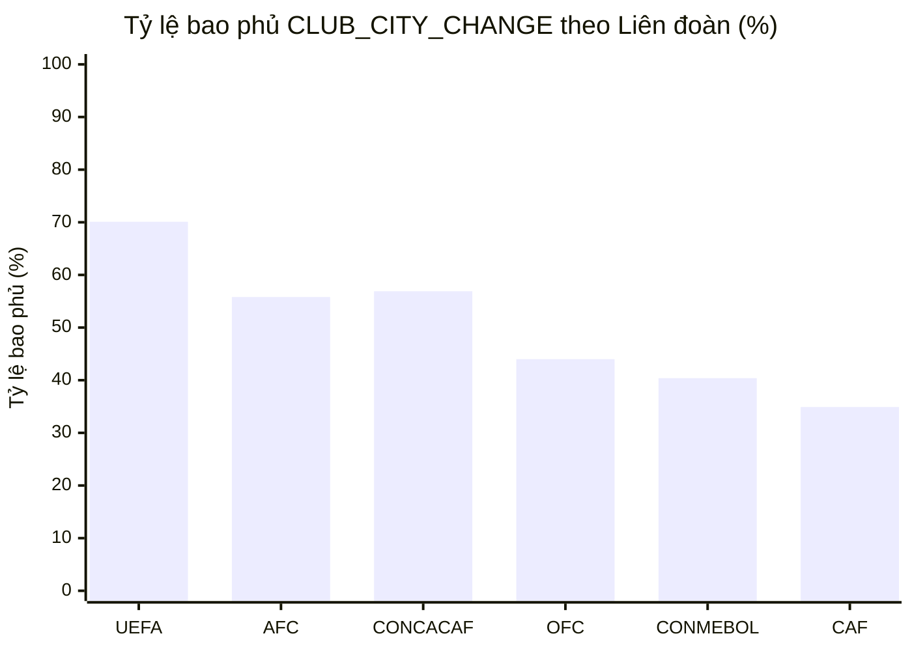

# Bảng Kiểm Kê Độ Bao Phủ CLUB_CITY_CHANGE (Official Competitions)

> [!NOTE]
> Checklist theo dõi mức độ bao phủ `CLUB_CITY_CHANGE` trên các giải đấu chính thức (Official Competitions) trong [fm24_club.lnc](file:///d:/Games/thudd/fm24-lnc/fm24-lnc-be/data/fm24_club.lnc).
> **Quy ước:** Đã tự động loại trừ các nhóm `[OTHER]` (ngoài hệ thống giải) và `[EXTINCT]` (CLB giải thể) để phản ánh chính xác nhất tiến độ hoàn thiện dữ liệu game.

## 1. Số Liệu Tổng Quan Tiến Độ

- **Tổng số CLB trong các giải đấu chính thức:** **4,819 CLB** (loại trừ các nhóm Other/Extinct)
- **Số CLB đã có City:** **2,949 CLB (61.20%)**
- **Số CLB chưa có City:** **1,870 CLB (38.80%)**
- **Số lượng `rd-uid` còn lại:** **0 dòng** (100% dòng city đều dùng City ID thật từ `fm24_geography.lnc`)

### Tổng hợp theo Liên đoàn

| Liên đoàn | Số quốc gia | Số CLB có City | Tổng số CLB | Tỷ lệ bao phủ | Tiến độ |
| :--- | :---: | :---: | :---: | :---: | :--- |
| **UEFA** | 53 | 1,820 | 2,596 | **70.1%** | 🟩🟩🟩🟩🟩🟩🟩⬜⬜⬜ |
| **AFC** | 35 | 653 | 1,171 | **55.8%** | 🟩🟩🟩🟩🟩⬜⬜⬜⬜⬜ |
| **CONCACAF** | 10 | 218 | 383 | **56.9%** | 🟩🟩🟩🟩🟩⬜⬜⬜⬜⬜ |
| **OFC** | 1 | 11 | 25 | **44.0%** | 🟩🟩🟩🟩⬜⬜⬜⬜⬜⬜ |
| **CONMEBOL** | 10 | 163 | 403 | **40.4%** | 🟩🟩🟩🟩⬜⬜⬜⬜⬜⬜ |
| **CAF** | 11 | 84 | 241 | **34.9%** | 🟩🟩🟩⬜⬜⬜⬜⬜⬜⬜ |

---

## 2. Các Quốc Gia Đã Hoàn Thành 100% City (100% Complete Nations)

> [!TIP]
> Các quốc gia dưới đây đã được cập nhật **100% City** cho toàn bộ mọi giải đấu chính thức:

| Liên đoàn | Quốc gia | Tổng số CLB | Trạng thái | Các giải đấu đã hoàn thành |
| :--- | :--- | :---: | :---: | :--- |
| UEFA | **[BIH] BOSNIA & HERZEGOVINA** | **46/46** | `100%` ✅ | `[8401073] Wwin League BIH (23/24)` (12), `[8407370] Prva liga Federacije BiH (23/24)` (16), `[8407360] Prva liga Republike Srpske (23/24)` (18) |
| UEFA | **[BLR] BELARUS** | **32/32** | `100%` ✅ | `[7483354] Belarusian Premier League (2023)` (15), `[7483366] Belarusian First League (2023)` (17) |
| UEFA | **[CZE] CZECHIA** | **57/57** | `100%` ✅ | `[131287] Chance Liga (23/24)` (16), `[131288] Chance Národní Liga (23/24)` (16), `[136041] CFL A (23/24)` (6), `[25060473] CFL B (23/24)` (7), `[136042] MSFL (23/24)` (12) |
| UEFA | **[ENG] ENGLAND** | **164/164** | `100%` ✅ | `[11] Premier League (23/24)` (20), `[12] EFL Championship (23/24)` (24), `[13] EFL League One (23/24)` (24), `[14] EFL League Two (23/24)` (24), `[109201] National League (23/24)` (24), `[5123054] National League North (23/24)` (24), `[5123055] National League South (23/24)` (24) |
| UEFA | **[ESP] SPAIN** | **218/218** | `100%` ✅ | `[67] LALIGA EA SPORTS (23/24)` (20), `[68] LALIGA HYPERMOTION (23/24)` (22), `[2000048844] Primera Federación Grupo 1 (23/24)` (20), `[2000048846] Primera Federación Grupo 2 (23/24)` (20), `[2000099903] Segunda Federación Grupo 1 (23/24)` (18), `[2000099904] Segunda Federación Grupo 2 (23/24)` (18), `[2000099905] Segunda Federación Grupo 3 (23/24)` (18), `[2000099906] Segunda Federación Grupo 4 (23/24)` (18), `[2000099907] Segunda Federación Grupo 5 (23/24)` (18), `Team B/C` (46) |
| UEFA | **[GEO] GEORGIA** | **20/20** | `100%` ✅ | `[59126495] Erovnuli Liga (2023)` (10), `[59126496] Erovnuli Liga 2 (2023)` (10) |
| UEFA | **[GIB] GIBRALTAR** | **11/11** | `100%` ✅ | `[36532636] Gibraltar Football League` (11) |
| UEFA | **[ISR] ISRAEL** | **28/28** | `100%` ✅ | `[7860000] Ligat TOTO Winner (23/24)` (14), `[7860001] Liga Leumit (23/24)` (14) |
| UEFA | **[ITA] ITALY** | **100/100** | `100%` ✅ | `[32] Serie A (23/24)` (20), `[33] Serie B (23/24)` (20), `[43127172] Serie C Girone A (23/24)` (20), `[43127173] Serie C Girone B (23/24)` (20), `[43127174] Serie C Girone C (23/24)` (20) |
| UEFA | **[MDA] MOLDOVA** | **8/8** | `100%` ✅ | `[59007607] Moldovan Super Liga (23/24)` (8) |
| UEFA | **[MLT] MALTA** | **14/14** | `100%` ✅ | `[2300050] Maltese Premier League (23/24)` (14) |
| UEFA | **[POR] PORTUGAL** | **56/56** | `100%` ✅ | `[60] Liga Portugal (23/24)` (18), `[61] Liga Portugal 2 (23/24)` (18), `[2000112232] Liga 3 Norte (23/24)` (10), `[2000112233] Liga 3 Sul (23/24)` (10) |
| UEFA | **[SRB] SERBIA** | **32/32** | `100%` ✅ | `[132321] SuperLiga Srbije (23/24)` (16), `[5776050] PrvaLiga Srbije (23/24)` (16) |
| UEFA | **[SUI] SWITZERLAND** | **32/32** | `100%` ✅ | `[137889] Swiss Super League (23/24)` (12), `[137890] Swiss Challenge League (23/24)` (10), `[98027828] Swiss Promotion League (23/24)` (10) |
| UEFA | **[SVK] SLOVAKIA** | **28/28** | `100%` ✅ | `[7560276] Niké liga (23/24)` (12), `[7560277] MONACObet LIGA (23/24)` (16) |
| AFC | **[KOR] KOREA REPUBLIC** | **74/74** | `100%` ✅ | `[136407] K.League 1 (2023)` (12), `[66029602] K.League 2 (2023)` (13), `[66010517] K3 League (2023)` (15), `[66040773] K4 League (2023)` (18), `[66039929] K.League Junior Group A` (6), `[66039930] K.League Junior Group B` (10) |
| AFC | **[MAC] MACAU** | **3/3** | `100%` ✅ | `[5630248] Liga de Elite` (3) |
| AFC | **[QAT] QATAR** | **24/24** | `100%` ✅ | `[5632126] Qatar Stars League (23/24)` (12), `[5632158] QSL 2 League (23/24)` (12) |
| AFC | **[SGP] SINGAPORE** | **10/10** | `100%` ✅ | `[5395850] Singapore Premier League (2023)` (9), `[23501268] Singapore Premier League 2` (1) |
| AFC | **[TJK] TAJIKISTAN** | **15/15** | `100%` ✅ | `[59007964] Ligai Olii Tojikiston (2023)` (10), `[59110037] Ligai Yakumi Tojikiston (2023)` (5) |
| AFC | **[VIE] VIETNAM** | **71/71** | `100%` ✅ | `[8550000] V.League 1 (23/24)` (14), `[8550001] V.League 2 (23/24)` (14), `[8550002] Vietnamese Second Division (23/24)` (16), `[8550003] Vietnamese Third Division (23/24)` (27) |
| CONCACAF | **[MEX] MEXICO** | **33/33** | `100%` ✅ | `[135973] Liga MX (23/24)` (18), `[2000017067] Liga de Expansión MX (23/24)` (15) |
| CONMEBOL | **[CHI] CHILE** | **32/32** | `100%` ✅ | `[5250792] Liga de Primera Chileno (2023)` (16), `[5250793] Liga de Ascenso Chileno (2023)` (16) |

---

## 3. Các Quốc Gia & Giải Đấu Đạt Độ Bao Phủ > 90% (High Coverage Milestone > 90%)

> [!NOTE]
> Hiện tại có **26 quốc gia** và **102 giải đấu chính thức** đã vượt mốc **90%** độ bao phủ `CLUB_CITY_CHANGE`.

### 3.1. Danh Sách 26 Quốc Gia Đạt Độ Bao Phủ > 90%

| STT | Liên đoàn | Quốc gia | Đã có City | Tổng số CLB | Còn thiếu | Tỷ lệ (%) | Trạng thái |
| :---: | :---: | :--- | :---: | :---: | :---: | :---: | :---: |
| 1 | UEFA | **[ESP] SPAIN** | 218 | 218 | 0 | **100.0%** | ✅ 100% Hoàn tất |
| 2 | UEFA | **[ENG] ENGLAND** | 164 | 164 | 0 | **100.0%** | ✅ 100% Hoàn tất |
| 3 | UEFA | **[ITA] ITALY** | 100 | 100 | 0 | **100.0%** | ✅ 100% Hoàn tất |
| 4 | AFC | **[KOR] KOREA REPUBLIC** | 74 | 74 | 0 | **100.0%** | ✅ 100% Hoàn tất |
| 5 | AFC | **[VIE] VIETNAM** | 71 | 71 | 0 | **100.0%** | ✅ 100% Hoàn tất |
| 6 | UEFA | **[CZE] CZECHIA** | 57 | 57 | 0 | **100.0%** | ✅ 100% Hoàn tất |
| 7 | UEFA | **[POR] PORTUGAL** | 56 | 56 | 0 | **100.0%** | ✅ 100% Hoàn tất |
| 8 | UEFA | **[BIH] BOSNIA & HERZEGOVINA** | 46 | 46 | 0 | **100.0%** | ✅ 100% Hoàn tất |
| 9 | CONCACAF | **[MEX] MEXICO** | 33 | 33 | 0 | **100.0%** | ✅ 100% Hoàn tất |
| 10 | UEFA | **[BLR] BELARUS** | 32 | 32 | 0 | **100.0%** | ✅ 100% Hoàn tất |
| 11 | CONMEBOL | **[CHI] CHILE** | 32 | 32 | 0 | **100.0%** | ✅ 100% Hoàn tất |
| 12 | UEFA | **[SRB] SERBIA** | 32 | 32 | 0 | **100.0%** | ✅ 100% Hoàn tất |
| 13 | UEFA | **[SUI] SWITZERLAND** | 32 | 32 | 0 | **100.0%** | ✅ 100% Hoàn tất |
| 14 | UEFA | **[ISR] ISRAEL** | 28 | 28 | 0 | **100.0%** | ✅ 100% Hoàn tất |
| 15 | UEFA | **[SVK] SLOVAKIA** | 28 | 28 | 0 | **100.0%** | ✅ 100% Hoàn tất |
| 16 | AFC | **[QAT] QATAR** | 24 | 24 | 0 | **100.0%** | ✅ 100% Hoàn tất |
| 17 | UEFA | **[GEO] GEORGIA** | 20 | 20 | 0 | **100.0%** | ✅ 100% Hoàn tất |
| 18 | AFC | **[TJK] TAJIKISTAN** | 15 | 15 | 0 | **100.0%** | ✅ 100% Hoàn tất |
| 19 | UEFA | **[MLT] MALTA** | 14 | 14 | 0 | **100.0%** | ✅ 100% Hoàn tất |
| 20 | UEFA | **[GIB] GIBRALTAR** | 11 | 11 | 0 | **100.0%** | ✅ 100% Hoàn tất |
| 21 | AFC | **[SGP] SINGAPORE** | 10 | 10 | 0 | **100.0%** | ✅ 100% Hoàn tất |
| 22 | UEFA | **[MDA] MOLDOVA** | 8 | 8 | 0 | **100.0%** | ✅ 100% Hoàn tất |
| 23 | AFC | **[MAC] MACAU** | 3 | 3 | 0 | **100.0%** | ✅ 100% Hoàn tất |
| 24 | UEFA | **[NED] NETHERLANDS** | 48 | 49 | 1 | **98.0%** | 🟡 Thiếu 1 CLB |
| 25 | AFC | **[HKG] HONG KONG** | 23 | 25 | 2 | **92.0%** | 🟡 Thiếu 2 CLB |
| 26 | CONCACAF | **[USA] USA** | 105 | 116 | 11 | **90.5%** | 🟡 Thiếu 11 CLB |

#### Nhóm Quốc Gia Cận Kề 90% (80% - 90%)

| Liên đoàn | Quốc gia | Đã có City | Tổng số CLB | Cần thêm | Tỷ lệ (%) | Trạng thái |
| :---: | :--- | :---: | :---: | :---: | :---: | :---: |
| UEFA | **[GER] GERMANY** | 160 | 179 | **+19** | **89.4%** | 🟠 Cận kề 90% |

---

### 3.2. Danh Sách Các Giải Đấu Chính Thức Đạt Độ Bao Phủ > 90% (102 giải đấu)

| Liên đoàn | Quốc gia | Giải đấu | Đã có City | Tổng số CLB | Còn thiếu | Tỷ lệ (%) | Vị trí trong file |
| :---: | :--- | :--- | :---: | :---: | :---: | :---: | :--- |
| UEFA | [ESP] SPAIN | `Team B/C` | 46 | 46 | 0 | 100.0% ✅ | [Line 31115](file:///d:/Games/thudd/fm24-lnc/fm24-lnc-be/data/fm24_club.lnc#L31115) |
| CONCACAF | [USA] USA | `[40] Major League Soccer (2023)` | 29 | 29 | 0 | 100.0% ✅ | [Line 10793](file:///d:/Games/thudd/fm24-lnc/fm24-lnc-be/data/fm24_club.lnc#L10793) |
| CONMEBOL | [ARG] ARGENTINA | `[102421] Liga Profesional (2023)` | 28 | 28 | 0 | 100.0% ✅ | [Line 11713](file:///d:/Games/thudd/fm24-lnc/fm24-lnc-be/data/fm24_club.lnc#L11713) |
| AFC | [VIE] VIETNAM | `[8550003] Vietnamese Third Division (23/24)` | 27 | 27 | 0 | 100.0% ✅ | [Line 7618](file:///d:/Games/thudd/fm24-lnc/fm24-lnc-be/data/fm24_club.lnc#L7618) |
| UEFA | [ENG] ENGLAND | `[12] EFL Championship (23/24)` | 24 | 24 | 0 | 100.0% ✅ | [Line 18250](file:///d:/Games/thudd/fm24-lnc/fm24-lnc-be/data/fm24_club.lnc#L18250) |
| UEFA | [ENG] ENGLAND | `[13] EFL League One (23/24)` | 24 | 24 | 0 | 100.0% ✅ | [Line 18397](file:///d:/Games/thudd/fm24-lnc/fm24-lnc-be/data/fm24_club.lnc#L18397) |
| UEFA | [ENG] ENGLAND | `[14] EFL League Two (23/24)` | 24 | 24 | 0 | 100.0% ✅ | [Line 18544](file:///d:/Games/thudd/fm24-lnc/fm24-lnc-be/data/fm24_club.lnc#L18544) |
| UEFA | [ENG] ENGLAND | `[109201] National League (23/24)` | 24 | 24 | 0 | 100.0% ✅ | [Line 18691](file:///d:/Games/thudd/fm24-lnc/fm24-lnc-be/data/fm24_club.lnc#L18691) |
| UEFA | [ENG] ENGLAND | `[5123054] National League North (23/24)` | 24 | 24 | 0 | 100.0% ✅ | [Line 18799](file:///d:/Games/thudd/fm24-lnc/fm24-lnc-be/data/fm24_club.lnc#L18799) |
| UEFA | [ENG] ENGLAND | `[5123055] National League South (23/24)` | 24 | 24 | 0 | 100.0% ✅ | [Line 18899](file:///d:/Games/thudd/fm24-lnc/fm24-lnc-be/data/fm24_club.lnc#L18899) |
| UEFA | [ESP] SPAIN | `[68] LALIGA HYPERMOTION (23/24)` | 22 | 22 | 0 | 100.0% ✅ | [Line 30315](file:///d:/Games/thudd/fm24-lnc/fm24-lnc-be/data/fm24_club.lnc#L30315) |
| CONCACAF | [USA] USA | `[72023762] MLS NEXT` | 21 | 21 | 0 | 100.0% ✅ | [Line 11418](file:///d:/Games/thudd/fm24-lnc/fm24-lnc-be/data/fm24_club.lnc#L11418) |
| CONMEBOL | [BRA] BRAZIL | `[102423] Brasileirão Série A (2023)` | 20 | 20 | 0 | 100.0% ✅ | [Line 12138](file:///d:/Games/thudd/fm24-lnc/fm24-lnc-be/data/fm24_club.lnc#L12138) |
| UEFA | [ENG] ENGLAND | `[11] Premier League (23/24)` | 20 | 20 | 0 | 100.0% ✅ | [Line 18127](file:///d:/Games/thudd/fm24-lnc/fm24-lnc-be/data/fm24_club.lnc#L18127) |
| UEFA | [FRA] FRANCE | `[17] Ligue 2 (23/24)` | 20 | 20 | 0 | 100.0% ✅ | [Line 20057](file:///d:/Games/thudd/fm24-lnc/fm24-lnc-be/data/fm24_club.lnc#L20057) |
| UEFA | [GER] GERMANY | `[35010926] 3. Liga (23/24)` | 20 | 20 | 0 | 100.0% ✅ | [Line 21712](file:///d:/Games/thudd/fm24-lnc/fm24-lnc-be/data/fm24_club.lnc#L21712) |
| UEFA | [ITA] ITALY | `[32] Serie A (23/24)` | 20 | 20 | 0 | 100.0% ✅ | [Line 23850](file:///d:/Games/thudd/fm24-lnc/fm24-lnc-be/data/fm24_club.lnc#L23850) |
| UEFA | [ITA] ITALY | `[33] Serie B (23/24)` | 20 | 20 | 0 | 100.0% ✅ | [Line 23973](file:///d:/Games/thudd/fm24-lnc/fm24-lnc-be/data/fm24_club.lnc#L23973) |
| UEFA | [ITA] ITALY | `[43127172] Serie C Girone A (23/24)` | 20 | 20 | 0 | 100.0% ✅ | [Line 24096](file:///d:/Games/thudd/fm24-lnc/fm24-lnc-be/data/fm24_club.lnc#L24096) |
| UEFA | [ITA] ITALY | `[43127173] Serie C Girone B (23/24)` | 20 | 20 | 0 | 100.0% ✅ | [Line 24205](file:///d:/Games/thudd/fm24-lnc/fm24-lnc-be/data/fm24_club.lnc#L24205) |
| UEFA | [ITA] ITALY | `[43127174] Serie C Girone C (23/24)` | 20 | 20 | 0 | 100.0% ✅ | [Line 24312](file:///d:/Games/thudd/fm24-lnc/fm24-lnc-be/data/fm24_club.lnc#L24312) |
| UEFA | [NED] NETHERLANDS | `[30] Keuken Kampioen Divisie (23/24)` | 20 | 20 | 0 | 100.0% ✅ | [Line 26538](file:///d:/Games/thudd/fm24-lnc/fm24-lnc-be/data/fm24_club.lnc#L26538) |
| UEFA | [ESP] SPAIN | `[67] LALIGA EA SPORTS (23/24)` | 20 | 20 | 0 | 100.0% ✅ | [Line 30192](file:///d:/Games/thudd/fm24-lnc/fm24-lnc-be/data/fm24_club.lnc#L30192) |
| UEFA | [ESP] SPAIN | `[2000048844] Primera Federación Grupo 1 (23/24)` | 20 | 20 | 0 | 100.0% ✅ | [Line 30451](file:///d:/Games/thudd/fm24-lnc/fm24-lnc-be/data/fm24_club.lnc#L30451) |
| UEFA | [ESP] SPAIN | `[2000048846] Primera Federación Grupo 2 (23/24)` | 20 | 20 | 0 | 100.0% ✅ | [Line 30572](file:///d:/Games/thudd/fm24-lnc/fm24-lnc-be/data/fm24_club.lnc#L30572) |
| UEFA | [TUR] TURKIYE | `[130286] Süper Lig (23/24)` | 20 | 20 | 0 | 100.0% ✅ | [Line 32194](file:///d:/Games/thudd/fm24-lnc/fm24-lnc-be/data/fm24_club.lnc#L32194) |
| AFC | [JPN] JAPAN | `[102428] J1 League (2023)` | 18 | 18 | 0 | 100.0% ✅ | [Line 2589](file:///d:/Games/thudd/fm24-lnc/fm24-lnc-be/data/fm24_club.lnc#L2589) |
| AFC | [KOR] KOREA REPUBLIC | `[66040773] K4 League (2023)` | 18 | 18 | 0 | 100.0% ✅ | [Line 3642](file:///d:/Games/thudd/fm24-lnc/fm24-lnc-be/data/fm24_club.lnc#L3642) |
| AFC | [KSA] SAUDI ARABIA | `[7920263] Saudi Pro League (23/24)` | 18 | 18 | 0 | 100.0% ✅ | [Line 5461](file:///d:/Games/thudd/fm24-lnc/fm24-lnc-be/data/fm24_club.lnc#L5461) |
| AFC | [THA] THAILAND | `[5637986] Thai League 2 (23/24)` | 18 | 18 | 0 | 100.0% ✅ | [Line 6208](file:///d:/Games/thudd/fm24-lnc/fm24-lnc-be/data/fm24_club.lnc#L6208) |
| CONCACAF | [MEX] MEXICO | `[135973] Liga MX (23/24)` | 18 | 18 | 0 | 100.0% ✅ | [Line 10185](file:///d:/Games/thudd/fm24-lnc/fm24-lnc-be/data/fm24_club.lnc#L10185) |
| UEFA | [BIH] BOSNIA & HERZEGOVINA | `[8407360] Prva liga Republike Srpske (23/24)` | 18 | 18 | 0 | 100.0% ✅ | [Line 16309](file:///d:/Games/thudd/fm24-lnc/fm24-lnc-be/data/fm24_club.lnc#L16309) |
| UEFA | [FRA] FRANCE | `[16] Ligue 1 (23/24)` | 18 | 18 | 0 | 100.0% ✅ | [Line 19946](file:///d:/Games/thudd/fm24-lnc/fm24-lnc-be/data/fm24_club.lnc#L19946) |
| UEFA | [FRA] FRANCE | `[18] Ligue 3 (23/24)` | 18 | 18 | 0 | 100.0% ✅ | [Line 20180](file:///d:/Games/thudd/fm24-lnc/fm24-lnc-be/data/fm24_club.lnc#L20180) |
| UEFA | [GER] GERMANY | `[22] Bundesliga (23/24)` | 18 | 18 | 0 | 100.0% ✅ | [Line 21490](file:///d:/Games/thudd/fm24-lnc/fm24-lnc-be/data/fm24_club.lnc#L21490) |
| UEFA | [GER] GERMANY | `[23] 2. Bundesliga (23/24)` | 18 | 18 | 0 | 100.0% ✅ | [Line 21601](file:///d:/Games/thudd/fm24-lnc/fm24-lnc-be/data/fm24_club.lnc#L21601) |
| UEFA | [NED] NETHERLANDS | `[29] Eredivisie (23/24)` | 18 | 18 | 0 | 100.0% ✅ | [Line 26433](file:///d:/Games/thudd/fm24-lnc/fm24-lnc-be/data/fm24_club.lnc#L26433) |
| UEFA | [POR] PORTUGAL | `[60] Liga Portugal (23/24)` | 18 | 18 | 0 | 100.0% ✅ | [Line 27790](file:///d:/Games/thudd/fm24-lnc/fm24-lnc-be/data/fm24_club.lnc#L27790) |
| UEFA | [POR] PORTUGAL | `[61] Liga Portugal 2 (23/24)` | 18 | 18 | 0 | 100.0% ✅ | [Line 27901](file:///d:/Games/thudd/fm24-lnc/fm24-lnc-be/data/fm24_club.lnc#L27901) |
| UEFA | [ESP] SPAIN | `[2000099903] Segunda Federación Grupo 1 (23/24)` | 18 | 18 | 0 | 100.0% ✅ | [Line 30692](file:///d:/Games/thudd/fm24-lnc/fm24-lnc-be/data/fm24_club.lnc#L30692) |
| UEFA | [ESP] SPAIN | `[2000099904] Segunda Federación Grupo 2 (23/24)` | 18 | 18 | 0 | 100.0% ✅ | [Line 30781](file:///d:/Games/thudd/fm24-lnc/fm24-lnc-be/data/fm24_club.lnc#L30781) |
| UEFA | [ESP] SPAIN | `[2000099905] Segunda Federación Grupo 3 (23/24)` | 18 | 18 | 0 | 100.0% ✅ | [Line 30867](file:///d:/Games/thudd/fm24-lnc/fm24-lnc-be/data/fm24_club.lnc#L30867) |
| UEFA | [ESP] SPAIN | `[2000099906] Segunda Federación Grupo 4 (23/24)` | 18 | 18 | 0 | 100.0% ✅ | [Line 30948](file:///d:/Games/thudd/fm24-lnc/fm24-lnc-be/data/fm24_club.lnc#L30948) |
| UEFA | [ESP] SPAIN | `[2000099907] Segunda Federación Grupo 5 (23/24)` | 18 | 18 | 0 | 100.0% ✅ | [Line 31035](file:///d:/Games/thudd/fm24-lnc/fm24-lnc-be/data/fm24_club.lnc#L31035) |
| UEFA | [BLR] BELARUS | `[7483366] Belarusian First League (2023)` | 17 | 17 | 0 | 100.0% ✅ | [Line 15450](file:///d:/Games/thudd/fm24-lnc/fm24-lnc-be/data/fm24_club.lnc#L15450) |
| AFC | [THA] THAILAND | `[5624920] Thai League 1 (23/24)` | 16 | 16 | 0 | 100.0% ✅ | [Line 6109](file:///d:/Games/thudd/fm24-lnc/fm24-lnc-be/data/fm24_club.lnc#L6109) |
| AFC | [VIE] VIETNAM | `[8550002] Vietnamese Second Division (23/24)` | 16 | 16 | 0 | 100.0% ✅ | [Line 7519](file:///d:/Games/thudd/fm24-lnc/fm24-lnc-be/data/fm24_club.lnc#L7519) |
| CONMEBOL | [CHI] CHILE | `[5250792] Liga de Primera Chileno (2023)` | 16 | 16 | 0 | 100.0% ✅ | [Line 12761](file:///d:/Games/thudd/fm24-lnc/fm24-lnc-be/data/fm24_club.lnc#L12761) |
| CONMEBOL | [CHI] CHILE | `[5250793] Liga de Ascenso Chileno (2023)` | 16 | 16 | 0 | 100.0% ✅ | [Line 12846](file:///d:/Games/thudd/fm24-lnc/fm24-lnc-be/data/fm24_club.lnc#L12846) |
| UEFA | [BEL] BELGIUM | `[1] Jupiler Pro League (23/24)` | 16 | 16 | 0 | 100.0% ✅ | [Line 15592](file:///d:/Games/thudd/fm24-lnc/fm24-lnc-be/data/fm24_club.lnc#L15592) |
| UEFA | [BIH] BOSNIA & HERZEGOVINA | `[8407370] Prva liga Federacije BiH (23/24)` | 16 | 16 | 0 | 100.0% ✅ | [Line 16241](file:///d:/Games/thudd/fm24-lnc/fm24-lnc-be/data/fm24_club.lnc#L16241) |
| UEFA | [CZE] CZECHIA | `[131287] Chance Liga (23/24)` | 16 | 16 | 0 | 100.0% ✅ | [Line 17091](file:///d:/Games/thudd/fm24-lnc/fm24-lnc-be/data/fm24_club.lnc#L17091) |
| UEFA | [CZE] CZECHIA | `[131288] Chance Národní Liga (23/24)` | 16 | 16 | 0 | 100.0% ✅ | [Line 17178](file:///d:/Games/thudd/fm24-lnc/fm24-lnc-be/data/fm24_club.lnc#L17178) |
| UEFA | [RUS] RUSSIA | `[130486] Russian Premier League (23/24)` | 16 | 16 | 0 | 100.0% ✅ | [Line 28759](file:///d:/Games/thudd/fm24-lnc/fm24-lnc-be/data/fm24_club.lnc#L28759) |
| UEFA | [SRB] SERBIA | `[132321] SuperLiga Srbije (23/24)` | 16 | 16 | 0 | 100.0% ✅ | [Line 29415](file:///d:/Games/thudd/fm24-lnc/fm24-lnc-be/data/fm24_club.lnc#L29415) |
| UEFA | [SRB] SERBIA | `[5776050] PrvaLiga Srbije (23/24)` | 16 | 16 | 0 | 100.0% ✅ | [Line 29500](file:///d:/Games/thudd/fm24-lnc/fm24-lnc-be/data/fm24_club.lnc#L29500) |
| UEFA | [SVK] SLOVAKIA | `[7560277] MONACObet LIGA (23/24)` | 16 | 16 | 0 | 100.0% ✅ | [Line 29728](file:///d:/Games/thudd/fm24-lnc/fm24-lnc-be/data/fm24_club.lnc#L29728) |
| UEFA | [UKR] UKRAINE | `[5314301] Ukrainian Premier League (23/24)` | 16 | 16 | 0 | 100.0% ✅ | [Line 32703](file:///d:/Games/thudd/fm24-lnc/fm24-lnc-be/data/fm24_club.lnc#L32703) |
| AFC | [KOR] KOREA REPUBLIC | `[66010517] K3 League (2023)` | 15 | 15 | 0 | 100.0% ✅ | [Line 3558](file:///d:/Games/thudd/fm24-lnc/fm24-lnc-be/data/fm24_club.lnc#L3558) |
| CONCACAF | [MEX] MEXICO | `[2000017067] Liga de Expansión MX (23/24)` | 15 | 15 | 0 | 100.0% ✅ | [Line 10297](file:///d:/Games/thudd/fm24-lnc/fm24-lnc-be/data/fm24_club.lnc#L10297) |
| UEFA | [BLR] BELARUS | `[7483354] Belarusian Premier League (2023)` | 15 | 15 | 0 | 100.0% ✅ | [Line 15365](file:///d:/Games/thudd/fm24-lnc/fm24-lnc-be/data/fm24_club.lnc#L15365) |
| AFC | [MAS] MALAYSIA | `[5624536] Liga Super Malaysia (23/24)` | 14 | 14 | 0 | 100.0% ✅ | [Line 4329](file:///d:/Games/thudd/fm24-lnc/fm24-lnc-be/data/fm24_club.lnc#L4329) |
| AFC | [UAE] UAE | `[7880000] UAE Pro League (23/24)` | 14 | 14 | 0 | 100.0% ✅ | [Line 6809](file:///d:/Games/thudd/fm24-lnc/fm24-lnc-be/data/fm24_club.lnc#L6809) |
| AFC | [UAE] UAE | `U21 Arabian Gulf League` | 14 | 14 | 0 | 100.0% ✅ | [Line 7061](file:///d:/Games/thudd/fm24-lnc/fm24-lnc-be/data/fm24_club.lnc#L7061) |
| AFC | [VIE] VIETNAM | `[8550000] V.League 1 (23/24)` | 14 | 14 | 0 | 100.0% ✅ | [Line 7345](file:///d:/Games/thudd/fm24-lnc/fm24-lnc-be/data/fm24_club.lnc#L7345) |
| AFC | [VIE] VIETNAM | `[8550001] V.League 2 (23/24)` | 14 | 14 | 0 | 100.0% ✅ | [Line 7432](file:///d:/Games/thudd/fm24-lnc/fm24-lnc-be/data/fm24_club.lnc#L7432) |
| UEFA | [GER] GERMANY | `[92086573] A-Junioren-Bundesliga Süd/Südwest (23/24)` | 14 | 14 | 0 | 100.0% ✅ | [Line 22375](file:///d:/Games/thudd/fm24-lnc/fm24-lnc-be/data/fm24_club.lnc#L22375) |
| UEFA | [GRE] GREECE | `[129650] Super League Greece (23/24)` | 14 | 14 | 0 | 100.0% ✅ | [Line 22751](file:///d:/Games/thudd/fm24-lnc/fm24-lnc-be/data/fm24_club.lnc#L22751) |
| UEFA | [ISR] ISRAEL | `[7860000] Ligat TOTO Winner (23/24)` | 14 | 14 | 0 | 100.0% ✅ | [Line 23646](file:///d:/Games/thudd/fm24-lnc/fm24-lnc-be/data/fm24_club.lnc#L23646) |
| UEFA | [ISR] ISRAEL | `[7860001] Liga Leumit (23/24)` | 14 | 14 | 0 | 100.0% ✅ | [Line 23727](file:///d:/Games/thudd/fm24-lnc/fm24-lnc-be/data/fm24_club.lnc#L23727) |
| UEFA | [MLT] MALTA | `[2300050] Maltese Premier League (23/24)` | 14 | 14 | 0 | 100.0% ✅ | [Line 25528](file:///d:/Games/thudd/fm24-lnc/fm24-lnc-be/data/fm24_club.lnc#L25528) |
| AFC | [KOR] KOREA REPUBLIC | `[66029602] K.League 2 (2023)` | 13 | 13 | 0 | 100.0% ✅ | [Line 3477](file:///d:/Games/thudd/fm24-lnc/fm24-lnc-be/data/fm24_club.lnc#L3477) |
| AFC | [HKG] HONG KONG | `[5624450] Hong Kong First Division (23/24)` | 12 | 12 | 0 | 100.0% ✅ | [Line 1356](file:///d:/Games/thudd/fm24-lnc/fm24-lnc-be/data/fm24_club.lnc#L1356) |
| AFC | [KOR] KOREA REPUBLIC | `[136407] K.League 1 (2023)` | 12 | 12 | 0 | 100.0% ✅ | [Line 3402](file:///d:/Games/thudd/fm24-lnc/fm24-lnc-be/data/fm24_club.lnc#L3402) |
| AFC | [QAT] QATAR | `[5632126] Qatar Stars League (23/24)` | 12 | 12 | 0 | 100.0% ✅ | [Line 5224](file:///d:/Games/thudd/fm24-lnc/fm24-lnc-be/data/fm24_club.lnc#L5224) |
| AFC | [QAT] QATAR | `[5632158] QSL 2 League (23/24)` | 12 | 12 | 0 | 100.0% ✅ | [Line 5299](file:///d:/Games/thudd/fm24-lnc/fm24-lnc-be/data/fm24_club.lnc#L5299) |
| UEFA | [AUT] AUSTRIA | `[136543] ÖFB Bundesliga (23/24)` | 12 | 12 | 0 | 100.0% ✅ | [Line 14768](file:///d:/Games/thudd/fm24-lnc/fm24-lnc-be/data/fm24_club.lnc#L14768) |
| UEFA | [BIH] BOSNIA & HERZEGOVINA | `[8401073] Wwin League BIH (23/24)` | 12 | 12 | 0 | 100.0% ✅ | [Line 16174](file:///d:/Games/thudd/fm24-lnc/fm24-lnc-be/data/fm24_club.lnc#L16174) |
| UEFA | [CZE] CZECHIA | `[136042] MSFL (23/24)` | 12 | 12 | 0 | 100.0% ✅ | [Line 17350](file:///d:/Games/thudd/fm24-lnc/fm24-lnc-be/data/fm24_club.lnc#L17350) |
| UEFA | [DEN] DENMARK | `[6] 3F Superliga (23/24)` | 12 | 12 | 0 | 100.0% ✅ | [Line 17484](file:///d:/Games/thudd/fm24-lnc/fm24-lnc-be/data/fm24_club.lnc#L17484) |
| UEFA | [SCO] SCOTLAND | `[45] Scottish Premiership (23/24)` | 12 | 12 | 0 | 100.0% ✅ | [Line 29160](file:///d:/Games/thudd/fm24-lnc/fm24-lnc-be/data/fm24_club.lnc#L29160) |
| UEFA | [SVK] SLOVAKIA | `[7560276] Niké liga (23/24)` | 12 | 12 | 0 | 100.0% ✅ | [Line 29661](file:///d:/Games/thudd/fm24-lnc/fm24-lnc-be/data/fm24_club.lnc#L29661) |
| UEFA | [SUI] SWITZERLAND | `[137889] Swiss Super League (23/24)` | 12 | 12 | 0 | 100.0% ✅ | [Line 31520](file:///d:/Games/thudd/fm24-lnc/fm24-lnc-be/data/fm24_club.lnc#L31520) |
| AFC | [HKG] HONG KONG | `[5624449] Hong Kong Premier League (23/24)` | 11 | 11 | 0 | 100.0% ✅ | [Line 1287](file:///d:/Games/thudd/fm24-lnc/fm24-lnc-be/data/fm24_club.lnc#L1287) |
| UEFA | [GIB] GIBRALTAR | `[36532636] Gibraltar Football League` | 11 | 11 | 0 | 100.0% ✅ | [Line 22682](file:///d:/Games/thudd/fm24-lnc/fm24-lnc-be/data/fm24_club.lnc#L22682) |
| AFC | [KOR] KOREA REPUBLIC | `[66039930] K.League Junior Group B` | 10 | 10 | 0 | 100.0% ✅ | [Line 3777](file:///d:/Games/thudd/fm24-lnc/fm24-lnc-be/data/fm24_club.lnc#L3777) |
| AFC | [TJK] TAJIKISTAN | `[59007964] Ligai Olii Tojikiston (2023)` | 10 | 10 | 0 | 100.0% ✅ | [Line 5992](file:///d:/Games/thudd/fm24-lnc/fm24-lnc-be/data/fm24_club.lnc#L5992) |
| UEFA | [CRO] CROATIA | `[129645] HNL (23/24)` | 10 | 10 | 0 | 100.0% ✅ | [Line 16718](file:///d:/Games/thudd/fm24-lnc/fm24-lnc-be/data/fm24_club.lnc#L16718) |
| UEFA | [GEO] GEORGIA | `[59126495] Erovnuli Liga (2023)` | 10 | 10 | 0 | 100.0% ✅ | [Line 21264](file:///d:/Games/thudd/fm24-lnc/fm24-lnc-be/data/fm24_club.lnc#L21264) |
| UEFA | [GEO] GEORGIA | `[59126496] Erovnuli Liga 2 (2023)` | 10 | 10 | 0 | 100.0% ✅ | [Line 21321](file:///d:/Games/thudd/fm24-lnc/fm24-lnc-be/data/fm24_club.lnc#L21321) |
| UEFA | [POR] PORTUGAL | `[2000112232] Liga 3 Norte (23/24)` | 10 | 10 | 0 | 100.0% ✅ | [Line 28014](file:///d:/Games/thudd/fm24-lnc/fm24-lnc-be/data/fm24_club.lnc#L28014) |
| UEFA | [POR] PORTUGAL | `[2000112233] Liga 3 Sul (23/24)` | 10 | 10 | 0 | 100.0% ✅ | [Line 28078](file:///d:/Games/thudd/fm24-lnc/fm24-lnc-be/data/fm24_club.lnc#L28078) |
| UEFA | [SUI] SWITZERLAND | `[137890] Swiss Challenge League (23/24)` | 10 | 10 | 0 | 100.0% ✅ | [Line 31589](file:///d:/Games/thudd/fm24-lnc/fm24-lnc-be/data/fm24_club.lnc#L31589) |
| UEFA | [SUI] SWITZERLAND | `[98027828] Swiss Promotion League (23/24)` | 10 | 10 | 0 | 100.0% ✅ | [Line 31650](file:///d:/Games/thudd/fm24-lnc/fm24-lnc-be/data/fm24_club.lnc#L31650) |
| AFC | [SGP] SINGAPORE | `[5395850] Singapore Premier League (2023)` | 9 | 9 | 0 | 100.0% ✅ | [Line 5837](file:///d:/Games/thudd/fm24-lnc/fm24-lnc-be/data/fm24_club.lnc#L5837) |
| UEFA | [MDA] MOLDOVA | `[59007607] Moldovan Super Liga (23/24)` | 8 | 8 | 0 | 100.0% ✅ | [Line 25605](file:///d:/Games/thudd/fm24-lnc/fm24-lnc-be/data/fm24_club.lnc#L25605) |
| CONCACAF | [USA] USA | `[2000102644] MLS Next Pro (2023)` | 27 | 28 | **-1** | 96.4% 🟡 | [Line 11224](file:///d:/Games/thudd/fm24-lnc/fm24-lnc-be/data/fm24_club.lnc#L11224) |
| UEFA | [GER] GERMANY | `[92086572] A-Junioren-Bundesliga Nord/Nordost (23/24)` | 13 | 14 | **-1** | 92.9% 🟡 | [Line 22203](file:///d:/Games/thudd/fm24-lnc/fm24-lnc-be/data/fm24_club.lnc#L22203) |
| UEFA | [GER] GERMANY | `[92086574] A-Junioren-Bundesliga West (23/24)` | 13 | 14 | **-1** | 92.9% 🟡 | [Line 22289](file:///d:/Games/thudd/fm24-lnc/fm24-lnc-be/data/fm24_club.lnc#L22289) |
| CONCACAF | [USA] USA | `[43] USL Championship (2023)` | 22 | 24 | **-2** | 91.7% 🟡 | [Line 10976](file:///d:/Games/thudd/fm24-lnc/fm24-lnc-be/data/fm24_club.lnc#L10976) |
| UEFA | [NED] NETHERLANDS | `Team B` | 10 | 11 | **-1** | 90.9% 🟡 | [Line 26652](file:///d:/Games/thudd/fm24-lnc/fm24-lnc-be/data/fm24_club.lnc#L26652) |
| UEFA | [GER] GERMANY | `Team II/III` | 19 | 21 | **-2** | 90.5% 🟡 | [Line 22059](file:///d:/Games/thudd/fm24-lnc/fm24-lnc-be/data/fm24_club.lnc#L22059) |

---

## 4. Các Giải Đấu Tiêu Biểu Đã Đạt 100% City (Completed Leagues Milestone)

| Liên đoàn | Quốc gia | Giải đấu | Số CLB | Vị trí trong file |
| :--- | :--- | :--- | :---: | :--- |
| AFC | [HKG] HONG KONG | `[5624449] Hong Kong Premier League (23/24)` | 11/11 | [Line 1287](file:///d:/Games/thudd/fm24-lnc/fm24-lnc-be/data/fm24_club.lnc#L1287) |
| AFC | [HKG] HONG KONG | `[5624450] Hong Kong First Division (23/24)` | 12/12 | [Line 1356](file:///d:/Games/thudd/fm24-lnc/fm24-lnc-be/data/fm24_club.lnc#L1356) |
| AFC | [JPN] JAPAN | `[102428] J1 League (2023)` | 18/18 | [Line 2589](file:///d:/Games/thudd/fm24-lnc/fm24-lnc-be/data/fm24_club.lnc#L2589) |
| AFC | [KOR] KOREA REPUBLIC | `[136407] K.League 1 (2023)` | 12/12 | [Line 3402](file:///d:/Games/thudd/fm24-lnc/fm24-lnc-be/data/fm24_club.lnc#L3402) |
| AFC | [KOR] KOREA REPUBLIC | `[66029602] K.League 2 (2023)` | 13/13 | [Line 3477](file:///d:/Games/thudd/fm24-lnc/fm24-lnc-be/data/fm24_club.lnc#L3477) |
| AFC | [KOR] KOREA REPUBLIC | `[66010517] K3 League (2023)` | 15/15 | [Line 3558](file:///d:/Games/thudd/fm24-lnc/fm24-lnc-be/data/fm24_club.lnc#L3558) |
| AFC | [KOR] KOREA REPUBLIC | `[66040773] K4 League (2023)` | 18/18 | [Line 3642](file:///d:/Games/thudd/fm24-lnc/fm24-lnc-be/data/fm24_club.lnc#L3642) |
| AFC | [KOR] KOREA REPUBLIC | `[66039930] K.League Junior Group B` | 10/10 | [Line 3777](file:///d:/Games/thudd/fm24-lnc/fm24-lnc-be/data/fm24_club.lnc#L3777) |
| AFC | [KSA] SAUDI ARABIA | `[7920263] Saudi Pro League (23/24)` | 18/18 | [Line 5461](file:///d:/Games/thudd/fm24-lnc/fm24-lnc-be/data/fm24_club.lnc#L5461) |
| AFC | [MAS] MALAYSIA | `[5624536] Liga Super Malaysia (23/24)` | 14/14 | [Line 4329](file:///d:/Games/thudd/fm24-lnc/fm24-lnc-be/data/fm24_club.lnc#L4329) |
| AFC | [QAT] QATAR | `[5632126] Qatar Stars League (23/24)` | 12/12 | [Line 5224](file:///d:/Games/thudd/fm24-lnc/fm24-lnc-be/data/fm24_club.lnc#L5224) |
| AFC | [QAT] QATAR | `[5632158] QSL 2 League (23/24)` | 12/12 | [Line 5299](file:///d:/Games/thudd/fm24-lnc/fm24-lnc-be/data/fm24_club.lnc#L5299) |
| AFC | [THA] THAILAND | `[5624920] Thai League 1 (23/24)` | 16/16 | [Line 6109](file:///d:/Games/thudd/fm24-lnc/fm24-lnc-be/data/fm24_club.lnc#L6109) |
| AFC | [THA] THAILAND | `[5637986] Thai League 2 (23/24)` | 18/18 | [Line 6208](file:///d:/Games/thudd/fm24-lnc/fm24-lnc-be/data/fm24_club.lnc#L6208) |
| AFC | [TJK] TAJIKISTAN | `[59007964] Ligai Olii Tojikiston (2023)` | 10/10 | [Line 5992](file:///d:/Games/thudd/fm24-lnc/fm24-lnc-be/data/fm24_club.lnc#L5992) |
| AFC | [UAE] UAE | `[7880000] UAE Pro League (23/24)` | 14/14 | [Line 6809](file:///d:/Games/thudd/fm24-lnc/fm24-lnc-be/data/fm24_club.lnc#L6809) |
| AFC | [UAE] UAE | `U21 Arabian Gulf League` | 14/14 | [Line 7061](file:///d:/Games/thudd/fm24-lnc/fm24-lnc-be/data/fm24_club.lnc#L7061) |
| AFC | [VIE] VIETNAM | `[8550000] V.League 1 (23/24)` | 14/14 | [Line 7345](file:///d:/Games/thudd/fm24-lnc/fm24-lnc-be/data/fm24_club.lnc#L7345) |
| AFC | [VIE] VIETNAM | `[8550001] V.League 2 (23/24)` | 14/14 | [Line 7432](file:///d:/Games/thudd/fm24-lnc/fm24-lnc-be/data/fm24_club.lnc#L7432) |
| AFC | [VIE] VIETNAM | `[8550002] Vietnamese Second Division (23/24)` | 16/16 | [Line 7519](file:///d:/Games/thudd/fm24-lnc/fm24-lnc-be/data/fm24_club.lnc#L7519) |
| AFC | [VIE] VIETNAM | `[8550003] Vietnamese Third Division (23/24)` | 27/27 | [Line 7618](file:///d:/Games/thudd/fm24-lnc/fm24-lnc-be/data/fm24_club.lnc#L7618) |
| CONCACAF | [MEX] MEXICO | `[135973] Liga MX (23/24)` | 18/18 | [Line 10185](file:///d:/Games/thudd/fm24-lnc/fm24-lnc-be/data/fm24_club.lnc#L10185) |
| CONCACAF | [MEX] MEXICO | `[2000017067] Liga de Expansión MX (23/24)` | 15/15 | [Line 10297](file:///d:/Games/thudd/fm24-lnc/fm24-lnc-be/data/fm24_club.lnc#L10297) |
| CONCACAF | [USA] USA | `[40] Major League Soccer (2023)` | 29/29 | [Line 10793](file:///d:/Games/thudd/fm24-lnc/fm24-lnc-be/data/fm24_club.lnc#L10793) |
| CONCACAF | [USA] USA | `[72023762] MLS NEXT` | 21/21 | [Line 11418](file:///d:/Games/thudd/fm24-lnc/fm24-lnc-be/data/fm24_club.lnc#L11418) |
| CONMEBOL | [ARG] ARGENTINA | `[102421] Liga Profesional (2023)` | 28/28 | [Line 11713](file:///d:/Games/thudd/fm24-lnc/fm24-lnc-be/data/fm24_club.lnc#L11713) |
| CONMEBOL | [BRA] BRAZIL | `[102423] Brasileirão Série A (2023)` | 20/20 | [Line 12138](file:///d:/Games/thudd/fm24-lnc/fm24-lnc-be/data/fm24_club.lnc#L12138) |
| CONMEBOL | [CHI] CHILE | `[5250792] Liga de Primera Chileno (2023)` | 16/16 | [Line 12761](file:///d:/Games/thudd/fm24-lnc/fm24-lnc-be/data/fm24_club.lnc#L12761) |
| CONMEBOL | [CHI] CHILE | `[5250793] Liga de Ascenso Chileno (2023)` | 16/16 | [Line 12846](file:///d:/Games/thudd/fm24-lnc/fm24-lnc-be/data/fm24_club.lnc#L12846) |
| UEFA | [AUT] AUSTRIA | `[136543] ÖFB Bundesliga (23/24)` | 12/12 | [Line 14768](file:///d:/Games/thudd/fm24-lnc/fm24-lnc-be/data/fm24_club.lnc#L14768) |
| UEFA | [BEL] BELGIUM | `[1] Jupiler Pro League (23/24)` | 16/16 | [Line 15592](file:///d:/Games/thudd/fm24-lnc/fm24-lnc-be/data/fm24_club.lnc#L15592) |
| UEFA | [BIH] BOSNIA & HERZEGOVINA | `[8401073] Wwin League BIH (23/24)` | 12/12 | [Line 16174](file:///d:/Games/thudd/fm24-lnc/fm24-lnc-be/data/fm24_club.lnc#L16174) |
| UEFA | [BIH] BOSNIA & HERZEGOVINA | `[8407370] Prva liga Federacije BiH (23/24)` | 16/16 | [Line 16241](file:///d:/Games/thudd/fm24-lnc/fm24-lnc-be/data/fm24_club.lnc#L16241) |
| UEFA | [BIH] BOSNIA & HERZEGOVINA | `[8407360] Prva liga Republike Srpske (23/24)` | 18/18 | [Line 16309](file:///d:/Games/thudd/fm24-lnc/fm24-lnc-be/data/fm24_club.lnc#L16309) |
| UEFA | [BLR] BELARUS | `[7483354] Belarusian Premier League (2023)` | 15/15 | [Line 15365](file:///d:/Games/thudd/fm24-lnc/fm24-lnc-be/data/fm24_club.lnc#L15365) |
| UEFA | [BLR] BELARUS | `[7483366] Belarusian First League (2023)` | 17/17 | [Line 15450](file:///d:/Games/thudd/fm24-lnc/fm24-lnc-be/data/fm24_club.lnc#L15450) |
| UEFA | [CRO] CROATIA | `[129645] HNL (23/24)` | 10/10 | [Line 16718](file:///d:/Games/thudd/fm24-lnc/fm24-lnc-be/data/fm24_club.lnc#L16718) |
| UEFA | [CZE] CZECHIA | `[131287] Chance Liga (23/24)` | 16/16 | [Line 17091](file:///d:/Games/thudd/fm24-lnc/fm24-lnc-be/data/fm24_club.lnc#L17091) |
| UEFA | [CZE] CZECHIA | `[131288] Chance Národní Liga (23/24)` | 16/16 | [Line 17178](file:///d:/Games/thudd/fm24-lnc/fm24-lnc-be/data/fm24_club.lnc#L17178) |
| UEFA | [CZE] CZECHIA | `[136042] MSFL (23/24)` | 12/12 | [Line 17350](file:///d:/Games/thudd/fm24-lnc/fm24-lnc-be/data/fm24_club.lnc#L17350) |
| UEFA | [DEN] DENMARK | `[6] 3F Superliga (23/24)` | 12/12 | [Line 17484](file:///d:/Games/thudd/fm24-lnc/fm24-lnc-be/data/fm24_club.lnc#L17484) |
| UEFA | [ENG] ENGLAND | `[11] Premier League (23/24)` | 20/20 | [Line 18127](file:///d:/Games/thudd/fm24-lnc/fm24-lnc-be/data/fm24_club.lnc#L18127) |
| UEFA | [ENG] ENGLAND | `[12] EFL Championship (23/24)` | 24/24 | [Line 18250](file:///d:/Games/thudd/fm24-lnc/fm24-lnc-be/data/fm24_club.lnc#L18250) |
| UEFA | [ENG] ENGLAND | `[13] EFL League One (23/24)` | 24/24 | [Line 18397](file:///d:/Games/thudd/fm24-lnc/fm24-lnc-be/data/fm24_club.lnc#L18397) |
| UEFA | [ENG] ENGLAND | `[14] EFL League Two (23/24)` | 24/24 | [Line 18544](file:///d:/Games/thudd/fm24-lnc/fm24-lnc-be/data/fm24_club.lnc#L18544) |
| UEFA | [ENG] ENGLAND | `[109201] National League (23/24)` | 24/24 | [Line 18691](file:///d:/Games/thudd/fm24-lnc/fm24-lnc-be/data/fm24_club.lnc#L18691) |
| UEFA | [ENG] ENGLAND | `[5123054] National League North (23/24)` | 24/24 | [Line 18799](file:///d:/Games/thudd/fm24-lnc/fm24-lnc-be/data/fm24_club.lnc#L18799) |
| UEFA | [ENG] ENGLAND | `[5123055] National League South (23/24)` | 24/24 | [Line 18899](file:///d:/Games/thudd/fm24-lnc/fm24-lnc-be/data/fm24_club.lnc#L18899) |
| UEFA | [ESP] SPAIN | `[67] LALIGA EA SPORTS (23/24)` | 20/20 | [Line 30192](file:///d:/Games/thudd/fm24-lnc/fm24-lnc-be/data/fm24_club.lnc#L30192) |
| UEFA | [ESP] SPAIN | `[68] LALIGA HYPERMOTION (23/24)` | 22/22 | [Line 30315](file:///d:/Games/thudd/fm24-lnc/fm24-lnc-be/data/fm24_club.lnc#L30315) |
| UEFA | [ESP] SPAIN | `[2000048844] Primera Federación Grupo 1 (23/24)` | 20/20 | [Line 30451](file:///d:/Games/thudd/fm24-lnc/fm24-lnc-be/data/fm24_club.lnc#L30451) |
| UEFA | [ESP] SPAIN | `[2000048846] Primera Federación Grupo 2 (23/24)` | 20/20 | [Line 30572](file:///d:/Games/thudd/fm24-lnc/fm24-lnc-be/data/fm24_club.lnc#L30572) |
| UEFA | [ESP] SPAIN | `[2000099903] Segunda Federación Grupo 1 (23/24)` | 18/18 | [Line 30692](file:///d:/Games/thudd/fm24-lnc/fm24-lnc-be/data/fm24_club.lnc#L30692) |
| UEFA | [ESP] SPAIN | `[2000099904] Segunda Federación Grupo 2 (23/24)` | 18/18 | [Line 30781](file:///d:/Games/thudd/fm24-lnc/fm24-lnc-be/data/fm24_club.lnc#L30781) |
| UEFA | [ESP] SPAIN | `[2000099905] Segunda Federación Grupo 3 (23/24)` | 18/18 | [Line 30867](file:///d:/Games/thudd/fm24-lnc/fm24-lnc-be/data/fm24_club.lnc#L30867) |
| UEFA | [ESP] SPAIN | `[2000099906] Segunda Federación Grupo 4 (23/24)` | 18/18 | [Line 30948](file:///d:/Games/thudd/fm24-lnc/fm24-lnc-be/data/fm24_club.lnc#L30948) |
| UEFA | [ESP] SPAIN | `[2000099907] Segunda Federación Grupo 5 (23/24)` | 18/18 | [Line 31035](file:///d:/Games/thudd/fm24-lnc/fm24-lnc-be/data/fm24_club.lnc#L31035) |
| UEFA | [ESP] SPAIN | `Team B/C` | 46/46 | [Line 31115](file:///d:/Games/thudd/fm24-lnc/fm24-lnc-be/data/fm24_club.lnc#L31115) |
| UEFA | [FRA] FRANCE | `[16] Ligue 1 (23/24)` | 18/18 | [Line 19946](file:///d:/Games/thudd/fm24-lnc/fm24-lnc-be/data/fm24_club.lnc#L19946) |
| UEFA | [FRA] FRANCE | `[17] Ligue 2 (23/24)` | 20/20 | [Line 20057](file:///d:/Games/thudd/fm24-lnc/fm24-lnc-be/data/fm24_club.lnc#L20057) |
| UEFA | [FRA] FRANCE | `[18] Ligue 3 (23/24)` | 18/18 | [Line 20180](file:///d:/Games/thudd/fm24-lnc/fm24-lnc-be/data/fm24_club.lnc#L20180) |
| UEFA | [GEO] GEORGIA | `[59126495] Erovnuli Liga (2023)` | 10/10 | [Line 21264](file:///d:/Games/thudd/fm24-lnc/fm24-lnc-be/data/fm24_club.lnc#L21264) |
| UEFA | [GEO] GEORGIA | `[59126496] Erovnuli Liga 2 (2023)` | 10/10 | [Line 21321](file:///d:/Games/thudd/fm24-lnc/fm24-lnc-be/data/fm24_club.lnc#L21321) |
| UEFA | [GER] GERMANY | `[22] Bundesliga (23/24)` | 18/18 | [Line 21490](file:///d:/Games/thudd/fm24-lnc/fm24-lnc-be/data/fm24_club.lnc#L21490) |
| UEFA | [GER] GERMANY | `[23] 2. Bundesliga (23/24)` | 18/18 | [Line 21601](file:///d:/Games/thudd/fm24-lnc/fm24-lnc-be/data/fm24_club.lnc#L21601) |
| UEFA | [GER] GERMANY | `[35010926] 3. Liga (23/24)` | 20/20 | [Line 21712](file:///d:/Games/thudd/fm24-lnc/fm24-lnc-be/data/fm24_club.lnc#L21712) |
| UEFA | [GER] GERMANY | `[92086573] A-Junioren-Bundesliga Süd/Südwest (23/24)` | 14/14 | [Line 22375](file:///d:/Games/thudd/fm24-lnc/fm24-lnc-be/data/fm24_club.lnc#L22375) |
| UEFA | [GIB] GIBRALTAR | `[36532636] Gibraltar Football League` | 11/11 | [Line 22682](file:///d:/Games/thudd/fm24-lnc/fm24-lnc-be/data/fm24_club.lnc#L22682) |
| UEFA | [GRE] GREECE | `[129650] Super League Greece (23/24)` | 14/14 | [Line 22751](file:///d:/Games/thudd/fm24-lnc/fm24-lnc-be/data/fm24_club.lnc#L22751) |
| UEFA | [ISR] ISRAEL | `[7860000] Ligat TOTO Winner (23/24)` | 14/14 | [Line 23646](file:///d:/Games/thudd/fm24-lnc/fm24-lnc-be/data/fm24_club.lnc#L23646) |
| UEFA | [ISR] ISRAEL | `[7860001] Liga Leumit (23/24)` | 14/14 | [Line 23727](file:///d:/Games/thudd/fm24-lnc/fm24-lnc-be/data/fm24_club.lnc#L23727) |
| UEFA | [ITA] ITALY | `[32] Serie A (23/24)` | 20/20 | [Line 23850](file:///d:/Games/thudd/fm24-lnc/fm24-lnc-be/data/fm24_club.lnc#L23850) |
| UEFA | [ITA] ITALY | `[33] Serie B (23/24)` | 20/20 | [Line 23973](file:///d:/Games/thudd/fm24-lnc/fm24-lnc-be/data/fm24_club.lnc#L23973) |
| UEFA | [ITA] ITALY | `[43127172] Serie C Girone A (23/24)` | 20/20 | [Line 24096](file:///d:/Games/thudd/fm24-lnc/fm24-lnc-be/data/fm24_club.lnc#L24096) |
| UEFA | [ITA] ITALY | `[43127173] Serie C Girone B (23/24)` | 20/20 | [Line 24205](file:///d:/Games/thudd/fm24-lnc/fm24-lnc-be/data/fm24_club.lnc#L24205) |
| UEFA | [ITA] ITALY | `[43127174] Serie C Girone C (23/24)` | 20/20 | [Line 24312](file:///d:/Games/thudd/fm24-lnc/fm24-lnc-be/data/fm24_club.lnc#L24312) |
| UEFA | [MLT] MALTA | `[2300050] Maltese Premier League (23/24)` | 14/14 | [Line 25528](file:///d:/Games/thudd/fm24-lnc/fm24-lnc-be/data/fm24_club.lnc#L25528) |
| UEFA | [NED] NETHERLANDS | `[29] Eredivisie (23/24)` | 18/18 | [Line 26433](file:///d:/Games/thudd/fm24-lnc/fm24-lnc-be/data/fm24_club.lnc#L26433) |
| UEFA | [NED] NETHERLANDS | `[30] Keuken Kampioen Divisie (23/24)` | 20/20 | [Line 26538](file:///d:/Games/thudd/fm24-lnc/fm24-lnc-be/data/fm24_club.lnc#L26538) |
| UEFA | [POR] PORTUGAL | `[60] Liga Portugal (23/24)` | 18/18 | [Line 27790](file:///d:/Games/thudd/fm24-lnc/fm24-lnc-be/data/fm24_club.lnc#L27790) |
| UEFA | [POR] PORTUGAL | `[61] Liga Portugal 2 (23/24)` | 18/18 | [Line 27901](file:///d:/Games/thudd/fm24-lnc/fm24-lnc-be/data/fm24_club.lnc#L27901) |
| UEFA | [POR] PORTUGAL | `[2000112232] Liga 3 Norte (23/24)` | 10/10 | [Line 28014](file:///d:/Games/thudd/fm24-lnc/fm24-lnc-be/data/fm24_club.lnc#L28014) |
| UEFA | [POR] PORTUGAL | `[2000112233] Liga 3 Sul (23/24)` | 10/10 | [Line 28078](file:///d:/Games/thudd/fm24-lnc/fm24-lnc-be/data/fm24_club.lnc#L28078) |
| UEFA | [RUS] RUSSIA | `[130486] Russian Premier League (23/24)` | 16/16 | [Line 28759](file:///d:/Games/thudd/fm24-lnc/fm24-lnc-be/data/fm24_club.lnc#L28759) |
| UEFA | [SCO] SCOTLAND | `[45] Scottish Premiership (23/24)` | 12/12 | [Line 29160](file:///d:/Games/thudd/fm24-lnc/fm24-lnc-be/data/fm24_club.lnc#L29160) |
| UEFA | [SRB] SERBIA | `[132321] SuperLiga Srbije (23/24)` | 16/16 | [Line 29415](file:///d:/Games/thudd/fm24-lnc/fm24-lnc-be/data/fm24_club.lnc#L29415) |
| UEFA | [SRB] SERBIA | `[5776050] PrvaLiga Srbije (23/24)` | 16/16 | [Line 29500](file:///d:/Games/thudd/fm24-lnc/fm24-lnc-be/data/fm24_club.lnc#L29500) |
| UEFA | [SUI] SWITZERLAND | `[137889] Swiss Super League (23/24)` | 12/12 | [Line 31520](file:///d:/Games/thudd/fm24-lnc/fm24-lnc-be/data/fm24_club.lnc#L31520) |
| UEFA | [SUI] SWITZERLAND | `[137890] Swiss Challenge League (23/24)` | 10/10 | [Line 31589](file:///d:/Games/thudd/fm24-lnc/fm24-lnc-be/data/fm24_club.lnc#L31589) |
| UEFA | [SUI] SWITZERLAND | `[98027828] Swiss Promotion League (23/24)` | 10/10 | [Line 31650](file:///d:/Games/thudd/fm24-lnc/fm24-lnc-be/data/fm24_club.lnc#L31650) |
| UEFA | [SVK] SLOVAKIA | `[7560276] Niké liga (23/24)` | 12/12 | [Line 29661](file:///d:/Games/thudd/fm24-lnc/fm24-lnc-be/data/fm24_club.lnc#L29661) |
| UEFA | [SVK] SLOVAKIA | `[7560277] MONACObet LIGA (23/24)` | 16/16 | [Line 29728](file:///d:/Games/thudd/fm24-lnc/fm24-lnc-be/data/fm24_club.lnc#L29728) |
| UEFA | [TUR] TURKIYE | `[130286] Süper Lig (23/24)` | 20/20 | [Line 32194](file:///d:/Games/thudd/fm24-lnc/fm24-lnc-be/data/fm24_club.lnc#L32194) |
| UEFA | [UKR] UKRAINE | `[5314301] Ukrainian Premier League (23/24)` | 16/16 | [Line 32703](file:///d:/Games/thudd/fm24-lnc/fm24-lnc-be/data/fm24_club.lnc#L32703) |

---

## 5. Các Giải Đấu Chính Thức Cần Ưu Tiên Hoàn Thiện (Priority Incomplete Leagues)

> [!IMPORTANT]
> Top các giải đấu chính thức có số lượng CLB chưa có City nhiều nhất:

| Liên đoàn | Quốc gia | Giải đấu | Đã có City | Tổng số CLB | Còn thiếu | Tỷ lệ | Vị trí |
| :--- | :--- | :--- | :---: | :---: | :---: | :---: | :--- |
| UEFA | [FRA] FRANCE | `Team 2` | 50 | 104 | **-54** | 48.1% | [Line 20504](file:///d:/Games/thudd/fm24-lnc/fm24-lnc-be/data/fm24_club.lnc#L20504) |
| CONMEBOL | [BRA] BRAZIL | `[19127222] Brasileirão Série D (2023)` | 16 | 61 | **-45** | 26.2% | [Line 12473](file:///d:/Games/thudd/fm24-lnc/fm24-lnc-be/data/fm24_club.lnc#L12473) |
| UEFA | [FIN] FINLAND | `[145450] Kakkonen` | 30 | 69 | **-39** | 43.5% | [Line 19709](file:///d:/Games/thudd/fm24-lnc/fm24-lnc-be/data/fm24_club.lnc#L19709) |
| UEFA | [NOR] NORWAY | `[1301420] Norsk Tipping-ligaen (2023)` | 10 | 40 | **-30** | 25.0% | [Line 26279](file:///d:/Games/thudd/fm24-lnc/fm24-lnc-be/data/fm24_club.lnc#L26279) |
| CONMEBOL | [ARG] ARGENTINA | `[102422] Primera Nacional (2023)` | 9 | 37 | **-28** | 24.3% | [Line 11884](file:///d:/Games/thudd/fm24-lnc/fm24-lnc-be/data/fm24_club.lnc#L11884) |
| CONCACAF | [HON] HONDURAS | `[87000202] Liga Nacional de Ascenso (23/24)` | 5 | 32 | **-27** | 15.6% | [Line 10016](file:///d:/Games/thudd/fm24-lnc/fm24-lnc-be/data/fm24_club.lnc#L10016) |
| AFC | [JPN] JAPAN | `[115424] J2 League (2023)` | 3 | 22 | **-19** | 13.6% | [Line 2700](file:///d:/Games/thudd/fm24-lnc/fm24-lnc-be/data/fm24_club.lnc#L2700) |
| CONCACAF | [PAN] PANAMA | `[80010007] Liga PROM` | 3 | 22 | **-19** | 13.6% | [Line 10663](file:///d:/Games/thudd/fm24-lnc/fm24-lnc-be/data/fm24_club.lnc#L10663) |
| CAF | [EGY] EGYPT | `[2000340108] Egyptian Second Division A (23/24)` | 2 | 20 | **-18** | 10.0% | [Line 8449](file:///d:/Games/thudd/fm24-lnc/fm24-lnc-be/data/fm24_club.lnc#L8449) |
| UEFA | [ROU] ROMANIA | `[150913] Liga II României (23/24)` | 3 | 20 | **-17** | 15.0% | [Line 28481](file:///d:/Games/thudd/fm24-lnc/fm24-lnc-be/data/fm24_club.lnc#L28481) |
| UEFA | [TUR] TURKIYE | `[463481] 2. Lig (23/24)` | 2 | 19 | **-17** | 10.5% | [Line 32464](file:///d:/Games/thudd/fm24-lnc/fm24-lnc-be/data/fm24_club.lnc#L32464) |
| AFC | [JPN] JAPAN | `[791180] J3 League (2023)` | 3 | 20 | **-17** | 15.0% | [Line 2817](file:///d:/Games/thudd/fm24-lnc/fm24-lnc-be/data/fm24_club.lnc#L2817) |
| AFC | [KSA] SAUDI ARABIA | `[7920264] Saudi First Division League (23/24)` | 1 | 18 | **-17** | 5.6% | [Line 5572](file:///d:/Games/thudd/fm24-lnc/fm24-lnc-be/data/fm24_club.lnc#L5572) |
| UEFA | [NOR] NORWAY | `[145428] PostNord-ligaen (2023)` | 8 | 24 | **-16** | 33.3% | [Line 26013](file:///d:/Games/thudd/fm24-lnc/fm24-lnc-be/data/fm24_club.lnc#L26013) |
| UEFA | [ROU] ROMANIA | `[7540024] Liga I României (23/24)` | 0 | 16 | **-16** | 0.0% | [Line 28405](file:///d:/Games/thudd/fm24-lnc/fm24-lnc-be/data/fm24_club.lnc#L28405) |
| UEFA | [RUS] RUSSIA | `[130487] Russian First League (23/24)` | 2 | 18 | **-16** | 11.1% | [Line 28852](file:///d:/Games/thudd/fm24-lnc/fm24-lnc-be/data/fm24_club.lnc#L28852) |
| AFC | [IRQ] IRAQ | `[2000099726] Iraqi Premier Division League (23/24)` | 6 | 22 | **-16** | 27.3% | [Line 2476](file:///d:/Games/thudd/fm24-lnc/fm24-lnc-be/data/fm24_club.lnc#L2476) |
| CONMEBOL | [BRA] BRAZIL | `[107191] Brasileirão Série B (2023)` | 4 | 20 | **-16** | 20.0% | [Line 12261](file:///d:/Games/thudd/fm24-lnc/fm24-lnc-be/data/fm24_club.lnc#L12261) |
| CONMEBOL | [BRA] BRAZIL | `[107192] Brasileirão Série C (2023)` | 4 | 20 | **-16** | 20.0% | [Line 12368](file:///d:/Games/thudd/fm24-lnc/fm24-lnc-be/data/fm24_club.lnc#L12368) |
| CAF | [EGY] EGYPT | `[12015393] Egyptian Premier League (23/24)` | 2 | 18 | **-16** | 11.1% | [Line 8375](file:///d:/Games/thudd/fm24-lnc/fm24-lnc-be/data/fm24_club.lnc#L8375) |
| CAF | [LBY] LIBYA | `[13208974] Libyan Premier League (23/24)` | 6 | 22 | **-16** | 27.3% | [Line 8529](file:///d:/Games/thudd/fm24-lnc/fm24-lnc-be/data/fm24_club.lnc#L8529) |
| UEFA | [BUL] BULGARIA | `[7500118] Bulgarian Second League (23/24)` | 3 | 18 | **-15** | 16.7% | [Line 16486](file:///d:/Games/thudd/fm24-lnc/fm24-lnc-be/data/fm24_club.lnc#L16486) |
| UEFA | [LUX] LUXEMBOURG | `[5340000] BGL Ligue` | 1 | 16 | **-15** | 6.2% | [Line 25476](file:///d:/Games/thudd/fm24-lnc/fm24-lnc-be/data/fm24_club.lnc#L25476) |
| UEFA | [SWE] SWEDEN | `[8114887] Ettan Södra (2023)` | 1 | 16 | **-15** | 6.2% | [Line 32022](file:///d:/Games/thudd/fm24-lnc/fm24-lnc-be/data/fm24_club.lnc#L32022) |
| CONMEBOL | [BOL] BOLIVIA | `[86000000] División Profesional de Bolivia (2023)` | 2 | 17 | **-15** | 11.8% | [Line 12053](file:///d:/Games/thudd/fm24-lnc/fm24-lnc-be/data/fm24_club.lnc#L12053) |
| UEFA | [TUR] TURKIYE | `[463479] 1. Lig (23/24)` | 3 | 17 | **-14** | 17.6% | [Line 32303](file:///d:/Games/thudd/fm24-lnc/fm24-lnc-be/data/fm24_club.lnc#L32303) |
| UEFA | [TUR] TURKIYE | `[463485] 2. Lig Beyaz Grup (23/24)` | 5 | 19 | **-14** | 26.3% | [Line 32381](file:///d:/Games/thudd/fm24-lnc/fm24-lnc-be/data/fm24_club.lnc#L32381) |
| AFC | [UAE] UAE | `[2000017168] UAE Second Division League (23/24)` | 0 | 14 | **-14** | 0.0% | [Line 6989](file:///d:/Games/thudd/fm24-lnc/fm24-lnc-be/data/fm24_club.lnc#L6989) |
| CAF | [NGA] NIGERIA | `NPFL (23/24)` | 2 | 16 | **-14** | 12.5% | [Line 8765](file:///d:/Games/thudd/fm24-lnc/fm24-lnc-be/data/fm24_club.lnc#L8765) |
| AFC | [IRQ] IRAQ | `[23038303] Iraq Stars League (23/24)` | 7 | 20 | **-13** | 35.0% | [Line 2366](file:///d:/Games/thudd/fm24-lnc/fm24-lnc-be/data/fm24_club.lnc#L2366) |

---

## 6. Checklist Chi Tiết Toàn Bộ Quốc Gia & Giải Đấu Chính Thức

### UEFA (53 quốc gia, 1,820/2,596 CLB — **70.1%**)

#### - [ ] [ALB] ALBANIA (20/45 CLB — **44.4%** 🟠)

| Mục | Giải đấu | Đã có City | Tổng số CLB | Tỷ lệ | Tiến độ | Vị trí |
| :---: | :--- | :---: | :---: | :---: | :---: | :--- |
| `[ ]` | `[11024371] FSHF Kategoria e Parë Grupi A (23/24)` | 6 | 12 | 50.0% | 🟡 | [Line 14230](file:///d:/Games/thudd/fm24-lnc/fm24-lnc-be/data/fm24_club.lnc#L14230) |
| `[ ]` | `[2000093167] FSHF Kategoria e Dytë Grupi A (23/24)` | 5 | 12 | 41.7% | 🟠 | [Line 14293](file:///d:/Games/thudd/fm24-lnc/fm24-lnc-be/data/fm24_club.lnc#L14293) |
| `[ ]` | `[2000093168] FSHF Kategoria e Dytë Grupi B (23/24)` | 2 | 11 | 18.2% | 🟠 | [Line 14351](file:///d:/Games/thudd/fm24-lnc/fm24-lnc-be/data/fm24_club.lnc#L14351) |
| `[ ]` | `[8350942] Abissnet Superiore (23/24)` | 7 | 10 | 70.0% | 🟡 | [Line 14175](file:///d:/Games/thudd/fm24-lnc/fm24-lnc-be/data/fm24_club.lnc#L14175) |

#### - [ ] [AND] ANDORRA (3/8 CLB — **37.5%** 🟠)

| Mục | Giải đấu | Đã có City | Tổng số CLB | Tỷ lệ | Tiến độ | Vị trí |
| :---: | :--- | :---: | :---: | :---: | :---: | :--- |
| `[ ]` | `[47000005] Lliga Multisegur Assegurances` | 3 | 8 | 37.5% | 🟠 | [Line 14497](file:///d:/Games/thudd/fm24-lnc/fm24-lnc-be/data/fm24_club.lnc#L14497) |

#### - [ ] [ARM] ARMENIA (16/25 CLB — **64.0%** 🟡)

| Mục | Giải đấu | Đã có City | Tổng số CLB | Tỷ lệ | Tiến độ | Vị trí |
| :---: | :--- | :---: | :---: | :---: | :---: | :--- |
| `[ ]` | `[59006197] Armenian First League (23/24)` | 11 | 15 | 73.3% | 🟡 | [Line 14630](file:///d:/Games/thudd/fm24-lnc/fm24-lnc-be/data/fm24_club.lnc#L14630) |
| `[ ]` | `[59006196] Armenian Premier League (23/24)` | 5 | 10 | 50.0% | 🟡 | [Line 14576](file:///d:/Games/thudd/fm24-lnc/fm24-lnc-be/data/fm24_club.lnc#L14576) |

#### - [ ] [AUT] AUSTRIA (34/49 CLB — **69.4%** 🟡)

| Mục | Giải đấu | Đã có City | Tổng số CLB | Tỷ lệ | Tiến độ | Vị trí |
| :---: | :--- | :---: | :---: | :---: | :---: | :--- |
| `[ ]` | `[136544] ÖFB 2. Liga (23/24)` | 8 | 16 | 50.0% | 🟡 | [Line 14843](file:///d:/Games/thudd/fm24-lnc/fm24-lnc-be/data/fm24_club.lnc#L14843) |
| `[ ]` | `[16068419] ÖFB Jugendliga U18` | 8 | 13 | 61.5% | 🟡 | [Line 14988](file:///d:/Games/thudd/fm24-lnc/fm24-lnc-be/data/fm24_club.lnc#L14988) |
| `[x]` | `[136543] ÖFB Bundesliga (23/24)` | 12 | 12 | 100.0% | ✅ | [Line 14768](file:///d:/Games/thudd/fm24-lnc/fm24-lnc-be/data/fm24_club.lnc#L14768) |
| `[ ]` | `[5607687] Regionalliga Mitte (23/24)` | 3 | 5 | 60.0% | 🟡 | [Line 14948](file:///d:/Games/thudd/fm24-lnc/fm24-lnc-be/data/fm24_club.lnc#L14948) |
| `[x]` | `[136546] Regionalliga Ost (23/24)` | 2 | 2 | 100.0% | ✅ | [Line 14931](file:///d:/Games/thudd/fm24-lnc/fm24-lnc-be/data/fm24_club.lnc#L14931) |
| `[x]` | `[5607688] Regionalliga West (23/24)` | 1 | 1 | 100.0% | ✅ | [Line 14980](file:///d:/Games/thudd/fm24-lnc/fm24-lnc-be/data/fm24_club.lnc#L14980) |

#### - [ ] [AZE] AZERBAIJAN (8/17 CLB — **47.1%** 🟠)

| Mục | Giải đấu | Đã có City | Tổng số CLB | Tỷ lệ | Tiến độ | Vị trí |
| :---: | :--- | :---: | :---: | :---: | :---: | :--- |
| `[ ]` | `[59006943] Azərbaycan Premyer Liqasi (23/24)` | 4 | 10 | 40.0% | 🟠 | [Line 15204](file:///d:/Games/thudd/fm24-lnc/fm24-lnc-be/data/fm24_club.lnc#L15204) |
| `[ ]` | `[59008101] Azərbaycan I Liqa (23/24)` | 4 | 7 | 57.1% | 🟡 | [Line 15259](file:///d:/Games/thudd/fm24-lnc/fm24-lnc-be/data/fm24_club.lnc#L15259) |

#### - [ ] [BEL] BELGIUM (30/50 CLB — **60.0%** 🟡)

| Mục | Giải đấu | Đã có City | Tổng số CLB | Tỷ lệ | Tiến độ | Vị trí |
| :---: | :--- | :---: | :---: | :---: | :---: | :--- |
| `[ ]` | `[8154824] Belgian Division 1 (23/24)` | 7 | 18 | 38.9% | 🟠 | [Line 15784](file:///d:/Games/thudd/fm24-lnc/fm24-lnc-be/data/fm24_club.lnc#L15784) |
| `[x]` | `[1] Jupiler Pro League (23/24)` | 16 | 16 | 100.0% | ✅ | [Line 15592](file:///d:/Games/thudd/fm24-lnc/fm24-lnc-be/data/fm24_club.lnc#L15592) |
| `[ ]` | `[2] Challenger Pro League (23/24)` | 7 | 16 | 43.8% | 🟠 | [Line 15691](file:///d:/Games/thudd/fm24-lnc/fm24-lnc-be/data/fm24_club.lnc#L15691) |

#### - [x] [BIH] BOSNIA & HERZEGOVINA (46/46 CLB — **100.0%** ✅)

| Mục | Giải đấu | Đã có City | Tổng số CLB | Tỷ lệ | Tiến độ | Vị trí |
| :---: | :--- | :---: | :---: | :---: | :---: | :--- |
| `[x]` | `[8407360] Prva liga Republike Srpske (23/24)` | 18 | 18 | 100.0% | ✅ | [Line 16309](file:///d:/Games/thudd/fm24-lnc/fm24-lnc-be/data/fm24_club.lnc#L16309) |
| `[x]` | `[8407370] Prva liga Federacije BiH (23/24)` | 16 | 16 | 100.0% | ✅ | [Line 16241](file:///d:/Games/thudd/fm24-lnc/fm24-lnc-be/data/fm24_club.lnc#L16241) |
| `[x]` | `[8401073] Wwin League BIH (23/24)` | 12 | 12 | 100.0% | ✅ | [Line 16174](file:///d:/Games/thudd/fm24-lnc/fm24-lnc-be/data/fm24_club.lnc#L16174) |

#### - [x] [BLR] BELARUS (32/32 CLB — **100.0%** ✅)

| Mục | Giải đấu | Đã có City | Tổng số CLB | Tỷ lệ | Tiến độ | Vị trí |
| :---: | :--- | :---: | :---: | :---: | :---: | :--- |
| `[x]` | `[7483366] Belarusian First League (2023)` | 17 | 17 | 100.0% | ✅ | [Line 15450](file:///d:/Games/thudd/fm24-lnc/fm24-lnc-be/data/fm24_club.lnc#L15450) |
| `[x]` | `[7483354] Belarusian Premier League (2023)` | 15 | 15 | 100.0% | ✅ | [Line 15365](file:///d:/Games/thudd/fm24-lnc/fm24-lnc-be/data/fm24_club.lnc#L15365) |

#### - [ ] [BUL] BULGARIA (9/34 CLB — **26.5%** 🟠)

| Mục | Giải đấu | Đã có City | Tổng số CLB | Tỷ lệ | Tiến độ | Vị trí |
| :---: | :--- | :---: | :---: | :---: | :---: | :--- |
| `[ ]` | `[7500118] Bulgarian Second League (23/24)` | 3 | 18 | 16.7% | 🟠 | [Line 16486](file:///d:/Games/thudd/fm24-lnc/fm24-lnc-be/data/fm24_club.lnc#L16486) |
| `[ ]` | `[7500000] efbet League (23/24)` | 6 | 16 | 37.5% | 🟠 | [Line 16406](file:///d:/Games/thudd/fm24-lnc/fm24-lnc-be/data/fm24_club.lnc#L16406) |

#### - [ ] [CRO] CROATIA (15/22 CLB — **68.2%** 🟡)

| Mục | Giải đấu | Đã có City | Tổng số CLB | Tỷ lệ | Tiến độ | Vị trí |
| :---: | :--- | :---: | :---: | :---: | :---: | :--- |
| `[ ]` | `[129646] Prva NL (23/24)` | 5 | 12 | 41.7% | 🟠 | [Line 16778](file:///d:/Games/thudd/fm24-lnc/fm24-lnc-be/data/fm24_club.lnc#L16778) |
| `[x]` | `[129645] HNL (23/24)` | 10 | 10 | 100.0% | ✅ | [Line 16718](file:///d:/Games/thudd/fm24-lnc/fm24-lnc-be/data/fm24_club.lnc#L16718) |

#### - [ ] [CYP] CYPRUS (17/30 CLB — **56.7%** 🟡)

| Mục | Giải đấu | Đã có City | Tổng số CLB | Tỷ lệ | Tiến độ | Vị trí |
| :---: | :--- | :---: | :---: | :---: | :---: | :--- |
| `[ ]` | `[692431] Cypriot Second Division` | 8 | 16 | 50.0% | 🟡 | [Line 17001](file:///d:/Games/thudd/fm24-lnc/fm24-lnc-be/data/fm24_club.lnc#L17001) |
| `[ ]` | `[692430] Cyprus League by Stoiximan (23/24)` | 9 | 14 | 64.3% | 🟡 | [Line 16926](file:///d:/Games/thudd/fm24-lnc/fm24-lnc-be/data/fm24_club.lnc#L16926) |

#### - [x] [CZE] CZECHIA (57/57 CLB — **100.0%** ✅)

| Mục | Giải đấu | Đã có City | Tổng số CLB | Tỷ lệ | Tiến độ | Vị trí |
| :---: | :--- | :---: | :---: | :---: | :---: | :--- |
| `[x]` | `[131287] Chance Liga (23/24)` | 16 | 16 | 100.0% | ✅ | [Line 17091](file:///d:/Games/thudd/fm24-lnc/fm24-lnc-be/data/fm24_club.lnc#L17091) |
| `[x]` | `[131288] Chance Národní Liga (23/24)` | 16 | 16 | 100.0% | ✅ | [Line 17178](file:///d:/Games/thudd/fm24-lnc/fm24-lnc-be/data/fm24_club.lnc#L17178) |
| `[x]` | `[136042] MSFL (23/24)` | 12 | 12 | 100.0% | ✅ | [Line 17350](file:///d:/Games/thudd/fm24-lnc/fm24-lnc-be/data/fm24_club.lnc#L17350) |
| `[x]` | `[25060473] CFL B (23/24)` | 7 | 7 | 100.0% | ✅ | [Line 17308](file:///d:/Games/thudd/fm24-lnc/fm24-lnc-be/data/fm24_club.lnc#L17308) |
| `[x]` | `[136041] CFL A (23/24)` | 6 | 6 | 100.0% | ✅ | [Line 17269](file:///d:/Games/thudd/fm24-lnc/fm24-lnc-be/data/fm24_club.lnc#L17269) |

#### - [ ] [DEN] DENMARK (28/48 CLB — **58.3%** 🟡)

| Mục | Giải đấu | Đã có City | Tổng số CLB | Tỷ lệ | Tiến độ | Vị trí |
| :---: | :--- | :---: | :---: | :---: | :---: | :--- |
| `[x]` | `[6] 3F Superliga (23/24)` | 12 | 12 | 100.0% | ✅ | [Line 17484](file:///d:/Games/thudd/fm24-lnc/fm24-lnc-be/data/fm24_club.lnc#L17484) |
| `[ ]` | `[7] NordicBet Liga (23/24)` | 8 | 12 | 66.7% | 🟡 | [Line 17559](file:///d:/Games/thudd/fm24-lnc/fm24-lnc-be/data/fm24_club.lnc#L17559) |
| `[ ]` | `[8] 2. division (23/24)` | 4 | 12 | 33.3% | 🟠 | [Line 17630](file:///d:/Games/thudd/fm24-lnc/fm24-lnc-be/data/fm24_club.lnc#L17630) |
| `[ ]` | `[2000016262] 3. division (23/24)` | 4 | 12 | 33.3% | 🟠 | [Line 17696](file:///d:/Games/thudd/fm24-lnc/fm24-lnc-be/data/fm24_club.lnc#L17696) |

#### - [x] [ENG] ENGLAND (164/164 CLB — **100.0%** ✅)

| Mục | Giải đấu | Đã có City | Tổng số CLB | Tỷ lệ | Tiến độ | Vị trí |
| :---: | :--- | :---: | :---: | :---: | :---: | :--- |
| `[x]` | `[12] EFL Championship (23/24)` | 24 | 24 | 100.0% | ✅ | [Line 18250](file:///d:/Games/thudd/fm24-lnc/fm24-lnc-be/data/fm24_club.lnc#L18250) |
| `[x]` | `[13] EFL League One (23/24)` | 24 | 24 | 100.0% | ✅ | [Line 18397](file:///d:/Games/thudd/fm24-lnc/fm24-lnc-be/data/fm24_club.lnc#L18397) |
| `[x]` | `[14] EFL League Two (23/24)` | 24 | 24 | 100.0% | ✅ | [Line 18544](file:///d:/Games/thudd/fm24-lnc/fm24-lnc-be/data/fm24_club.lnc#L18544) |
| `[x]` | `[109201] National League (23/24)` | 24 | 24 | 100.0% | ✅ | [Line 18691](file:///d:/Games/thudd/fm24-lnc/fm24-lnc-be/data/fm24_club.lnc#L18691) |
| `[x]` | `[5123054] National League North (23/24)` | 24 | 24 | 100.0% | ✅ | [Line 18799](file:///d:/Games/thudd/fm24-lnc/fm24-lnc-be/data/fm24_club.lnc#L18799) |
| `[x]` | `[5123055] National League South (23/24)` | 24 | 24 | 100.0% | ✅ | [Line 18899](file:///d:/Games/thudd/fm24-lnc/fm24-lnc-be/data/fm24_club.lnc#L18899) |
| `[x]` | `[11] Premier League (23/24)` | 20 | 20 | 100.0% | ✅ | [Line 18127](file:///d:/Games/thudd/fm24-lnc/fm24-lnc-be/data/fm24_club.lnc#L18127) |

#### - [x] [ESP] SPAIN (218/218 CLB — **100.0%** ✅)

| Mục | Giải đấu | Đã có City | Tổng số CLB | Tỷ lệ | Tiến độ | Vị trí |
| :---: | :--- | :---: | :---: | :---: | :---: | :--- |
| `[x]` | `Team B/C` | 46 | 46 | 100.0% | ✅ | [Line 31115](file:///d:/Games/thudd/fm24-lnc/fm24-lnc-be/data/fm24_club.lnc#L31115) |
| `[x]` | `[68] LALIGA HYPERMOTION (23/24)` | 22 | 22 | 100.0% | ✅ | [Line 30315](file:///d:/Games/thudd/fm24-lnc/fm24-lnc-be/data/fm24_club.lnc#L30315) |
| `[x]` | `[67] LALIGA EA SPORTS (23/24)` | 20 | 20 | 100.0% | ✅ | [Line 30192](file:///d:/Games/thudd/fm24-lnc/fm24-lnc-be/data/fm24_club.lnc#L30192) |
| `[x]` | `[2000048844] Primera Federación Grupo 1 (23/24)` | 20 | 20 | 100.0% | ✅ | [Line 30451](file:///d:/Games/thudd/fm24-lnc/fm24-lnc-be/data/fm24_club.lnc#L30451) |
| `[x]` | `[2000048846] Primera Federación Grupo 2 (23/24)` | 20 | 20 | 100.0% | ✅ | [Line 30572](file:///d:/Games/thudd/fm24-lnc/fm24-lnc-be/data/fm24_club.lnc#L30572) |
| `[x]` | `[2000099903] Segunda Federación Grupo 1 (23/24)` | 18 | 18 | 100.0% | ✅ | [Line 30692](file:///d:/Games/thudd/fm24-lnc/fm24-lnc-be/data/fm24_club.lnc#L30692) |
| `[x]` | `[2000099904] Segunda Federación Grupo 2 (23/24)` | 18 | 18 | 100.0% | ✅ | [Line 30781](file:///d:/Games/thudd/fm24-lnc/fm24-lnc-be/data/fm24_club.lnc#L30781) |
| `[x]` | `[2000099905] Segunda Federación Grupo 3 (23/24)` | 18 | 18 | 100.0% | ✅ | [Line 30867](file:///d:/Games/thudd/fm24-lnc/fm24-lnc-be/data/fm24_club.lnc#L30867) |
| `[x]` | `[2000099906] Segunda Federación Grupo 4 (23/24)` | 18 | 18 | 100.0% | ✅ | [Line 30948](file:///d:/Games/thudd/fm24-lnc/fm24-lnc-be/data/fm24_club.lnc#L30948) |
| `[x]` | `[2000099907] Segunda Federación Grupo 5 (23/24)` | 18 | 18 | 100.0% | ✅ | [Line 31035](file:///d:/Games/thudd/fm24-lnc/fm24-lnc-be/data/fm24_club.lnc#L31035) |

#### - [ ] [EST] ESTONIA (11/19 CLB — **57.9%** 🟡)

| Mục | Giải đấu | Đã có City | Tổng số CLB | Tỷ lệ | Tiến độ | Vị trí |
| :---: | :--- | :---: | :---: | :---: | :---: | :--- |
| `[ ]` | `[7681558] Meistriliiga (2024)` | 5 | 10 | 50.0% | 🟡 | [Line 19294](file:///d:/Games/thudd/fm24-lnc/fm24-lnc-be/data/fm24_club.lnc#L19294) |
| `[ ]` | `[7681559] Esiliiga (2024)` | 6 | 9 | 66.7% | 🟡 | [Line 19349](file:///d:/Games/thudd/fm24-lnc/fm24-lnc-be/data/fm24_club.lnc#L19349) |

#### - [ ] [FIN] FINLAND (47/93 CLB — **50.5%** 🟡)

| Mục | Giải đấu | Đã có City | Tổng số CLB | Tỷ lệ | Tiến độ | Vị trí |
| :---: | :--- | :---: | :---: | :---: | :---: | :--- |
| `[ ]` | `[145450] Kakkonen` | 30 | 69 | 43.5% | 🟠 | [Line 19709](file:///d:/Games/thudd/fm24-lnc/fm24-lnc-be/data/fm24_club.lnc#L19709) |
| `[ ]` | `[129120] Veikkausliiga (2023)` | 9 | 12 | 75.0% | 🟡 | [Line 19532](file:///d:/Games/thudd/fm24-lnc/fm24-lnc-be/data/fm24_club.lnc#L19532) |
| `[ ]` | `[129131] Ykkönen (2023)` | 8 | 12 | 66.7% | 🟡 | [Line 19602](file:///d:/Games/thudd/fm24-lnc/fm24-lnc-be/data/fm24_club.lnc#L19602) |

#### - [ ] [FRA] FRANCE (113/214 CLB — **52.8%** 🟡)

| Mục | Giải đấu | Đã có City | Tổng số CLB | Tỷ lệ | Tiến độ | Vị trí |
| :---: | :--- | :---: | :---: | :---: | :---: | :--- |
| `[ ]` | `Team 2` | 50 | 104 | 48.1% | 🟠 | [Line 20504](file:///d:/Games/thudd/fm24-lnc/fm24-lnc-be/data/fm24_club.lnc#L20504) |
| `[x]` | `[17] Ligue 2 (23/24)` | 20 | 20 | 100.0% | ✅ | [Line 20057](file:///d:/Games/thudd/fm24-lnc/fm24-lnc-be/data/fm24_club.lnc#L20057) |
| `[x]` | `[16] Ligue 1 (23/24)` | 18 | 18 | 100.0% | ✅ | [Line 19946](file:///d:/Games/thudd/fm24-lnc/fm24-lnc-be/data/fm24_club.lnc#L19946) |
| `[x]` | `[18] Ligue 3 (23/24)` | 18 | 18 | 100.0% | ✅ | [Line 20180](file:///d:/Games/thudd/fm24-lnc/fm24-lnc-be/data/fm24_club.lnc#L20180) |
| `[ ]` | `[914522] National 2 Groupe B (23/24)` | 2 | 14 | 14.3% | 🟠 | [Line 20347](file:///d:/Games/thudd/fm24-lnc/fm24-lnc-be/data/fm24_club.lnc#L20347) |
| `[ ]` | `[914523] National 2 Groupe C (23/24)` | 2 | 14 | 14.3% | 🟠 | [Line 20398](file:///d:/Games/thudd/fm24-lnc/fm24-lnc-be/data/fm24_club.lnc#L20398) |
| `[ ]` | `[19] National 2 Groupe A (23/24)` | 2 | 13 | 15.4% | 🟠 | [Line 20291](file:///d:/Games/thudd/fm24-lnc/fm24-lnc-be/data/fm24_club.lnc#L20291) |
| `[ ]` | `[914524] National 2 Groupe D (23/24)` | 1 | 13 | 7.7% | 🟠 | [Line 20450](file:///d:/Games/thudd/fm24-lnc/fm24-lnc-be/data/fm24_club.lnc#L20450) |

#### - [ ] [FRO] FAROE ISLANDS (2/9 CLB — **22.2%** 🟠)

| Mục | Giải đấu | Đã có City | Tổng số CLB | Tỷ lệ | Tiến độ | Vị trí |
| :---: | :--- | :---: | :---: | :---: | :---: | :--- |
| `[ ]` | `[8300358] Betrideildin` | 2 | 9 | 22.2% | 🟠 | [Line 19437](file:///d:/Games/thudd/fm24-lnc/fm24-lnc-be/data/fm24_club.lnc#L19437) |

#### - [x] [GEO] GEORGIA (20/20 CLB — **100.0%** ✅)

| Mục | Giải đấu | Đã có City | Tổng số CLB | Tỷ lệ | Tiến độ | Vị trí |
| :---: | :--- | :---: | :---: | :---: | :---: | :--- |
| `[x]` | `[59126495] Erovnuli Liga (2023)` | 10 | 10 | 100.0% | ✅ | [Line 21264](file:///d:/Games/thudd/fm24-lnc/fm24-lnc-be/data/fm24_club.lnc#L21264) |
| `[x]` | `[59126496] Erovnuli Liga 2 (2023)` | 10 | 10 | 100.0% | ✅ | [Line 21321](file:///d:/Games/thudd/fm24-lnc/fm24-lnc-be/data/fm24_club.lnc#L21321) |

#### - [ ] [GER] GERMANY (160/179 CLB — **89.4%** 🟡)

| Mục | Giải đấu | Đã có City | Tổng số CLB | Tỷ lệ | Tiến độ | Vị trí |
| :---: | :--- | :---: | :---: | :---: | :---: | :--- |
| `[ ]` | `NLZ Teams` | 19 | 25 | 76.0% | 🟡 | [Line 22462](file:///d:/Games/thudd/fm24-lnc/fm24-lnc-be/data/fm24_club.lnc#L22462) |
| `[ ]` | `Team II/III` | 19 | 21 | 90.5% | 🟡 | [Line 22059](file:///d:/Games/thudd/fm24-lnc/fm24-lnc-be/data/fm24_club.lnc#L22059) |
| `[x]` | `[35010926] 3. Liga (23/24)` | 20 | 20 | 100.0% | ✅ | [Line 21712](file:///d:/Games/thudd/fm24-lnc/fm24-lnc-be/data/fm24_club.lnc#L21712) |
| `[x]` | `[22] Bundesliga (23/24)` | 18 | 18 | 100.0% | ✅ | [Line 21490](file:///d:/Games/thudd/fm24-lnc/fm24-lnc-be/data/fm24_club.lnc#L21490) |
| `[x]` | `[23] 2. Bundesliga (23/24)` | 18 | 18 | 100.0% | ✅ | [Line 21601](file:///d:/Games/thudd/fm24-lnc/fm24-lnc-be/data/fm24_club.lnc#L21601) |
| `[ ]` | `[92086572] A-Junioren-Bundesliga Nord/Nordost (23/24)` | 13 | 14 | 92.9% | 🟡 | [Line 22203](file:///d:/Games/thudd/fm24-lnc/fm24-lnc-be/data/fm24_club.lnc#L22203) |
| `[ ]` | `[92086574] A-Junioren-Bundesliga West (23/24)` | 13 | 14 | 92.9% | 🟡 | [Line 22289](file:///d:/Games/thudd/fm24-lnc/fm24-lnc-be/data/fm24_club.lnc#L22289) |
| `[x]` | `[92086573] A-Junioren-Bundesliga Süd/Südwest (23/24)` | 14 | 14 | 100.0% | ✅ | [Line 22375](file:///d:/Games/thudd/fm24-lnc/fm24-lnc-be/data/fm24_club.lnc#L22375) |
| `[ ]` | `[91107110] Regionalliga Nordost (23/24)` | 5 | 8 | 62.5% | 🟡 | [Line 21877](file:///d:/Games/thudd/fm24-lnc/fm24-lnc-be/data/fm24_club.lnc#L21877) |
| `[x]` | `[35010927] Regionalliga West (23/24)` | 7 | 7 | 100.0% | ✅ | [Line 21922](file:///d:/Games/thudd/fm24-lnc/fm24-lnc-be/data/fm24_club.lnc#L21922) |
| `[ ]` | `[27] Regionalliga Südwest (23/24)` | 4 | 7 | 57.1% | 🟡 | [Line 21970](file:///d:/Games/thudd/fm24-lnc/fm24-lnc-be/data/fm24_club.lnc#L21970) |
| `[ ]` | `[91107111] Regionalliga Bayern (23/24)` | 5 | 7 | 71.4% | 🟡 | [Line 22014](file:///d:/Games/thudd/fm24-lnc/fm24-lnc-be/data/fm24_club.lnc#L22014) |
| `[ ]` | `[26] Regionalliga Nord (23/24)` | 5 | 6 | 83.3% | 🟡 | [Line 21837](file:///d:/Games/thudd/fm24-lnc/fm24-lnc-be/data/fm24_club.lnc#L21837) |

#### - [x] [GIB] GIBRALTAR (11/11 CLB — **100.0%** ✅)

| Mục | Giải đấu | Đã có City | Tổng số CLB | Tỷ lệ | Tiến độ | Vị trí |
| :---: | :--- | :---: | :---: | :---: | :---: | :--- |
| `[x]` | `[36532636] Gibraltar Football League` | 11 | 11 | 100.0% | ✅ | [Line 22682](file:///d:/Games/thudd/fm24-lnc/fm24-lnc-be/data/fm24_club.lnc#L22682) |

#### - [ ] [GRE] GREECE (24/38 CLB — **63.2%** 🟡)

| Mục | Giải đấu | Đã có City | Tổng số CLB | Tỷ lệ | Tiến độ | Vị trí |
| :---: | :--- | :---: | :---: | :---: | :---: | :--- |
| `[x]` | `[129650] Super League Greece (23/24)` | 14 | 14 | 100.0% | ✅ | [Line 22751](file:///d:/Games/thudd/fm24-lnc/fm24-lnc-be/data/fm24_club.lnc#L22751) |
| `[ ]` | `[36086001] Super League Greece 2 North Group (23/24)` | 3 | 12 | 25.0% | 🟠 | [Line 22832](file:///d:/Games/thudd/fm24-lnc/fm24-lnc-be/data/fm24_club.lnc#L22832) |
| `[ ]` | `[36086002] Super League Greece 2 South Group (23/24)` | 7 | 12 | 58.3% | 🟡 | [Line 22883](file:///d:/Games/thudd/fm24-lnc/fm24-lnc-be/data/fm24_club.lnc#L22883) |

#### - [ ] [HUN] HUNGARY (13/35 CLB — **37.1%** 🟠)

| Mục | Giải đấu | Đã có City | Tổng số CLB | Tỷ lệ | Tiến độ | Vị trí |
| :---: | :--- | :---: | :---: | :---: | :---: | :--- |
| `[ ]` | `[152045] Merkantil Bank Liga (23/24)` | 9 | 18 | 50.0% | 🟡 | [Line 23000](file:///d:/Games/thudd/fm24-lnc/fm24-lnc-be/data/fm24_club.lnc#L23000) |
| `[ ]` | `[7520391] OTP Bank Liga (23/24)` | 4 | 12 | 33.3% | 🟠 | [Line 22936](file:///d:/Games/thudd/fm24-lnc/fm24-lnc-be/data/fm24_club.lnc#L22936) |
| `[ ]` | `[38013451] Nemzeti Bajnokság III` | 0 | 5 | 0.0% | ❌ | [Line 23095](file:///d:/Games/thudd/fm24-lnc/fm24-lnc-be/data/fm24_club.lnc#L23095) |

#### - [ ] [IRL] IRELAND (26/40 CLB — **65.0%** 🟡)

| Mục | Giải đấu | Đã có City | Tổng số CLB | Tỷ lệ | Tiến độ | Vị trí |
| :---: | :--- | :---: | :---: | :---: | :---: | :--- |
| `[ ]` | `[52086882] LOI Academy U19 League` | 13 | 20 | 65.0% | 🟡 | [Line 23511](file:///d:/Games/thudd/fm24-lnc/fm24-lnc-be/data/fm24_club.lnc#L23511) |
| `[ ]` | `[129372] LOI Premier Division (2023)` | 5 | 10 | 50.0% | 🟡 | [Line 23407](file:///d:/Games/thudd/fm24-lnc/fm24-lnc-be/data/fm24_club.lnc#L23407) |
| `[ ]` | `[129373] LOI First Division (2023)` | 8 | 10 | 80.0% | 🟡 | [Line 23458](file:///d:/Games/thudd/fm24-lnc/fm24-lnc-be/data/fm24_club.lnc#L23458) |

#### - [ ] [ISL] ICELAND (15/24 CLB — **62.5%** 🟡)

| Mục | Giải đấu | Đã có City | Tổng số CLB | Tỷ lệ | Tiến độ | Vị trí |
| :---: | :--- | :---: | :---: | :---: | :---: | :--- |
| `[ ]` | `[7840132] Besta deild karla (2023)` | 8 | 12 | 66.7% | 🟡 | [Line 23230](file:///d:/Games/thudd/fm24-lnc/fm24-lnc-be/data/fm24_club.lnc#L23230) |
| `[ ]` | `[7840133] Lengjudeild karla (2023)` | 7 | 12 | 58.3% | 🟡 | [Line 23297](file:///d:/Games/thudd/fm24-lnc/fm24-lnc-be/data/fm24_club.lnc#L23297) |

#### - [x] [ISR] ISRAEL (28/28 CLB — **100.0%** ✅)

| Mục | Giải đấu | Đã có City | Tổng số CLB | Tỷ lệ | Tiến độ | Vị trí |
| :---: | :--- | :---: | :---: | :---: | :---: | :--- |
| `[x]` | `[7860000] Ligat TOTO Winner (23/24)` | 14 | 14 | 100.0% | ✅ | [Line 23646](file:///d:/Games/thudd/fm24-lnc/fm24-lnc-be/data/fm24_club.lnc#L23646) |
| `[x]` | `[7860001] Liga Leumit (23/24)` | 14 | 14 | 100.0% | ✅ | [Line 23727](file:///d:/Games/thudd/fm24-lnc/fm24-lnc-be/data/fm24_club.lnc#L23727) |

#### - [x] [ITA] ITALY (100/100 CLB — **100.0%** ✅)

| Mục | Giải đấu | Đã có City | Tổng số CLB | Tỷ lệ | Tiến độ | Vị trí |
| :---: | :--- | :---: | :---: | :---: | :---: | :--- |
| `[x]` | `[32] Serie A (23/24)` | 20 | 20 | 100.0% | ✅ | [Line 23850](file:///d:/Games/thudd/fm24-lnc/fm24-lnc-be/data/fm24_club.lnc#L23850) |
| `[x]` | `[33] Serie B (23/24)` | 20 | 20 | 100.0% | ✅ | [Line 23973](file:///d:/Games/thudd/fm24-lnc/fm24-lnc-be/data/fm24_club.lnc#L23973) |
| `[x]` | `[43127172] Serie C Girone A (23/24)` | 20 | 20 | 100.0% | ✅ | [Line 24096](file:///d:/Games/thudd/fm24-lnc/fm24-lnc-be/data/fm24_club.lnc#L24096) |
| `[x]` | `[43127173] Serie C Girone B (23/24)` | 20 | 20 | 100.0% | ✅ | [Line 24205](file:///d:/Games/thudd/fm24-lnc/fm24-lnc-be/data/fm24_club.lnc#L24205) |
| `[x]` | `[43127174] Serie C Girone C (23/24)` | 20 | 20 | 100.0% | ✅ | [Line 24312](file:///d:/Games/thudd/fm24-lnc/fm24-lnc-be/data/fm24_club.lnc#L24312) |

#### - [ ] [KAZ] KAZAKHSTAN (27/43 CLB — **62.8%** 🟡)

| Mục | Giải đấu | Đã có City | Tổng số CLB | Tỷ lệ | Tiến độ | Vị trí |
| :---: | :--- | :---: | :---: | :---: | :---: | :--- |
| `[ ]` | `[59107180] QJ League` | 9 | 15 | 60.0% | 🟡 | [Line 24881](file:///d:/Games/thudd/fm24-lnc/fm24-lnc-be/data/fm24_club.lnc#L24881) |
| `[ ]` | `[59007527] Qazaqstan Premier Ligasy (2023)` | 7 | 14 | 50.0% | 🟡 | [Line 24574](file:///d:/Games/thudd/fm24-lnc/fm24-lnc-be/data/fm24_club.lnc#L24574) |
| `[ ]` | `[59010820] Qazaqstan Birinshi Ligasy (2023)` | 11 | 14 | 78.6% | 🟡 | [Line 24649](file:///d:/Games/thudd/fm24-lnc/fm24-lnc-be/data/fm24_club.lnc#L24649) |

#### - [ ] [LTU] LITHUANIA (18/36 CLB — **50.0%** 🟡)

| Mục | Giải đấu | Đã có City | Tổng số CLB | Tỷ lệ | Tiến độ | Vị trí |
| :---: | :--- | :---: | :---: | :---: | :---: | :--- |
| `[ ]` | `[2300047] LFF I Lyga (2023)` | 9 | 16 | 56.2% | 🟡 | [Line 25249](file:///d:/Games/thudd/fm24-lnc/fm24-lnc-be/data/fm24_club.lnc#L25249) |
| `[ ]` | `[2300046] TOPLYGA (2023)` | 4 | 10 | 40.0% | 🟠 | [Line 25199](file:///d:/Games/thudd/fm24-lnc/fm24-lnc-be/data/fm24_club.lnc#L25199) |
| `[ ]` | `[2000170236] LFF II Lyga (2023)` | 5 | 10 | 50.0% | 🟡 | [Line 25332](file:///d:/Games/thudd/fm24-lnc/fm24-lnc-be/data/fm24_club.lnc#L25332) |

#### - [ ] [LUX] LUXEMBOURG (1/16 CLB — **6.2%** 🟠)

| Mục | Giải đấu | Đã có City | Tổng số CLB | Tỷ lệ | Tiến độ | Vị trí |
| :---: | :--- | :---: | :---: | :---: | :---: | :--- |
| `[ ]` | `[5340000] BGL Ligue` | 1 | 16 | 6.2% | 🟠 | [Line 25476](file:///d:/Games/thudd/fm24-lnc/fm24-lnc-be/data/fm24_club.lnc#L25476) |

#### - [ ] [LVA] LATVIA (14/23 CLB — **60.9%** 🟡)

| Mục | Giải đấu | Đã có City | Tổng số CLB | Tỷ lệ | Tiến độ | Vị trí |
| :---: | :--- | :---: | :---: | :---: | :---: | :--- |
| `[ ]` | `[8403797] Latvijas Nakotnes liga (2023)` | 8 | 13 | 61.5% | 🟡 | [Line 25070](file:///d:/Games/thudd/fm24-lnc/fm24-lnc-be/data/fm24_club.lnc#L25070) |
| `[ ]` | `[8403697] Latvijas Virsliga (2023)` | 6 | 10 | 60.0% | 🟡 | [Line 25016](file:///d:/Games/thudd/fm24-lnc/fm24-lnc-be/data/fm24_club.lnc#L25016) |

#### - [x] [MDA] MOLDOVA (8/8 CLB — **100.0%** ✅)

| Mục | Giải đấu | Đã có City | Tổng số CLB | Tỷ lệ | Tiến độ | Vị trí |
| :---: | :--- | :---: | :---: | :---: | :---: | :--- |
| `[x]` | `[59007607] Moldovan Super Liga (23/24)` | 8 | 8 | 100.0% | ✅ | [Line 25605](file:///d:/Games/thudd/fm24-lnc/fm24-lnc-be/data/fm24_club.lnc#L25605) |

#### - [ ] [MKD] NORTH MACEDONIA (19/28 CLB — **67.9%** 🟡)

| Mục | Giải đấu | Đã có City | Tổng số CLB | Tỷ lệ | Tiến độ | Vị trí |
| :---: | :--- | :---: | :---: | :---: | :---: | :--- |
| `[ ]` | `[8403796] 2.MFL (23/24)` | 12 | 16 | 75.0% | 🟡 | [Line 26958](file:///d:/Games/thudd/fm24-lnc/fm24-lnc-be/data/fm24_club.lnc#L26958) |
| `[ ]` | `[8401070] 1.MFL (23/24)` | 7 | 12 | 58.3% | 🟡 | [Line 26896](file:///d:/Games/thudd/fm24-lnc/fm24-lnc-be/data/fm24_club.lnc#L26896) |

#### - [x] [MLT] MALTA (14/14 CLB — **100.0%** ✅)

| Mục | Giải đấu | Đã có City | Tổng số CLB | Tỷ lệ | Tiến độ | Vị trí |
| :---: | :--- | :---: | :---: | :---: | :---: | :--- |
| `[x]` | `[2300050] Maltese Premier League (23/24)` | 14 | 14 | 100.0% | ✅ | [Line 25528](file:///d:/Games/thudd/fm24-lnc/fm24-lnc-be/data/fm24_club.lnc#L25528) |

#### - [ ] [MNE] MONTENEGRO (11/20 CLB — **55.0%** 🟡)

| Mục | Giải đấu | Đã có City | Tổng số CLB | Tỷ lệ | Tiến độ | Vị trí |
| :---: | :--- | :---: | :---: | :---: | :---: | :--- |
| `[ ]` | `[5745020] 1.CFL (23/24)` | 5 | 10 | 50.0% | 🟡 | [Line 25676](file:///d:/Games/thudd/fm24-lnc/fm24-lnc-be/data/fm24_club.lnc#L25676) |
| `[ ]` | `[5754888] 2.CFL (23/24)` | 6 | 10 | 60.0% | 🟡 | [Line 25724](file:///d:/Games/thudd/fm24-lnc/fm24-lnc-be/data/fm24_club.lnc#L25724) |

#### - [ ] [NED] NETHERLANDS (48/49 CLB — **98.0%** 🟡)

| Mục | Giải đấu | Đã có City | Tổng số CLB | Tỷ lệ | Tiến độ | Vị trí |
| :---: | :--- | :---: | :---: | :---: | :---: | :--- |
| `[x]` | `[30] Keuken Kampioen Divisie (23/24)` | 20 | 20 | 100.0% | ✅ | [Line 26538](file:///d:/Games/thudd/fm24-lnc/fm24-lnc-be/data/fm24_club.lnc#L26538) |
| `[x]` | `[29] Eredivisie (23/24)` | 18 | 18 | 100.0% | ✅ | [Line 26433](file:///d:/Games/thudd/fm24-lnc/fm24-lnc-be/data/fm24_club.lnc#L26433) |
| `[ ]` | `Team B` | 10 | 11 | 90.9% | 🟡 | [Line 26652](file:///d:/Games/thudd/fm24-lnc/fm24-lnc-be/data/fm24_club.lnc#L26652) |

#### - [ ] [NIR] NORTHERN IRELAND (15/38 CLB — **39.5%** 🟠)

| Mục | Giải đấu | Đã có City | Tổng số CLB | Tỷ lệ | Tiến độ | Vị trí |
| :---: | :--- | :---: | :---: | :---: | :---: | :--- |
| `[ ]` | `[147023] NIFL Premier Intermediate League (23/24)` | 7 | 14 | 50.0% | 🟡 | [Line 26818](file:///d:/Games/thudd/fm24-lnc/fm24-lnc-be/data/fm24_club.lnc#L26818) |
| `[ ]` | `[130023] NIFL Premiership (23/24)` | 5 | 12 | 41.7% | 🟠 | [Line 26732](file:///d:/Games/thudd/fm24-lnc/fm24-lnc-be/data/fm24_club.lnc#L26732) |
| `[ ]` | `[130024] NIFL Championship (23/24)` | 3 | 12 | 25.0% | 🟠 | [Line 26776](file:///d:/Games/thudd/fm24-lnc/fm24-lnc-be/data/fm24_club.lnc#L26776) |

#### - [ ] [NOR] NORWAY (28/96 CLB — **29.2%** 🟠)

| Mục | Giải đấu | Đã có City | Tổng số CLB | Tỷ lệ | Tiến độ | Vị trí |
| :---: | :--- | :---: | :---: | :---: | :---: | :--- |
| `[ ]` | `[1301420] Norsk Tipping-ligaen (2023)` | 10 | 40 | 25.0% | 🟠 | [Line 26279](file:///d:/Games/thudd/fm24-lnc/fm24-lnc-be/data/fm24_club.lnc#L26279) |
| `[ ]` | `[145428] PostNord-ligaen (2023)` | 8 | 24 | 33.3% | 🟠 | [Line 26013](file:///d:/Games/thudd/fm24-lnc/fm24-lnc-be/data/fm24_club.lnc#L26013) |
| `[ ]` | `[1300397] Eliteserien (2023)` | 6 | 16 | 37.5% | 🟠 | [Line 25795](file:///d:/Games/thudd/fm24-lnc/fm24-lnc-be/data/fm24_club.lnc#L25795) |
| `[ ]` | `[1300398] OBOS-ligaen (2023)` | 4 | 16 | 25.0% | 🟠 | [Line 25877](file:///d:/Games/thudd/fm24-lnc/fm24-lnc-be/data/fm24_club.lnc#L25877) |

#### - [ ] [POL] POLAND (51/76 CLB — **67.1%** 🟡)

| Mục | Giải đấu | Đã có City | Tổng số CLB | Tỷ lệ | Tiến độ | Vị trí |
| :---: | :--- | :---: | :---: | :---: | :---: | :--- |
| `[ ]` | `[129560] III liga (23/24)` | 12 | 22 | 54.5% | 🟡 | [Line 27344](file:///d:/Games/thudd/fm24-lnc/fm24-lnc-be/data/fm24_club.lnc#L27344) |
| `[ ]` | `[129558] Ekstraklasa (23/24)` | 13 | 18 | 72.2% | 🟡 | [Line 27062](file:///d:/Games/thudd/fm24-lnc/fm24-lnc-be/data/fm24_club.lnc#L27062) |
| `[ ]` | `[129559] I liga (23/24)` | 15 | 18 | 83.3% | 🟡 | [Line 27160](file:///d:/Games/thudd/fm24-lnc/fm24-lnc-be/data/fm24_club.lnc#L27160) |
| `[ ]` | `[162504] II liga (23/24)` | 11 | 18 | 61.1% | 🟡 | [Line 27254](file:///d:/Games/thudd/fm24-lnc/fm24-lnc-be/data/fm24_club.lnc#L27254) |

#### - [x] [POR] PORTUGAL (56/56 CLB — **100.0%** ✅)

| Mục | Giải đấu | Đã có City | Tổng số CLB | Tỷ lệ | Tiến độ | Vị trí |
| :---: | :--- | :---: | :---: | :---: | :---: | :--- |
| `[x]` | `[60] Liga Portugal (23/24)` | 18 | 18 | 100.0% | ✅ | [Line 27790](file:///d:/Games/thudd/fm24-lnc/fm24-lnc-be/data/fm24_club.lnc#L27790) |
| `[x]` | `[61] Liga Portugal 2 (23/24)` | 18 | 18 | 100.0% | ✅ | [Line 27901](file:///d:/Games/thudd/fm24-lnc/fm24-lnc-be/data/fm24_club.lnc#L27901) |
| `[x]` | `[2000112232] Liga 3 Norte (23/24)` | 10 | 10 | 100.0% | ✅ | [Line 28014](file:///d:/Games/thudd/fm24-lnc/fm24-lnc-be/data/fm24_club.lnc#L28014) |
| `[x]` | `[2000112233] Liga 3 Sul (23/24)` | 10 | 10 | 100.0% | ✅ | [Line 28078](file:///d:/Games/thudd/fm24-lnc/fm24-lnc-be/data/fm24_club.lnc#L28078) |

#### - [ ] [ROU] ROMANIA (3/36 CLB — **8.3%** 🟠)

| Mục | Giải đấu | Đã có City | Tổng số CLB | Tỷ lệ | Tiến độ | Vị trí |
| :---: | :--- | :---: | :---: | :---: | :---: | :--- |
| `[ ]` | `[150913] Liga II României (23/24)` | 3 | 20 | 15.0% | 🟠 | [Line 28481](file:///d:/Games/thudd/fm24-lnc/fm24-lnc-be/data/fm24_club.lnc#L28481) |
| `[ ]` | `[7540024] Liga I României (23/24)` | 0 | 16 | 0.0% | ❌ | [Line 28405](file:///d:/Games/thudd/fm24-lnc/fm24-lnc-be/data/fm24_club.lnc#L28405) |

#### - [ ] [RUS] RUSSIA (25/48 CLB — **52.1%** 🟡)

| Mục | Giải đấu | Đã có City | Tổng số CLB | Tỷ lệ | Tiến độ | Vị trí |
| :---: | :--- | :---: | :---: | :---: | :---: | :--- |
| `[ ]` | `[130487] Russian First League (23/24)` | 2 | 18 | 11.1% | 🟠 | [Line 28852](file:///d:/Games/thudd/fm24-lnc/fm24-lnc-be/data/fm24_club.lnc#L28852) |
| `[x]` | `[130486] Russian Premier League (23/24)` | 16 | 16 | 100.0% | ✅ | [Line 28759](file:///d:/Games/thudd/fm24-lnc/fm24-lnc-be/data/fm24_club.lnc#L28759) |
| `[ ]` | `[2000272298] Russian Second League Div. A Gold Group (23/24)` | 3 | 10 | 30.0% | 🟠 | [Line 28937](file:///d:/Games/thudd/fm24-lnc/fm24-lnc-be/data/fm24_club.lnc#L28937) |
| `[x]` | `[8051008] Russian Second League (23/24)` | 3 | 3 | 100.0% | ✅ | [Line 28989](file:///d:/Games/thudd/fm24-lnc/fm24-lnc-be/data/fm24_club.lnc#L28989) |
| `[x]` | `[2000272300] Russian Second League Div. A Silver Group (23/24)` | 1 | 1 | 100.0% | ✅ | [Line 28980](file:///d:/Games/thudd/fm24-lnc/fm24-lnc-be/data/fm24_club.lnc#L28980) |

#### - [ ] [SCO] SCOTLAND (30/42 CLB — **71.4%** 🟡)

| Mục | Giải đấu | Đã có City | Tổng số CLB | Tỷ lệ | Tiến độ | Vị trí |
| :---: | :--- | :---: | :---: | :---: | :---: | :--- |
| `[x]` | `[45] Scottish Premiership (23/24)` | 12 | 12 | 100.0% | ✅ | [Line 29160](file:///d:/Games/thudd/fm24-lnc/fm24-lnc-be/data/fm24_club.lnc#L29160) |
| `[ ]` | `[46] Scottish Championship (23/24)` | 5 | 10 | 50.0% | 🟡 | [Line 29229](file:///d:/Games/thudd/fm24-lnc/fm24-lnc-be/data/fm24_club.lnc#L29229) |
| `[ ]` | `[47] Scottish League One (23/24)` | 6 | 10 | 60.0% | 🟡 | [Line 29278](file:///d:/Games/thudd/fm24-lnc/fm24-lnc-be/data/fm24_club.lnc#L29278) |
| `[ ]` | `[48] Scottish League Two (23/24)` | 7 | 10 | 70.0% | 🟡 | [Line 29327](file:///d:/Games/thudd/fm24-lnc/fm24-lnc-be/data/fm24_club.lnc#L29327) |

#### - [ ] [SMR] SAN MARINO (3/15 CLB — **20.0%** 🟠)

| Mục | Giải đấu | Đã có City | Tổng số CLB | Tỷ lệ | Tiến độ | Vị trí |
| :---: | :--- | :---: | :---: | :---: | :---: | :--- |
| `[ ]` | `[43032015] Campionato Sammarinese` | 3 | 15 | 20.0% | 🟠 | [Line 29109](file:///d:/Games/thudd/fm24-lnc/fm24-lnc-be/data/fm24_club.lnc#L29109) |

#### - [x] [SRB] SERBIA (32/32 CLB — **100.0%** ✅)

| Mục | Giải đấu | Đã có City | Tổng số CLB | Tỷ lệ | Tiến độ | Vị trí |
| :---: | :--- | :---: | :---: | :---: | :---: | :--- |
| `[x]` | `[132321] SuperLiga Srbije (23/24)` | 16 | 16 | 100.0% | ✅ | [Line 29415](file:///d:/Games/thudd/fm24-lnc/fm24-lnc-be/data/fm24_club.lnc#L29415) |
| `[x]` | `[5776050] PrvaLiga Srbije (23/24)` | 16 | 16 | 100.0% | ✅ | [Line 29500](file:///d:/Games/thudd/fm24-lnc/fm24-lnc-be/data/fm24_club.lnc#L29500) |

#### - [x] [SUI] SWITZERLAND (32/32 CLB — **100.0%** ✅)

| Mục | Giải đấu | Đã có City | Tổng số CLB | Tỷ lệ | Tiến độ | Vị trí |
| :---: | :--- | :---: | :---: | :---: | :---: | :--- |
| `[x]` | `[137889] Swiss Super League (23/24)` | 12 | 12 | 100.0% | ✅ | [Line 31520](file:///d:/Games/thudd/fm24-lnc/fm24-lnc-be/data/fm24_club.lnc#L31520) |
| `[x]` | `[137890] Swiss Challenge League (23/24)` | 10 | 10 | 100.0% | ✅ | [Line 31589](file:///d:/Games/thudd/fm24-lnc/fm24-lnc-be/data/fm24_club.lnc#L31589) |
| `[x]` | `[98027828] Swiss Promotion League (23/24)` | 10 | 10 | 100.0% | ✅ | [Line 31650](file:///d:/Games/thudd/fm24-lnc/fm24-lnc-be/data/fm24_club.lnc#L31650) |

#### - [x] [SVK] SLOVAKIA (28/28 CLB — **100.0%** ✅)

| Mục | Giải đấu | Đã có City | Tổng số CLB | Tỷ lệ | Tiến độ | Vị trí |
| :---: | :--- | :---: | :---: | :---: | :---: | :--- |
| `[x]` | `[7560277] MONACObet LIGA (23/24)` | 16 | 16 | 100.0% | ✅ | [Line 29728](file:///d:/Games/thudd/fm24-lnc/fm24-lnc-be/data/fm24_club.lnc#L29728) |
| `[x]` | `[7560276] Niké liga (23/24)` | 12 | 12 | 100.0% | ✅ | [Line 29661](file:///d:/Games/thudd/fm24-lnc/fm24-lnc-be/data/fm24_club.lnc#L29661) |

#### - [ ] [SVN] SLOVENIA (17/26 CLB — **65.4%** 🟡)

| Mục | Giải đấu | Đã có City | Tổng số CLB | Tỷ lệ | Tiến độ | Vị trí |
| :---: | :--- | :---: | :---: | :---: | :---: | :--- |
| `[ ]` | `[7580001] 2.SNL (23/24)` | 10 | 16 | 62.5% | 🟡 | [Line 30054](file:///d:/Games/thudd/fm24-lnc/fm24-lnc-be/data/fm24_club.lnc#L30054) |
| `[ ]` | `[7580000] Prva Liga Telemach (23/24)` | 7 | 10 | 70.0% | 🟡 | [Line 30000](file:///d:/Games/thudd/fm24-lnc/fm24-lnc-be/data/fm24_club.lnc#L30000) |

#### - [ ] [SWE] SWEDEN (20/64 CLB — **31.2%** 🟠)

| Mục | Giải đấu | Đã có City | Tổng số CLB | Tỷ lệ | Tiến độ | Vị trí |
| :---: | :--- | :---: | :---: | :---: | :---: | :--- |
| `[ ]` | `[50] Allsvenskan (2023)` | 5 | 16 | 31.2% | 🟠 | [Line 31865](file:///d:/Games/thudd/fm24-lnc/fm24-lnc-be/data/fm24_club.lnc#L31865) |
| `[ ]` | `[52] Superettan (2023)` | 6 | 16 | 37.5% | 🟠 | [Line 31943](file:///d:/Games/thudd/fm24-lnc/fm24-lnc-be/data/fm24_club.lnc#L31943) |
| `[ ]` | `[8114887] Ettan Södra (2023)` | 1 | 16 | 6.2% | 🟠 | [Line 32022](file:///d:/Games/thudd/fm24-lnc/fm24-lnc-be/data/fm24_club.lnc#L32022) |
| `[ ]` | `[8114888] Ettan Norra (2023)` | 8 | 16 | 50.0% | 🟡 | [Line 32090](file:///d:/Games/thudd/fm24-lnc/fm24-lnc-be/data/fm24_club.lnc#L32090) |

#### - [ ] [TUR] TURKIYE (30/75 CLB — **40.0%** 🟠)

| Mục | Giải đấu | Đã có City | Tổng số CLB | Tỷ lệ | Tiến độ | Vị trí |
| :---: | :--- | :---: | :---: | :---: | :---: | :--- |
| `[x]` | `[130286] Süper Lig (23/24)` | 20 | 20 | 100.0% | ✅ | [Line 32194](file:///d:/Games/thudd/fm24-lnc/fm24-lnc-be/data/fm24_club.lnc#L32194) |
| `[ ]` | `[463485] 2. Lig Beyaz Grup (23/24)` | 5 | 19 | 26.3% | 🟠 | [Line 32381](file:///d:/Games/thudd/fm24-lnc/fm24-lnc-be/data/fm24_club.lnc#L32381) |
| `[ ]` | `[463481] 2. Lig (23/24)` | 2 | 19 | 10.5% | 🟠 | [Line 32464](file:///d:/Games/thudd/fm24-lnc/fm24-lnc-be/data/fm24_club.lnc#L32464) |
| `[ ]` | `[463479] 1. Lig (23/24)` | 3 | 17 | 17.6% | 🟠 | [Line 32303](file:///d:/Games/thudd/fm24-lnc/fm24-lnc-be/data/fm24_club.lnc#L32303) |

#### - [ ] [UKR] UKRAINE (22/32 CLB — **68.8%** 🟡)

| Mục | Giải đấu | Đã có City | Tổng số CLB | Tỷ lệ | Tiến độ | Vị trí |
| :---: | :--- | :---: | :---: | :---: | :---: | :--- |
| `[x]` | `[5314301] Ukrainian Premier League (23/24)` | 16 | 16 | 100.0% | ✅ | [Line 32703](file:///d:/Games/thudd/fm24-lnc/fm24-lnc-be/data/fm24_club.lnc#L32703) |
| `[ ]` | `[5314302] Ukrainian First League (23/24)` | 6 | 16 | 37.5% | 🟠 | [Line 32793](file:///d:/Games/thudd/fm24-lnc/fm24-lnc-be/data/fm24_club.lnc#L32793) |

#### - [ ] [WAL] WALES (1/8 CLB — **12.5%** 🟠)

| Mục | Giải đấu | Đã có City | Tổng số CLB | Tỷ lệ | Tiến độ | Vị trí |
| :---: | :--- | :---: | :---: | :---: | :---: | :--- |
| `[ ]` | `[130672] Cymru Premier (22/23)` | 1 | 8 | 12.5% | 🟠 | [Line 32940](file:///d:/Games/thudd/fm24-lnc/fm24-lnc-be/data/fm24_club.lnc#L32940) |

### AFC (35 quốc gia, 653/1,171 CLB — **55.8%**)

#### - [ ] [AUS] AUSTRALIA (22/35 CLB — **62.9%** 🟡)

| Mục | Giải đấu | Đã có City | Tổng số CLB | Tỷ lệ | Tiến độ | Vị trí |
| :---: | :--- | :---: | :---: | :---: | :---: | :--- |
| `[ ]` | `[129985] A-League Men (23/24)` | 8 | 12 | 66.7% | 🟡 | [Line 3](file:///d:/Games/thudd/fm24-lnc/fm24-lnc-be/data/fm24_club.lnc#L3) |
| `[ ]` | `[130185] NPL NSW` | 5 | 10 | 50.0% | 🟡 | [Line 87](file:///d:/Games/thudd/fm24-lnc/fm24-lnc-be/data/fm24_club.lnc#L87) |
| `[ ]` | `[130188] NPL Victoria` | 1 | 3 | 33.3% | 🟠 | [Line 180](file:///d:/Games/thudd/fm24-lnc/fm24-lnc-be/data/fm24_club.lnc#L180) |
| `[x]` | `[15045003] NPL South Australia` | 2 | 2 | 100.0% | ✅ | [Line 155](file:///d:/Games/thudd/fm24-lnc/fm24-lnc-be/data/fm24_club.lnc#L155) |
| `[ ]` | `[15020175] Victorian Premier League 1` | 1 | 2 | 50.0% | 🟡 | [Line 209](file:///d:/Games/thudd/fm24-lnc/fm24-lnc-be/data/fm24_club.lnc#L209) |
| `[x]` | `[432083] NPL ACT` | 1 | 1 | 100.0% | ✅ | [Line 79](file:///d:/Games/thudd/fm24-lnc/fm24-lnc-be/data/fm24_club.lnc#L79) |
| `[ ]` | `[15007722] NPL Northern NSW` | 0 | 1 | 0.0% | ❌ | [Line 148](file:///d:/Games/thudd/fm24-lnc/fm24-lnc-be/data/fm24_club.lnc#L148) |
| `[x]` | `[15041771] NPL Queensland` | 1 | 1 | 100.0% | ✅ | [Line 170](file:///d:/Games/thudd/fm24-lnc/fm24-lnc-be/data/fm24_club.lnc#L170) |
| `[x]` | `[130189] NPL Western Australia` | 1 | 1 | 100.0% | ✅ | [Line 199](file:///d:/Games/thudd/fm24-lnc/fm24-lnc-be/data/fm24_club.lnc#L199) |
| `[x]` | `[15045546] NSW League Two` | 1 | 1 | 100.0% | ✅ | [Line 225](file:///d:/Games/thudd/fm24-lnc/fm24-lnc-be/data/fm24_club.lnc#L225) |
| `[x]` | `[15090908] Victorian Premier League 2` | 1 | 1 | 100.0% | ✅ | [Line 235](file:///d:/Games/thudd/fm24-lnc/fm24-lnc-be/data/fm24_club.lnc#L235) |

#### - [ ] [BAN] BANGLADESH (5/20 CLB — **25.0%** 🟠)

| Mục | Giải đấu | Đã có City | Tổng số CLB | Tỷ lệ | Tiến độ | Vị trí |
| :---: | :--- | :---: | :---: | :---: | :---: | :--- |
| `[ ]` | `[5630062] Bangladesh Football League (23/24)` | 3 | 10 | 30.0% | 🟠 | [Line 400](file:///d:/Games/thudd/fm24-lnc/fm24-lnc-be/data/fm24_club.lnc#L400) |
| `[ ]` | `[23184385] Bangladesh Championship League (23/24)` | 2 | 10 | 20.0% | 🟠 | [Line 456](file:///d:/Games/thudd/fm24-lnc/fm24-lnc-be/data/fm24_club.lnc#L456) |

#### - [ ] [BHR] BAHRAIN (15/24 CLB — **62.5%** 🟡)

| Mục | Giải đấu | Đã có City | Tổng số CLB | Tỷ lệ | Tiến độ | Vị trí |
| :---: | :--- | :---: | :---: | :---: | :---: | :--- |
| `[ ]` | `[1039313] Bahraini Premier League (23/24)` | 9 | 12 | 75.0% | 🟡 | [Line 260](file:///d:/Games/thudd/fm24-lnc/fm24-lnc-be/data/fm24_club.lnc#L260) |
| `[ ]` | `[1039314] Bahraini Second Division (23/24)` | 6 | 12 | 50.0% | 🟡 | [Line 332](file:///d:/Games/thudd/fm24-lnc/fm24-lnc-be/data/fm24_club.lnc#L332) |

#### - [ ] [CAM] CAMBODIA (5/20 CLB — **25.0%** 🟠)

| Mục | Giải đấu | Đã có City | Tổng số CLB | Tỷ lệ | Tiến độ | Vị trí |
| :---: | :--- | :---: | :---: | :---: | :---: | :--- |
| `[ ]` | `[23084471] Cambodian Premier League (23/24)` | 4 | 12 | 33.3% | 🟠 | [Line 531](file:///d:/Games/thudd/fm24-lnc/fm24-lnc-be/data/fm24_club.lnc#L531) |
| `[ ]` | `[23184338] Cambodian League 2 (23/24)` | 1 | 8 | 12.5% | 🟠 | [Line 598](file:///d:/Games/thudd/fm24-lnc/fm24-lnc-be/data/fm24_club.lnc#L598) |

#### - [ ] [CHN] CHINA PR (49/74 CLB — **66.2%** 🟡)

| Mục | Giải đấu | Đã có City | Tổng số CLB | Tỷ lệ | Tiến độ | Vị trí |
| :---: | :--- | :---: | :---: | :---: | :---: | :--- |
| `[ ]` | `[5627655] Chinese Champions League` | 15 | 26 | 57.7% | 🟡 | [Line 935](file:///d:/Games/thudd/fm24-lnc/fm24-lnc-be/data/fm24_club.lnc#L935) |
| `[ ]` | `[130931] Chinese Super League (2023)` | 13 | 16 | 81.2% | 🟡 | [Line 649](file:///d:/Games/thudd/fm24-lnc/fm24-lnc-be/data/fm24_club.lnc#L649) |
| `[ ]` | `[131126] China League One (2023)` | 10 | 16 | 62.5% | 🟡 | [Line 745](file:///d:/Games/thudd/fm24-lnc/fm24-lnc-be/data/fm24_club.lnc#L745) |
| `[ ]` | `[1002872] China League Two North Group (2023)` | 7 | 8 | 87.5% | 🟡 | [Line 838](file:///d:/Games/thudd/fm24-lnc/fm24-lnc-be/data/fm24_club.lnc#L838) |
| `[ ]` | `[1002873] China League Two South Group (2023)` | 4 | 8 | 50.0% | 🟡 | [Line 888](file:///d:/Games/thudd/fm24-lnc/fm24-lnc-be/data/fm24_club.lnc#L888) |

#### - [ ] [HKG] HONG KONG (23/25 CLB — **92.0%** 🟡)

| Mục | Giải đấu | Đã có City | Tổng số CLB | Tỷ lệ | Tiến độ | Vị trí |
| :---: | :--- | :---: | :---: | :---: | :---: | :--- |
| `[x]` | `[5624450] Hong Kong First Division (23/24)` | 12 | 12 | 100.0% | ✅ | [Line 1356](file:///d:/Games/thudd/fm24-lnc/fm24-lnc-be/data/fm24_club.lnc#L1356) |
| `[x]` | `[5624449] Hong Kong Premier League (23/24)` | 11 | 11 | 100.0% | ✅ | [Line 1287](file:///d:/Games/thudd/fm24-lnc/fm24-lnc-be/data/fm24_club.lnc#L1287) |
| `[ ]` | `[7400579] Hong Kong Second Division (23/24)` | 0 | 2 | 0.0% | ❌ | [Line 1430](file:///d:/Games/thudd/fm24-lnc/fm24-lnc-be/data/fm24_club.lnc#L1430) |

#### - [ ] [IDN] INDONESIA (33/53 CLB — **62.3%** 🟡)

| Mục | Giải đấu | Đã có City | Tổng số CLB | Tỷ lệ | Tiến độ | Vị trí |
| :---: | :--- | :---: | :---: | :---: | :---: | :--- |
| `[ ]` | `[41042740] Indonesian Championship (23/24)` | 19 | 28 | 67.9% | 🟡 | [Line 1927](file:///d:/Games/thudd/fm24-lnc/fm24-lnc-be/data/fm24_club.lnc#L1927) |
| `[ ]` | `[41004312] Indonesian Super League (23/24)` | 8 | 18 | 44.4% | 🟠 | [Line 1826](file:///d:/Games/thudd/fm24-lnc/fm24-lnc-be/data/fm24_club.lnc#L1826) |
| `[ ]` | `[41042746] Liga Nusantara (23/24)` | 6 | 7 | 85.7% | 🟡 | [Line 2089](file:///d:/Games/thudd/fm24-lnc/fm24-lnc-be/data/fm24_club.lnc#L2089) |

#### - [ ] [IND] INDIA (13/51 CLB — **25.5%** 🟠)

| Mục | Giải đấu | Đã có City | Tổng số CLB | Tỷ lệ | Tiến độ | Vị trí |
| :---: | :--- | :---: | :---: | :---: | :---: | :--- |
| `[ ]` | `[5624525] I-League (23/24)` | 2 | 13 | 15.4% | 🟠 | [Line 1527](file:///d:/Games/thudd/fm24-lnc/fm24-lnc-be/data/fm24_club.lnc#L1527) |
| `[ ]` | `[40026565] Indian Super League (23/24)` | 4 | 12 | 33.3% | 🟠 | [Line 1460](file:///d:/Games/thudd/fm24-lnc/fm24-lnc-be/data/fm24_club.lnc#L1460) |
| `[ ]` | `[7640505] I-League 2 (23/24)` | 2 | 8 | 25.0% | 🟠 | [Line 1595](file:///d:/Games/thudd/fm24-lnc/fm24-lnc-be/data/fm24_club.lnc#L1595) |
| `[ ]` | `[40000892] I-League 3 (23/24)` | 2 | 7 | 28.6% | 🟠 | [Line 1632](file:///d:/Games/thudd/fm24-lnc/fm24-lnc-be/data/fm24_club.lnc#L1632) |
| `[ ]` | `[40026090] Kerala Super League` | 0 | 2 | 0.0% | ❌ | [Line 1670](file:///d:/Games/thudd/fm24-lnc/fm24-lnc-be/data/fm24_club.lnc#L1670) |
| `[ ]` | `[5624530] Calcutta Football League` | 0 | 2 | 0.0% | ❌ | [Line 1683](file:///d:/Games/thudd/fm24-lnc/fm24-lnc-be/data/fm24_club.lnc#L1683) |
| `[ ]` | `[5624535] Goa Professional League` | 0 | 2 | 0.0% | ❌ | [Line 1705](file:///d:/Games/thudd/fm24-lnc/fm24-lnc-be/data/fm24_club.lnc#L1705) |
| `[ ]` | `[5624538] Punjab Super League` | 0 | 1 | 0.0% | ❌ | [Line 1662](file:///d:/Games/thudd/fm24-lnc/fm24-lnc-be/data/fm24_club.lnc#L1662) |
| `[x]` | `[5624534] Bangalore Super Division` | 1 | 1 | 100.0% | ✅ | [Line 1696](file:///d:/Games/thudd/fm24-lnc/fm24-lnc-be/data/fm24_club.lnc#L1696) |
| `[x]` | `[5624899] Mumbai Football League` | 1 | 1 | 100.0% | ✅ | [Line 1718](file:///d:/Games/thudd/fm24-lnc/fm24-lnc-be/data/fm24_club.lnc#L1718) |
| `[ ]` | `[5625174] Chennai Senior Division` | 0 | 1 | 0.0% | ❌ | [Line 1727](file:///d:/Games/thudd/fm24-lnc/fm24-lnc-be/data/fm24_club.lnc#L1727) |
| `[x]` | `[40035413] AIFF Elite Youth League` | 1 | 1 | 100.0% | ✅ | [Line 1735](file:///d:/Games/thudd/fm24-lnc/fm24-lnc-be/data/fm24_club.lnc#L1735) |

#### - [ ] [IRN] IR IRAN (10/34 CLB — **29.4%** 🟠)

| Mục | Giải đấu | Đã có City | Tổng số CLB | Tỷ lệ | Tiến độ | Vị trí |
| :---: | :--- | :---: | :---: | :---: | :---: | :--- |
| `[ ]` | `[1018790] Azadegan League (23/24)` | 6 | 18 | 33.3% | 🟠 | [Line 2231](file:///d:/Games/thudd/fm24-lnc/fm24-lnc-be/data/fm24_club.lnc#L2231) |
| `[ ]` | `[1018789] Persian Gulf Pro League (23/24)` | 4 | 16 | 25.0% | 🟠 | [Line 2146](file:///d:/Games/thudd/fm24-lnc/fm24-lnc-be/data/fm24_club.lnc#L2146) |

#### - [ ] [IRQ] IRAQ (13/42 CLB — **31.0%** 🟠)

| Mục | Giải đấu | Đã có City | Tổng số CLB | Tỷ lệ | Tiến độ | Vị trí |
| :---: | :--- | :---: | :---: | :---: | :---: | :--- |
| `[ ]` | `[2000099726] Iraqi Premier Division League (23/24)` | 6 | 22 | 27.3% | 🟠 | [Line 2476](file:///d:/Games/thudd/fm24-lnc/fm24-lnc-be/data/fm24_club.lnc#L2476) |
| `[ ]` | `[23038303] Iraq Stars League (23/24)` | 7 | 20 | 35.0% | 🟠 | [Line 2366](file:///d:/Games/thudd/fm24-lnc/fm24-lnc-be/data/fm24_club.lnc#L2366) |

#### - [ ] [JOR] JORDAN (10/26 CLB — **38.5%** 🟠)

| Mục | Giải đấu | Đã có City | Tổng số CLB | Tỷ lệ | Tiến độ | Vị trí |
| :---: | :--- | :---: | :---: | :---: | :---: | :--- |
| `[ ]` | `[5635282] Jordanian First Division League (23/24)` | 4 | 14 | 28.6% | 🟠 | [Line 3260](file:///d:/Games/thudd/fm24-lnc/fm24-lnc-be/data/fm24_club.lnc#L3260) |
| `[ ]` | `[5635278] Jordanian Pro League (23/24)` | 6 | 12 | 50.0% | 🟡 | [Line 3194](file:///d:/Games/thudd/fm24-lnc/fm24-lnc-be/data/fm24_club.lnc#L3194) |

#### - [ ] [JPN] JAPAN (28/75 CLB — **37.3%** 🟠)

| Mục | Giải đấu | Đã có City | Tổng số CLB | Tỷ lệ | Tiến độ | Vị trí |
| :---: | :--- | :---: | :---: | :---: | :---: | :--- |
| `[ ]` | `[115424] J2 League (2023)` | 3 | 22 | 13.6% | 🟠 | [Line 2700](file:///d:/Games/thudd/fm24-lnc/fm24-lnc-be/data/fm24_club.lnc#L2700) |
| `[ ]` | `[791180] J3 League (2023)` | 3 | 20 | 15.0% | 🟠 | [Line 2817](file:///d:/Games/thudd/fm24-lnc/fm24-lnc-be/data/fm24_club.lnc#L2817) |
| `[x]` | `[102428] J1 League (2023)` | 18 | 18 | 100.0% | ✅ | [Line 2589](file:///d:/Games/thudd/fm24-lnc/fm24-lnc-be/data/fm24_club.lnc#L2589) |
| `[ ]` | `[107256] Japan Football League (2023)` | 4 | 15 | 26.7% | 🟠 | [Line 2923](file:///d:/Games/thudd/fm24-lnc/fm24-lnc-be/data/fm24_club.lnc#L2923) |

#### - [ ] [KGZ] KYRGYZSTAN (16/27 CLB — **59.3%** 🟡)

| Mục | Giải đấu | Đã có City | Tổng số CLB | Tỷ lệ | Tiến độ | Vị trí |
| :---: | :--- | :---: | :---: | :---: | :---: | :--- |
| `[ ]` | `[59005735] Kyrgyz Premier League (2023)` | 5 | 11 | 45.5% | 🟠 | [Line 3926](file:///d:/Games/thudd/fm24-lnc/fm24-lnc-be/data/fm24_club.lnc#L3926) |
| `[ ]` | `[2000174549] Kyrgyz National League Group A (2023)` | 6 | 8 | 75.0% | 🟡 | [Line 4006](file:///d:/Games/thudd/fm24-lnc/fm24-lnc-be/data/fm24_club.lnc#L4006) |
| `[ ]` | `[2000174550] Kyrgyz National League Group B (2023)` | 5 | 8 | 62.5% | 🟡 | [Line 4043](file:///d:/Games/thudd/fm24-lnc/fm24-lnc-be/data/fm24_club.lnc#L4043) |

#### - [x] [KOR] KOREA REPUBLIC (74/74 CLB — **100.0%** ✅)

| Mục | Giải đấu | Đã có City | Tổng số CLB | Tỷ lệ | Tiến độ | Vị trí |
| :---: | :--- | :---: | :---: | :---: | :---: | :--- |
| `[x]` | `[66040773] K4 League (2023)` | 18 | 18 | 100.0% | ✅ | [Line 3642](file:///d:/Games/thudd/fm24-lnc/fm24-lnc-be/data/fm24_club.lnc#L3642) |
| `[x]` | `[66010517] K3 League (2023)` | 15 | 15 | 100.0% | ✅ | [Line 3558](file:///d:/Games/thudd/fm24-lnc/fm24-lnc-be/data/fm24_club.lnc#L3558) |
| `[x]` | `[66029602] K.League 2 (2023)` | 13 | 13 | 100.0% | ✅ | [Line 3477](file:///d:/Games/thudd/fm24-lnc/fm24-lnc-be/data/fm24_club.lnc#L3477) |
| `[x]` | `[136407] K.League 1 (2023)` | 12 | 12 | 100.0% | ✅ | [Line 3402](file:///d:/Games/thudd/fm24-lnc/fm24-lnc-be/data/fm24_club.lnc#L3402) |
| `[x]` | `[66039930] K.League Junior Group B` | 10 | 10 | 100.0% | ✅ | [Line 3777](file:///d:/Games/thudd/fm24-lnc/fm24-lnc-be/data/fm24_club.lnc#L3777) |
| `[x]` | `[66039929] K.League Junior Group A` | 6 | 6 | 100.0% | ✅ | [Line 3740](file:///d:/Games/thudd/fm24-lnc/fm24-lnc-be/data/fm24_club.lnc#L3740) |

#### - [ ] [KSA] SAUDI ARABIA (28/68 CLB — **41.2%** 🟠)

| Mục | Giải đấu | Đã có City | Tổng số CLB | Tỷ lệ | Tiến độ | Vị trí |
| :---: | :--- | :---: | :---: | :---: | :---: | :--- |
| `[x]` | `[7920263] Saudi Pro League (23/24)` | 18 | 18 | 100.0% | ✅ | [Line 5461](file:///d:/Games/thudd/fm24-lnc/fm24-lnc-be/data/fm24_club.lnc#L5461) |
| `[ ]` | `[7920264] Saudi First Division League (23/24)` | 1 | 18 | 5.6% | 🟠 | [Line 5572](file:///d:/Games/thudd/fm24-lnc/fm24-lnc-be/data/fm24_club.lnc#L5572) |
| `[ ]` | `[23155549] Saudi Second Division League Group A (23/24)` | 5 | 16 | 31.2% | 🟠 | [Line 5666](file:///d:/Games/thudd/fm24-lnc/fm24-lnc-be/data/fm24_club.lnc#L5666) |
| `[ ]` | `[23155550] Saudi Second Division League Group B (23/24)` | 4 | 16 | 25.0% | 🟠 | [Line 5738](file:///d:/Games/thudd/fm24-lnc/fm24-lnc-be/data/fm24_club.lnc#L5738) |

#### - [ ] [KUW] KUWAIT (6/16 CLB — **37.5%** 🟠)

| Mục | Giải đấu | Đã có City | Tổng số CLB | Tỷ lệ | Tiến độ | Vị trí |
| :---: | :--- | :---: | :---: | :---: | :---: | :--- |
| `[ ]` | `[23063354] Kuwait Premier League (23/24)` | 5 | 10 | 50.0% | 🟡 | [Line 3838](file:///d:/Games/thudd/fm24-lnc/fm24-lnc-be/data/fm24_club.lnc#L3838) |
| `[ ]` | `[23078275] Kuwaiti Division One (23/24)` | 1 | 6 | 16.7% | 🟠 | [Line 3896](file:///d:/Games/thudd/fm24-lnc/fm24-lnc-be/data/fm24_club.lnc#L3896) |

#### - [ ] [LAO] LAOS (2/12 CLB — **16.7%** 🟠)

| Mục | Giải đấu | Đã có City | Tổng số CLB | Tỷ lệ | Tiến độ | Vị trí |
| :---: | :--- | :---: | :---: | :---: | :---: | :--- |
| `[ ]` | `[5634246] Lao League 1 (2023)` | 2 | 12 | 16.7% | 🟠 | [Line 4112](file:///d:/Games/thudd/fm24-lnc/fm24-lnc-be/data/fm24_club.lnc#L4112) |

#### - [ ] [LBN] LEBANON (7/17 CLB — **41.2%** 🟠)

| Mục | Giải đấu | Đã có City | Tổng số CLB | Tỷ lệ | Tiến độ | Vị trí |
| :---: | :--- | :---: | :---: | :---: | :---: | :--- |
| `[ ]` | `[5629952] Lebanese Premier League (23/24)` | 4 | 12 | 33.3% | 🟠 | [Line 4213](file:///d:/Games/thudd/fm24-lnc/fm24-lnc-be/data/fm24_club.lnc#L4213) |
| `[ ]` | `[5631613] Lebanese Second Division (23/24)` | 3 | 5 | 60.0% | 🟡 | [Line 4280](file:///d:/Games/thudd/fm24-lnc/fm24-lnc-be/data/fm24_club.lnc#L4280) |

#### - [x] [MAC] MACAU (3/3 CLB — **100.0%** ✅)

| Mục | Giải đấu | Đã có City | Tổng số CLB | Tỷ lệ | Tiến độ | Vị trí |
| :---: | :--- | :---: | :---: | :---: | :---: | :--- |
| `[x]` | `[5630248] Liga de Elite` | 3 | 3 | 100.0% | ✅ | [Line 4311](file:///d:/Games/thudd/fm24-lnc/fm24-lnc-be/data/fm24_club.lnc#L4311) |

#### - [ ] [MAS] MALAYSIA (24/45 CLB — **53.3%** 🟡)

| Mục | Giải đấu | Đã có City | Tổng số CLB | Tỷ lệ | Tiến độ | Vị trí |
| :---: | :--- | :---: | :---: | :---: | :---: | :--- |
| `[x]` | `[5624536] Liga Super Malaysia (23/24)` | 14 | 14 | 100.0% | ✅ | [Line 4329](file:///d:/Games/thudd/fm24-lnc/fm24-lnc-be/data/fm24_club.lnc#L4329) |
| `[ ]` | `[23493567] Liga A1 Semi-Pro Malaysia (23/24)` | 5 | 14 | 35.7% | 🟠 | [Line 4416](file:///d:/Games/thudd/fm24-lnc/fm24-lnc-be/data/fm24_club.lnc#L4416) |
| `[ ]` | `[2000293660] Liga A2 Amateur Central` | 1 | 5 | 20.0% | 🟠 | [Line 4548](file:///d:/Games/thudd/fm24-lnc/fm24-lnc-be/data/fm24_club.lnc#L4548) |
| `[ ]` | `[2000293663] Liga A2 Amateur Borneo` | 1 | 4 | 25.0% | 🟠 | [Line 4494](file:///d:/Games/thudd/fm24-lnc/fm24-lnc-be/data/fm24_club.lnc#L4494) |
| `[ ]` | `[2000293661] Liga A2 Amateur East Coast` | 3 | 4 | 75.0% | 🟡 | [Line 4518](file:///d:/Games/thudd/fm24-lnc/fm24-lnc-be/data/fm24_club.lnc#L4518) |
| `[ ]` | `[23404341] Piala Belia Malaysia` | 0 | 2 | 0.0% | ❌ | [Line 4588](file:///d:/Games/thudd/fm24-lnc/fm24-lnc-be/data/fm24_club.lnc#L4588) |
| `[ ]` | `[23501366] Piala MFL` | 0 | 1 | 0.0% | ❌ | [Line 4574](file:///d:/Games/thudd/fm24-lnc/fm24-lnc-be/data/fm24_club.lnc#L4574) |
| `[ ]` | `[23226054] Piala Presiden Malaysia` | 0 | 1 | 0.0% | ❌ | [Line 4581](file:///d:/Games/thudd/fm24-lnc/fm24-lnc-be/data/fm24_club.lnc#L4581) |

#### - [ ] [MNG] MONGOLIA (3/10 CLB — **30.0%** 🟠)

| Mục | Giải đấu | Đã có City | Tổng số CLB | Tỷ lệ | Tiến độ | Vị trí |
| :---: | :--- | :---: | :---: | :---: | :---: | :--- |
| `[ ]` | `[23090971] Mongolian Premier League (23/24)` | 3 | 10 | 30.0% | 🟠 | [Line 4714](file:///d:/Games/thudd/fm24-lnc/fm24-lnc-be/data/fm24_club.lnc#L4714) |

#### - [ ] [MYA] MYANMAR (3/22 CLB — **13.6%** 🟠)

| Mục | Giải đấu | Đã có City | Tổng số CLB | Tỷ lệ | Tiến độ | Vị trí |
| :---: | :--- | :---: | :---: | :---: | :---: | :--- |
| `[ ]` | `[23090922] Myanmar National League (2023)` | 1 | 12 | 8.3% | 🟠 | [Line 4771](file:///d:/Games/thudd/fm24-lnc/fm24-lnc-be/data/fm24_club.lnc#L4771) |
| `[ ]` | `[23193285] MNL-2 League (2023)` | 2 | 10 | 20.0% | 🟠 | [Line 4832](file:///d:/Games/thudd/fm24-lnc/fm24-lnc-be/data/fm24_club.lnc#L4832) |

#### - [ ] [OMA] OMAN (12/24 CLB — **50.0%** 🟡)

| Mục | Giải đấu | Đã có City | Tổng số CLB | Tỷ lệ | Tiến độ | Vị trí |
| :---: | :--- | :---: | :---: | :---: | :---: | :--- |
| `[ ]` | `[23071760] Oman Professional League (23/24)` | 6 | 12 | 50.0% | 🟡 | [Line 4932](file:///d:/Games/thudd/fm24-lnc/fm24-lnc-be/data/fm24_club.lnc#L4932) |
| `[ ]` | `[23237487] Oman First Division League Group A (23/24)` | 3 | 6 | 50.0% | 🟡 | [Line 5001](file:///d:/Games/thudd/fm24-lnc/fm24-lnc-be/data/fm24_club.lnc#L5001) |
| `[ ]` | `[23237488] Oman First Division League Group B (23/24)` | 3 | 6 | 50.0% | 🟡 | [Line 5031](file:///d:/Games/thudd/fm24-lnc/fm24-lnc-be/data/fm24_club.lnc#L5031) |

#### - [ ] [PHI] PHILIPPINES (0/10 CLB — **0.0%** ❌)

| Mục | Giải đấu | Đã có City | Tổng số CLB | Tỷ lệ | Tiến độ | Vị trí |
| :---: | :--- | :---: | :---: | :---: | :---: | :--- |
| `[ ]` | `[23390834] Philippines Football League (23/24)` | 0 | 10 | 0.0% | ❌ | [Line 5093](file:///d:/Games/thudd/fm24-lnc/fm24-lnc-be/data/fm24_club.lnc#L5093) |

#### - [ ] [PRK] KOREA DPR (1/12 CLB — **8.3%** 🟠)

| Mục | Giải đấu | Đã có City | Tổng số CLB | Tỷ lệ | Tiến độ | Vị trí |
| :---: | :--- | :---: | :---: | :---: | :---: | :--- |
| `[ ]` | `[23100525] DPRK Premier Football League` | 1 | 12 | 8.3% | 🟠 | [Line 3333](file:///d:/Games/thudd/fm24-lnc/fm24-lnc-be/data/fm24_club.lnc#L3333) |

#### - [x] [QAT] QATAR (24/24 CLB — **100.0%** ✅)

| Mục | Giải đấu | Đã có City | Tổng số CLB | Tỷ lệ | Tiến độ | Vị trí |
| :---: | :--- | :---: | :---: | :---: | :---: | :--- |
| `[x]` | `[5632126] Qatar Stars League (23/24)` | 12 | 12 | 100.0% | ✅ | [Line 5224](file:///d:/Games/thudd/fm24-lnc/fm24-lnc-be/data/fm24_club.lnc#L5224) |
| `[x]` | `[5632158] QSL 2 League (23/24)` | 12 | 12 | 100.0% | ✅ | [Line 5299](file:///d:/Games/thudd/fm24-lnc/fm24-lnc-be/data/fm24_club.lnc#L5299) |

#### - [x] [SGP] SINGAPORE (10/10 CLB — **100.0%** ✅)

| Mục | Giải đấu | Đã có City | Tổng số CLB | Tỷ lệ | Tiến độ | Vị trí |
| :---: | :--- | :---: | :---: | :---: | :---: | :--- |
| `[x]` | `[5395850] Singapore Premier League (2023)` | 9 | 9 | 100.0% | ✅ | [Line 5837](file:///d:/Games/thudd/fm24-lnc/fm24-lnc-be/data/fm24_club.lnc#L5837) |
| `[x]` | `[23501268] Singapore Premier League 2` | 1 | 1 | 100.0% | ✅ | [Line 5894](file:///d:/Games/thudd/fm24-lnc/fm24-lnc-be/data/fm24_club.lnc#L5894) |

#### - [ ] [SYR] SYRIA (5/12 CLB — **41.7%** 🟠)

| Mục | Giải đấu | Đã có City | Tổng số CLB | Tỷ lệ | Tiến độ | Vị trí |
| :---: | :--- | :---: | :---: | :---: | :---: | :--- |
| `[ ]` | `[5635022] Syrian Premier League (23/24)` | 5 | 12 | 41.7% | 🟠 | [Line 5903](file:///d:/Games/thudd/fm24-lnc/fm24-lnc-be/data/fm24_club.lnc#L5903) |

#### - [ ] [THA] THAILAND (70/106 CLB — **66.0%** 🟡)

| Mục | Giải đấu | Đã có City | Tổng số CLB | Tỷ lệ | Tiến độ | Vị trí |
| :---: | :--- | :---: | :---: | :---: | :---: | :--- |
| `[x]` | `[5637986] Thai League 2 (23/24)` | 18 | 18 | 100.0% | ✅ | [Line 6208](file:///d:/Games/thudd/fm24-lnc/fm24-lnc-be/data/fm24_club.lnc#L6208) |
| `[x]` | `[5624920] Thai League 1 (23/24)` | 16 | 16 | 100.0% | ✅ | [Line 6109](file:///d:/Games/thudd/fm24-lnc/fm24-lnc-be/data/fm24_club.lnc#L6109) |
| `[ ]` | `[2000038395] Thai League 3 BK Metropolitan Region (23/24)` | 7 | 14 | 50.0% | 🟡 | [Line 6632](file:///d:/Games/thudd/fm24-lnc/fm24-lnc-be/data/fm24_club.lnc#L6632) |
| `[ ]` | `[2000038392] Thai League 3 Northeastern Region (23/24)` | 6 | 13 | 46.2% | 🟠 | [Line 6379](file:///d:/Games/thudd/fm24-lnc/fm24-lnc-be/data/fm24_club.lnc#L6379) |
| `[ ]` | `[2000038398] Thai League 3 Southern Region (23/24)` | 10 | 12 | 83.3% | 🟡 | [Line 6563](file:///d:/Games/thudd/fm24-lnc/fm24-lnc-be/data/fm24_club.lnc#L6563) |
| `[ ]` | `[2000038391] Thai League 3 Northern Region (23/24)` | 5 | 11 | 45.5% | 🟠 | [Line 6319](file:///d:/Games/thudd/fm24-lnc/fm24-lnc-be/data/fm24_club.lnc#L6319) |
| `[ ]` | `[2000038393] Thai League 3 Eastern Region (23/24)` | 3 | 11 | 27.3% | 🟠 | [Line 6452](file:///d:/Games/thudd/fm24-lnc/fm24-lnc-be/data/fm24_club.lnc#L6452) |
| `[ ]` | `[2000038394] Thai League 3 Western Region (23/24)` | 5 | 11 | 45.5% | 🟠 | [Line 6506](file:///d:/Games/thudd/fm24-lnc/fm24-lnc-be/data/fm24_club.lnc#L6506) |

#### - [x] [TJK] TAJIKISTAN (15/15 CLB — **100.0%** ✅)

| Mục | Giải đấu | Đã có City | Tổng số CLB | Tỷ lệ | Tiến độ | Vị trí |
| :---: | :--- | :---: | :---: | :---: | :---: | :--- |
| `[x]` | `[59007964] Ligai Olii Tojikiston (2023)` | 10 | 10 | 100.0% | ✅ | [Line 5992](file:///d:/Games/thudd/fm24-lnc/fm24-lnc-be/data/fm24_club.lnc#L5992) |
| `[x]` | `[59110037] Ligai Yakumi Tojikiston (2023)` | 5 | 5 | 100.0% | ✅ | [Line 6055](file:///d:/Games/thudd/fm24-lnc/fm24-lnc-be/data/fm24_club.lnc#L6055) |

#### - [ ] [TKM] TURKMENISTAN (4/9 CLB — **44.4%** 🟠)

| Mục | Giải đấu | Đã có City | Tổng số CLB | Tỷ lệ | Tiến độ | Vị trí |
| :---: | :--- | :---: | :---: | :---: | :---: | :--- |
| `[ ]` | `[5638083] Türkmenistan Ýokary Liga (2023)` | 4 | 9 | 44.4% | 🟠 | [Line 6757](file:///d:/Games/thudd/fm24-lnc/fm24-lnc-be/data/fm24_club.lnc#L6757) |

#### - [ ] [TPE] CHINESE TAIPEI (7/14 CLB — **50.0%** 🟡)

| Mục | Giải đấu | Đã có City | Tổng số CLB | Tỷ lệ | Tiến độ | Vị trí |
| :---: | :--- | :---: | :---: | :---: | :---: | :--- |
| `[ ]` | `[23397138] Taiwan Football Premier League (2023)` | 5 | 8 | 62.5% | 🟡 | [Line 1199](file:///d:/Games/thudd/fm24-lnc/fm24-lnc-be/data/fm24_club.lnc#L1199) |
| `[ ]` | `[2000070108] Taiwan Football Challenge League (2023)` | 2 | 6 | 33.3% | 🟠 | [Line 1247](file:///d:/Games/thudd/fm24-lnc/fm24-lnc-be/data/fm24_club.lnc#L1247) |

#### - [ ] [UAE] UAE (36/59 CLB — **61.0%** 🟡)

| Mục | Giải đấu | Đã có City | Tổng số CLB | Tỷ lệ | Tiến độ | Vị trí |
| :---: | :--- | :---: | :---: | :---: | :---: | :--- |
| `[ ]` | `[7880028] UAE First Division League (23/24)` | 8 | 17 | 47.1% | 🟠 | [Line 6895](file:///d:/Games/thudd/fm24-lnc/fm24-lnc-be/data/fm24_club.lnc#L6895) |
| `[x]` | `[7880000] UAE Pro League (23/24)` | 14 | 14 | 100.0% | ✅ | [Line 6809](file:///d:/Games/thudd/fm24-lnc/fm24-lnc-be/data/fm24_club.lnc#L6809) |
| `[ ]` | `[2000017168] UAE Second Division League (23/24)` | 0 | 14 | 0.0% | ❌ | [Line 6989](file:///d:/Games/thudd/fm24-lnc/fm24-lnc-be/data/fm24_club.lnc#L6989) |
| `[x]` | `U21 Arabian Gulf League` | 14 | 14 | 100.0% | ✅ | [Line 7061](file:///d:/Games/thudd/fm24-lnc/fm24-lnc-be/data/fm24_club.lnc#L7061) |

#### - [ ] [UZB] UZBEKISTAN (6/32 CLB — **18.8%** 🟠)

| Mục | Giải đấu | Đã có City | Tổng số CLB | Tỷ lệ | Tiến độ | Vị trí |
| :---: | :--- | :---: | :---: | :---: | :---: | :--- |
| `[ ]` | `[59135038] Uzbekistan Super League (2023)` | 2 | 14 | 14.3% | 🟠 | [Line 7148](file:///d:/Games/thudd/fm24-lnc/fm24-lnc-be/data/fm24_club.lnc#L7148) |
| `[ ]` | `[59135039] Uzbekistan Pro League (2023)` | 2 | 11 | 18.2% | 🟠 | [Line 7223](file:///d:/Games/thudd/fm24-lnc/fm24-lnc-be/data/fm24_club.lnc#L7223) |
| `[ ]` | `[73000048] Uzbekistan First League (2023)` | 2 | 7 | 28.6% | 🟠 | [Line 7283](file:///d:/Games/thudd/fm24-lnc/fm24-lnc-be/data/fm24_club.lnc#L7283) |

#### - [x] [VIE] VIETNAM (71/71 CLB — **100.0%** ✅)

| Mục | Giải đấu | Đã có City | Tổng số CLB | Tỷ lệ | Tiến độ | Vị trí |
| :---: | :--- | :---: | :---: | :---: | :---: | :--- |
| `[x]` | `[8550003] Vietnamese Third Division (23/24)` | 27 | 27 | 100.0% | ✅ | [Line 7618](file:///d:/Games/thudd/fm24-lnc/fm24-lnc-be/data/fm24_club.lnc#L7618) |
| `[x]` | `[8550002] Vietnamese Second Division (23/24)` | 16 | 16 | 100.0% | ✅ | [Line 7519](file:///d:/Games/thudd/fm24-lnc/fm24-lnc-be/data/fm24_club.lnc#L7519) |
| `[x]` | `[8550000] V.League 1 (23/24)` | 14 | 14 | 100.0% | ✅ | [Line 7345](file:///d:/Games/thudd/fm24-lnc/fm24-lnc-be/data/fm24_club.lnc#L7345) |
| `[x]` | `[8550001] V.League 2 (23/24)` | 14 | 14 | 100.0% | ✅ | [Line 7432](file:///d:/Games/thudd/fm24-lnc/fm24-lnc-be/data/fm24_club.lnc#L7432) |

### CONCACAF (10 quốc gia, 218/383 CLB — **56.9%**)

#### - [ ] [CAN] CANADA (22/47 CLB — **46.8%** 🟠)

| Mục | Giải đấu | Đã có City | Tổng số CLB | Tỷ lệ | Tiến độ | Vị trí |
| :---: | :--- | :---: | :---: | :---: | :---: | :--- |
| `[ ]` | `[20500261] Ontario Premier League 1` | 5 | 12 | 41.7% | 🟠 | [Line 9241](file:///d:/Games/thudd/fm24-lnc/fm24-lnc-be/data/fm24_club.lnc#L9241) |
| `[ ]` | `[20035150] Ligue1 Québec` | 6 | 12 | 50.0% | 🟡 | [Line 9296](file:///d:/Games/thudd/fm24-lnc/fm24-lnc-be/data/fm24_club.lnc#L9296) |
| `[ ]` | `[20502998] Canadian Premier League (2023)` | 3 | 8 | 37.5% | 🟠 | [Line 9195](file:///d:/Games/thudd/fm24-lnc/fm24-lnc-be/data/fm24_club.lnc#L9195) |
| `[ ]` | `[2000150744] British Columbia Premier League` | 2 | 8 | 25.0% | 🟠 | [Line 9351](file:///d:/Games/thudd/fm24-lnc/fm24-lnc-be/data/fm24_club.lnc#L9351) |
| `[ ]` | `[2000320681] Alberta Premier League` | 6 | 7 | 85.7% | 🟡 | [Line 9387](file:///d:/Games/thudd/fm24-lnc/fm24-lnc-be/data/fm24_club.lnc#L9387) |

#### - [ ] [CRC] COSTA RICA (18/29 CLB — **62.1%** 🟡)

| Mục | Giải đấu | Đã có City | Tổng số CLB | Tỷ lệ | Tiến độ | Vị trí |
| :---: | :--- | :---: | :---: | :---: | :---: | :--- |
| `[ ]` | `[80000564] Liga Transcomer (23/24)` | 11 | 17 | 64.7% | 🟡 | [Line 9527](file:///d:/Games/thudd/fm24-lnc/fm24-lnc-be/data/fm24_club.lnc#L9527) |
| `[ ]` | `[80000563] Liga Promérica (23/24)` | 7 | 12 | 58.3% | 🟡 | [Line 9457](file:///d:/Games/thudd/fm24-lnc/fm24-lnc-be/data/fm24_club.lnc#L9457) |

#### - [ ] [GUA] GUATEMALA (9/27 CLB — **33.3%** 🟠)

| Mục | Giải đấu | Đã có City | Tổng số CLB | Tỷ lệ | Tiến độ | Vị trí |
| :---: | :--- | :---: | :---: | :---: | :---: | :--- |
| `[ ]` | `[87000505] Primera División de Ascenso (23/24)` | 3 | 15 | 20.0% | 🟠 | [Line 9855](file:///d:/Games/thudd/fm24-lnc/fm24-lnc-be/data/fm24_club.lnc#L9855) |
| `[ ]` | `[87000495] Liga Guate (23/24)` | 6 | 12 | 50.0% | 🟡 | [Line 9787](file:///d:/Games/thudd/fm24-lnc/fm24-lnc-be/data/fm24_club.lnc#L9787) |

#### - [ ] [HON] HONDURAS (5/42 CLB — **11.9%** 🟠)

| Mục | Giải đấu | Đã có City | Tổng số CLB | Tỷ lệ | Tiến độ | Vị trí |
| :---: | :--- | :---: | :---: | :---: | :---: | :--- |
| `[ ]` | `[87000202] Liga Nacional de Ascenso (23/24)` | 5 | 32 | 15.6% | 🟠 | [Line 10016](file:///d:/Games/thudd/fm24-lnc/fm24-lnc-be/data/fm24_club.lnc#L10016) |
| `[ ]` | `[87000201] Liga Hondubet (23/24)` | 0 | 10 | 0.0% | ❌ | [Line 9963](file:///d:/Games/thudd/fm24-lnc/fm24-lnc-be/data/fm24_club.lnc#L9963) |

#### - [ ] [JAM] JAMAICA (0/2 CLB — **0.0%** ❌)

| Mục | Giải đấu | Đã có City | Tổng số CLB | Tỷ lệ | Tiến độ | Vị trí |
| :---: | :--- | :---: | :---: | :---: | :---: | :--- |
| `[ ]` | `[81001093] Jamaica Premier League` | 0 | 2 | 0.0% | ❌ | [Line 10176](file:///d:/Games/thudd/fm24-lnc/fm24-lnc-be/data/fm24_club.lnc#L10176) |

#### - [x] [MEX] MEXICO (33/33 CLB — **100.0%** ✅)

| Mục | Giải đấu | Đã có City | Tổng số CLB | Tỷ lệ | Tiến độ | Vị trí |
| :---: | :--- | :---: | :---: | :---: | :---: | :--- |
| `[x]` | `[135973] Liga MX (23/24)` | 18 | 18 | 100.0% | ✅ | [Line 10185](file:///d:/Games/thudd/fm24-lnc/fm24-lnc-be/data/fm24_club.lnc#L10185) |
| `[x]` | `[2000017067] Liga de Expansión MX (23/24)` | 15 | 15 | 100.0% | ✅ | [Line 10297](file:///d:/Games/thudd/fm24-lnc/fm24-lnc-be/data/fm24_club.lnc#L10297) |

#### - [ ] [NCA] NICARAGUA (10/23 CLB — **43.5%** 🟠)

| Mục | Giải đấu | Đã có City | Tổng số CLB | Tỷ lệ | Tiến độ | Vị trí |
| :---: | :--- | :---: | :---: | :---: | :---: | :--- |
| `[ ]` | `[80024180] Liga Ascenso de Nicaragua (23/24)` | 4 | 13 | 30.8% | 🟠 | [Line 10514](file:///d:/Games/thudd/fm24-lnc/fm24-lnc-be/data/fm24_club.lnc#L10514) |
| `[ ]` | `[86000027] Liga Primera de Nicaragua (23/24)` | 6 | 10 | 60.0% | 🟡 | [Line 10456](file:///d:/Games/thudd/fm24-lnc/fm24-lnc-be/data/fm24_club.lnc#L10456) |

#### - [ ] [PAN] PANAMA (5/34 CLB — **14.7%** 🟠)

| Mục | Giải đấu | Đã có City | Tổng số CLB | Tỷ lệ | Tiến độ | Vị trí |
| :---: | :--- | :---: | :---: | :---: | :---: | :--- |
| `[ ]` | `[80010007] Liga PROM` | 3 | 22 | 13.6% | 🟠 | [Line 10663](file:///d:/Games/thudd/fm24-lnc/fm24-lnc-be/data/fm24_club.lnc#L10663) |
| `[ ]` | `[86000021] Liga LPF Tigo` | 2 | 12 | 16.7% | 🟠 | [Line 10598](file:///d:/Games/thudd/fm24-lnc/fm24-lnc-be/data/fm24_club.lnc#L10598) |

#### - [ ] [SLV] EL SALVADOR (11/30 CLB — **36.7%** 🟠)

| Mục | Giải đấu | Đã có City | Tổng số CLB | Tỷ lệ | Tiến độ | Vị trí |
| :---: | :--- | :---: | :---: | :---: | :---: | :--- |
| `[ ]` | `[87001812] Segunda División de El Salvador` | 7 | 18 | 38.9% | 🟠 | [Line 9704](file:///d:/Games/thudd/fm24-lnc/fm24-lnc-be/data/fm24_club.lnc#L9704) |
| `[ ]` | `[87001116] Primera División de El Salvador` | 4 | 12 | 33.3% | 🟠 | [Line 9638](file:///d:/Games/thudd/fm24-lnc/fm24-lnc-be/data/fm24_club.lnc#L9638) |

#### - [ ] [USA] USA (105/116 CLB — **90.5%** 🟡)

| Mục | Giải đấu | Đã có City | Tổng số CLB | Tỷ lệ | Tiến độ | Vị trí |
| :---: | :--- | :---: | :---: | :---: | :---: | :--- |
| `[x]` | `[40] Major League Soccer (2023)` | 29 | 29 | 100.0% | ✅ | [Line 10793](file:///d:/Games/thudd/fm24-lnc/fm24-lnc-be/data/fm24_club.lnc#L10793) |
| `[ ]` | `[2000102644] MLS Next Pro (2023)` | 27 | 28 | 96.4% | 🟡 | [Line 11224](file:///d:/Games/thudd/fm24-lnc/fm24-lnc-be/data/fm24_club.lnc#L11224) |
| `[ ]` | `[43] USL Championship (2023)` | 22 | 24 | 91.7% | 🟡 | [Line 10976](file:///d:/Games/thudd/fm24-lnc/fm24-lnc-be/data/fm24_club.lnc#L10976) |
| `[x]` | `[72023762] MLS NEXT` | 21 | 21 | 100.0% | ✅ | [Line 11418](file:///d:/Games/thudd/fm24-lnc/fm24-lnc-be/data/fm24_club.lnc#L11418) |
| `[ ]` | `[20047508] USL League One (2023)` | 6 | 14 | 42.9% | 🟠 | [Line 11124](file:///d:/Games/thudd/fm24-lnc/fm24-lnc-be/data/fm24_club.lnc#L11124) |

### OFC (1 quốc gia, 11/25 CLB — **44.0%**)

#### - [ ] [NZL] NEW ZEALAND (11/25 CLB — **44.0%** 🟠)

| Mục | Giải đấu | Đã có City | Tổng số CLB | Tỷ lệ | Tiến độ | Vị trí |
| :---: | :--- | :---: | :---: | :---: | :---: | :--- |
| `[ ]` | `[432266] Northern League` | 4 | 11 | 36.4% | 🟠 | [Line 13944](file:///d:/Games/thudd/fm24-lnc/fm24-lnc-be/data/fm24_club.lnc#L13944) |
| `[ ]` | `[88006344] Central League` | 4 | 9 | 44.4% | 🟠 | [Line 13987](file:///d:/Games/thudd/fm24-lnc/fm24-lnc-be/data/fm24_club.lnc#L13987) |
| `[ ]` | `[2000095538] Southern League` | 3 | 5 | 60.0% | 🟡 | [Line 14027](file:///d:/Games/thudd/fm24-lnc/fm24-lnc-be/data/fm24_club.lnc#L14027) |

### CONMEBOL (10 quốc gia, 163/403 CLB — **40.4%**)

#### - [ ] [ARG] ARGENTINA (37/65 CLB — **56.9%** 🟡)

| Mục | Giải đấu | Đã có City | Tổng số CLB | Tỷ lệ | Tiến độ | Vị trí |
| :---: | :--- | :---: | :---: | :---: | :---: | :--- |
| `[ ]` | `[102422] Primera Nacional (2023)` | 9 | 37 | 24.3% | 🟠 | [Line 11884](file:///d:/Games/thudd/fm24-lnc/fm24-lnc-be/data/fm24_club.lnc#L11884) |
| `[x]` | `[102421] Liga Profesional (2023)` | 28 | 28 | 100.0% | ✅ | [Line 11713](file:///d:/Games/thudd/fm24-lnc/fm24-lnc-be/data/fm24_club.lnc#L11713) |

#### - [ ] [BOL] BOLIVIA (2/17 CLB — **11.8%** 🟠)

| Mục | Giải đấu | Đã có City | Tổng số CLB | Tỷ lệ | Tiến độ | Vị trí |
| :---: | :--- | :---: | :---: | :---: | :---: | :--- |
| `[ ]` | `[86000000] División Profesional de Bolivia (2023)` | 2 | 17 | 11.8% | 🟠 | [Line 12053](file:///d:/Games/thudd/fm24-lnc/fm24-lnc-be/data/fm24_club.lnc#L12053) |

#### - [ ] [BRA] BRAZIL (44/121 CLB — **36.4%** 🟠)

| Mục | Giải đấu | Đã có City | Tổng số CLB | Tỷ lệ | Tiến độ | Vị trí |
| :---: | :--- | :---: | :---: | :---: | :---: | :--- |
| `[ ]` | `[19127222] Brasileirão Série D (2023)` | 16 | 61 | 26.2% | 🟠 | [Line 12473](file:///d:/Games/thudd/fm24-lnc/fm24-lnc-be/data/fm24_club.lnc#L12473) |
| `[x]` | `[102423] Brasileirão Série A (2023)` | 20 | 20 | 100.0% | ✅ | [Line 12138](file:///d:/Games/thudd/fm24-lnc/fm24-lnc-be/data/fm24_club.lnc#L12138) |
| `[ ]` | `[107191] Brasileirão Série B (2023)` | 4 | 20 | 20.0% | 🟠 | [Line 12261](file:///d:/Games/thudd/fm24-lnc/fm24-lnc-be/data/fm24_club.lnc#L12261) |
| `[ ]` | `[107192] Brasileirão Série C (2023)` | 4 | 20 | 20.0% | 🟠 | [Line 12368](file:///d:/Games/thudd/fm24-lnc/fm24-lnc-be/data/fm24_club.lnc#L12368) |

#### - [x] [CHI] CHILE (32/32 CLB — **100.0%** ✅)

| Mục | Giải đấu | Đã có City | Tổng số CLB | Tỷ lệ | Tiến độ | Vị trí |
| :---: | :--- | :---: | :---: | :---: | :---: | :--- |
| `[x]` | `[5250792] Liga de Primera Chileno (2023)` | 16 | 16 | 100.0% | ✅ | [Line 12761](file:///d:/Games/thudd/fm24-lnc/fm24-lnc-be/data/fm24_club.lnc#L12761) |
| `[x]` | `[5250793] Liga de Ascenso Chileno (2023)` | 16 | 16 | 100.0% | ✅ | [Line 12846](file:///d:/Games/thudd/fm24-lnc/fm24-lnc-be/data/fm24_club.lnc#L12846) |

#### - [ ] [COL] COLOMBIA (15/36 CLB — **41.7%** 🟠)

| Mục | Giải đấu | Đã có City | Tổng số CLB | Tỷ lệ | Tiến độ | Vị trí |
| :---: | :--- | :---: | :---: | :---: | :---: | :--- |
| `[ ]` | `[5260948] Liga BetPlay DIMAYOR (2023)` | 8 | 20 | 40.0% | 🟠 | [Line 12949](file:///d:/Games/thudd/fm24-lnc/fm24-lnc-be/data/fm24_club.lnc#L12949) |
| `[ ]` | `[5260950] Torneo BetPlay DIMAYOR (2023)` | 7 | 16 | 43.8% | 🟠 | [Line 13045](file:///d:/Games/thudd/fm24-lnc/fm24-lnc-be/data/fm24_club.lnc#L13045) |

#### - [ ] [ECU] ECUADOR (7/26 CLB — **26.9%** 🟠)

| Mục | Giải đấu | Đã có City | Tổng số CLB | Tỷ lệ | Tiến độ | Vị trí |
| :---: | :--- | :---: | :---: | :---: | :---: | :--- |
| `[ ]` | `[80000566] LigaPro Serie A (2024)` | 4 | 16 | 25.0% | 🟠 | [Line 13207](file:///d:/Games/thudd/fm24-lnc/fm24-lnc-be/data/fm24_club.lnc#L13207) |
| `[ ]` | `[80000567] LigaPro Serie B (2024)` | 3 | 10 | 30.0% | 🟠 | [Line 13287](file:///d:/Games/thudd/fm24-lnc/fm24-lnc-be/data/fm24_club.lnc#L13287) |

#### - [ ] [PAR] PARAGUAY (5/28 CLB — **17.9%** 🟠)

| Mục | Giải đấu | Đã có City | Tổng số CLB | Tỷ lệ | Tiến độ | Vị trí |
| :---: | :--- | :---: | :---: | :---: | :---: | :--- |
| `[ ]` | `[79010962] AFP Intermedia (2023)` | 5 | 16 | 31.2% | 🟠 | [Line 13409](file:///d:/Games/thudd/fm24-lnc/fm24-lnc-be/data/fm24_club.lnc#L13409) |
| `[ ]` | `[79010950] Copa de Primera APF (2023)` | 0 | 12 | 0.0% | ❌ | [Line 13358](file:///d:/Games/thudd/fm24-lnc/fm24-lnc-be/data/fm24_club.lnc#L13358) |

#### - [ ] [PER] PERU (11/33 CLB — **33.3%** 🟠)

| Mục | Giải đấu | Đã có City | Tổng số CLB | Tỷ lệ | Tiến độ | Vị trí |
| :---: | :--- | :---: | :---: | :---: | :---: | :--- |
| `[ ]` | `[5290551] Liga 1 Peru (2023)` | 6 | 19 | 31.6% | 🟠 | [Line 13487](file:///d:/Games/thudd/fm24-lnc/fm24-lnc-be/data/fm24_club.lnc#L13487) |
| `[ ]` | `[5290553] Liga 2 Peru (2023)` | 5 | 14 | 35.7% | 🟠 | [Line 13579](file:///d:/Games/thudd/fm24-lnc/fm24-lnc-be/data/fm24_club.lnc#L13579) |

#### - [ ] [URU] URUGUAY (6/30 CLB — **20.0%** 🟠)

| Mục | Giải đấu | Đã có City | Tổng số CLB | Tỷ lệ | Tiến độ | Vị trí |
| :---: | :--- | :---: | :---: | :---: | :---: | :--- |
| `[ ]` | `[5512770] Liga AUF Uruguaya (2023)` | 5 | 16 | 31.2% | 🟠 | [Line 13651](file:///d:/Games/thudd/fm24-lnc/fm24-lnc-be/data/fm24_club.lnc#L13651) |
| `[ ]` | `[5512771] Segunda División Profesional AUF (2023)` | 1 | 14 | 7.1% | 🟠 | [Line 13731](file:///d:/Games/thudd/fm24-lnc/fm24-lnc-be/data/fm24_club.lnc#L13731) |

#### - [ ] [VEN] VENEZUELA (4/15 CLB — **26.7%** 🟠)

| Mục | Giải đấu | Đã có City | Tổng số CLB | Tỷ lệ | Tiến độ | Vị trí |
| :---: | :--- | :---: | :---: | :---: | :---: | :--- |
| `[ ]` | `[86000001] Liga FUTVE (2023)` | 4 | 15 | 26.7% | 🟠 | [Line 13817](file:///d:/Games/thudd/fm24-lnc/fm24-lnc-be/data/fm24_club.lnc#L13817) |

### CAF (11 quốc gia, 84/241 CLB — **34.9%**)

#### - [ ] [ALG] ALGERIA (22/48 CLB — **45.8%** 🟠)

| Mục | Giải đấu | Đã có City | Tổng số CLB | Tỷ lệ | Tiến độ | Vị trí |
| :---: | :--- | :---: | :---: | :---: | :---: | :--- |
| `[ ]` | `[12015290] Ligue Professionnelle 1 (23/24)` | 8 | 16 | 50.0% | 🟡 | [Line 8019](file:///d:/Games/thudd/fm24-lnc/fm24-lnc-be/data/fm24_club.lnc#L8019) |
| `[ ]` | `[2000021475] Ligue Professionnelle 2 Poule Est (23/24)` | 7 | 16 | 43.8% | 🟠 | [Line 8106](file:///d:/Games/thudd/fm24-lnc/fm24-lnc-be/data/fm24_club.lnc#L8106) |
| `[ ]` | `[12031135] Ligue Professionnelle 2 (23/24)` | 7 | 16 | 43.8% | 🟠 | [Line 8186](file:///d:/Games/thudd/fm24-lnc/fm24-lnc-be/data/fm24_club.lnc#L8186) |

#### - [ ] [ANG] ANGOLA (4/14 CLB — **28.6%** 🟠)

| Mục | Giải đấu | Đã có City | Tổng số CLB | Tỷ lệ | Tiến độ | Vị trí |
| :---: | :--- | :---: | :---: | :---: | :---: | :--- |
| `[ ]` | `[12034515] Girabola (23/24)` | 4 | 14 | 28.6% | 🟠 | [Line 8271](file:///d:/Games/thudd/fm24-lnc/fm24-lnc-be/data/fm24_club.lnc#L8271) |

#### - [ ] [CIV] CÔTE D'IVOIRE (0/1 CLB — **0.0%** ❌)

| Mục | Giải đấu | Đã có City | Tổng số CLB | Tỷ lệ | Tiến độ | Vị trí |
| :---: | :--- | :---: | :---: | :---: | :---: | :--- |
| `[ ]` | `[13109926] Ligue 1 LONACI` | 0 | 1 | 0.0% | ❌ | [Line 8352](file:///d:/Games/thudd/fm24-lnc/fm24-lnc-be/data/fm24_club.lnc#L8352) |

#### - [ ] [EGY] EGYPT (4/38 CLB — **10.5%** 🟠)

| Mục | Giải đấu | Đã có City | Tổng số CLB | Tỷ lệ | Tiến độ | Vị trí |
| :---: | :--- | :---: | :---: | :---: | :---: | :--- |
| `[ ]` | `[2000340108] Egyptian Second Division A (23/24)` | 2 | 20 | 10.0% | 🟠 | [Line 8449](file:///d:/Games/thudd/fm24-lnc/fm24-lnc-be/data/fm24_club.lnc#L8449) |
| `[ ]` | `[12015393] Egyptian Premier League (23/24)` | 2 | 18 | 11.1% | 🟠 | [Line 8375](file:///d:/Games/thudd/fm24-lnc/fm24-lnc-be/data/fm24_club.lnc#L8375) |

#### - [ ] [LBY] LIBYA (6/22 CLB — **27.3%** 🟠)

| Mục | Giải đấu | Đã có City | Tổng số CLB | Tỷ lệ | Tiến độ | Vị trí |
| :---: | :--- | :---: | :---: | :---: | :---: | :--- |
| `[ ]` | `[13208974] Libyan Premier League (23/24)` | 6 | 22 | 27.3% | 🟠 | [Line 8529](file:///d:/Games/thudd/fm24-lnc/fm24-lnc-be/data/fm24_club.lnc#L8529) |

#### - [ ] [MAR] MOROCCO (21/31 CLB — **67.7%** 🟡)

| Mục | Giải đấu | Đã có City | Tổng số CLB | Tỷ lệ | Tiến độ | Vị trí |
| :---: | :--- | :---: | :---: | :---: | :---: | :--- |
| `[ ]` | `[12019395] Botola Pro (23/24)` | 10 | 16 | 62.5% | 🟡 | [Line 8615](file:///d:/Games/thudd/fm24-lnc/fm24-lnc-be/data/fm24_club.lnc#L8615) |
| `[ ]` | `[12019395] Botola Pro (22/23)` | 11 | 15 | 73.3% | 🟡 | [Line 8688](file:///d:/Games/thudd/fm24-lnc/fm24-lnc-be/data/fm24_club.lnc#L8688) |

#### - [ ] [NGA] NIGERIA (2/16 CLB — **12.5%** 🟠)

| Mục | Giải đấu | Đã có City | Tổng số CLB | Tỷ lệ | Tiến độ | Vị trí |
| :---: | :--- | :---: | :---: | :---: | :---: | :--- |
| `[ ]` | `NPFL (23/24)` | 2 | 16 | 12.5% | 🟠 | [Line 8765](file:///d:/Games/thudd/fm24-lnc/fm24-lnc-be/data/fm24_club.lnc#L8765) |

#### - [ ] [RSA] SOUTH AFRICA (8/32 CLB — **25.0%** 🟠)

| Mục | Giải đấu | Đã có City | Tổng số CLB | Tỷ lệ | Tiến độ | Vị trí |
| :---: | :--- | :---: | :---: | :---: | :---: | :--- |
| `[ ]` | `[131234] South African Premiership (23/24)` | 5 | 16 | 31.2% | 🟠 | [Line 8855](file:///d:/Games/thudd/fm24-lnc/fm24-lnc-be/data/fm24_club.lnc#L8855) |
| `[ ]` | `[131235] South African Championship (23/24)` | 3 | 16 | 18.8% | 🟠 | [Line 8928](file:///d:/Games/thudd/fm24-lnc/fm24-lnc-be/data/fm24_club.lnc#L8928) |

#### - [ ] [SUD] SUDAN (8/18 CLB — **44.4%** 🟠)

| Mục | Giải đấu | Đã có City | Tổng số CLB | Tỷ lệ | Tiến độ | Vị trí |
| :---: | :--- | :---: | :---: | :---: | :---: | :--- |
| `[ ]` | `[36513629] Sudani Premier League (23/24)` | 8 | 18 | 44.4% | 🟠 | [Line 9019](file:///d:/Games/thudd/fm24-lnc/fm24-lnc-be/data/fm24_club.lnc#L9019) |

#### - [ ] [TAN] TANZANIA (1/7 CLB — **14.3%** 🟠)

| Mục | Giải đấu | Đã có City | Tổng số CLB | Tỷ lệ | Tiến độ | Vị trí |
| :---: | :--- | :---: | :---: | :---: | :---: | :--- |
| `[ ]` | `[13211724] Tanzanian Premier League` | 1 | 7 | 14.3% | 🟠 | [Line 9092](file:///d:/Games/thudd/fm24-lnc/fm24-lnc-be/data/fm24_club.lnc#L9092) |

#### - [ ] [TUN] TUNISIA (8/14 CLB — **57.1%** 🟡)

| Mục | Giải đấu | Đã có City | Tổng số CLB | Tỷ lệ | Tiến độ | Vị trí |
| :---: | :--- | :---: | :---: | :---: | :---: | :--- |
| `[ ]` | `[12019164] Tunisian Ligue Professionnelle 1 (23/24)` | 8 | 14 | 57.1% | 🟡 | [Line 9128](file:///d:/Games/thudd/fm24-lnc/fm24-lnc-be/data/fm24_club.lnc#L9128) |

